# 061：独立性 🎲

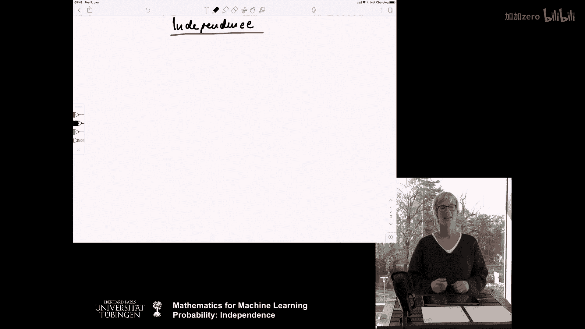

在本节课中，我们将要学习概率论中的一个核心概念——独立性。我们将探讨如何定义两个事件是否相互独立，并通过掷骰子的例子来理解其直观含义和应用。

上一节我们介绍了条件概率，它用于表达一个事件对另一个事件的影响程度。本节中我们来看看与之相对的概念——独立性。

## 独立性定义

我们始终在一个概率空间 `(Ω, A, P)` 中进行讨论。现在考虑两个事件 `A` 和 `B`，它们都属于σ-代数 `A`。

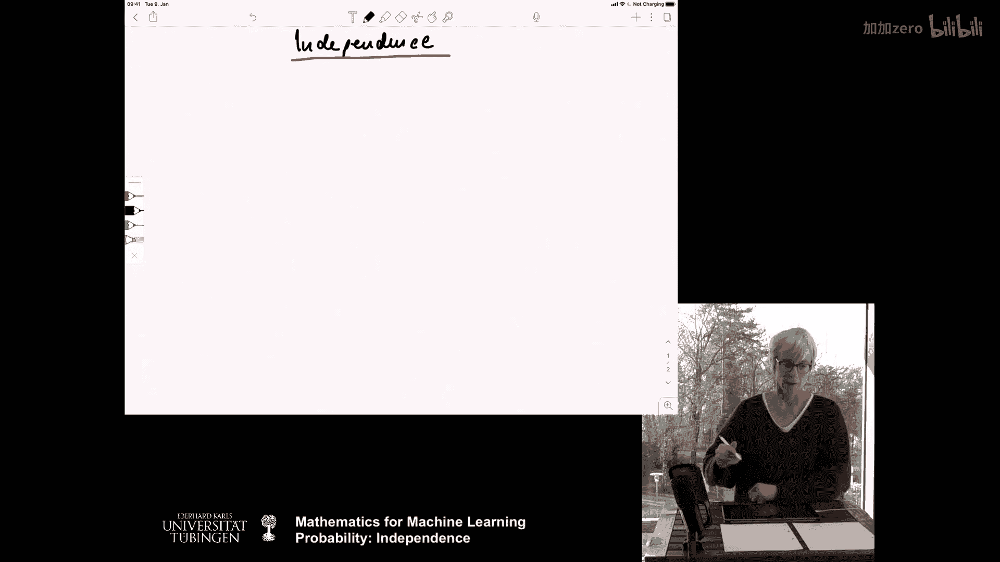

我们称事件 `A` 和 `B` 是**独立的**，如果它们满足以下性质：事件 `A` 与 `B` 同时发生的概率，等于事件 `A` 发生的概率乘以事件 `B` 发生的概率。

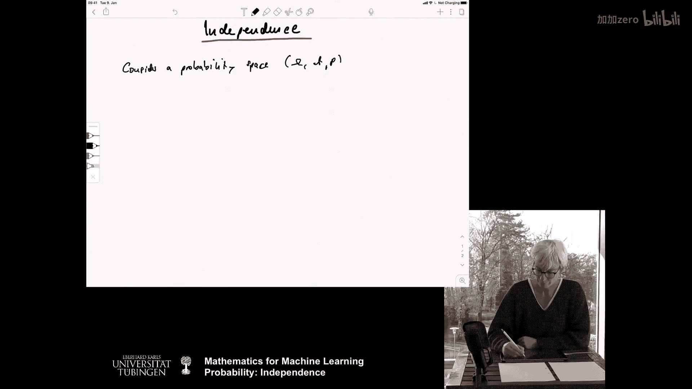

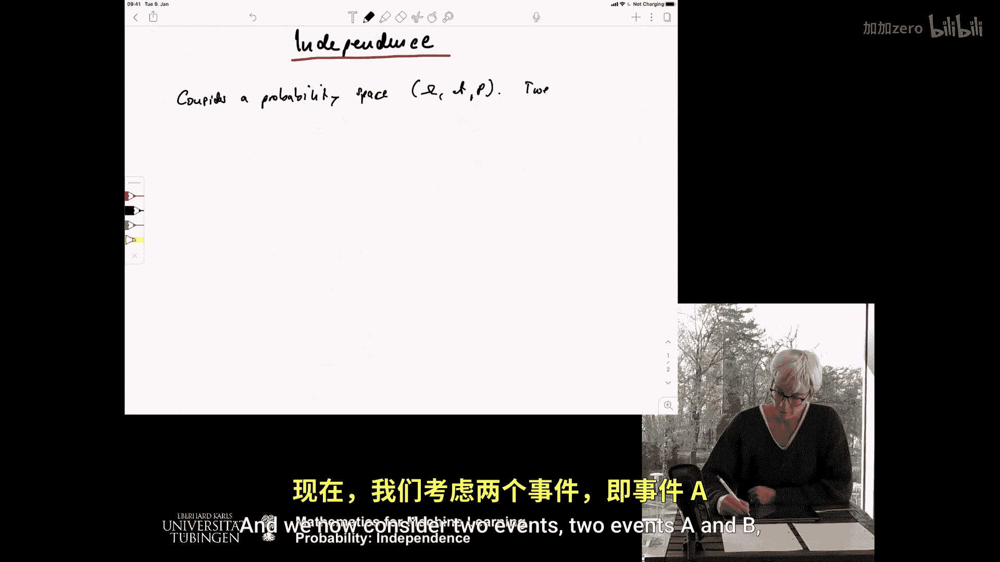

用公式表示如下：

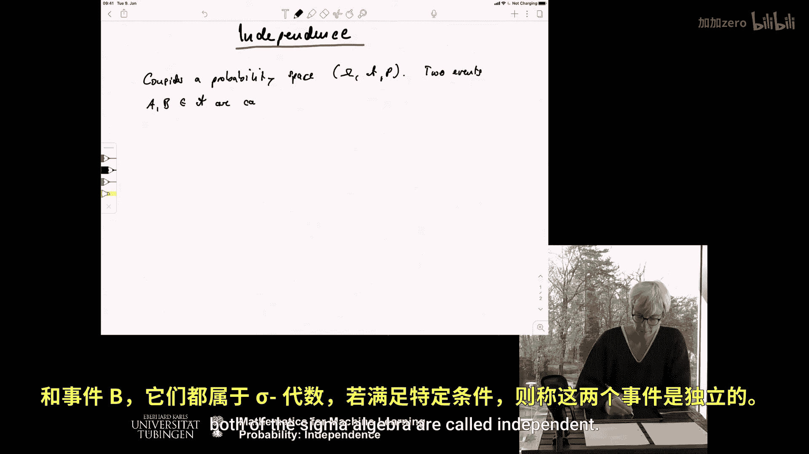

`P(A ∩ B) = P(A) * P(B)`

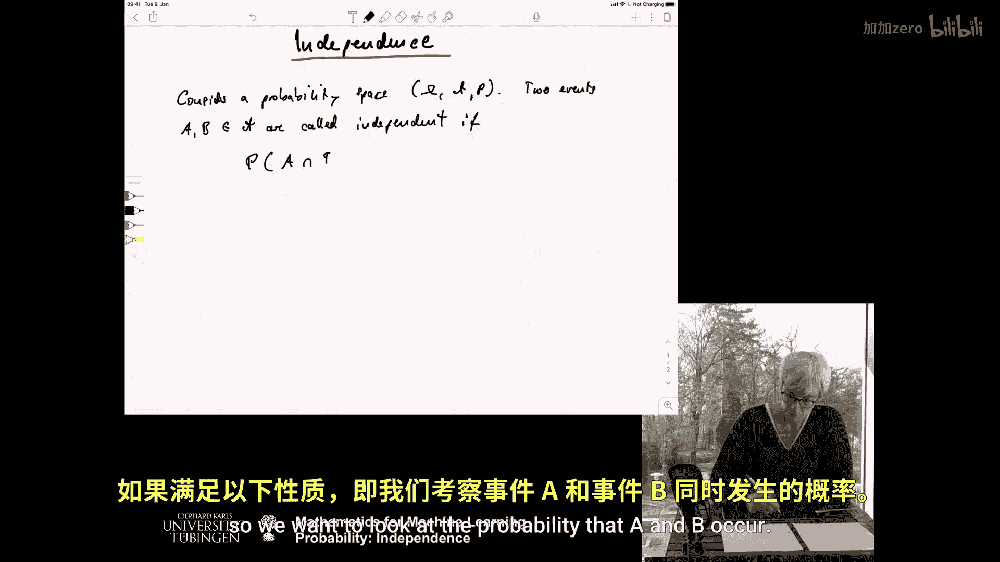

其中，符号 `∩` 表示交集，即“A 且 B”。

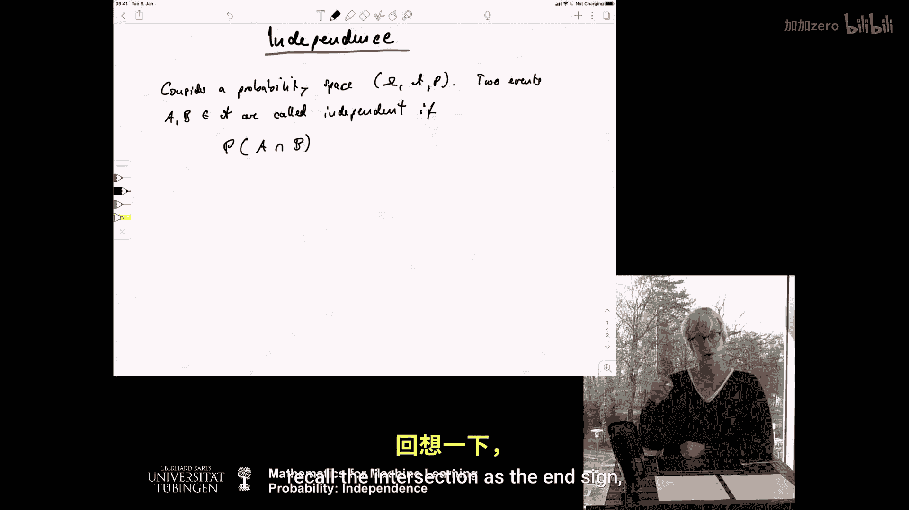

## 直观理解与例子

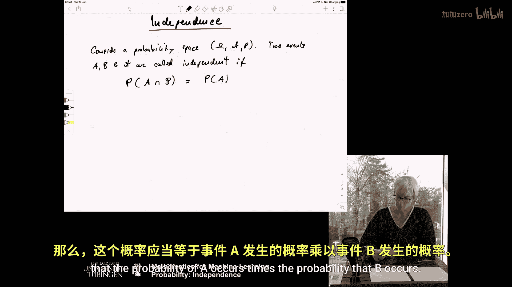

为了理解这个定义，我们可以回想之前经常使用的模型，例如掷两个骰子。

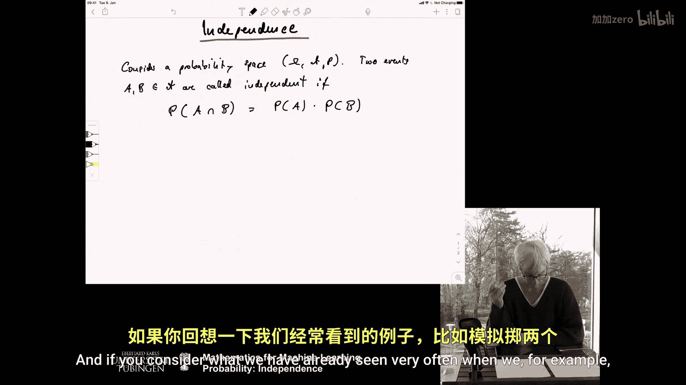

我通常的做法是：第一个骰子每个面出现的概率是 `1/6`，第二个骰子每个面出现的概率也是 `1/6`。我们通常假设第一个骰子的结果不会影响第二个骰子的结果。

因此，第一个骰子掷出五点**且**第二个骰子掷出三点的概率，简单地就是这两个概率的乘积。在均匀分布的情况下，这个概率就是 `(1/6) * (1/6) = 1/36`。

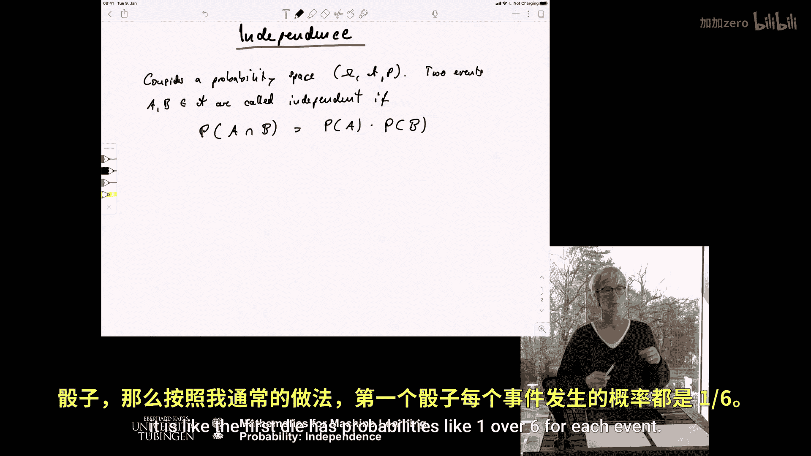

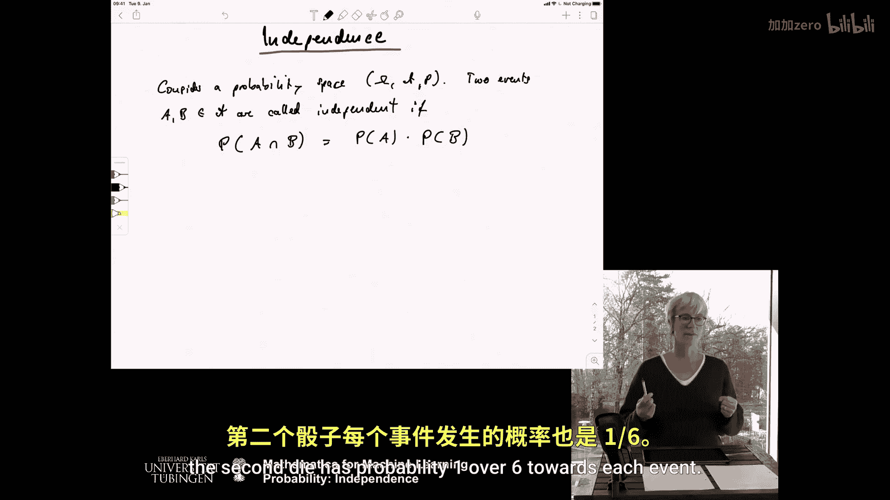

这正是因为我们相信这两个骰子是相互独立的。

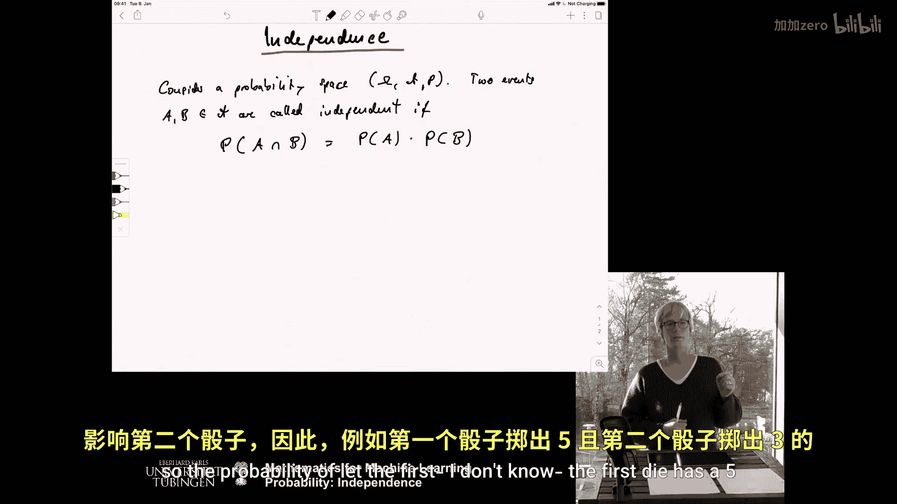

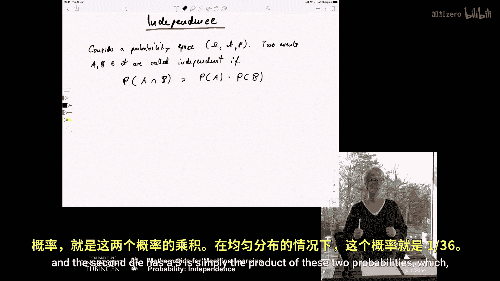

另一种理解方式是观察以下事实：如果事件 `A` 的发生概率不因事件 `B` 是否发生而改变，那么这两个事件就是独立的。例如，掷一个骰子得到“2点”这个事件，通常与“今天是晴天”这个事件是独立的，因为天气通常不会影响骰子的结果。

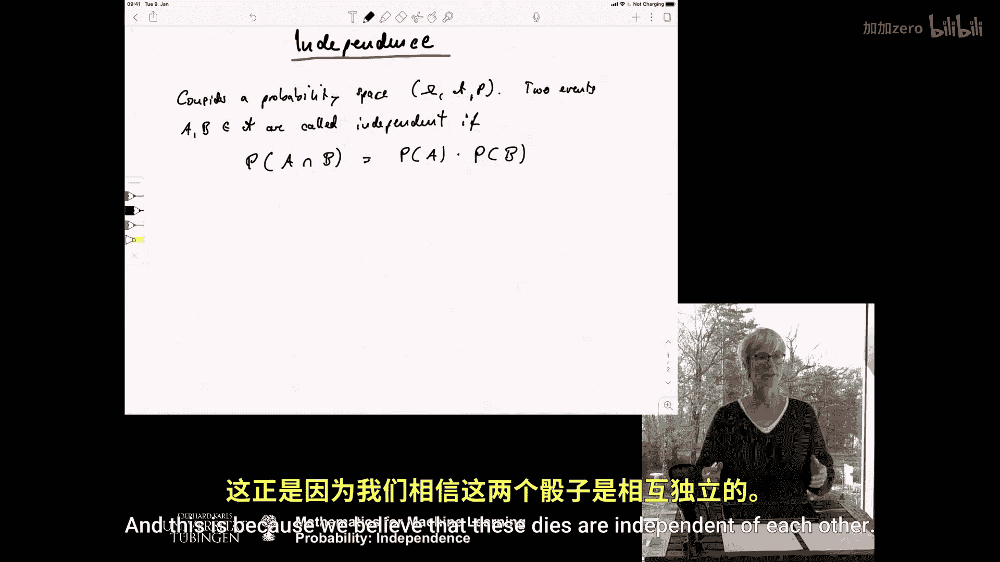

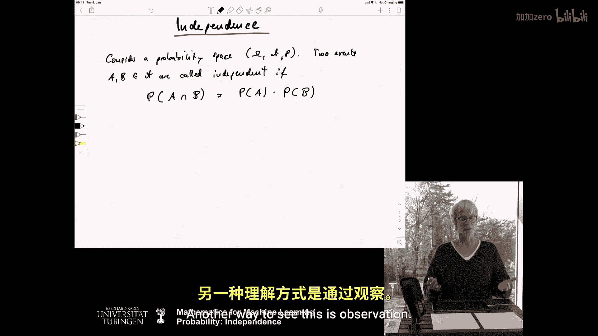

本节课中我们一起学习了独立性的定义：两个事件 `A` 和 `B` 独立，当且仅当 `P(A ∩ B) = P(A) * P(B)`。我们通过掷骰子的例子理解了其直观意义，即一个事件的发生不会影响另一个事件发生的概率。这是构建更复杂概率模型（如多次独立试验）的基础。