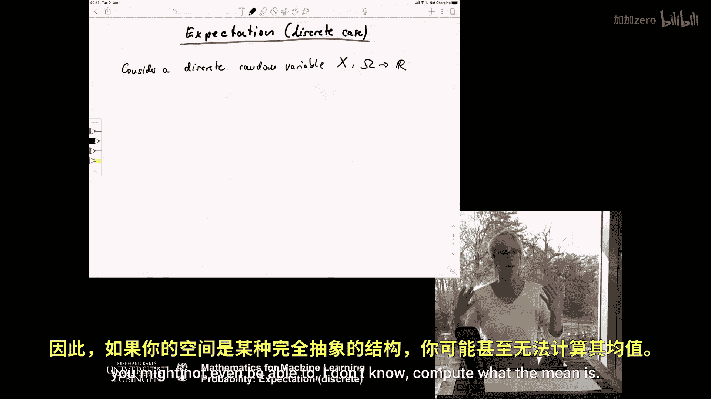
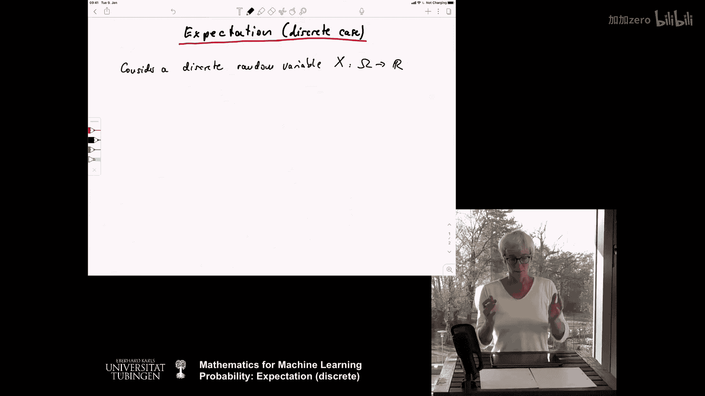

# 062：离散型随机变量的期望值 📊


在本节课中，我们将学习概率论中一个核心概念：**期望值**。期望值描述了一个随机变量的“平均值”或“中心趋势”，是机器学习中评估模型性能（如测试误差）的关键工具。在介绍了概率测度、独立性、条件分布等基础概念后，我们现在转向如何描述随机变量本身。

期望值，以及后续将学习的偏差（如方差），是贯穿机器学习理论的两个关键概念。本节我们将从直观的**离散型随机变量**入手，建立对期望值的理解，为后续学习连续型情况下的积分定义打下基础。

## 离散型随机变量的期望定义


首先，我们考虑一个离散型随机变量 **X**，它从一个样本空间 **Ω** 映射到实数集 **R**。需要说明的是，当我们谈论期望值时，通常针对的是**实值随机变量**，因为计算“平均值”至少需要向量空间的结构。


期望值的直观想法是：如果我们能无限次重复同一个随机实验，随机变量 **X** 所有可能取值的长期平均值就是它的期望。对于离散情况，其数学定义如下：


**定义**：设 **X** 是一个离散型随机变量，其可能取值为 **x₁, x₂, x₃, …**，对应的概率为 **P(X = xᵢ)**。则 **X** 的期望值（或称均值）**E[X]** 定义为：
```
E[X] = Σᵢ (xᵢ * P(X = xᵢ))
```
其中，求和遍历 **X** 的所有可能取值。


这个公式可以理解为：将每个可能的结果乘以其发生的概率，然后将所有这些乘积相加。


## 期望值的性质

理解了期望的定义后，我们来看看它的一些重要性质。这些性质在简化计算和理解随机变量行为时非常有用。


以下是期望值的几个关键性质：
1.  **线性性**：对于任意常数 **a, b** 和随机变量 **X, Y**，有 **E[aX + bY] = aE[X] + bE[Y]**。这是期望值最重要、最常用的性质。
2.  **常数期望**：常数 **c** 的期望就是它本身，即 **E[c] = c**。
3.  **单调性**：如果随机变量 **X** 总是小于等于 **Y**（即 **X ≤ Y** 总是成立），那么 **E[X] ≤ E[Y]**。
4.  **独立变量的乘积**：如果 **X** 和 **Y** 是相互独立的随机变量，那么 **E[XY] = E[X]E[Y]**。


## 期望值在机器学习中的应用


现在，让我们看看期望值在机器学习中的具体作用。它为我们提供了一种量化不确定性和模型性能的理论工具。

在机器学习中，期望值的一个典型应用是评估模型的**泛化误差**。我们无法获得所有可能的数据，因此将模型在未知测试集上的误差视为一个随机变量，其期望值代表了模型的平均性能。学习理论的许多工作都致力于分析和估计这个期望值，并控制实际误差围绕该期望值的波动（即偏差）。

## 总结




本节课中，我们一起学习了概率论的核心概念——**期望值**在离散型随机变量情况下的定义与性质。


我们首先明确了期望值描述的是随机变量长期实验下的平均结果，并给出了其离散形式的计算公式 **E[X] = Σ (xᵢ * P(X = xᵢ))**。接着，我们探讨了期望值的几个基本性质，特别是其线性性，这在计算中极为重要。最后，我们了解了期望值在机器学习，尤其是在模型泛化误差分析中的关键作用。




理解期望值为我们接下来学习衡量随机变量波动性的概念（如方差）奠定了坚实的基础。