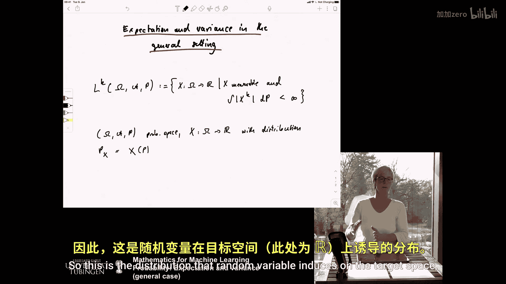

# 064：期望与协方差（一般情形）📈

在本节课中，我们将学习期望和方差在一般概率空间中的定义。我们已经了解过离散情形下的这两个概念，现在将推广到更一般的设置，其中随机变量可以是任何可测函数，而不仅仅是离散的。

## 从离散到一般的过渡 🔄

上一节我们介绍了离散随机变量的期望与方差。本节中，我们来看看如何将这些概念推广到任意概率空间和任意随机变量的情形。本质上，当我们从离散转向连续（或更一般）时，需要将求和替换为积分，并且必须确保所做的定义是合理的。

## 定义 L^k 空间 📊

首先，我需要定义一个称为 **L^k(Ω, A, P)** 的空间。

这个空间包含了所有满足以下条件的函数：它们是可测的，并且其 k 次幂是可积的。具体来说，这些函数 X 从样本空间 Ω 映射到实数集 R。

*   **可测性**：X 是 A-可测的。
*   **可积性**：函数 |X|^k 关于概率测度 P 的积分是有限的。其数学表达式为：
    **∫ |X(ω)|^k dP(ω) < ∞**

如果你不熟悉在任意空间上关于任意测度的积分，可以简单地理解为：对于一个取值于 R 的随机变量，如果我们有一个概率密度函数，那么就可以关于该密度函数进行积分。但上述定义方式是为了涵盖最一般的情形。

现在考虑以下标准设置：设 **(Ω, A, P)** 是一个概率空间。我们考虑一个随机变量 **X: Ω → R**，它有一个分布 **P_X**（有时也记作 **X_*P**，即 X 诱导的测度）。

---

## 期望的定义 🎯

基于上述准备，我们现在可以定义随机变量 X 的期望。

**期望** 定义为随机变量 X 关于其自身分布 P_X 的积分。其数学表达式为：
**E[X] = ∫ x dP_X(x)**

这个定义是合理的，因为如果 X 属于 L^1 空间（即其绝对值的积分有限），那么这个积分就是有限的。

为了帮助你理解，这里有一些直观的解释：

*   如果 X 是**离散型**随机变量，其分布由概率质量函数 (PMF) p(x) 描述，那么期望就是加权和：
    **E[X] = Σ x * p(x)**
*   如果 X 是**连续型**随机变量，其分布由概率密度函数 (PDF) f(x) 描述，那么期望就是积分：
    **E[X] = ∫ x * f(x) dx**

以上两种常见情形都是这个一般定义的特例。

---

## 方差与协方差的定义 🔗

定义了期望之后，我们可以进一步定义方差和协方差。

**方差** 衡量的是随机变量与其期望的偏离程度的平方的平均值。其数学定义为：
**Var(X) = E[(X - E[X])^2]**

**协方差** 衡量的是两个随机变量之间的线性相关程度。对于随机变量 X 和 Y，其协方差定义为：
**Cov(X, Y) = E[(X - E[X])(Y - E[Y])]**

以下是关于方差和协方差的一些关键性质：

*   **方差公式**：方差通常也通过以下公式计算，它有时更为方便：
    **Var(X) = E[X^2] - (E[X])^2**
*   **协方差与方差的关系**：一个随机变量与自身的协方差就是其方差：
    **Cov(X, X) = Var(X)**
*   **线性性质**：期望算子 E[·] 是线性的。对于任意常数 a, b 和随机变量 X, Y，有：
    **E[aX + bY] = aE[X] + bE[Y]**
    基于此，协方差公式也可以展开为：
    **Cov(X, Y) = E[XY] - E[X]E[Y]**

---

## 总结 📝

本节课中，我们一起学习了期望与方差在一般概率空间中的定义。

1.  我们首先定义了 **L^k 空间**，它包含了所有 k 次可积的可测函数，这是定义期望的数学基础。
2.  接着，我们给出了随机变量 **期望** 的一般定义：**E[X] = ∫ x dP_X(x)**。这个定义统一了离散（求和）和连续（积分）的情形。
3.  最后，我们基于期望定义了 **方差** 和 **协方差**，并介绍了它们的基本计算公式和性质，例如 `Var(X) = E[X^2] - (E[X])^2` 和 `Cov(X, Y) = E[XY] - E[X]E[Y]`。

理解这些一般化的定义是深入学习概率论和机器学习中更高级概念的重要基石。