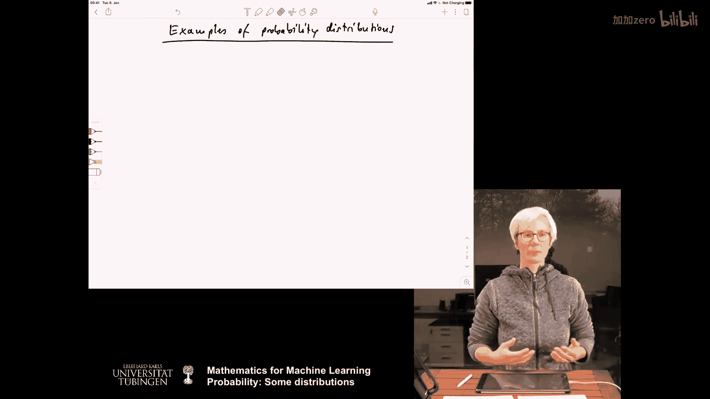
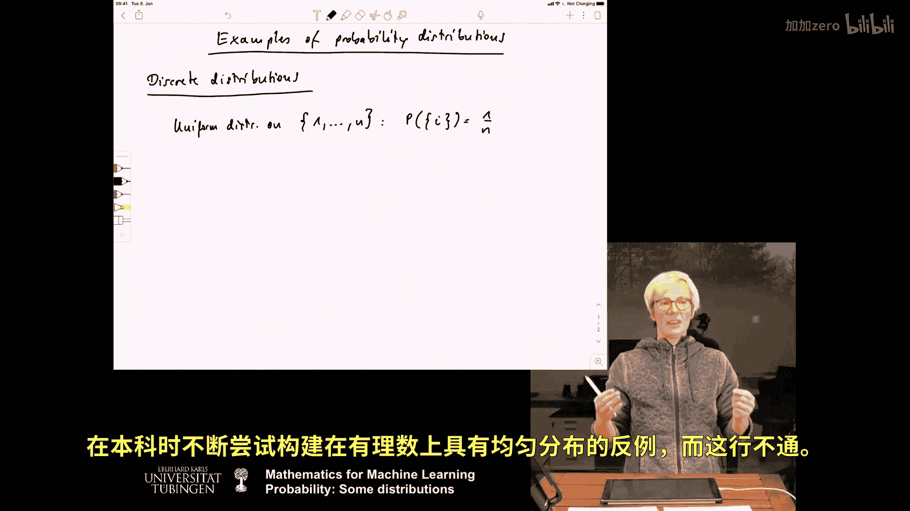

# 066：二项分布、泊松分布、多元分布 📊

在本节课中，我们将学习几种重要的概率分布，包括离散分布和连续分布。这些分布是后续课程中讨论更复杂概念的基础示例。

## 离散分布 📈

上一节我们介绍了概率论的基本概念，本节中我们来看看具体的概率分布。首先从离散分布开始。离散分布定义在一个通常是有限或可数的空间上，我们为基本事件分配概率。

### 均匀分布

最重要的离散分布之一是均匀分布。我们从一个离散的有限集开始。

以下是均匀分布的定义：
*   设有一个包含 `n` 个元素的有限集 `{1, 2, ..., n}`。
*   均匀分布为每个基本事件 `i` 分配相同的概率 `1/n`。

对于一个离散概率分布，定义基本事件的概率就足够了。均匀意味着每个事件具有相同的概率。例如，投掷一个公平的骰子，其每一面出现的概率是 `1/6`，这就是在数字 `1` 到 `6` 上的均匀分布。

因此，当我在离散空间上谈论均匀分布时，指的就是这种分布。

需要特别注意：**无法在可数空间上定义均匀分布**。事实上，在某些空间上，定义所谓的“均匀分布”并不那么显而易见。

对于一个可数事件的空间，例如有理数集或自然数集，你无法定义一个均匀分布。你可以尝试构思一个证明，来说明为什么在自然数集上不可能存在均匀分布。假设存在一个均匀分布，很快就会推导出矛盾。

我认为这是一个需要理解的重要信息，因为人们常常在寻找反例。我记得自己本科时，就总想构造一个在有理数集上均匀分布的反例。

---

本节课中我们一起学习了均匀分布这一重要的离散概率分布，并理解了其定义域的限制。在接下来的课程中，我们将以此为基础，探讨更多复杂的分布。