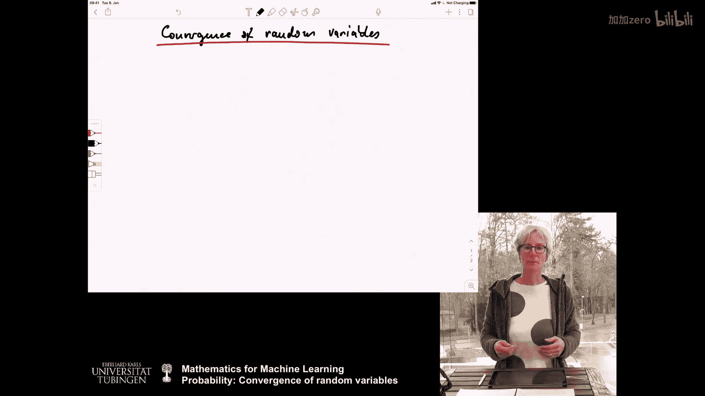
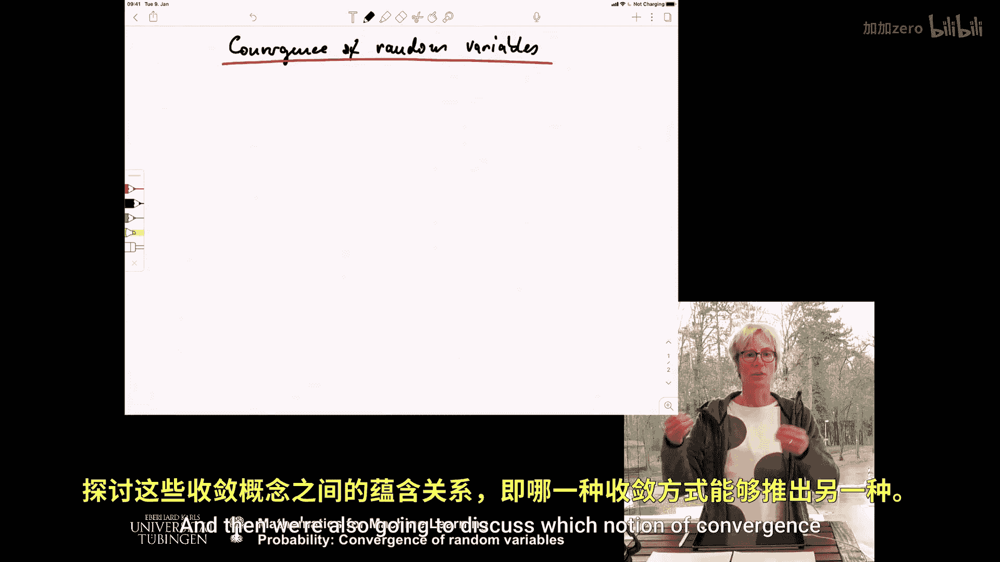
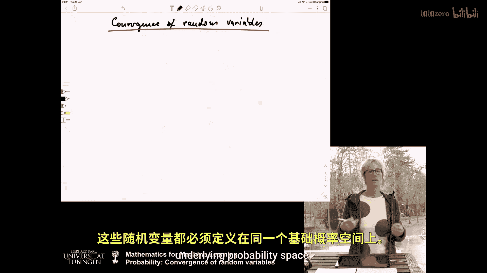
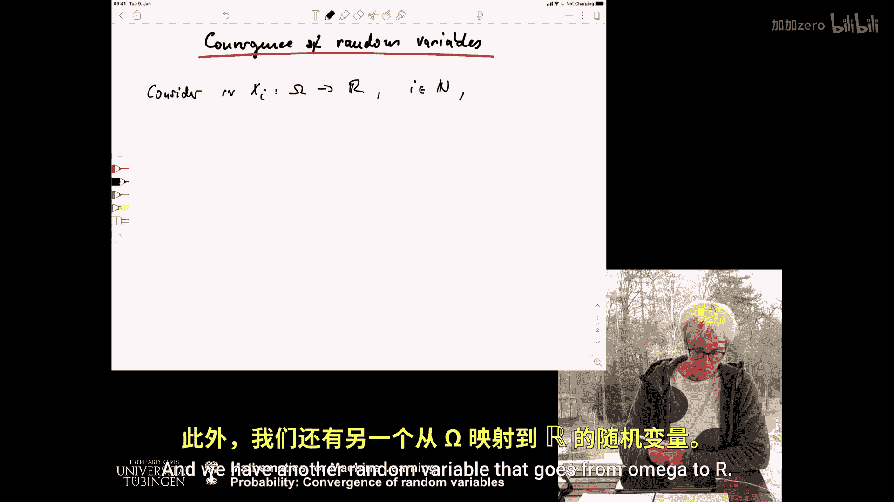
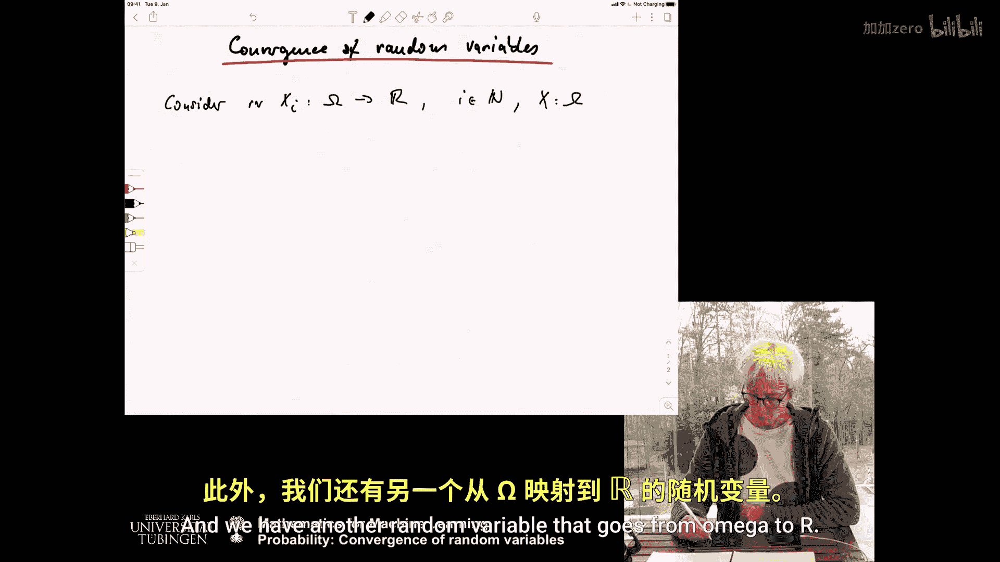
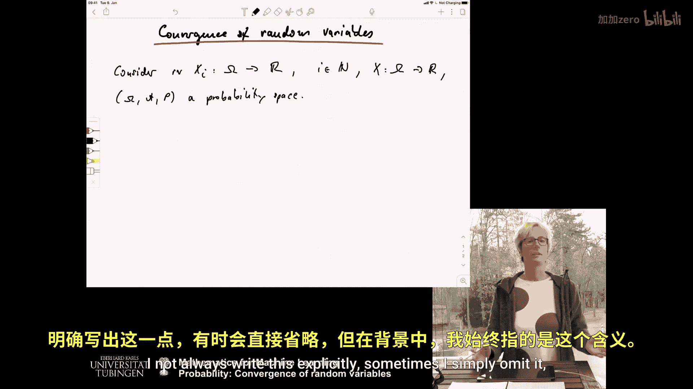

# 067：随机变量的收敛性 🔄

在本节课中，我们将要学习随机变量的收敛性。随机变量本质上是函数，因此我们可以像讨论函数序列的收敛一样，讨论随机变量序列的收敛。理解不同的收敛概念对于掌握概率论中的核心定理，如大数定律和中心极限定理，至关重要。

## 基本设定

首先，我们设定一个基本场景。我们考虑一系列随机变量，它们都定义在同一个基础概率空间上。

具体来说，我们有一系列随机变量 **X₁, X₂, X₃, ...**，每个都是从某个概率空间 **(Ω, F, P)** 映射到实数域 **R** 的函数。同时，我们有另一个随机变量 **X**，通常作为序列 **{Xᵢ}** 的极限。

用公式表示，即：
**Xᵢ: Ω → R**，其中 **i ∈ ℕ**。
**X: Ω → R**。

## 收敛性的不同概念

正如在标准函数分析中有多种收敛定义一样，对于随机变量，我们也有多种方式来定义“收敛”。本节中，我们将介绍几种主要的收敛概念。

以下是几种常见的随机变量收敛定义：

*   **几乎必然收敛**：随机变量序列 **{Xₙ}** 几乎必然收敛于 **X**，如果存在一个概率为1的事件，使得在该事件上，**Xₙ(ω)** 作为函数逐点收敛于 **X(ω)**。
    *   公式：**P( { ω ∈ Ω: lim_{n→∞} Xₙ(ω) = X(ω) } ) = 1**。
    *   记作：**Xₙ → X a.s.**。

*   **依概率收敛**：随机变量序列 **{Xₙ}** 依概率收敛于 **X**，如果对于任意 **ε > 0**，当 **n** 趋于无穷时，**Xₙ** 与 **X** 的偏差大于 **ε** 的概率趋于0。
    *   公式：**∀ε > 0, lim_{n→∞} P( |Xₙ - X| > ε ) = 0**。
    *   记作：**Xₙ → X in probability**。

*   **依分布收敛**：随机变量序列 **{Xₙ}** 依分布收敛于 **X**，如果对于 **X** 的累积分布函数 **F(x)** 的所有连续点 **x**，**Xₙ** 的累积分布函数 **Fₙ(x)** 都收敛于 **F(x)**。
    *   公式：**lim_{n→∞} Fₙ(x) = F(x)**，对所有 **F(x)** 的连续点 **x** 成立。
    *   记作：**Xₙ → X in distribution** 或 **Xₙ →ᵈ X**。

*   **Lᵖ 收敛**：对于 **p ≥ 1**，随机变量序列 **{Xₙ}** 在 **Lᵖ** 空间收敛于 **X**，如果当 **n** 趋于无穷时，**Xₙ** 与 **X** 之差的 **p** 次方的期望值趋于0。
    *   公式：**lim_{n→∞} 𝔼[ |Xₙ - X|ᵖ ] = 0**。
    *   记作：**Xₙ → X in Lᵖ**。特别地，当 **p=2** 时称为均方收敛。

## 收敛概念之间的关系

上一节我们介绍了不同的收敛定义，本节中我们来看看这些概念之间的强弱关系。并非所有收敛方式都是等价的，某些收敛形式蕴含了其他形式。

以下是主要收敛概念之间的蕴含关系：

*   **几乎必然收敛** 蕴含 **依概率收敛**。
*   **Lᵖ 收敛** 蕴含 **依概率收敛**。
*   **依概率收敛** 蕴含 **依分布收敛**。

反之则不成立。例如，一个序列可以依概率收敛但不一定几乎必然收敛；可以依分布收敛但不一定依概率收敛。理解这些关系有助于我们在不同场景下选择和使用合适的收敛定理。

## 总结

本节课中我们一起学习了随机变量收敛性的核心概念。我们首先明确了讨论的基础：定义在同一概率空间上的随机变量序列及其极限。然后，我们详细介绍了**几乎必然收敛**、**依概率收敛**、**依分布收敛**和**Lᵖ收敛**这四种主要的收敛定义及其数学表述。最后，我们探讨了这些收敛概念之间的强弱关系，了解到“几乎必然收敛”和“Lᵖ收敛”强于“依概率收敛”，而“依概率收敛”又强于“依分布收敛”。掌握这些内容是理解概率论中渐进理论（如大数定律和中心极限定理）的关键基础。