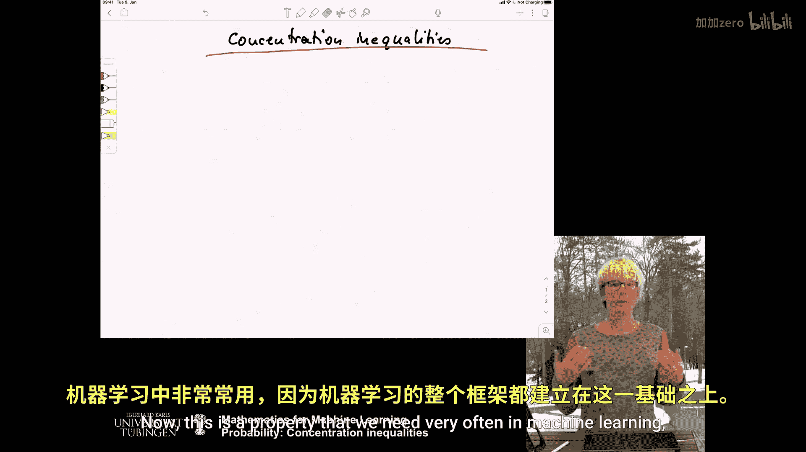
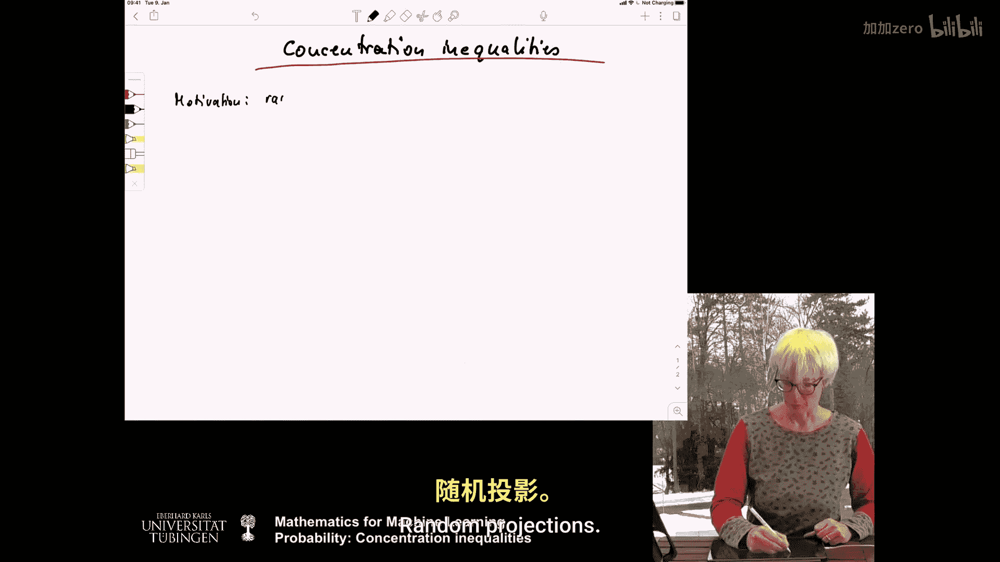

# 070：集中不等式 🎯

在本节课中，我们将要学习**集中不等式**。这是机器学习理论中至关重要的工具，用于量化有限样本的经验估计与真实期望值之间的差距，并分析这种差距随样本量增加而收敛的速度。

## 概述

上一节我们介绍了大数定律，它指出样本的经验均值会收敛于其分布的期望值。然而，大数定律只告诉我们最终会收敛，但没有说明收敛的速度有多快。本节中，我们来看看**集中不等式**，它能提供更精确的界限，告诉我们需要多少样本才能以高概率保证经验均值接近真实均值。这在机器学习中评估模型在有限训练数据上的性能时尤其重要。

## 动机：随机投影的应用

为了理解集中不等式的重要性，我们先看一个在机器学习中常见的应用场景：**随机投影**。在许多算法中，我们需要处理高维数据，而集中不等式是分析此类技术性能的理论基础。

## 从大数定律到集中不等式

我们已经知道，对于独立同分布的样本，其经验均值会收敛到真实期望。用公式表示，对于随机变量 \( X_1, ..., X_M \)，有：

\[
\bar{X}_M = \frac{1}{M} \sum_{i=1}^{M} X_i \quad \xrightarrow[M \to \infty]{\text{概率}} \quad \mathbb{E}[X]
\]

在机器学习中，我们经常在训练数据上计算某些量（如训练误差、测试误差），我们最终关心的是：基于有限样本计算出的性能指标，与真实的期望性能（即模型在全体数据分布上的表现）有多接近。

大数定律只保证了当样本量 \( M \) 趋于无穷时，两者会相等。但我们更关心的是**收敛的速度**，即需要多少样本才能确保经验均值非常接近真实均值。

为了证明这类关于收敛速度的陈述，标准工具就是**集中不等式**。我们已经见过一些较弱的不等式，例如切比雪夫不等式，它也能关联经验值与真实值之间的距离，但集中不等式通常能提供更强、更紧的界限。

## 相关资源

如果你对这个主题的文献感兴趣，虽然这不是我推荐教材的一部分，但有一本由Boucheron、Lugosi和Massart合著的专著《Concentration Inequalities》全面涵盖了所有相关内容。此外，也有一些综述性论文，例如2002年由Boucheron、Lugosi等人撰写的一篇名为《Introduction to Concentration Inequalities》的概述。

无论如何，集中不等式是机器学习，特别是学习理论中无处不在的工具。不了解集中不等式，几乎无法进行深入的理论研究。

## 总结

本节课中我们一起学习了集中不等式的核心概念及其重要性。我们回顾了大数定律的局限性，并引出了集中不等式作为量化有限样本估计误差与收敛速度的强有力工具。我们还通过**随机投影**的例子，初步了解了其在机器学习中的关键应用。在接下来的课程中，我们将深入探讨几个具体的集中不等式及其证明。