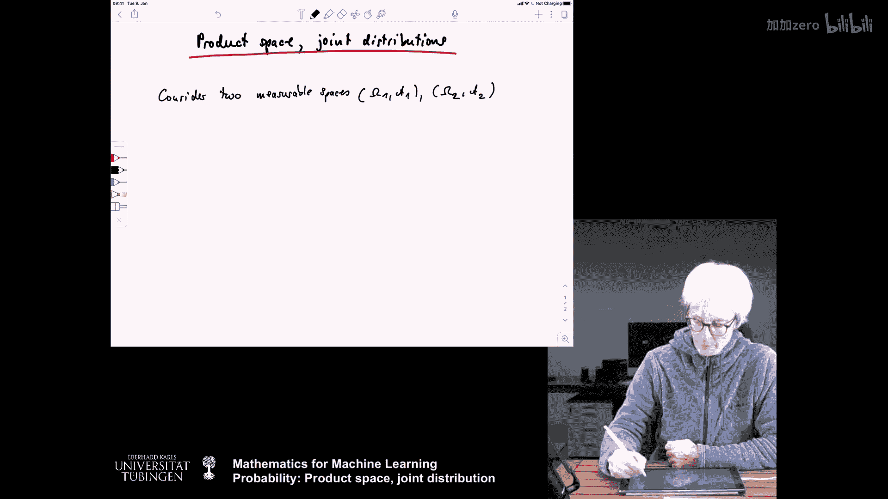
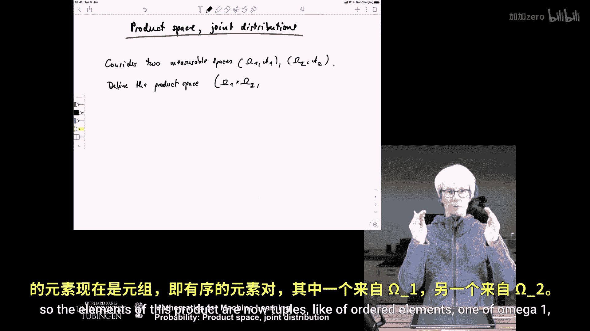

# 071：乘积空间与联合分布 📊

在本节课中，我们将要学习如何处理多个随机变量。在机器学习中，我们通常需要同时处理多个随机变量，这些变量可能描述了我们感兴趣对象的不同特征。例如，描述一个分子时，其重量、形状参数等都可以被视为随机变量。这些变量通常不是独立的，因为它们共同描述了同一个对象。因此，我们需要理解联合分布的概念，以及当变量独立或不独立时，联合分布有何不同。

## 从单个变量到多个变量 🔄

上一节我们介绍了单个随机变量的基本概念。本节中，我们来看看当涉及多个随机变量时，如何构建数学模型。

在机器学习中，我们通常不只处理一个随机变量，而是处理许多随机变量。这些随机变量可能描述了你感兴趣事物的不同特征。例如，假设你想描述分子，你可能有分子的重量，还有一些描述分子形状的参数。因此，你会有许多不同的参数，每个参数在我们的模型设定中都可以被视为一个随机变量。所有这些变量共同描述了这个分子。

当然，这些随机变量通常完全不独立，因为它们都描述了同一种分子，并且可能存在许多关联。所以，我们现在需要发展的一个概念是：当我们有多个随机变量时，什么是联合分布？以及当它们独立或不独立时，联合分布有何区别。

在后续课程中，我们还会探讨相反的问题：如果你有一个联合分布，那么边际分布是什么？如果你想从整体回到单个随机变量，以及条件分布是什么。今天，我们从联合分布和乘积空间开始。

## 定义乘积空间 🧱

让我们尝试将其写下来。为了简单起见，我们现在只考虑两个变量。你也可以考虑有限多个变量，但为了简便，我只为两个变量写下定义。

考虑两个可测空间：`(Ω₁, A₁)` 和 `(Ω₂, A₂)`。这些是**两个随机变量的像空间**。

首先，我们需要思考：如何为映射到这两个不同空间的两个随机变量建模？它们的联合对象会是什么？为此，我们首先需要定义什么是乘积空间。

我们现在定义**乘积空间**。首先，它简单地是两个输入空间的乘积。这通常就是集合的笛卡尔积。

乘积空间的元素是**有序对**，形式为 `(ω₁, ω₂)`，其中 `ω₁ ∈ Ω₁`，`ω₂ ∈ Ω₂`。

---

本节课中我们一起学习了多个随机变量的必要性，并引入了为它们建模所需的**乘积空间**概念。我们了解到，多个随机变量（如描述分子的不同参数）通常不是独立的，因此需要研究它们的**联合分布**。我们开始构建基础，定义了两个随机变量像空间的笛卡尔积作为乘积空间，这是理解联合分布的第一步。在接下来的课程中，我们将基于此乘积空间进一步探讨联合分布、边际分布和条件分布的具体形式与关系。