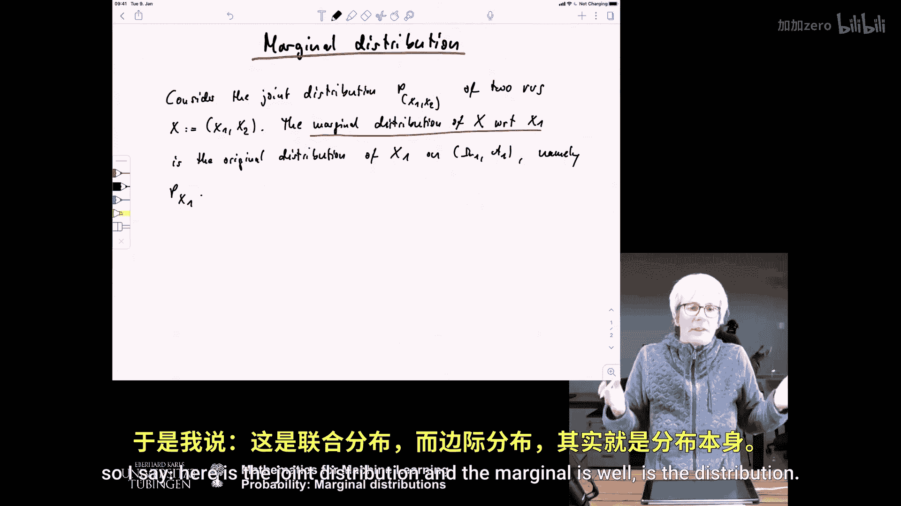
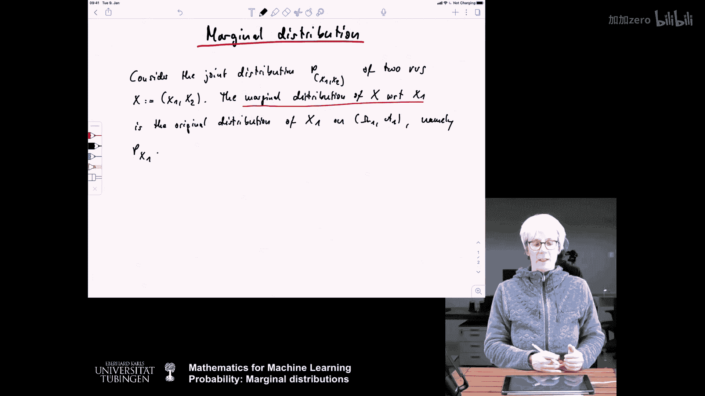
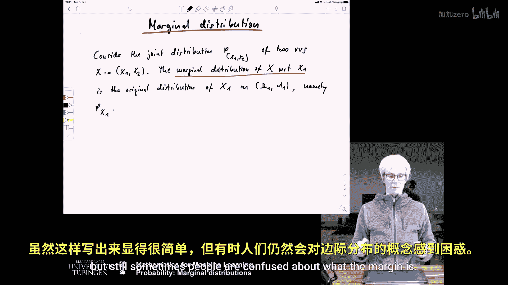
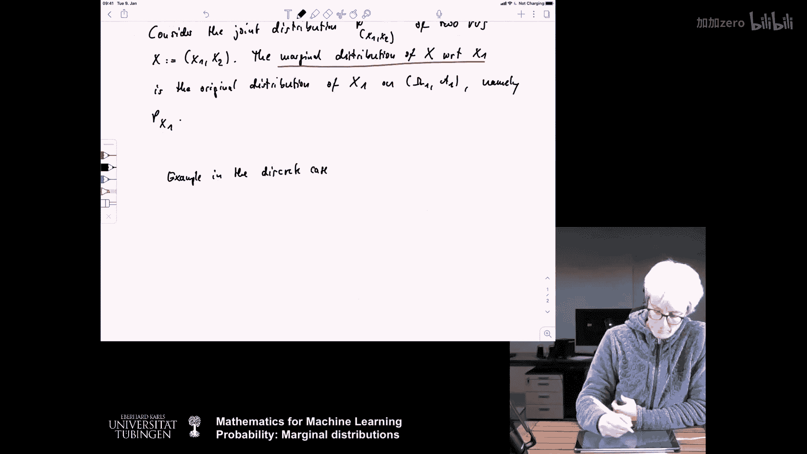
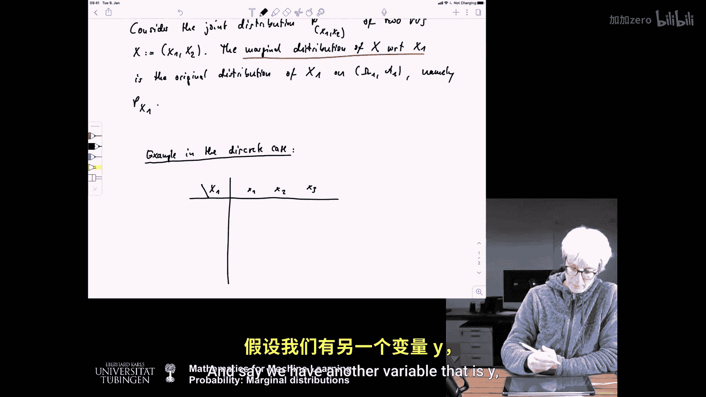

# 072：边缘分布

在本节课中，我们将要学习边缘分布的概念。上一节我们介绍了联合分布，本节中我们来看看如何从联合分布中提取出单个变量的分布信息，这就是边缘分布。

## 从联合分布到边缘分布

我们考虑两个随机变量 **X₁** 和 **X₂** 的联合分布，可以将其总结为一个向量 **X = (X₁, X₂)**。

现在，我们想要定义 **X** 关于 **X₁** 的边缘分布。这其实就是忽略第二个变量 **X₂**，只关注第一个变量 **X₁** 的分布。从数学上讲，它就是 **X₁** 自身的原始分布 **P(X₁)**。

听起来很简单，但有时这个概念会让人感到困惑。为了更好地理解，我们先看一个离散情况下的例子。

## 离散情况下的例子

在离散情况下，假设我们有两个随机变量。变量 **X₁** 可以取三个值：**x₁**、**x₂** 和 **x₃**。变量 **X₂** 可以取两个值：**y₁** 和 **y₂**。

它们的联合概率分布可以用一个表格来表示。以下是这个联合分布的示例表格：

|       | **y₁** | **y₂** | **边缘 P(X₁)** |
| :---- | :----: | :----: | :------------: |
| **x₁**|  0.1   |  0.2   |      0.3       |
| **x₂**|  0.3   |  0.1   |      0.4       |
| **x₃**|  0.2   |  0.1   |      0.3       |
|**边缘 P(X₂)**|  0.6   |  0.4   |       1        |

在这个表格中，中间单元格的数字是联合概率 **P(X₁ = xᵢ, X₂ = yⱼ)**。例如，**P(X₁ = x₁, X₂ = y₁) = 0.1**。

那么，如何得到 **X₁** 的边缘分布呢？方法是将表格中每一行的概率值相加。以下是计算步骤：

*   对于 **X₁ = x₁**：`P(X₁ = x₁) = 0.1 + 0.2 = 0.3`
*   对于 **X₁ = x₂**：`P(X₁ = x₂) = 0.3 + 0.1 = 0.4`
*   对于 **X₁ = x₃**：`P(X₁ = x₃) = 0.2 + 0.1 = 0.3`

这些计算结果（0.3， 0.4， 0.3）就构成了 **X₁** 的边缘分布，它们显示在表格最右侧的“边缘 P(X₁)”一列中。同理，将每一列相加，就得到了 **X₂** 的边缘分布（0.6， 0.4），显示在表格最下方的“边缘 P(X₂)”一行中。

## 连续情况下的边缘分布

理解了离散情况后，我们来看连续情况。当随机变量有概率密度函数时，计算边缘分布的原理是相同的，只不过求和变成了积分。

假设有两个连续随机变量 **X** 和 **Y**，它们的联合概率密度函数为 **f_{X,Y}(x, y)**。

那么，**X** 的边缘概率密度函数 **f_X(x)** 可以通过对 **y** 积分来获得：
`f_X(x) = ∫ f_{X,Y}(x, y) dy`

同样地，**Y** 的边缘概率密度函数 **f_Y(y)** 可以通过对 **x** 积分来获得：
`f_Y(y) = ∫ f_{X,Y}(x, y) dx`

这个积分过程，在几何上可以理解为将联合概率密度曲面“压扁”到某个坐标轴上，从而得到在该轴上的投影（即密度）。

## 总结

本节课中我们一起学习了边缘分布。我们从联合分布出发，理解了边缘分布就是忽略其他变量后，单个变量的概率分布。在离散情况下，通过将联合概率表的行或列相加来计算；在连续情况下，则通过对联合概率密度函数进行积分来计算。掌握边缘分布是理解更复杂概率概念（如条件分布、独立性）的重要基础。