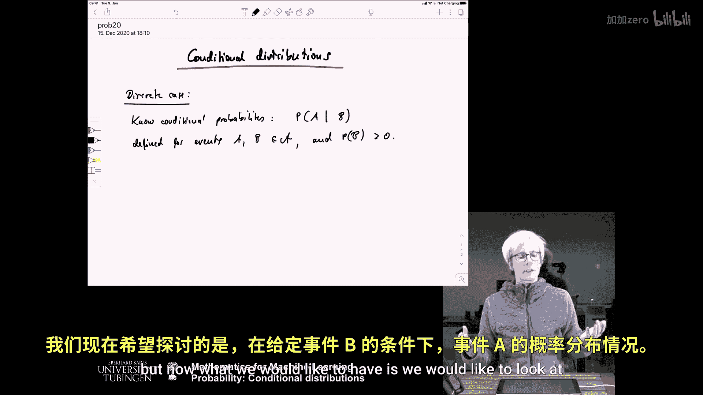
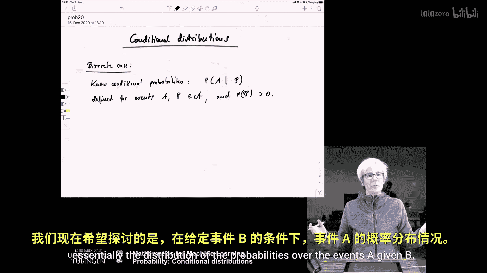
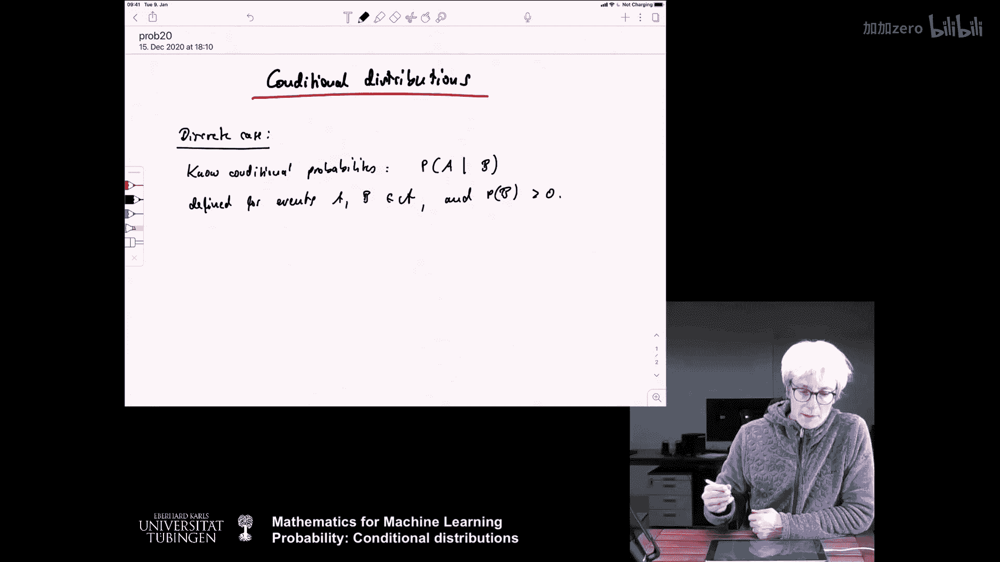

# 073：条件分布 📊

在本节课中，我们将要学习概率论中的最后一个核心概念——条件分布。我们已经了解了联合分布和边缘分布，条件分布将帮助我们理解在已知一个随机变量取特定值时，另一个随机变量的行为。

## 联合分布与边缘分布回顾

上一节我们介绍了联合分布和边缘分布。联合分布关注两个随机变量 `X` 和 `Y` 同时发生的概率。边缘分布则是通过“积分掉”或“求和掉”其中一个变量，来关注另一个变量的概率分布，本质上是从联合分布中简化出单一变量的信息。

## 条件分布简介

现在，我们来看第三种处理方式：条件化。当我们有两个随机变量 `X` 和 `Y` 时，我们可以问：如果我已经知道 `Y` 取某个特定值，那么关于 `X` 我能知道什么？这便引出了条件分布的概念。

## 从条件概率到条件分布

我们的起点是条件概率。核心问题是如何将事件的**条件概率**转化为**概率分布**或**概率测度**。

我们将看到，在某些情况下这很容易，但一般情况却出人意料地困难，本课程甚至不会涉及一般情况的处理。

### 离散情况下的条件分布

让我们先尝试看看离散情况。

我们知道事件的条件概率。如果 `A` 和 `B` 是两个事件，我们可以考察在事件 `B` 发生的条件下，事件 `A` 发生的概率。

对于定义在某个σ-代数中的事件 `A` 和 `B`，条件概率的定义如下：

**公式：** `P(A|B) = P(A ∩ B) / P(B)`

这里有一个重要前提：事件 `B` 的概率 `P(B)` 必须大于零。因为定义中需要除以 `P(B)`，而分母不能为零。

现在，这是针对事件的。但我们真正想要的是，在给定事件 `B` 的条件下，考察事件 `A` 的概率分布。我们该如何看待这个分布呢？

---

本节课中，我们一起学习了条件分布的基本思想。我们从回顾联合分布和边缘分布开始，引入了条件分布的概念，即研究在已知一个变量信息时另一个变量的分布。我们明确了其基础是条件概率公式 `P(A|B) = P(A ∩ B) / P(B)`，并特别指出了在离散情况下定义的条件（`P(B) > 0`）。理解条件分布是理解贝叶斯定理和许多机器学习算法（如朴素贝叶斯分类器）的关键一步。