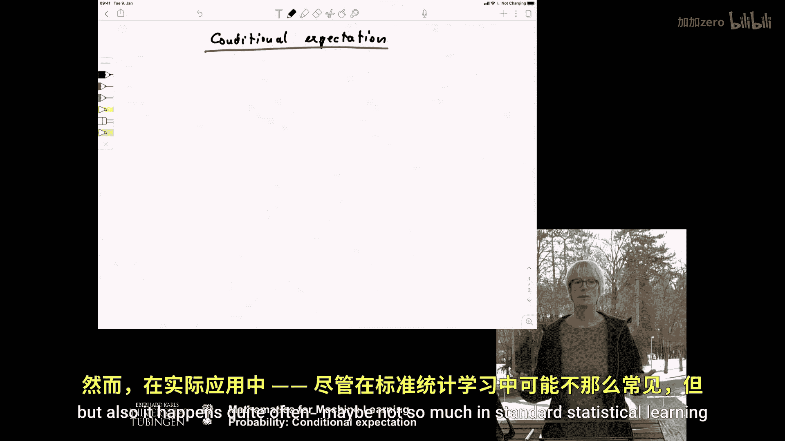
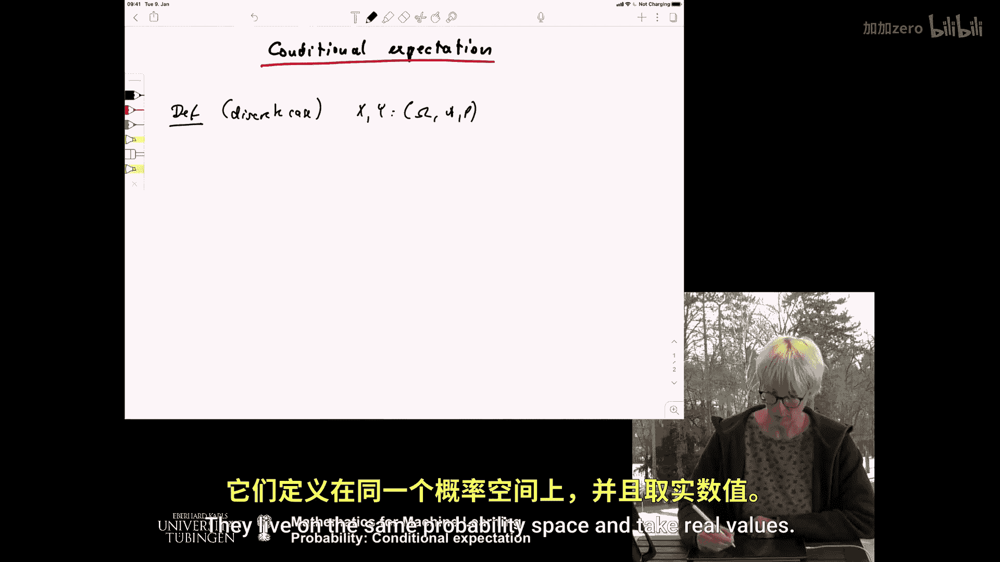
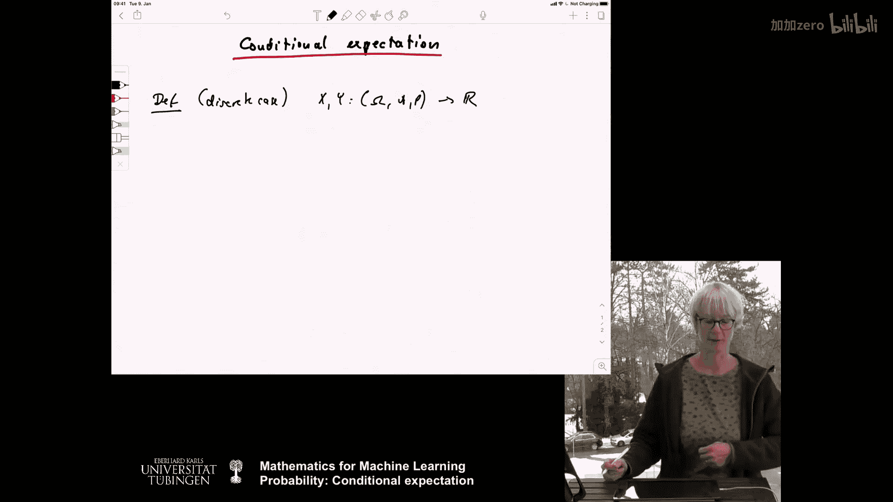

# 074：条件期望


在本节课中，我们将学习概率论中的一个核心概念——条件期望。我们将从离散随机变量的简单情况入手，逐步理解其定义和重要性，并探讨其在更一般情况下的应用。

## 概述





上一节我们介绍了当所有分布都具有密度形式时的条件分布。现在，我们将开始引入一个更一般、更广泛的概念。为了定义一般情况下的条件分布，我们需要理解条件期望。这个概念不仅在标准统计学习中，而且在机器学习的概率方法中也经常出现，例如当我们对某个变量在给定其他变量的条件下进行积分时。

## 从离散情况开始


条件期望可能是一个复杂的话题。为了建立直觉，我们从最简单的案例开始：两个离散随机变量的条件期望。


假设我们有两个定义在同一概率空间上、取实数值的随机变量 **X** 和 **Y**。我们想要计算在已知 **X** 的某个结果的情况下，**Y** 的期望值。


在离散情况下，这非常简单。以下是其定义：


**定义（离散随机变量的条件期望）**：
对于离散随机变量 **X** 和 **Y**，给定 **X = x** 时 **Y** 的条件期望定义为：
```
E[Y | X = x] = Σ_y (y * P(Y = y | X = x))
```
其中，求和遍历 **Y** 的所有可能取值 **y**，而 `P(Y = y | X = x)` 是给定 **X = x** 时 **Y = y** 的条件概率。


## 总结






本节课我们一起学习了条件期望的基本概念。我们从离散随机变量的简单定义出发，引入了在已知一个变量信息时计算另一个变量期望值的思想。理解这个基础是掌握更一般、更抽象的条件期望定义的关键。在后续课程中，我们将以此为基础，探讨连续随机变量以及更一般概率空间上的条件期望。