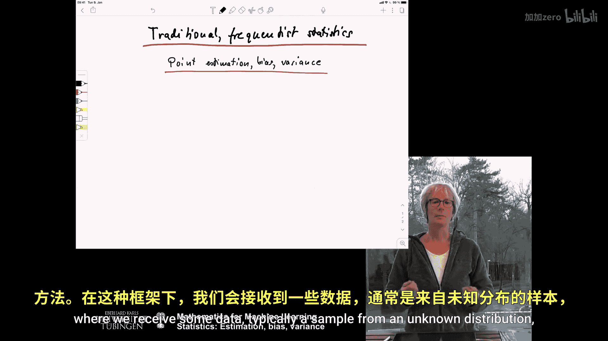
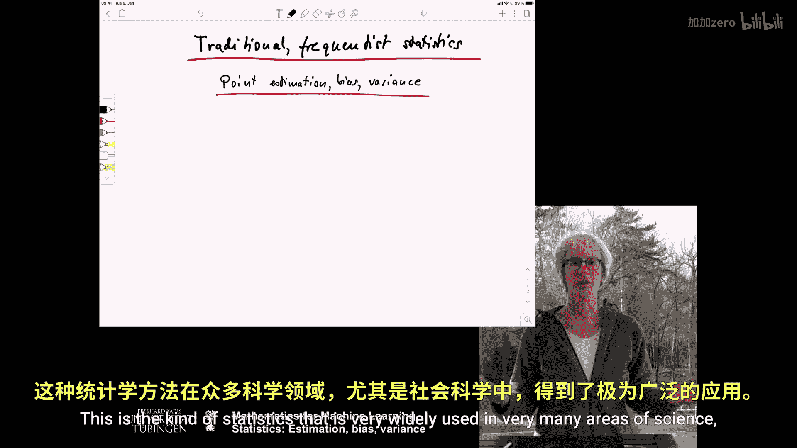
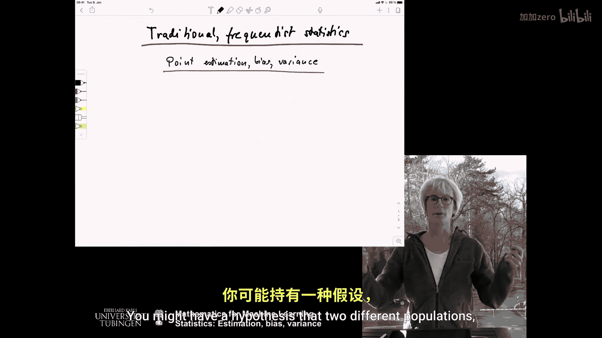
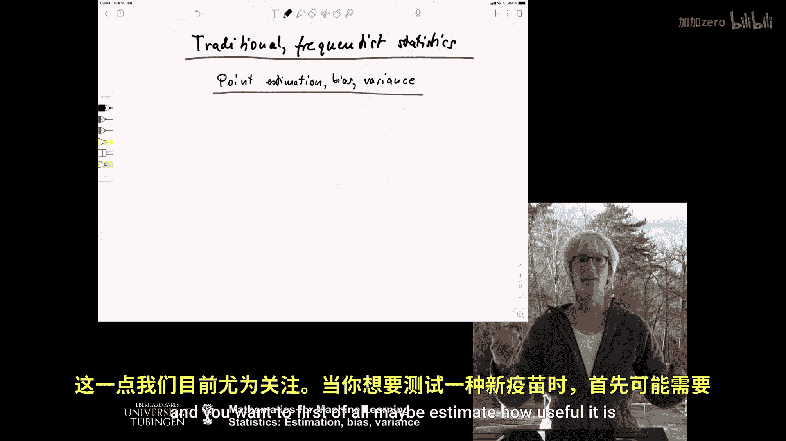
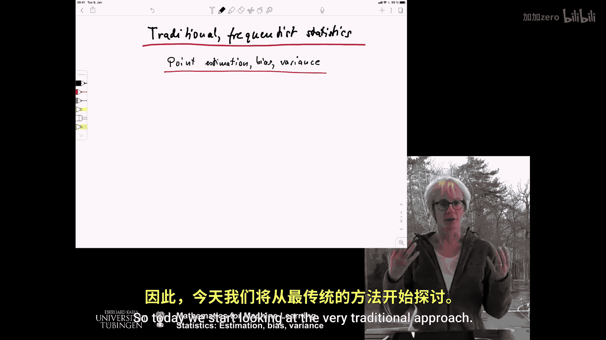
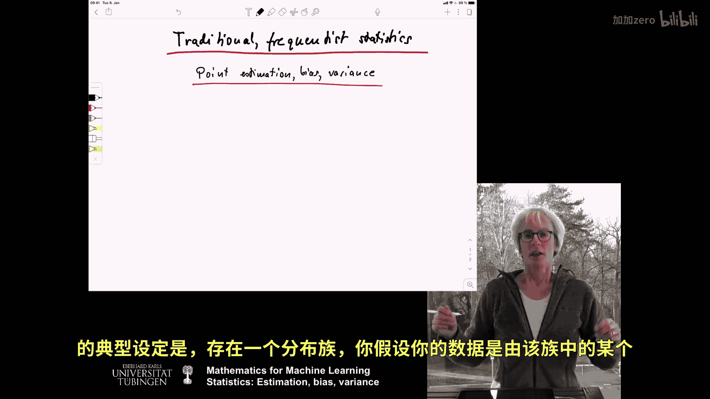
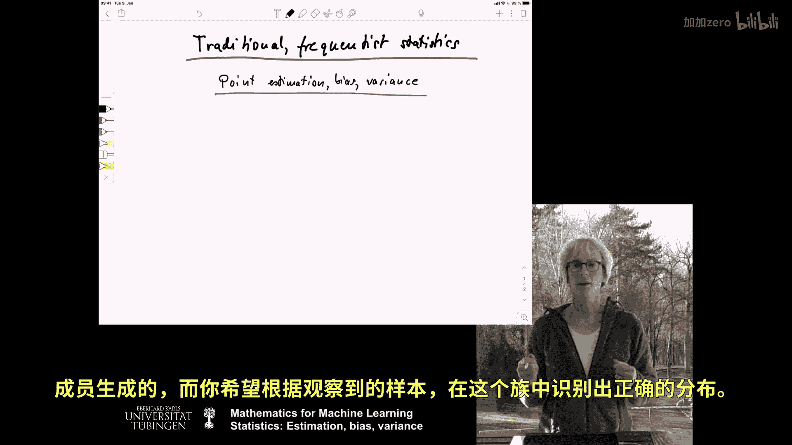
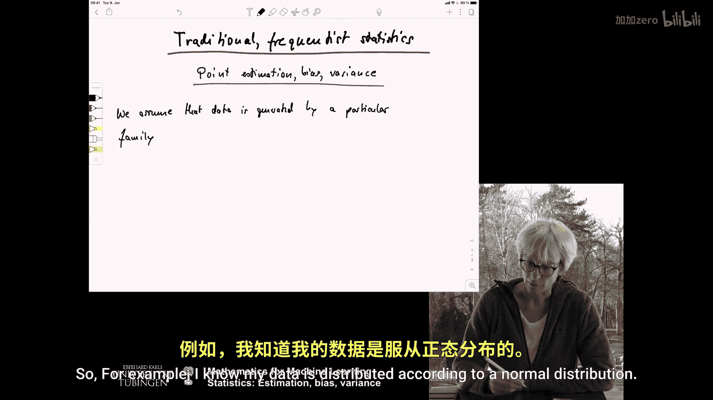

# 075：统计模型与估计入门 📊

在本节课中，我们将开始学习统计学，特别是传统的频率派统计方法。我们将了解什么是统计模型，并重点探讨点估计的概念，以及如何评估估计量的偏差与方差。

---

## 统计模型概述

传统的统计学通常基于一个核心假设：存在一个分布族，而我们观测到的数据是由该族中的某一个特定分布生成的。我们的目标就是基于观测到的样本，从这个族中识别出那个“正确”的分布。

让我们更正式地描述这个设定。

我们假设数据由一个特定的分布族 **F** 生成。这个族通常由一个参数 **θ** 来索引，因此可以写作 **F = { P_θ : θ ∈ Θ }**。其中，**Θ** 称为参数空间。我们的目标是：给定从某个未知参数 **θ*** 对应的分布 **P_θ*** 中抽取的独立同分布样本 **X₁, ..., X_n**，去估计或推断这个 **θ***。

---

## 估计量

上一节我们介绍了统计模型的基本框架。本节中，我们来看看如何从数据中得出关于参数 **θ** 的结论，这需要通过一个称为“估计量”的函数来实现。

一个**估计量** 是一个将观测数据映射到参数空间 **Θ** 的函数。也就是说，如果我们有数据 **X = (X₁, ..., X_n)**，那么估计量 **T** 给出一个估计值：**θ̂ = T(X)**。

估计量本身是一个随机变量，因为它的输入（数据）是随机的。因此，我们可以讨论它的分布、期望和方差等性质。

以下是两种常见的估计方法：
*   **点估计**：提供一个单一的数值作为参数的最佳猜测，例如样本均值 **μ̂ = (1/n) Σ X_i**。
*   **区间估计**：提供一个数值区间，声称参数以一定的概率落在这个区间内。

本节课我们主要关注点估计。

---

## 评估估计量：偏差与方差

我们已经知道，估计量是基于随机样本计算出来的，因此它本身也具有随机性。为了衡量一个估计量的好坏，我们需要一些评价标准。最核心的两个概念是偏差和方差。

**偏差** 衡量的是估计量的期望值是否与真实参数一致。
*   公式为：**Bias(θ̂) = E[θ̂] - θ**。
*   如果 **Bias(θ̂) = 0**，则称估计量 **θ̂** 是**无偏的**。这意味着，如果我们重复多次实验，计算出的估计值的平均值会等于真实参数。

**方差** 衡量的是估计量自身的波动程度，即估计值围绕其期望值的分散情况。
*   公式为：**Var(θ̂) = E[(θ̂ - E[θ̂])²]**。
*   方差越小，说明估计量在不同样本下的结果越稳定。

一个理想的估计量是同时具有**低偏差**和**低方差**的。然而，在现实中，偏差和方差往往存在权衡，这被称为**偏差-方差权衡**。

---

## 总结

本节课中，我们一起学习了传统频率派统计学的入门知识。我们首先定义了**统计模型**，即一个由参数索引的分布族。然后，我们引入了**估计量**的概念，它是根据样本数据对未知参数进行猜测的函数。最后，我们探讨了评估估计量质量的两个核心指标：**偏差**和**方差**。理解这些基础概念是后续学习假设检验、置信区间等更复杂统计方法的关键。