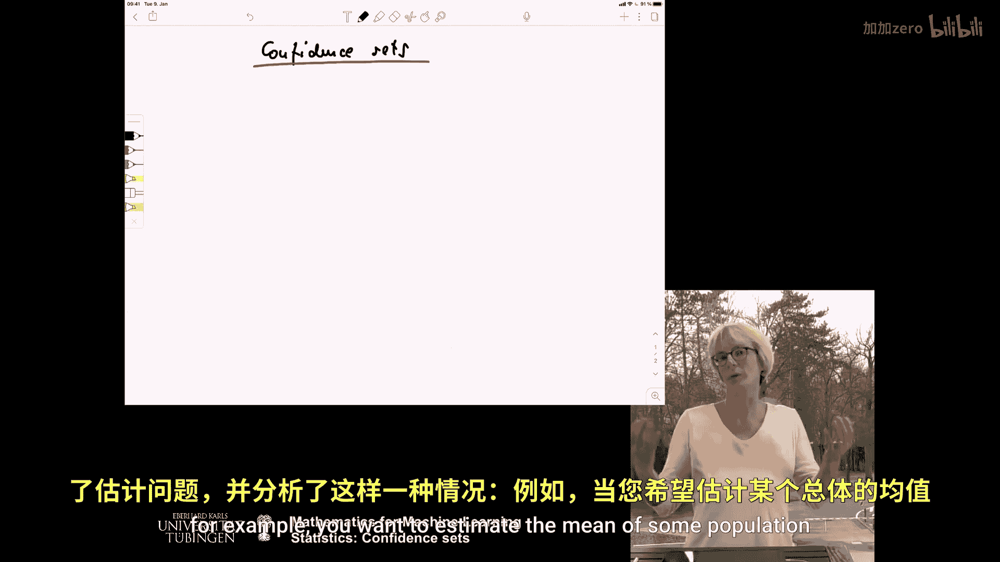
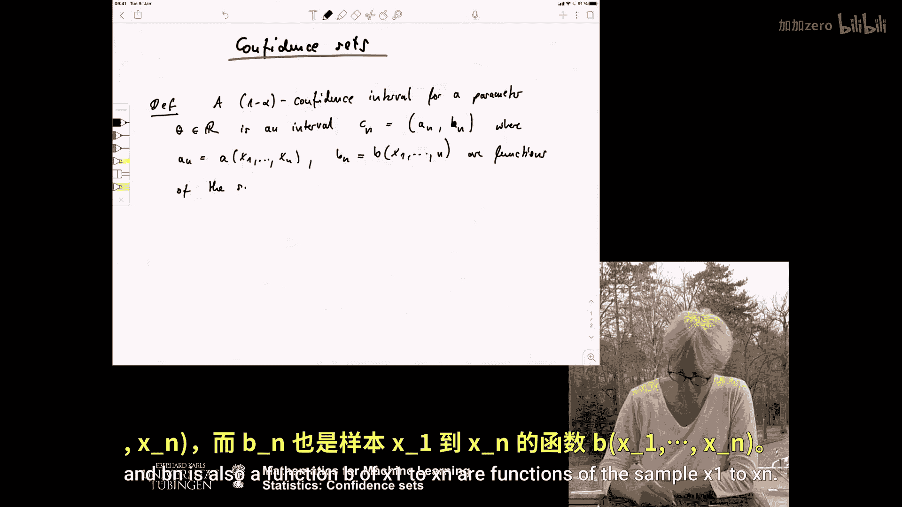

# 076：置信区间 📊

在本节课中，我们将要学习如何构建**置信区间**。上一节我们介绍了参数估计及其质量评估指标（如偏差、方差）。本节中，我们来看看如何给出一个更具体的概率性陈述，即估计的参数以高概率接近真实参数的范围。

## 概述

在上一讲中，我们研究了估计问题。我们考察了例如估计某个总体均值的情况。

你构建了一个估计量，然后我们通过**偏差**、**方差**或**均方偏差**来衡量其质量。

现在，这些指标的共同问题是，它们描述的是期望意义上的性质。有时，你可能更想知道一个更具体的陈述：你的估计参数以高概率接近真实参数的程度。

在标准的频率统计中，要给出这种陈述出人意料地复杂。

我们现在要做的是构建**置信区间**，它旨在传递这类信息。虽然其解释有些微妙，但在频率统计中没有更好的方法，所以让我们来尝试理解它。

## 置信区间的定义

我们首先定义什么是置信区间。

**定义**：我们将定义一个 **1 - α** 置信区间。

其中 **α** 是一个参数，通常希望它很小，例如 5% 或 1%。

现在，我们来看参数 **θ ∈ ℝ** 的一个 **1 - α** 置信区间。θ 是我们要估计的真实参数。

它是一个区间，我们称之为 **C_N**（基于 N 个样本点的置信区间）。

其形式为 **[A_N, B_N]**，其中 **A_N** 和 **B_N** 是实数。

这些数字将依赖于样本。

其中，**A_N** 是样本 **X₁, ..., X_N** 的某个函数 **A(X₁, ..., X_N)**。

**B_N** 也是样本 **X₁, ..., X_N** 的一个函数 **B(X₁, ..., X_N)**。它们是样本的函数。

## 总结

本节课中，我们一起学习了置信区间的基本概念。我们了解到，置信区间 `C_N = [A_N, B_N]` 是基于样本数据构建的一个区间，旨在以 `1 - α` 的概率覆盖未知的真实参数 θ。虽然其频率学派的解释（即关于重复抽样过程的概率）可能有些抽象，但它是量化估计不确定性的一个重要工具。下一节我们将探讨如何具体计算置信区间。