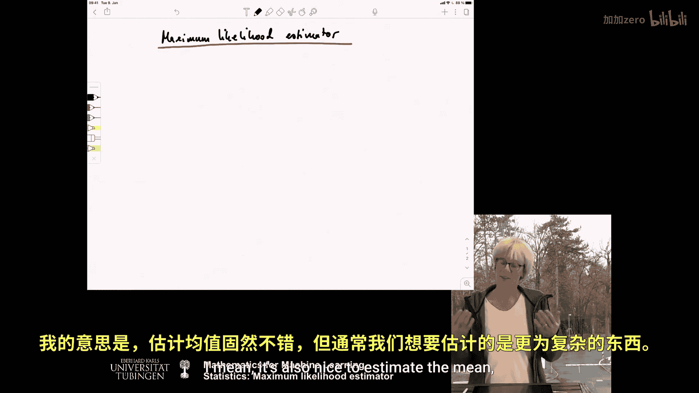
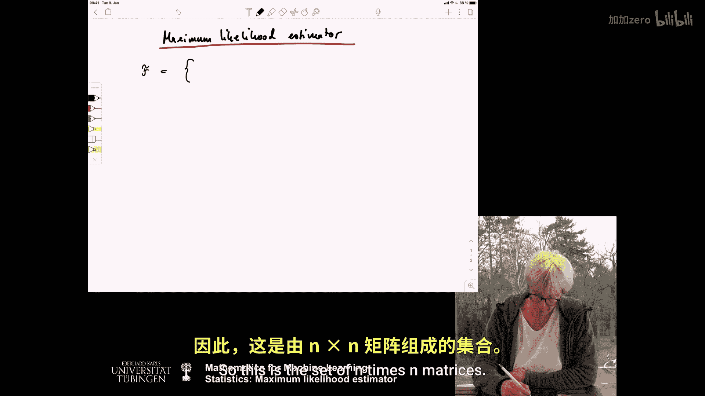
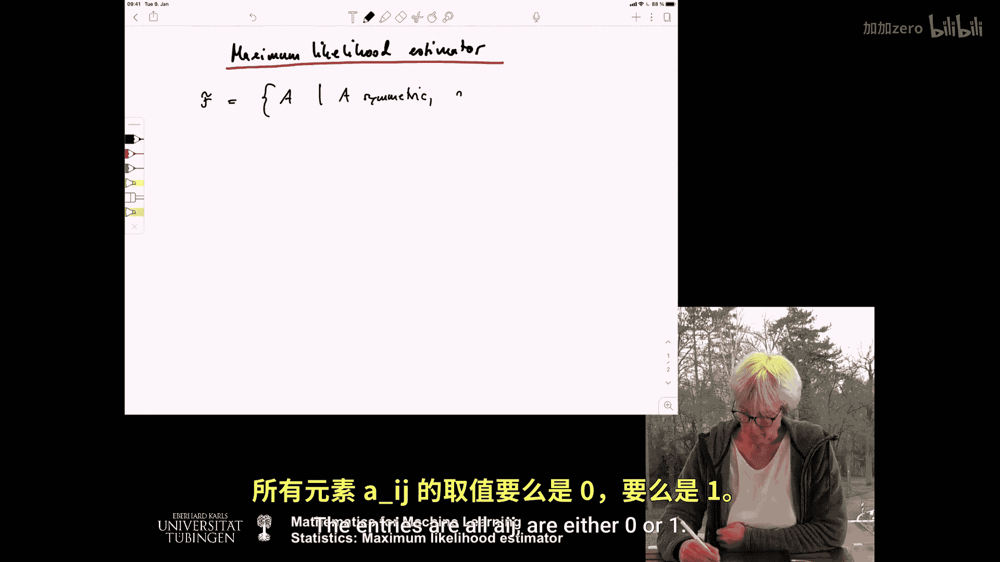
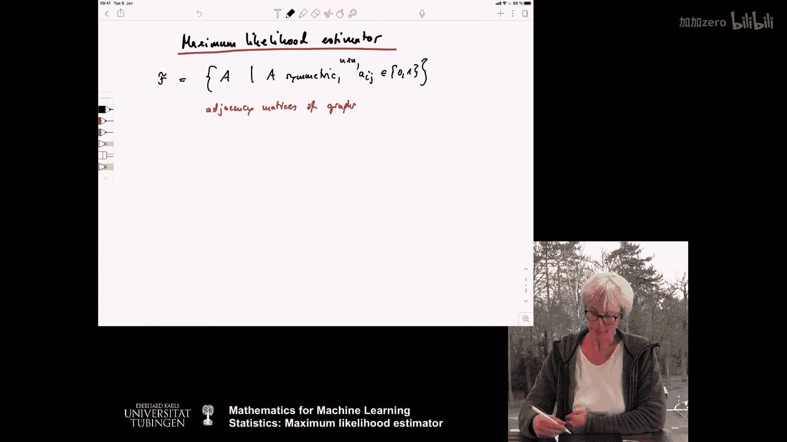
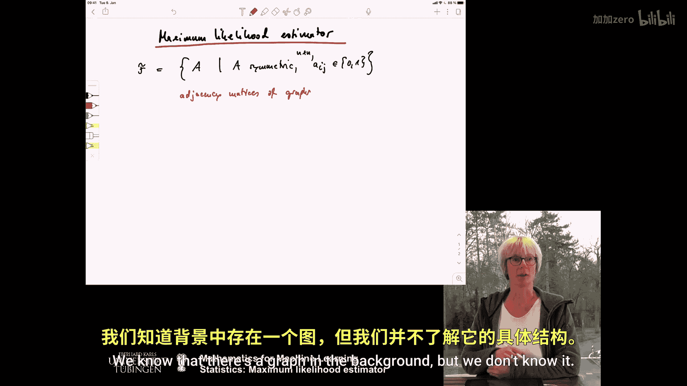

# 077：最大似然估计量 📈

在本节课中，我们将学习最大似然估计量。这是一种在统计学和机器学习中用于估计模型参数的核心方法。我们将从一个简单的概念回顾开始，然后通过一个具体的图模型例子，来理解如何应用最大似然估计解决复杂问题。

## 统计估计问题回顾

在之前的课程中，我们探讨了统计估计问题。

我们有一个由参数 `θ` 描述的概率分布族 `P_θ`，我们的目标是基于观测数据 `X` 来估计这个参数 `θ`。

**公式**：`X ~ P_θ`

我们目前做过的例子都非常简单，例如估计分布的均值或方差等。

## 机器学习中的复杂估计

然而，在机器学习中，我们很少仅仅估计均值或方差。虽然估计均值也有用，但我们通常需要估计更复杂的参数。这时，直接写出估计量的闭式解（解析解）就变得非常困难。

有时你仍然可以写出闭式解，但推导过程并不显而易见。

## 一个图模型的例子

我想从一个例子开始。这个例子来自我们去年发表的一篇名为《Net Gun Without Gu》的论文。

以下是该场景的描述：我们被给定一个图。在我们的模型中，统计模型由各种图构成。这个集合是所有可能的邻接矩阵。

**定义**：邻接矩阵 `A` 是一个 `n x n` 的对称矩阵，其元素 `A_ij` 取值要么是0，要么是1。它代表了一个具有 `n` 个顶点的图的邻接关系。

`n` 是已知的。这个矩阵代表了某个图的连接情况。

背景思想是：我们有一些图，例如社交网络、大脑连接图或气候网络。为了具体化，假设我们有一个大脑连接图，它有100个顶点，代表大脑的不同区域，如果两个区域相互通信，它们之间就有一条边。

到目前为止，这里还没有引入随机性。矩阵 `A` 是参数化的，我们知道背后存在一个真实的图。

---

本节课中，我们一起回顾了统计估计的基本框架，并指出了在机器学习中处理复杂参数估计时面临的挑战。我们引入了一个图模型的例子，为后续讲解如何应用最大似然估计来解决这类非平凡问题做好了铺垫。在接下来的章节中，我们将深入探讨最大似然估计的原理和应用。