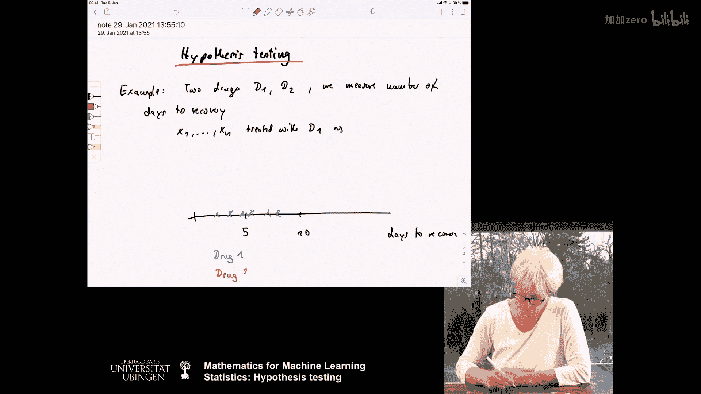

# 079：假设检验、检验水平与功效 🔬

在本节课中，我们将学习统计学中的另一个核心部分：假设检验。我们将了解什么是假设检验，以及如何评估一个检验的“水平”和“功效”。

## 概述

前几节课我们主要围绕**估计问题**展开。你有一个来自某个分布的样本，你知道这个分布可以用一个参数来描述，你的目标是估计这个参数。这是传统统计学的一部分。

传统统计学的另一大部分是**检验问题**。检验问题的形式有所不同。在估计问题中，你首先想了解你可能并不完全清楚的分布信息。而在检验问题中，你有一个具体的假设，你想检验是否应该相信这个假设。

## 假设检验的应用场景

一个典型的应用场景是在医学领域。假设有一种疾病，有两种药物：药物一和药物二。你有一批病人，你用第一种药物治疗其中一部分，用第二种药物治疗另一部分。对于每种药物，你测量病人从疾病中恢复所需的时间。

通常，你会得到一大片时间数据点。例如，我们可以画一个草图：横轴代表两种药物（D1， D2），纵轴代表恢复所需的天数。对于药物一，你有一个样本 `X1, X2, ..., Xn`，记录了恢复天数。你可能会观察到一些数据点，比如这里有5天，那里有10天等等。对于药物二，你也会观察到另一组数据点。

## 核心概念：假设检验

上一节我们介绍了假设检验的应用背景，本节中我们来看看其核心思想。假设检验的核心是提出一个关于总体参数的**假设**（例如，两种药物的平均恢复时间相同），然后利用样本数据来判断是否有足够的证据**拒绝**这个假设。

以下是假设检验的基本步骤：
1.  **建立假设**：提出**原假设 (H0)** 和**备择假设 (H1)**。原假设通常是希望被检验的、保守的假设。
2.  **选择检验统计量**：根据数据和假设，选择一个合适的统计量（如样本均值差）。
3.  **确定显著性水平**：设定一个阈值 **α**（通常为0.05），它代表了当原假设为真时，错误地拒绝它的最大概率。
4.  **计算p值**：在原假设成立的条件下，计算得到当前样本观测结果（或更极端结果）的概率。
5.  **做出决策**：如果p值小于显著性水平α，则拒绝原假设；否则，不拒绝原假设。

## 检验水平与功效

在做出决策时，我们可能会犯两种错误：
*   **第一类错误**：原假设为真，但我们拒绝了它。犯第一类错误的概率就是**显著性水平 α**。
*   **第二类错误**：原假设为假，但我们没有拒绝它。犯第二类错误的概率记为 **β**。

与第二类错误相对的概念是**检验功效**。检验功效定义为当备择假设为真时，我们正确拒绝原假设的概率。其公式为：
**功效 = 1 - β**

一个理想的检验希望同时控制第一类错误（α小）并拥有高功效（1-β大）。然而，在样本量固定的情况下，两者通常存在权衡关系。

## 总结

本节课中我们一起学习了假设检验的基础知识。我们了解到，假设检验用于对关于总体参数的特定主张进行决策。我们介绍了原假设与备择假设的概念，学习了假设检验的基本步骤，并重点探讨了评估检验好坏的两个关键指标：**检验水平 (α)** 和 **检验功效 (1-β)**。理解这些概念对于科学地解读数据、做出可靠推断至关重要。