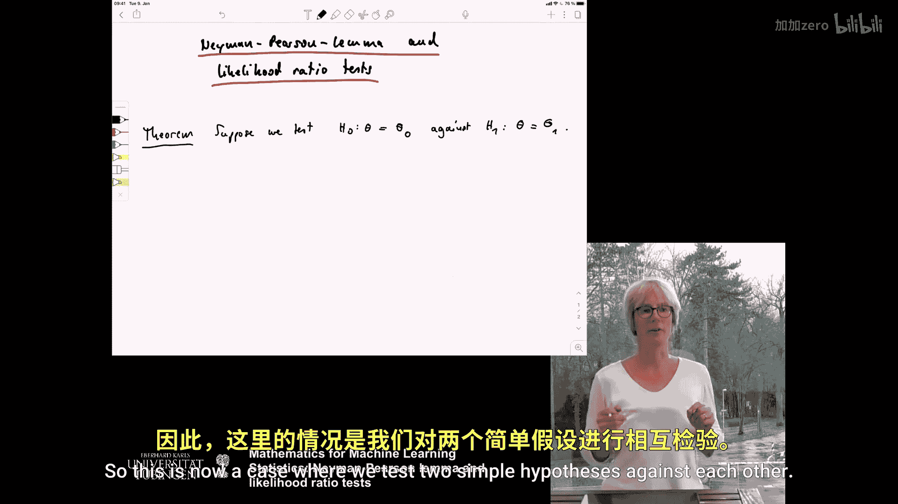

# 080：似然比检验与Neyman-Pearson引理 📊


在本节课中，我们将学习如何构建统计检验来比较两个假设。具体来说，我们将探讨一种非常直观且在某些情况下最优的检验方法——似然比检验，并介绍保证其最优性的Neyman-Pearson引理。


---

## 回顾：统计检验的基本概念


上一节我们介绍了用于检验两个假设（原假设与备择假设）的标准统计检验概念。

一个统计检验的核心是控制两类错误：
*   **第一类错误（Type I Error）**：当原假设为真时错误地拒绝它。
*   **第二类错误（Type II Error）**：当备择假设为真时未能拒绝原假设。


构建检验时，通常首先固定检验的**显著性水平（Level）**，即控制第一类错误的概率上限。在满足第一类错误约束的众多可能检验中，我们会尝试选择**功效（Power）**最高（即第二类错误最小）的那个。


我们还引入了**一致最大功效检验（Uniformly Most Powerful Test， UMP）**的概念，即在给定显著性水平下，对所有可能的备择参数值都具有最高功效的检验。但在实践中，这种理想的UMP检验很少存在。


---

## 一种存在最优解的情况：Neyman-Pearson框架


然而，存在一种特殊情况可以找到一致最优的检验，这由**Neyman-Pearson引理**描述。这种检验被称为**似然比检验（Likelihood-Ratio Test）**，其思想非常直观。

### 似然比检验的直观思想


我们想要检验一个假设（H0）相对于另一个假设（H1）。在统计学中，我们如何评估某个参数值在给定数据下的合理性？我们计算**似然（Likelihood）**，即在给定特定参数下观测到当前数据的概率。


似然比检验的思想很简单：如果数据在原假设H0下的似然值大于在备择假设H1下的似然值，那么我们倾向于**保留H0**；反之，则**拒绝H0**。


### Neyman-Pearson引理的形式化描述

现在，让我们将这一直观概念形式化。Neyman-Pearson引理（尽管在文献中称为“引理”，但其结论非常强大）给出了构建最优检验的具体方法。


**定理设定**：
假设我们要检验一个**简单原假设**对一个**简单备择假设**：
*   **H0**: 参数 θ = θ₀
*   **H1**: 参数 θ = θ₁


这里“简单假设”是指参数被设定为一个具体的值，而不是一个集合。


**检验构造**：
对于给定的显著性水平 α，定义以下检验函数 φ(x)：


```
φ(x) = 1,  if L(θ₁; x) / L(θ₀; x) > k
φ(x) = γ, if L(θ₁; x) / L(θ₀; x) = k
φ(x) = 0,  if L(θ₁; x) / L(θ₀; x) < k
```


其中：
*   `L(θ; x)` 是参数θ在数据x下的似然函数。
*   `k` 和 `γ` 是选定的常数，使得检验的水平恰好为 α，即 `Eθ₀[φ(X)] = α`。


**引理结论**：
按上述方式构造的检验，是所有水平不超过α的检验中，**功效最大**的检验。也就是说，它在控制第一类错误的同时，最大化检测出备择假设H1为真的概率（即最小化第二类错误）。


---


## 总结


本节课我们一起学习了统计推断中一对重要的概念：
1.  **似然比检验**：一种基于比较原假设与备择假设下数据似然值的直观检验方法。
2.  **Neyman-Pearson引理**：该引理严格证明，在检验两个简单假设时，基于似然比构造的检验是所有给定水平检验中功效最高的，即它是**一致最大功效检验**。这为我们在一个特定但重要的场景下找到了最优的决策规则。




理解这个引理是学习更复杂检验（如广义似然比检验）的基础，它体现了在统计决策中权衡两类错误的核心思想。