# 082：多重检验介绍 🧬

在本节课中，我们将要学习统计学中的一个重要概念——多重检验。当我们同时进行大量假设检验时，传统的检验方法会遇到问题，本节将介绍这些问题的本质。

上一节我们介绍了假设检验的基本框架，本节中我们来看看当这个框架被大规模应用时会发生什么。

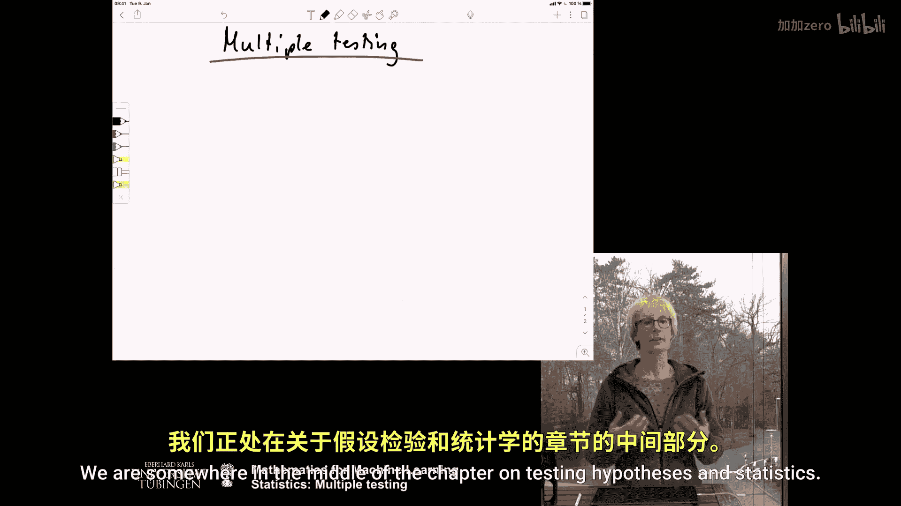

## 假设检验回顾

一个典型的假设检验设置如下：

我们有一个待检验的假设，称为**原假设**（Null Hypothesis），通常记作 **H₀**。

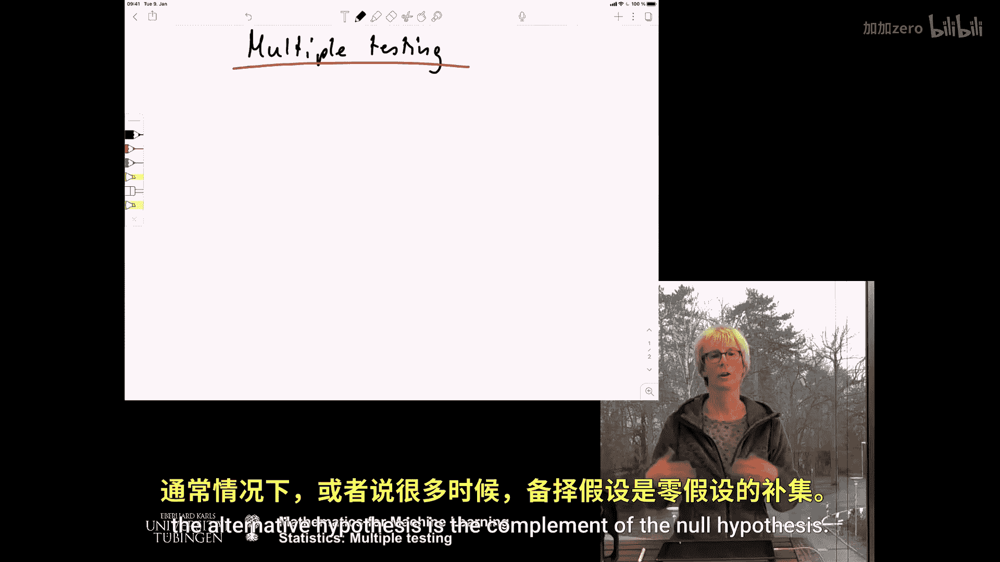

我们将其与一个**备择假设**（Alternative Hypothesis）进行对比，备择假设通常是原假设的补集，记作 **H₁**。

我们观察一些数据，然后基于这些数据判断是否应该拒绝原假设。

这些检验的构建方式是，首先固定一个检验的**显著性水平 α**，这是我们可能犯的**第一类错误**的概率。我们构建的检验期望犯错的概率不超过这个水平（例如5%）。

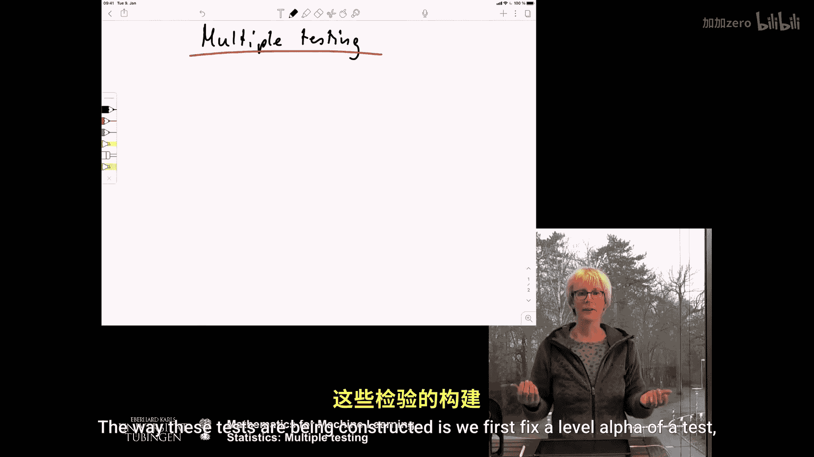

在确定了检验之后，我们还可以关注**第二类错误**，其反面就是检验的**功效**（Power），我们希望功效尽可能高。

## 多重检验问题

上述整个框架在只进行一次检验时是有效的。

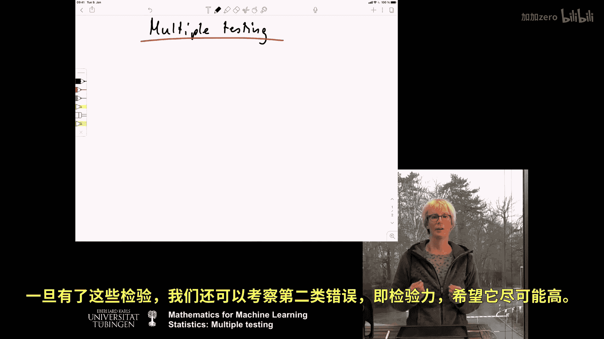

但现在假设你有很多东西需要检验。一个典型的例子是基因表达数据。在生物学研究中，你可能有两组病人：一组20名患者患有某种癌症，另一组20名健康人作为对照组。

你的目标是找出哪些基因可能与这种癌症有关。

以下是该场景的一个简化示例：

我们有一个**癌症患者组**，假设有20人（n=20）。

我们有一个**健康对照组**，同样假设有20人。

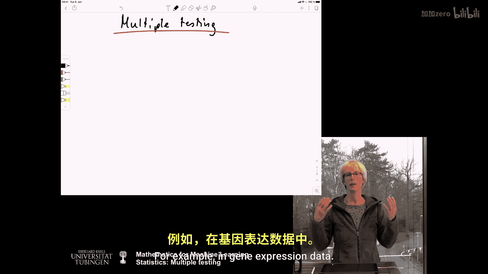

我们有很多基因，例如**基因1，基因2，...，基因1000**。我们观察每个基因在每个个体中的**激活水平**。

为了找出哪些基因在两组间有显著差异，一个自然的想法是：对每一个基因（例如基因1），分别进行一次假设检验。原假设 H₀ 可以是“该基因在两组间的平均表达水平无差异”。

然而，当我们对1000个基因分别进行独立的显著性水平为 α=0.05 的检验时，问题就出现了。

## 错误率膨胀

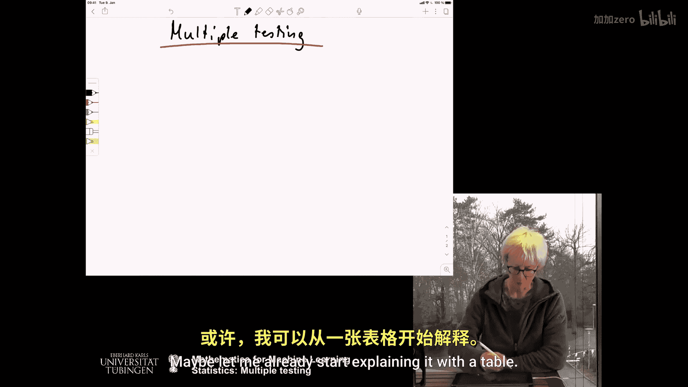

即使所有基因实际上都与癌症无关（即所有原假设都为真），我们仍然可能仅仅由于随机波动而错误地拒绝一些原假设。

具体来说，对于单个检验，犯第一类错误的概率是 α（例如5%）。

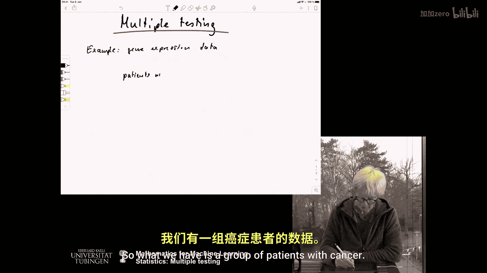

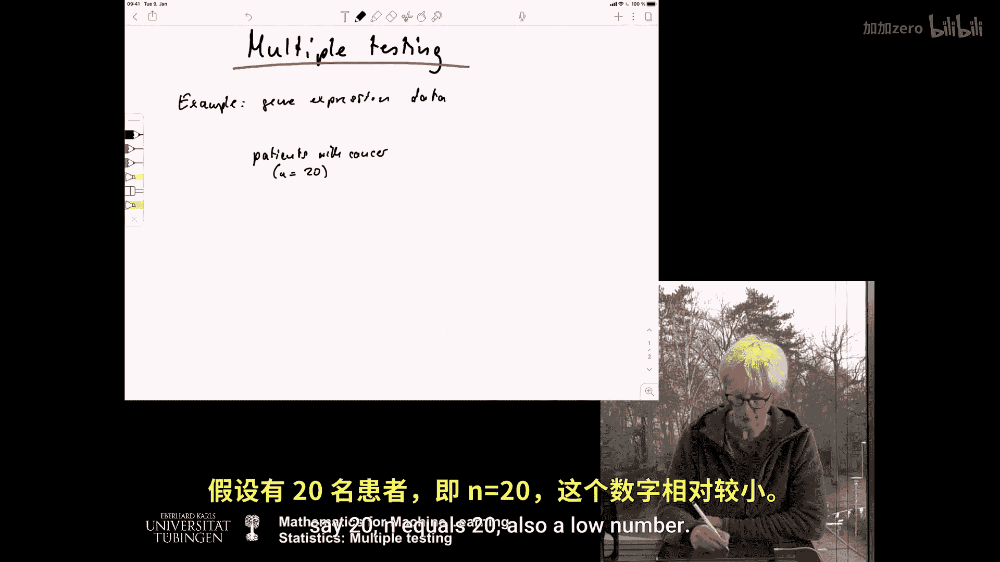

如果我们独立地进行 m 次检验，那么**至少犯一次第一类错误**的概率会急剧增加。这个概率称为**族错误率**（Family-Wise Error Rate, FWER）。

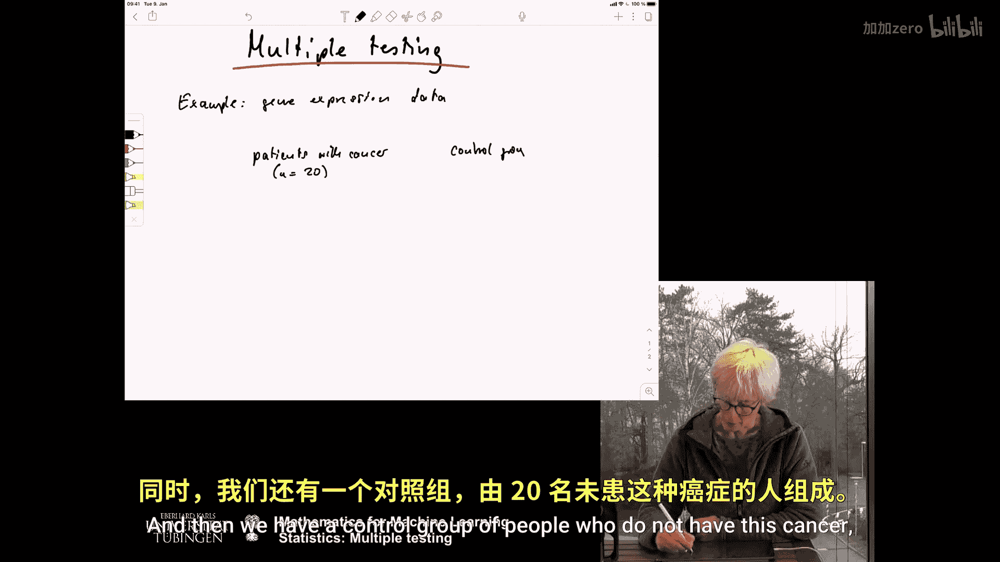

其计算公式为：
**FWER = 1 - (1 - α)^m**

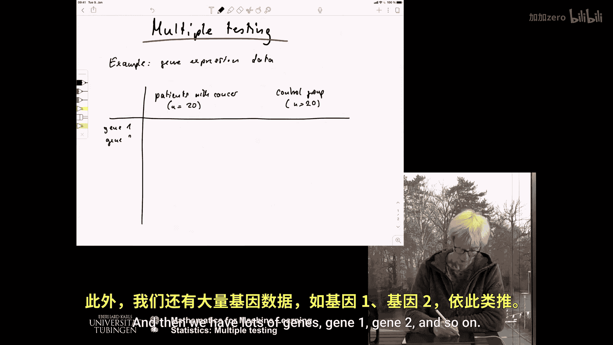

例如，当 α=0.05， m=1000 时：
**FWER ≈ 1 - (1 - 0.05)^1000 ≈ 1 - 0.95^1000 ≈ 1**

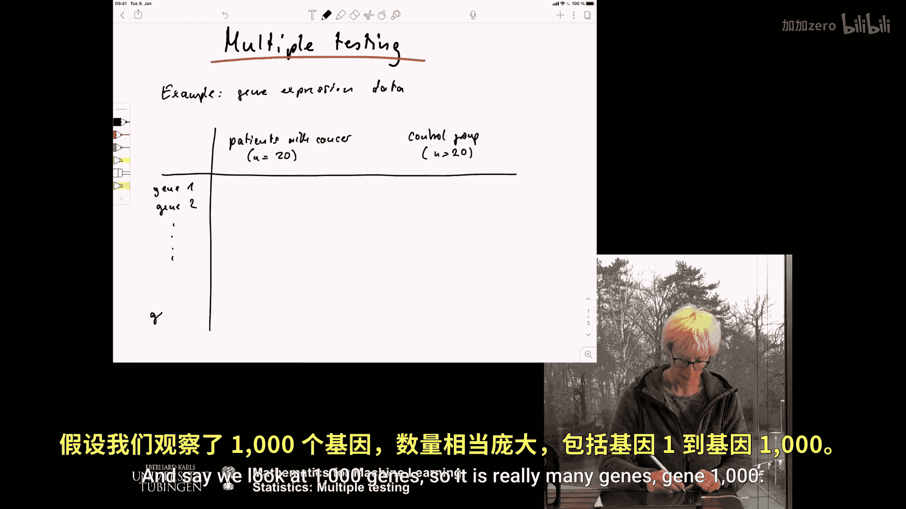

这意味着，即使没有任何基因真正相关，我们几乎**必然**会错误地宣称至少一个基因是显著的。这显然是不可接受的。

## 小结

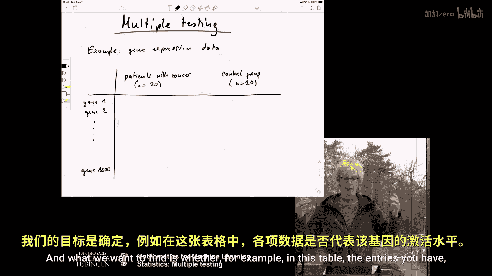

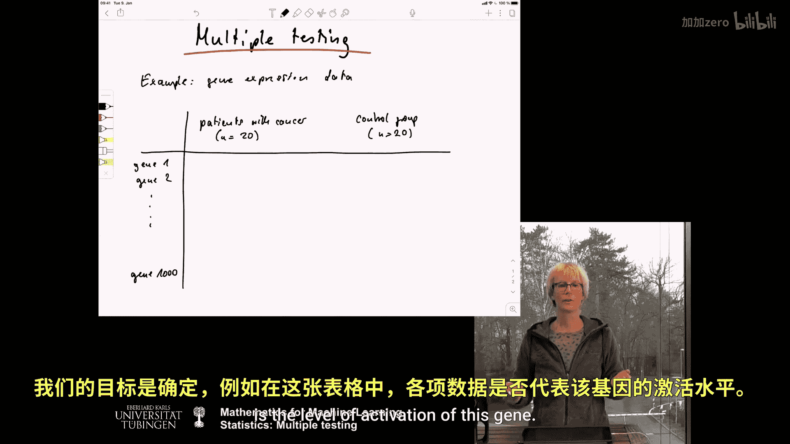

本节课中我们一起学习了多重检验问题的核心。我们回顾了单次假设检验的基本原理，然后通过基因表达数据的例子，展示了当同时进行大量检验时，传统的显著性水平控制方法会失效，导致第一类错误概率（族错误率）急剧膨胀。在接下来的章节中，我们将探讨如何校正多重检验，以控制这种整体错误率。