# 085：Bootstrap方法 🚀

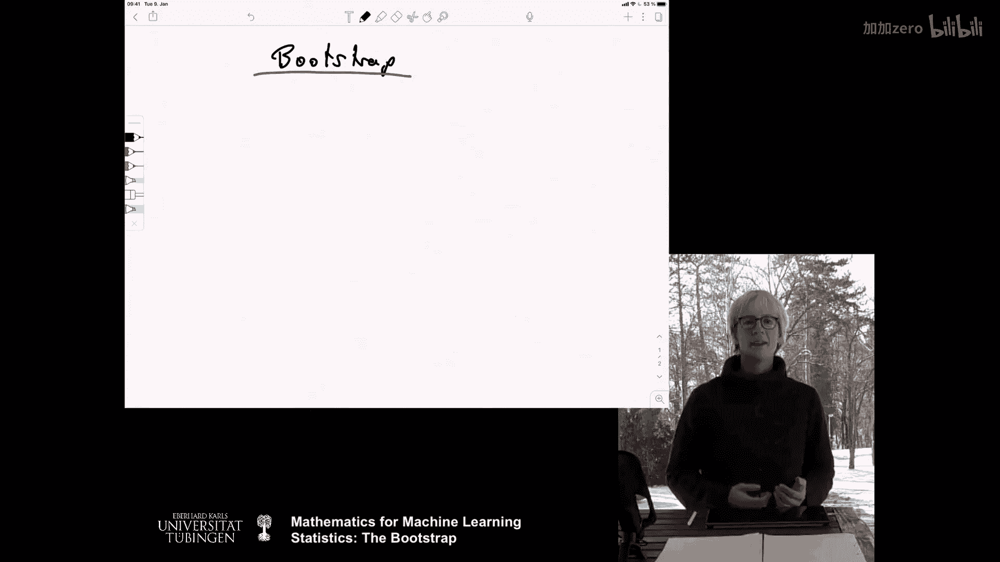

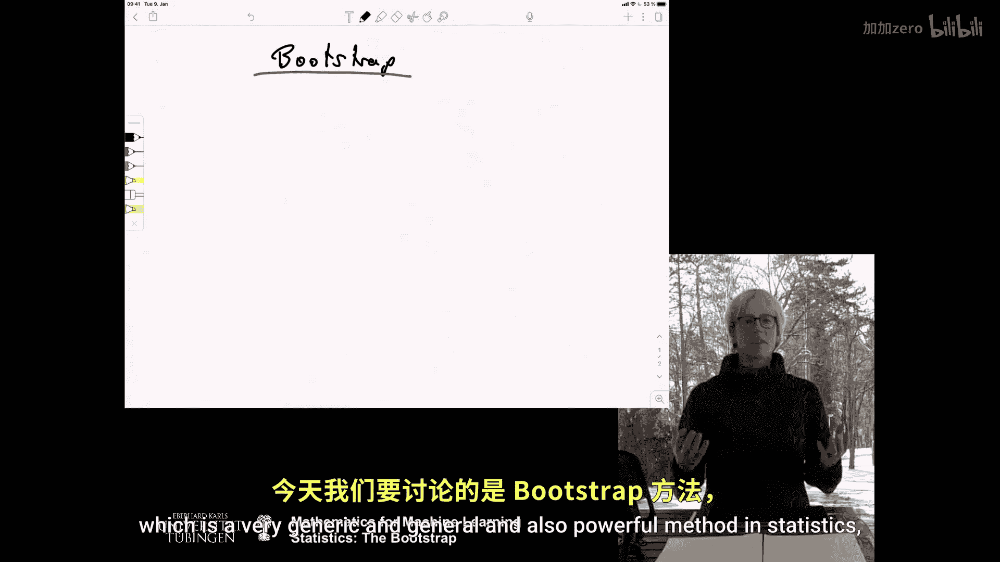

在本节课中，我们将要学习一种在统计学中非常通用且强大的方法——Bootstrap方法。它特别适用于非参数统计场景，即当我们对数据的潜在分布没有任何假设时。

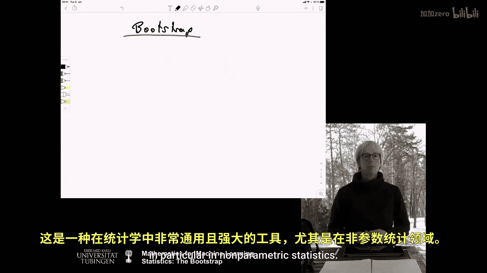

## 概述

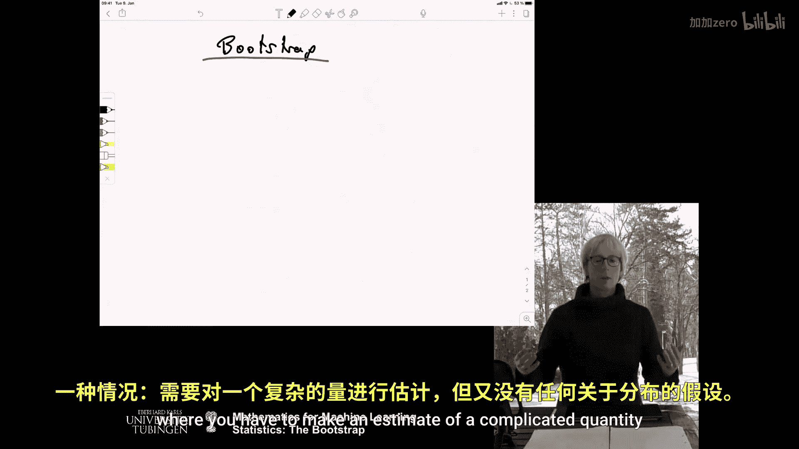

Bootstrap方法是一种通过从原始数据集中**有放回地重复抽样**来估计统计量（如均值、标准差、置信区间）的分布的方法。它不依赖于对总体分布的具体假设，因此非常灵活。

上一节我们介绍了非参数统计中的其他方法，如置换检验。本节中我们来看看Bootstrap这一更通用的方法是如何工作的。

## 动机与问题设定

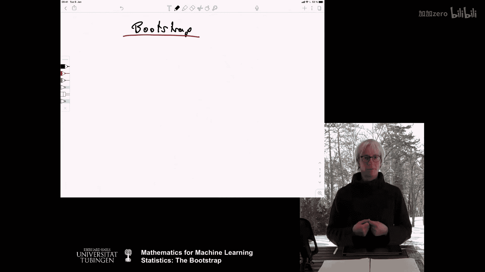

首先，让我们明确Bootstrap方法要解决的问题。

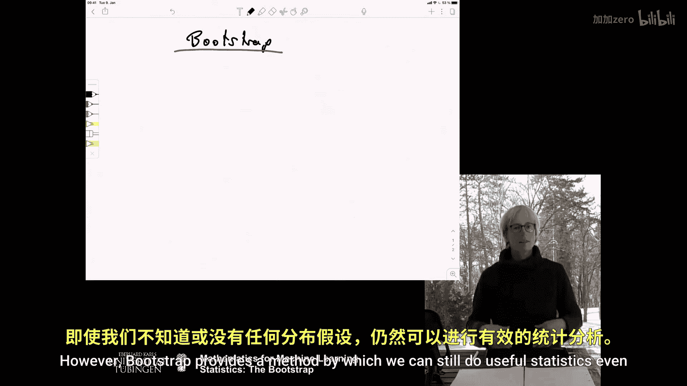

假设我们有一个来自某个未知分布 **F** 的样本：**X₁, X₂, ..., Xₙ**。我们对该分布 **F** 没有任何先验知识或假设。

我们的目标是估计一个基于该分布的参数 **θ**。这个参数可以是均值、中位数、相关系数，或任何其他复杂的统计量。

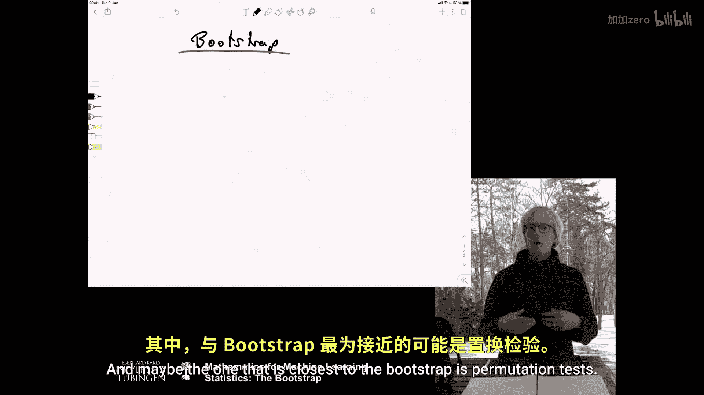

## Bootstrap的核心思想

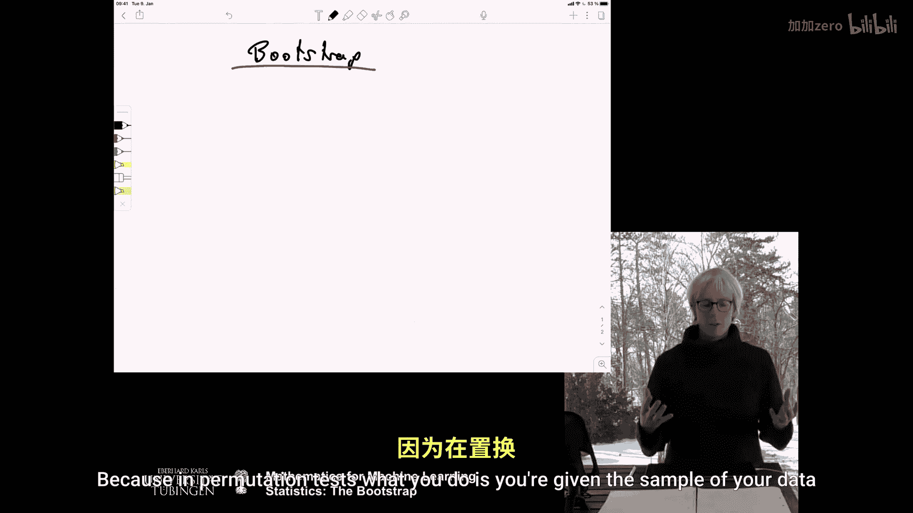

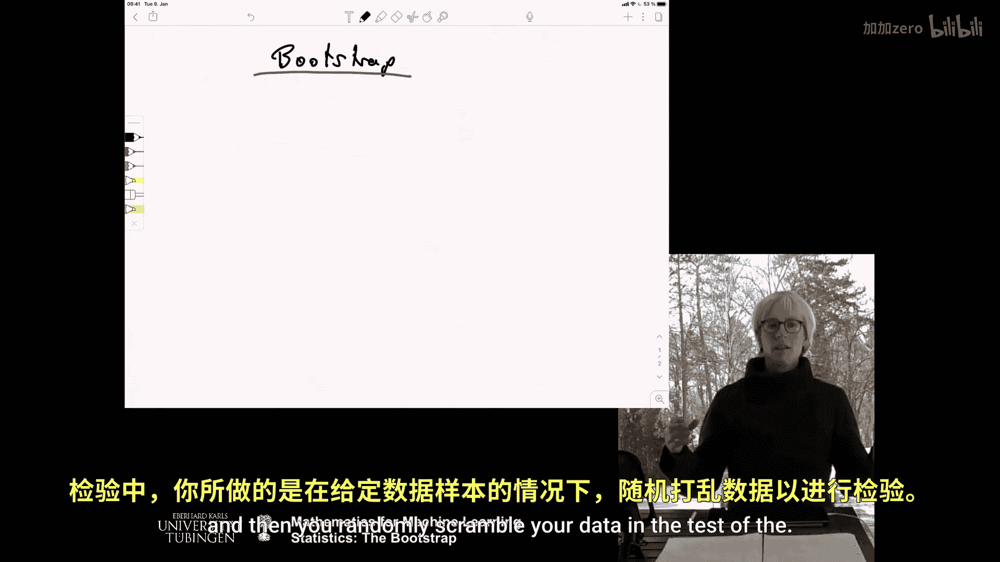

Bootstrap的核心思想非常简单：**将观测到的样本视为对总体分布的最佳估计**。

既然我们没有总体的信息，我们就用样本本身来模拟总体的行为。具体做法是，从原始样本中进行**有放回的重复抽样**，生成许多个“Bootstrap样本”，然后基于这些新样本计算我们感兴趣的统计量，从而近似该统计量的抽样分布。

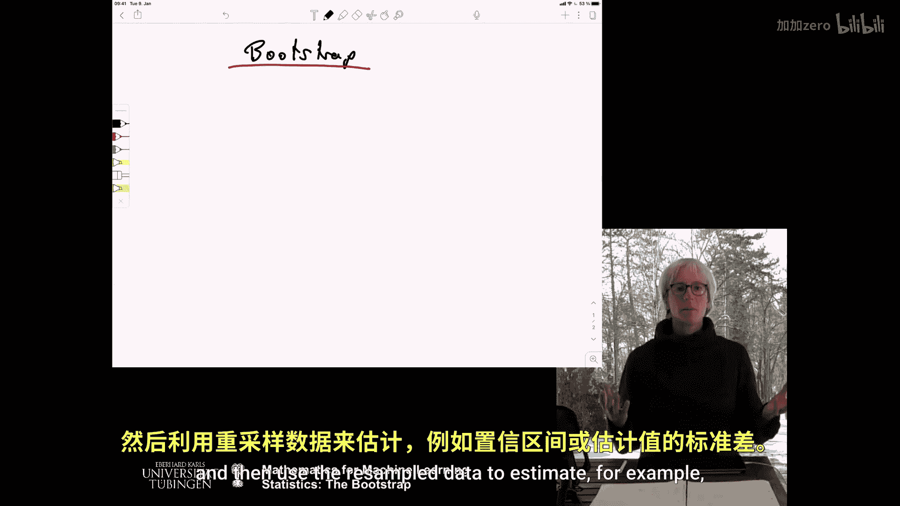

以下是Bootstrap方法的基本步骤：

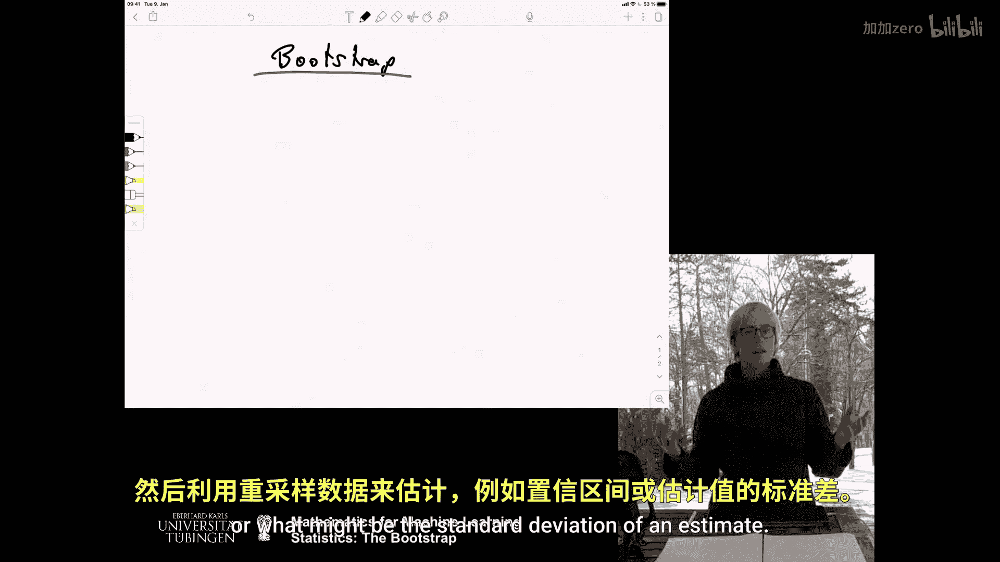

1.  **从原始样本中重抽样**：从原始样本 **X₁, X₂, ..., Xₙ** 中，**有放回地**随机抽取 **n** 个观测值，构成一个新的Bootstrap样本 **X*₁, X*₂, ..., X*ₙ**。注意，由于是有放回抽样，原始样本中的某些数据点可能在新样本中出现多次，而另一些则可能一次都不出现。
2.  **计算统计量**：对这个Bootstrap样本计算我们感兴趣的统计量估计值，记作 **θ̂***。
3.  **重复多次**：将步骤1和步骤2重复 **B** 次（例如 B=1000 或 10000），得到 **B** 个Bootstrap统计量估计值：**θ̂*₁, θ̂*₂, ..., θ̂*_B**。
4.  **利用Bootstrap分布进行推断**：这 **B** 个 **θ̂*** 值构成了统计量 **θ̂** 的一个近似抽样分布，称为Bootstrap分布。我们可以利用这个分布来计算标准误、置信区间等。

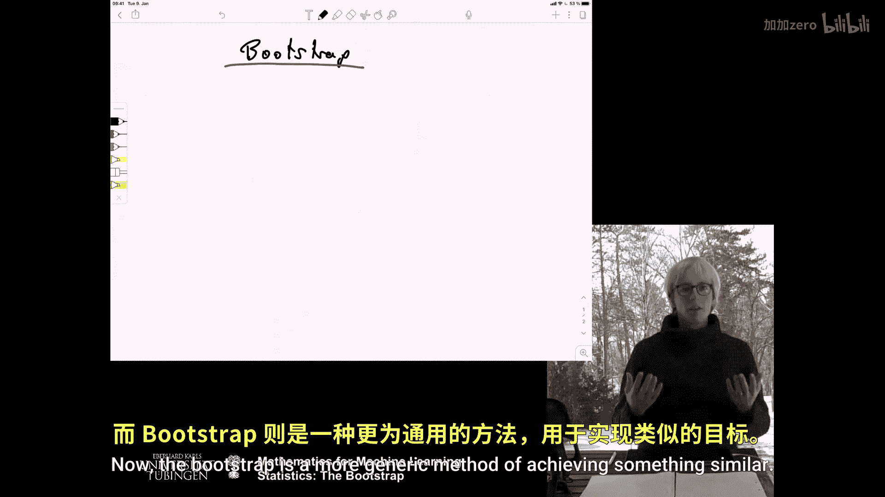

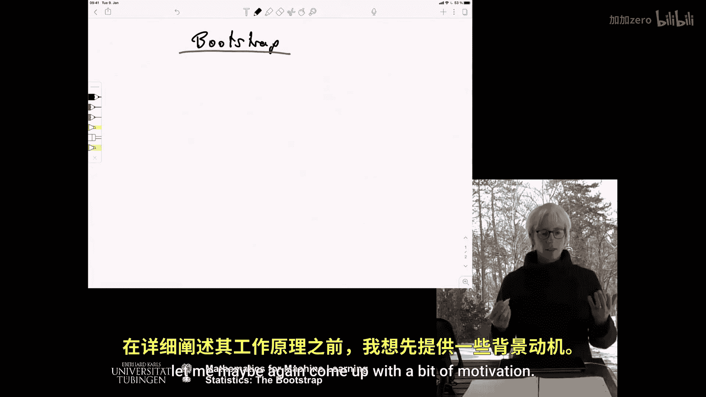

## Bootstrap的应用示例

我们可以用Bootstrap分布来完成多种统计推断任务。

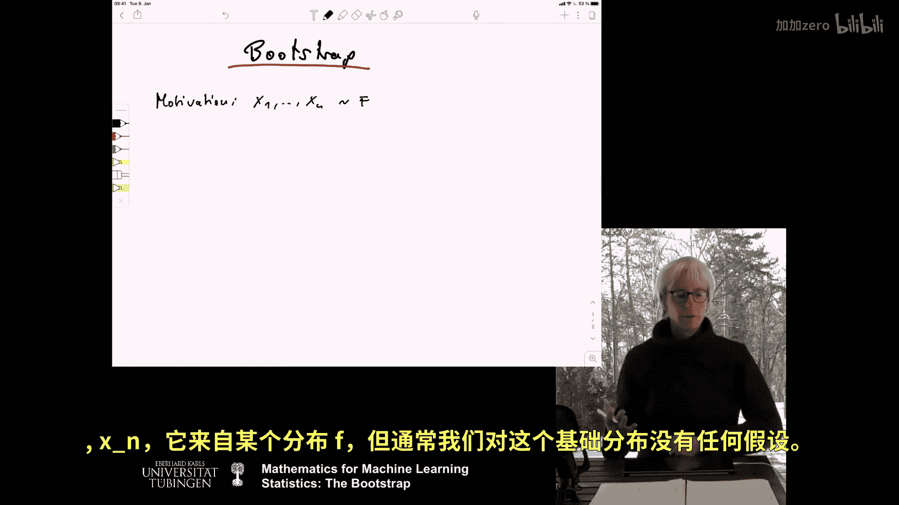

以下是几个常见的应用：

*   **估计标准误**：Bootstrap分布的标准差可以作为原始估计量 **θ̂** 的标准误的一个估计。
    *   公式：**SE_boot = sqrt( (1/(B-1)) * Σ (θ̂*_b - θ̂*_mean)² )**，其中 **θ̂*_mean** 是Bootstrap估计值的均值。
*   **计算置信区间**：有多种方法可以利用Bootstrap分布计算置信区间。
    *   **百分位数法**：直接取Bootstrap分布的 **α/2** 和 **1-α/2** 分位数作为置信区间的上下限。例如，对于95%的置信区间，取2.5%分位数和97.5%分位数。
    *   **偏差校正法**：对百分位数法进行修正，以考虑估计量可能存在的偏差。
*   **进行假设检验**：通过比较基于原始数据计算的统计量与基于Bootstrap分布生成的零假设下的统计量分布，可以计算p值。

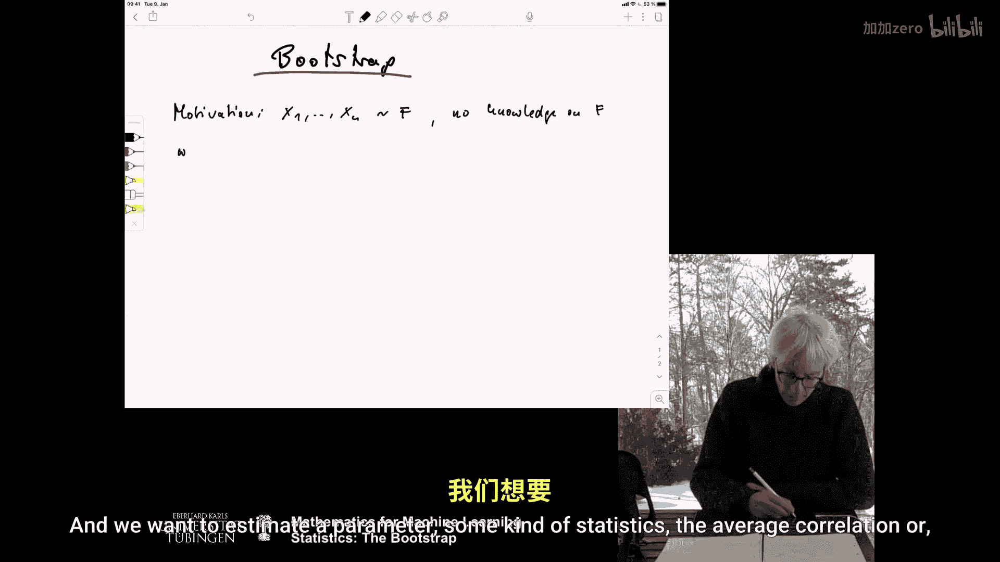

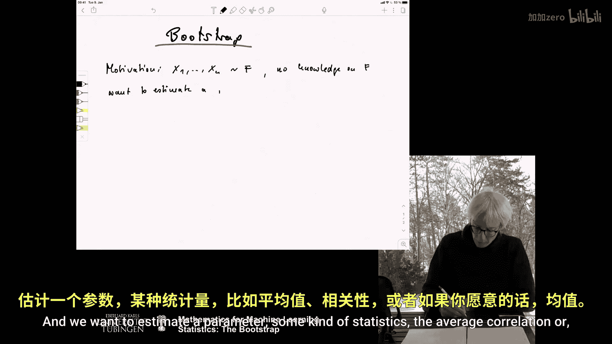

## 总结

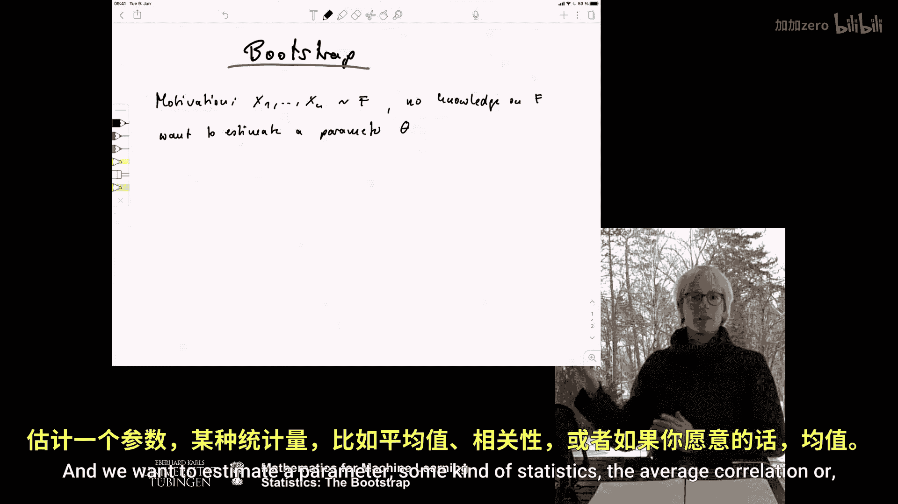

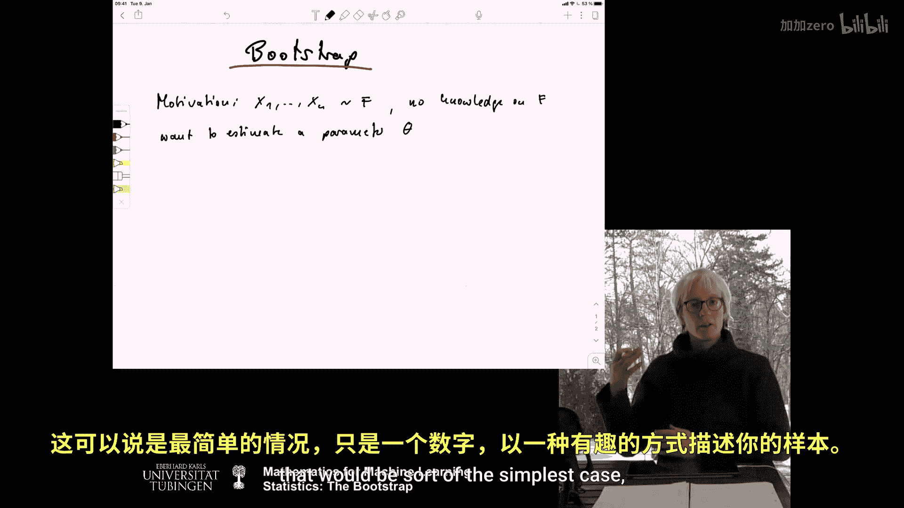

本节课中我们一起学习了Bootstrap方法。它是一种强大的非参数统计工具，核心在于通过**有放回地重抽样**从原始数据中生成大量新样本，并基于这些新样本构建我们感兴趣统计量的近似分布。这种方法不依赖于严格的总分布假设，使其在分析复杂、无明确模型的数据时非常有用。我们可以利用得到的Bootstrap分布来估计标准误、构建置信区间以及进行假设检验。