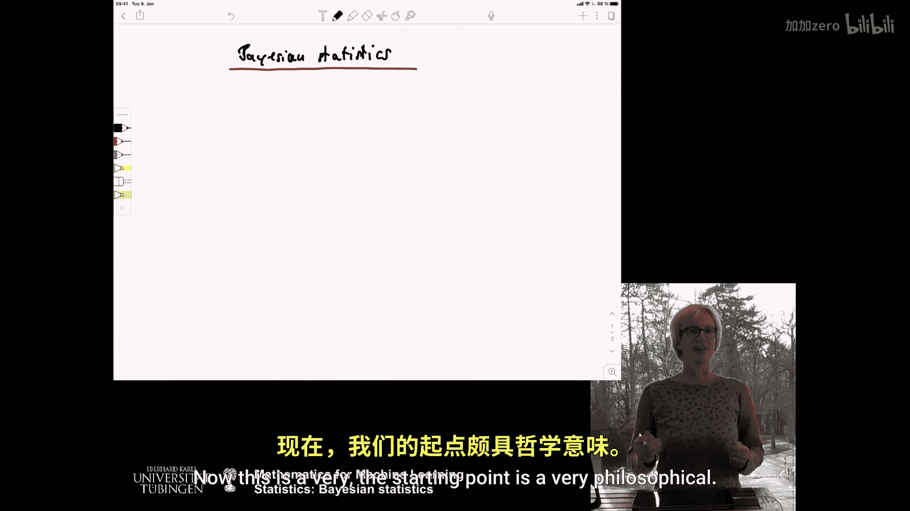
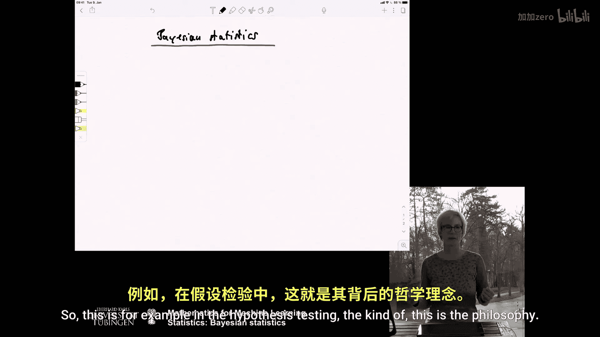

# 086：贝叶斯统计学入门 🧠

在本节课中，我们将简要了解贝叶斯统计学。到目前为止，我们学习的所有统计学内容都属于频率主义统计学。然而，统计学领域还存在一个完全不同的世界——贝叶斯统计学，我们尚未触及。

## 为何先学频率主义？🤔

之所以先重点介绍频率主义统计学，是因为它在许多科学领域应用最为广泛。同时，贝叶斯方法在机器学习中也被使用，例如在概率机器学习课程中，你会看到大量的贝叶斯推理。因此，我认为打好频率主义统计学的基础更为重要。

不过，考虑到可能有人不会选修概率机器学习课程，我希望通过这短短15分钟的讲解，为你打开贝叶斯统计学的大门。

## 两种统计哲学的起点 🧭

现在，我们从非常哲学的起点开始。传统统计学，通常称为频率主义统计学，基于以下核心理念。

### 频率主义对概率的定义

在频率主义框架下，**概率**是一个分配给在重复实验中发生的事件的数字。例如，如果我反复抛掷一枚硬币数百万次，在极限（无限次）的情况下，我可以统计硬币正面或反面朝上的频率，并用概率来表达这个频率。

所以，概率是实验无限重复时的**极限频率**。

### 频率主义对参数的看法

在统计场景中，我们想要估计的**参数**（例如正态分布的均值）被视为**常数**。它们不被当作随机变量处理。

举例来说，如果我知道数据服从正态分布但不知道其均值，那么这个均值是一个参数。我可能不知道它的值，但它是一个固定的、确定性的参数。我永远不能说“均值大于20的概率很低”这样的话，因为我不能为参数分配概率。参数只是一个确定性的量，它要么大于20，要么不大于。

因此，在这种频率主义场景下发展出的统计学（例如假设检验），其意义在于：如果我**重复进行统计推断足够多次**，那么我可以给出关于该推断有多少次会是错误或正确的保证（例如显著性水平α）。

---

上一节我们介绍了频率主义统计学的哲学基础，本节中我们来看看贝叶斯统计学的核心思想有何不同。

## 贝叶斯统计学的核心：概率即信念 🎯

贝叶斯统计学采取了一种截然不同的观点。在这里，**概率被解释为对命题合理性的主观信念程度**。这意味着，即使对于一次性事件或未知的固定参数，我们也可以谈论其概率。

### 关键公式：贝叶斯定理

贝叶斯推理的核心是著名的**贝叶斯定理**，它描述了在获得新证据（数据）后，如何更新我们对假设（参数）的信念。

其公式如下：

`P(θ|D) = [P(D|θ) * P(θ)] / P(D)`

其中：
*   **`P(θ|D)`** 是**后验概率**。表示在观察到数据 `D` 之后，我们对参数 `θ` 的信念。
*   **`P(D|θ)`** 是**似然函数**。表示在参数 `θ` 为真的情况下，观察到当前数据 `D` 的可能性。
*   **`P(θ)`** 是**先验概率**。表示在观察到任何数据之前，我们对参数 `θ` 的初始信念。
*   **`P(D)`** 是**证据**或**边缘似然**。这是一个归一化常数，确保后验概率的总和为1。通常通过积分计算：`P(D) = ∫ P(D|θ)P(θ) dθ`。

简单来说，这个定理可以理解为：

**后验概率 ∝ 似然函数 × 先验概率**

### 贝叶斯框架下的参数

在贝叶斯观点中，**未知参数 `θ` 本身被视为随机变量**。这意味着我们可以直接谈论“参数落在某个区间的概率”，例如 `P(θ > 20 | D)`，这代表了在现有数据 `D` 下，我们认为 `θ` 大于20的可信度。

---

了解了贝叶斯定理后，我们来看看贝叶斯分析的具体步骤和组成部分。

## 贝叶斯分析的工作流程 🔄

进行一次完整的贝叶斯分析通常包含以下步骤：

1.  **设定先验 `P(θ)`**：基于领域知识、历史数据或主观判断，对参数 `θ` 的分布做出初始假设。如果没有先验信息，可以使用无信息先验。
2.  **构建似然 `P(D|θ)`**：根据所选的数据生成模型（例如，假设数据来自正态分布），写出给定参数 `θ` 时观测到数据 `D` 的概率。
3.  **计算后验 `P(θ|D)`**：应用贝叶斯定理，将先验和似然结合，得到参数在给定数据下的更新后的分布。
4.  **后验推断**：基于后验分布进行决策、预测或区间估计（在贝叶斯中称为可信区间）。

### 一个简单示例：估计硬币偏差

假设我们有一枚可能不均匀的硬币，想要估计其正面朝上的概率 `θ`。

*   **先验**：我们可能假设 `θ` 在0到1之间均匀分布，即 `P(θ) = 1`（对于 0 ≤ θ ≤ 1）。这是一个无信息先验。
*   **似然**：如果我们进行了 `N` 次投掷，观察到 `k` 次正面，那么似然函数是一个二项分布：`P(D|θ) ∝ θ^k (1-θ)^(N-k)`。
*   **后验**：根据贝叶斯定理，后验分布 `P(θ|D) ∝ θ^k (1-θ)^(N-k) * 1`。这正好是贝塔分布 `Beta(k+1, N-k+1)` 的形式。
*   **推断**：我们可以计算后验分布的均值作为 `θ` 的点估计，或者计算 `θ` 的95%可信区间。

## 频率主义 vs. 贝叶斯：简要对比 ⚖️

以下是两种范式的主要区别：

| 方面 | 频率主义 | 贝叶斯 |
| :--- | :--- | :--- |
| **概率定义** | 长期频率 | 主观信念程度 |
| **参数性质** | 固定未知常数 | 随机变量 |
| **推断目标** | 估计参数真值，评估估计量的重复抽样性质（如置信区间） | 获得参数的后验概率分布 |
| **先验信息** | 不直接使用 | 通过先验分布明确使用 |
| **结果解释** | “95%置信区间”意味着：如果重复实验，95%的区间会包含真参数。 | “95%可信区间”意味着：基于现有数据和先验，参数落在此区间内的概率是95%。 |

---

## 总结与展望 📚

本节课中我们一起学习了贝叶斯统计学的入门知识。我们了解到，与将概率视为频率、将参数视为常数的频率主义不同，贝叶斯统计学将概率解释为信念，并将未知参数本身视为具有概率分布的随机变量。其核心引擎是贝叶斯定理，它指导我们如何用新数据更新旧信念。

虽然本课程以频率主义方法为主，但理解贝叶斯观点对于深入学习现代机器学习（尤其是概率图模型、贝叶斯优化等领域）至关重要。希望这简短的介绍能为你未来的学习铺平道路。