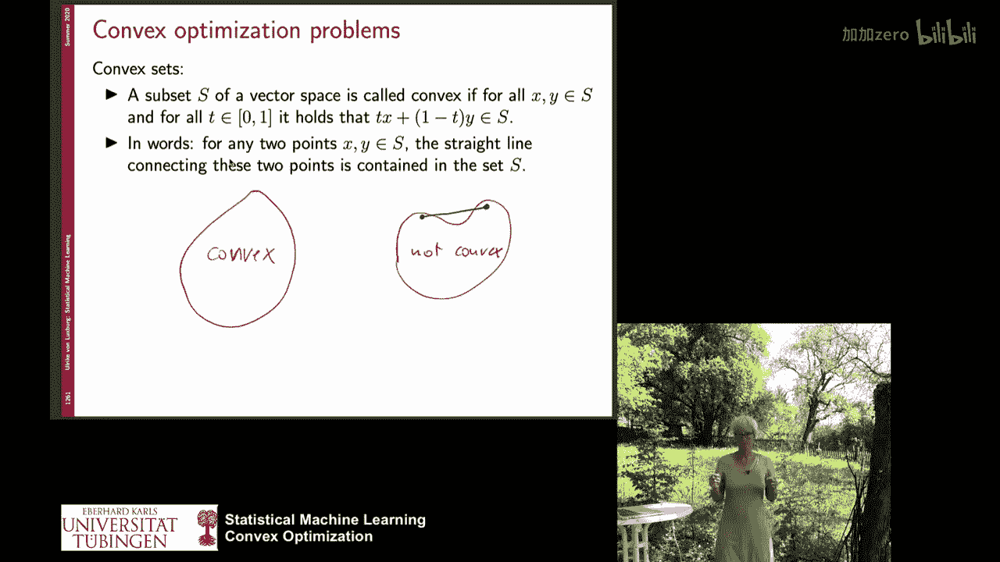
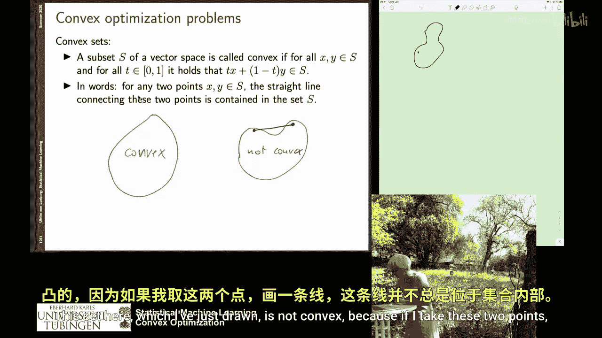
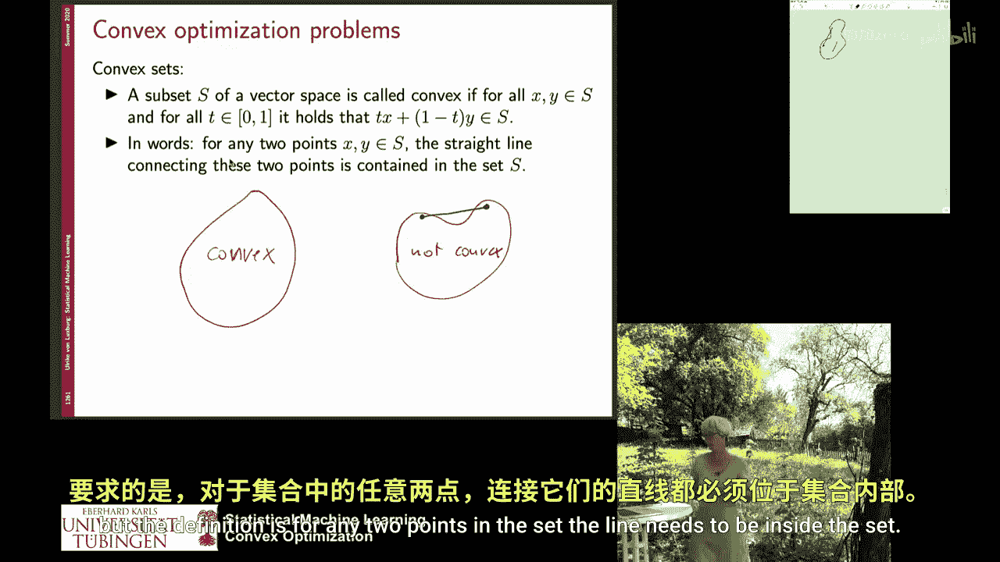
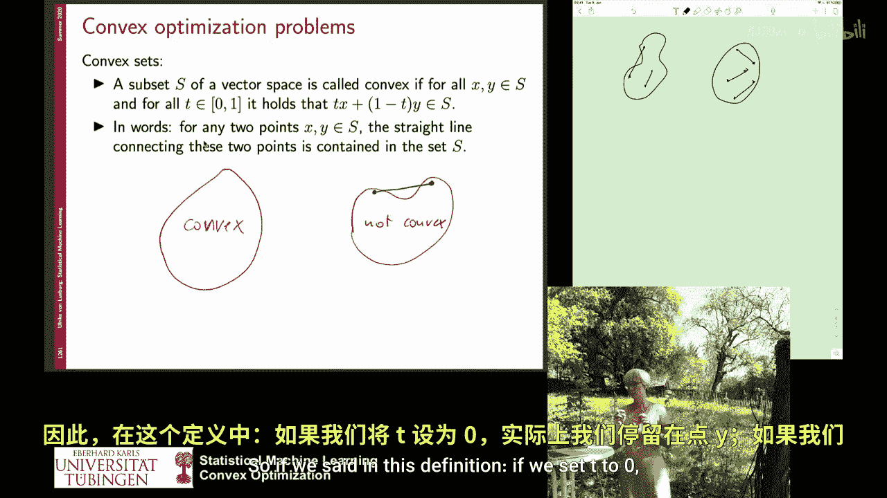

机器学习数学：7a：什么是凸优化问题

在本节课程中，我们将学习凸优化问题的定义及其重要性。凸优化是机器学习中一个非常强大的工具，因为它能保证找到全局最优解，而非局部最优解。接下来，我们将从基础概念开始，逐步构建对凸优化问题的理解。

在讨论凸优化问题之前，我们首先需要理解什么是凸集。幻灯片上展示了一些图像，可以帮助我们直观地理解这个概念。

直观地说，凸集就像幻灯片底部展示的图形那样，外部是圆滑的，并且没有任何向内凹陷的部分。

非正式的定义是：一个集合是凸集，当且仅当我在集合中任意取两点，并用一条直线连接这两点，这条直线上的所有点都仍然包含在该集合内。

让我们来看几个例子。这个我刚刚画的集合不是凸集，因为如果我取这两点并画一条线，这条线并不完全在集合内部。

需要注意的是，可能存在其他两点，其连线完全在集合内部。但凸集的定义要求，对于集合中的任意两点，其连线都必须完全在集合内部。

本质上，凸集是这样的：无论我取哪两个点，它们之间的连线总是会落在集合内部。以上就是非正式的定义。

当然，也有对应的数学公式来描述这个概念。首先需要注意的一点是，当我们谈论凸集和两点之间的连线时，我们需要一个向量空间结构。因为在没有度量或任何数学结构的空间中，我们甚至无法谈论连接两点的直线。因此，我们至少需要处在一个向量空间中。

现在给出正式定义：向量空间的一个子集 S 被称为凸集，当且仅当对于集合中的任意两点 X 和 Y，以及对于任何参数 t ∈ [0, 1]，点 `t * x + (1 - t) * y` 仍然在集合 S 中。

观察这个定义，参数 t 从 0 变化到 1，本质上就是驱动你从点 x 移动到点 y 的参数。

本节课中，我们一起学习了凸集的定义，这是理解凸优化问题的基础。我们了解了凸集的直观含义和正式数学定义，并明白了为什么需要在向量空间的框架下讨论它。在接下来的课程中，我们将以此为基础，深入探讨凸优化问题的构成及其求解方法。