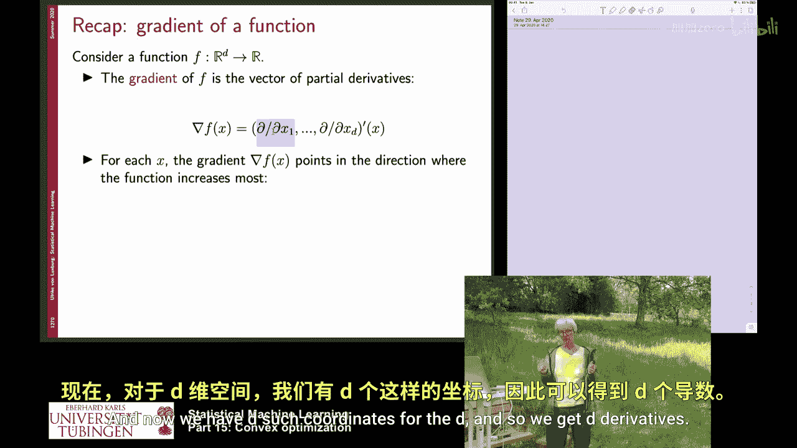

# 089：凸优化、拉格朗日函数与对偶问题 🧠

在本节课中，我们将学习如何利用拉格朗日方法解决凸优化问题。这是一种非常通用的方法，在许多情况下都能提供帮助，尤其是在支持向量机（SVM）的求解中。我们将从直观理解入手，介绍一些基本概念和定义，以便后续能够解决SVM的对偶优化问题。

## 凸优化问题简介 📈

上一节我们介绍了优化问题的基本概念，本节中我们来看看一类特殊的优化问题——凸优化问题。凸优化在机器学习中应用广泛，其文献非常丰富，甚至有专门的课程用整个学期来研究其性质与解法。这里我们仅作简要介绍，目标是掌握足够的知识来解决SVM问题。

一个凸优化问题通常具有以下形式：
$$
\begin{aligned}
\min_{x} & \quad f(x) \\
\text{s.t.} & \quad g_i(x) \leq 0, \quad i = 1, \ldots, m \\
& \quad h_j(x) = 0, \quad j = 1, \ldots, p
\end{aligned}
$$
其中，目标函数 $f(x)$ 和不等式约束函数 $g_i(x)$ 是凸函数，等式约束函数 $h_j(x)$ 是仿射函数。

## 梯度回顾 📐

在深入讨论解法之前，我们先回顾一个核心数学工具——梯度。梯度是多元函数的一阶导数向量。

对于一个从 $\mathbb{R}^D$ 映射到 $\mathbb{R}$ 的函数 $f$，其梯度定义为所有偏导数组成的向量：
$$
\nabla f(x) = \begin{bmatrix} \frac{\partial f}{\partial x_1} \\ \frac{\partial f}{\partial x_2} \\ \vdots \\ \frac{\partial f}{\partial x_D} \end{bmatrix}
$$
例如，$\frac{\partial f}{\partial x_1}$ 表示函数 $f$ 对第一个坐标 $x_1$ 的偏导数。梯度指向函数值增长最快的方向。

## 拉格朗日方法 🧩

接下来，我们将介绍解决带约束优化问题的核心方法——拉格朗日方法。这有时被看作一个“配方”，在某些条件下有效。

对于上述凸优化问题，我们引入拉格朗日函数 $L$，它将目标函数和约束结合起来：
$$
L(x, \lambda, \nu) = f(x) + \sum_{i=1}^{m} \lambda_i g_i(x) + \sum_{j=1}^{p} \nu_j h_j(x)
$$
其中，$\lambda_i \geq 0$ 和 $\nu_j$ 称为拉格朗日乘子。

## 对偶问题与KKT条件 ⚖️

通过拉格朗日函数，我们可以构造原问题的对偶问题。对偶问题有时更容易求解，并且在强对偶性成立时，对偶问题的最优值等于原问题的最优值。

以下是求解过程的关键步骤：

1.  **构造拉格朗日函数**：如上所述，引入乘子。
2.  **构建对偶函数**：对偶函数 $g(\lambda, \nu)$ 定义为拉格朗日函数关于原变量 $x$ 的下确界：
    $$
    g(\lambda, \nu) = \inf_{x} L(x, \lambda, \nu)
    $$
3.  **求解对偶问题**：对偶问题是最大化对偶函数：
    $$
    \max_{\lambda \geq 0, \nu} g(\lambda, \nu)
    $$

在最优解处，需要满足**卡罗需-库恩-塔克（KKT）条件**，这是一组最优解必须满足的条件（在函数可微等“良好”假设下）。为了简化，本教程假设所有函数都是连续可微的。

## 总结 🎯

本节课中我们一起学习了凸优化问题的基本形式，回顾了梯度的概念，并重点介绍了利用拉格朗日函数和对偶性来求解约束优化问题的方法。我们了解到，通过引入拉格朗日乘子构造拉格朗日函数，可以导出原问题的对偶问题。在满足强对偶性的情况下，求解对偶问题等价于求解原问题，这为后续解决支持向量机（SVM）的优化问题奠定了理论基础。