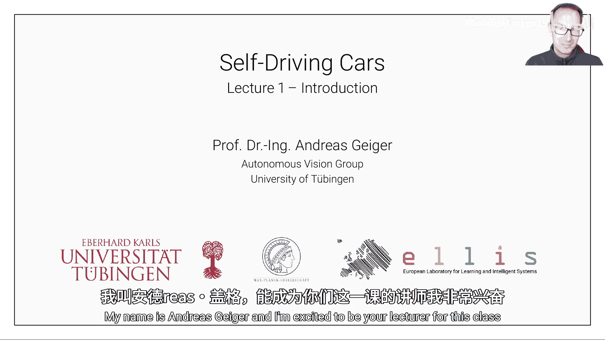
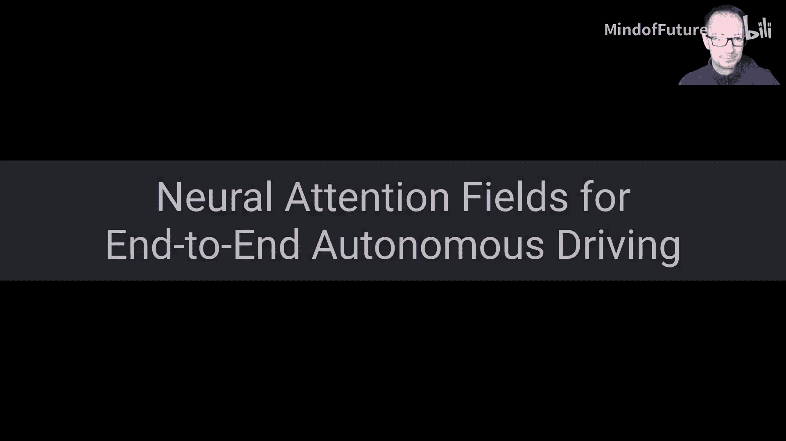
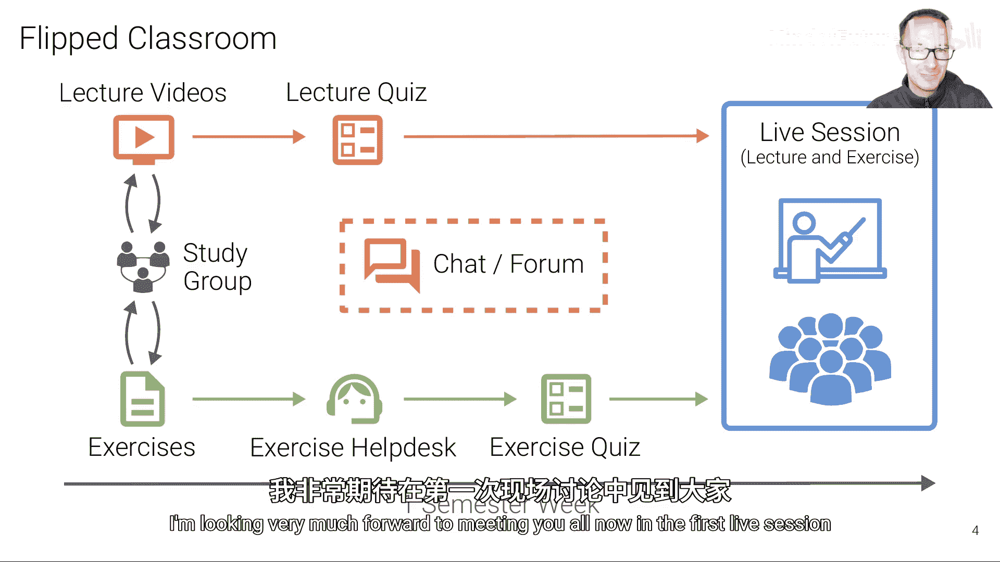

# 001：课程介绍与组织方式 🚗

在本节课中，我们将要学习自动驾驶汽车课程的基本介绍，并了解这门课独特的“翻转课堂”组织方式。

---

欢迎来到图宾根大学的自动驾驶汽车课程。我是安德烈亚·盖加，我将担任这门课的讲师。

自动驾驶一直是人类的梦想，正如这张来自20世纪50年代的插图所示。然而，这一目标至今尚未完全实现。在本课程中，我们将探讨自动驾驶技术的现状，以及未来实现自动驾驶所面临的挑战。

我的研究小组也在进行自动驾驶系统的研究。我想快速展示一下我们通过一个端到端训练系统所取得的成果。该系统仅通过观察图像和人类驾驶示范进行学习，之后便能在名为“卡拉”的模拟器中自主驾驶。

---

上一节我们介绍了课程背景，本节中我们来看看这门课的具体组织方式。

这门课程采用所谓的“翻转课堂”模式进行教学。这意味着什么？

在翻转课堂中，我们会提前提供讲课视频和练习材料。你需要观看视频并完成练习。然后，我们将在实体线下课中重聚，与所有同学一起讨论课程的全部内容。

为了提升学习动力并提供自我评估的手段，同时也为了分析课程的难点与易点，我们提供了可填写的**多项选择题测验**。参与这些测验可以为你的期末考试赢得加分，并帮助我们根据你的需求调整线下课内容。

同时，我们建议你与同学组建学习小组，共同讨论课程材料和练习。

此外，我们还提供在线练习答疑服务，助教随时准备为你解答与练习相关的任何问题。

与讲课类似，练习部分也提供**多项选择题测验**，这同样是自我评估和获取期末考试加分的机会。

在整个学习周内，我们通过在线聊天或论坛提供快速反馈。

以下是典型学习周的安排流程：

*   **观看视频**：首先观看课程视频。
*   **开始练习**：着手完成相关练习。
*   **寻求帮助**：与学习小组讨论或在聊天中提问。
*   **完成测验**：完成讲课测验和练习测验。
*   **准备问题**：带着所有问题参加线下课。

---

本节课中我们一起学习了自动驾驶课程的概况及其“翻转课堂”的组织模式。我期待在第一次线下课中与大家见面。