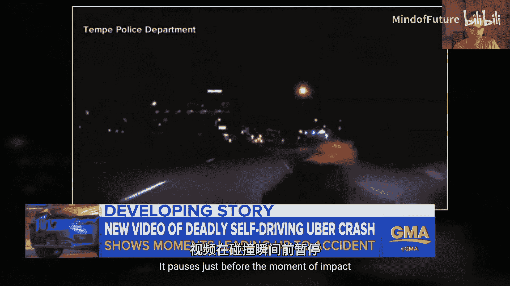
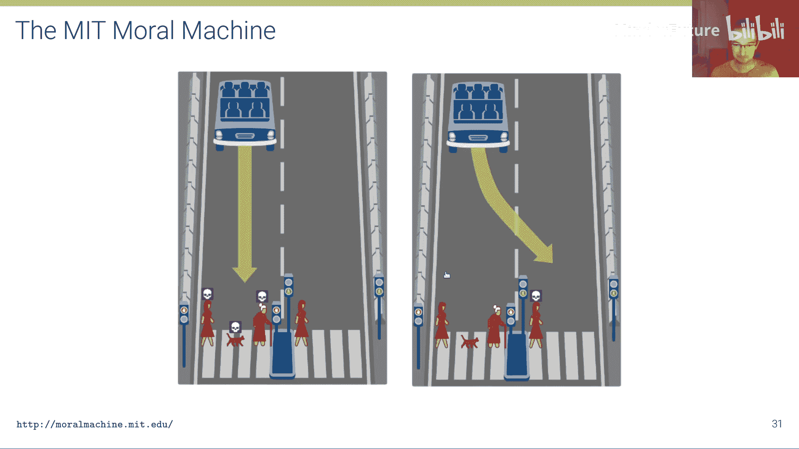
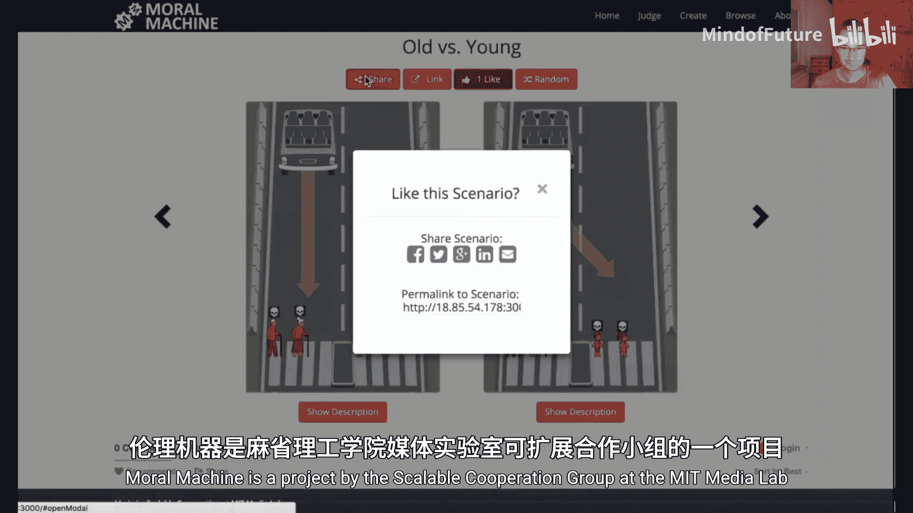
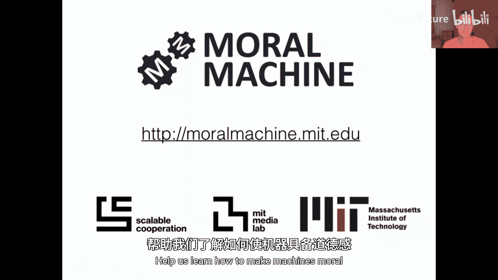

# 002：自动驾驶的挑战与愿景 🚗

在本节课中，我们将探讨为何自动驾驶汽车尚未普及，以及实现完全自动驾驶所面临的核心挑战。我们将从这项技术的潜在益处入手，分析其技术、伦理和现实障碍。

## 概述

自动驾驶技术被誉为交通领域的革命，但其发展道路远比预想的复杂。本节将系统性地介绍自动驾驶的愿景、当前面临的困难，以及一些关键的伦理困境。

## 为何需要自动驾驶？🤔

在深入探讨挑战之前，我们首先需要理解发展自动驾驶技术的根本动机。其益处主要体现在以下几个方面。

以下是自动驾驶技术的主要潜在益处：

1.  **降低事故风险**：全球交通事故伤亡数字触目惊心。仅2017年，美国有超过32,000人死于交通事故，德国超过3,000人，全球则超过100万人。超速、酒驾和分心驾驶是主要因素，而自动驾驶系统可以有效应对这些问题，未来甚至可能完全消除事故。
2.  **为特殊群体提供出行便利**：自动驾驶能为老年人和残障人士提供安全、经济的出行方式。例如，在美国，45%的残障人士仍在工作，他们需要可靠的交通解决方案。
3.  **减少污染，优化交通**：大规模部署自动驾驶汽车可以提高车辆使用率，减少所需汽车总量，从而降低制造污染。此外，车辆间可以协同运行，有效缓解交通拥堵。
4.  **推动共享出行，提升资源效率**：未来，人们可能无需拥有汽车，而是随时随地呼叫自动驾驶服务。车辆可以在途中以最优方式拼载其他乘客。据统计，普通汽车95%的时间处于闲置状态，这是巨大的资源浪费。自动驾驶可以实现车辆近乎全天候运行，极大提升效率和环保性。

## 工业界的热情与残酷的现实 🏭

基于计算能力、内存、算法和人工智能的飞速发展，过去十年工业界对自动驾驶抱有极大热情，认为其即将成为现实。

例如，优步在2018年的宣传片中展示了其自动驾驶测试车队，配备了360度摄像头、激光雷达和雷达系统，并有安全员随车监控。视频强调了通过持续测试、数据收集和软件迭代，车辆正变得越来越智能，旨在减少事故、拯救生命。

然而，同样在2018年，优步的一辆自动驾驶测试车在亚利桑那州发生了致命事故，撞死了一名横穿马路的行人。调查显示车辆在碰撞前没有显著减速迹象。这起悲剧凸显了自动驾驶技术面临的严峻挑战和风险。

## 自动驾驶为何如此困难？🛑

自动驾驶之所以困难，一个关键原因是我们可能低估了人类驾驶员的性能。从统计数据看，人类驾驶员平均每行驶1亿英里才会发生一起致命事故，错误率仅为 **0.000001%**。

在计算机视觉领域，99%的准确率已令人兴奋，但显然远不足以解决自动驾驶问题。99%的准确率意味着每100次判断就有1次错误，这在高速行驶中是不可接受的。

除了极高的可靠性要求，自动驾驶还面临一系列具体挑战：

1.  **全场景适应能力（Level 5）**：完全自动驾驶车辆必须在任何地点、任何条件下运行，包括雪天、暴雨、夜晚、无标线的非结构化道路（如停车场），并能应对行人不可预测的行为、路面反光造成的感知干扰以及快速变化的动态场景。
2.  **处理罕见与未知事件**：收集常规驾驶数据容易，但难以覆盖所有“极端案例”。机器学习模型在像人类一样稳健地泛化到未见过的场景方面，能力仍然有限。
3.  **复杂的路径规划与控制**：这不仅仅是保持车道行驶。例如，汇入繁忙的高速公路需要车辆与其他道路使用者进行复杂的“协商”和交互，这对自动驾驶系统是巨大挑战。
4.  **伦理与法律困境**：在不可避免的事故中，车辆应如何决策？这引出了著名的“电车难题”伦理思考。

## 伦理挑战：电车难题与道德机器 🧠

“电车难题”是一个经典的伦理思想实验：一辆失控的电车驶向轨道上的五个人，你可以扳动道岔让电车驶向另一条轨道，但那条轨道上也有一个人。你该如何选择？

麻省理工学院的研究团队将其转化为自动驾驶场景，创建了“道德机器”平台。该平台向公众展示各种道德困境，例如：一辆无法刹车的自动驾驶汽车，是应该撞向违规过马路的三人，还是转向撞向遵守交规的一人？

这些没有标准答案的伦理问题，是自动驾驶技术商业化前必须面对和探讨的社会议题。

## 总结

本节课我们一起探讨了自动驾驶技术的宏伟愿景与其面临的现实挑战。我们了解到，尽管自动驾驶有望大幅提升道路安全、出行效率和环保水平，但其实现之路布满荆棘。技术层面需要达到远超当前水平的可靠性与泛化能力，同时还需解决复杂的路径规划、以及深刻的伦理与法律问题。理解这些挑战，是我们深入学习后续具体技术方案的基础。