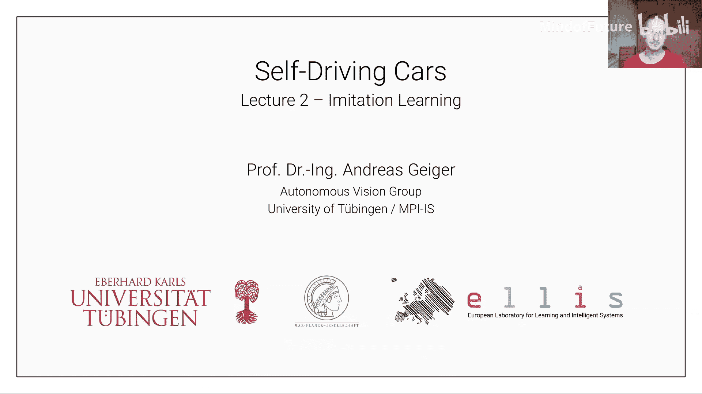
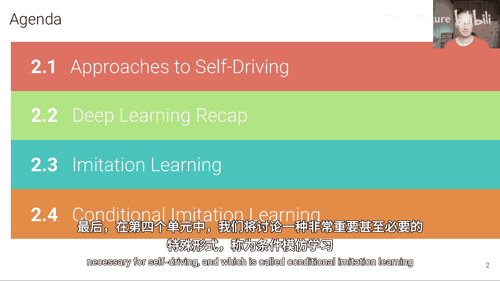
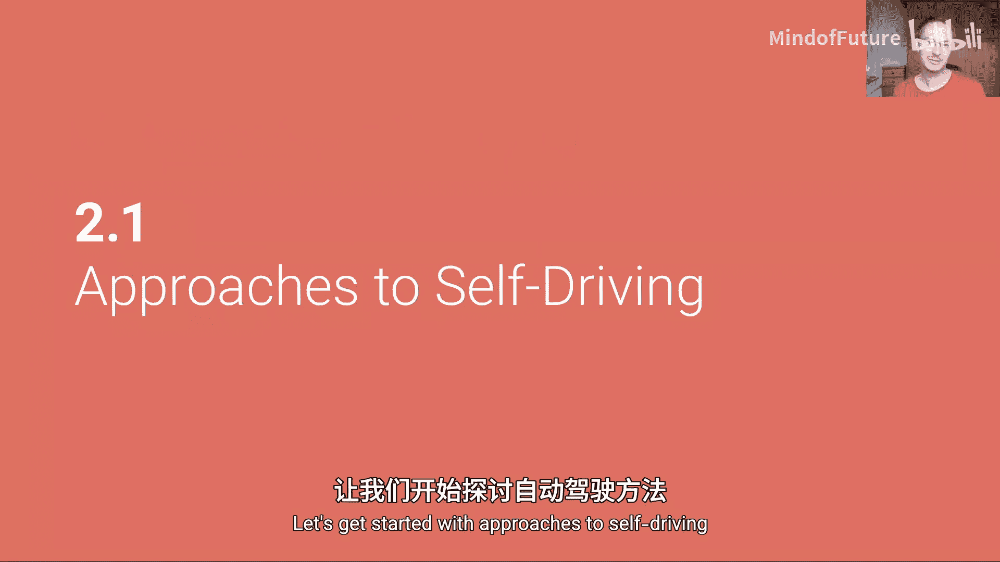
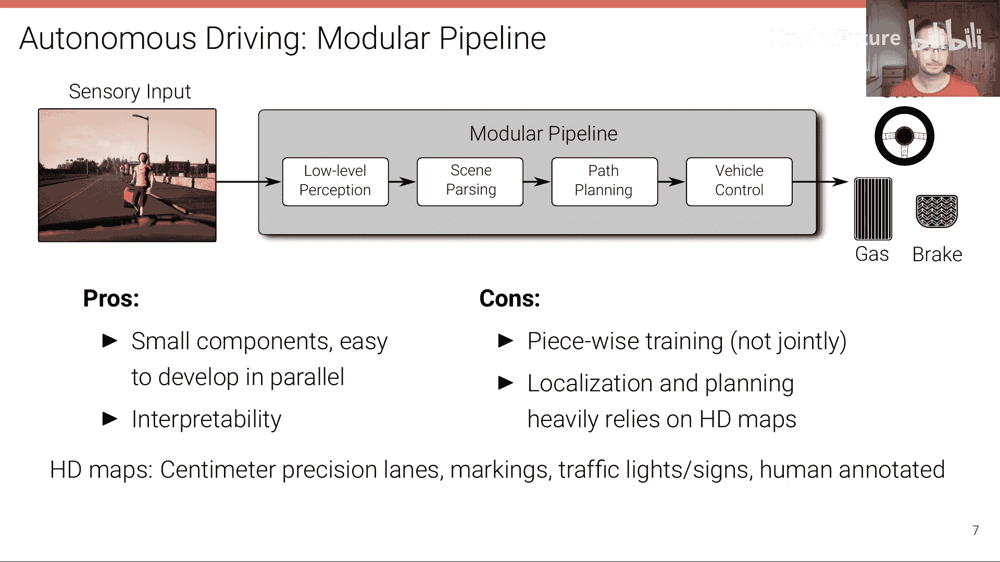
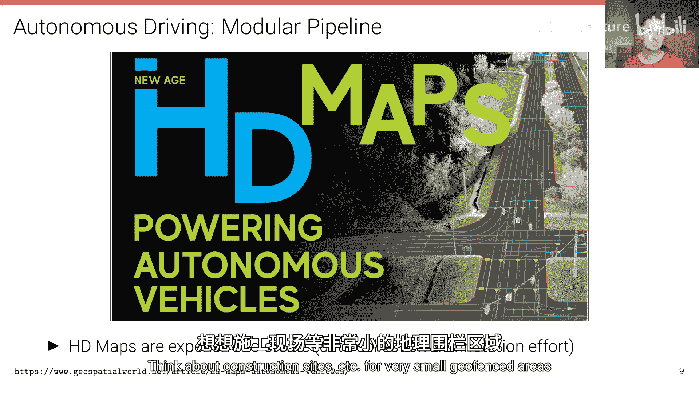
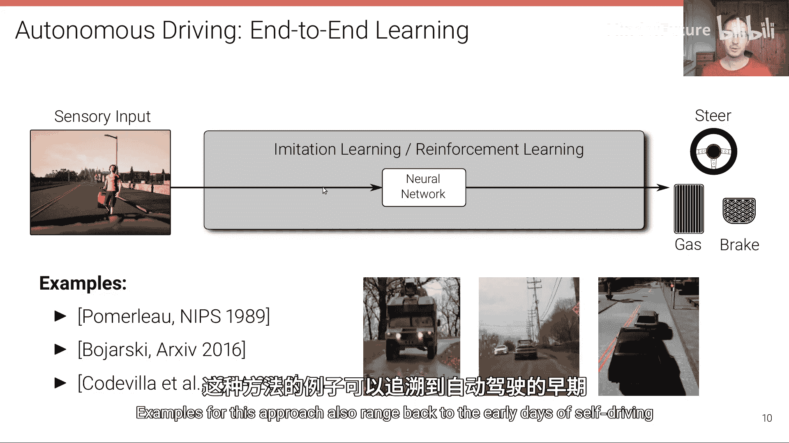
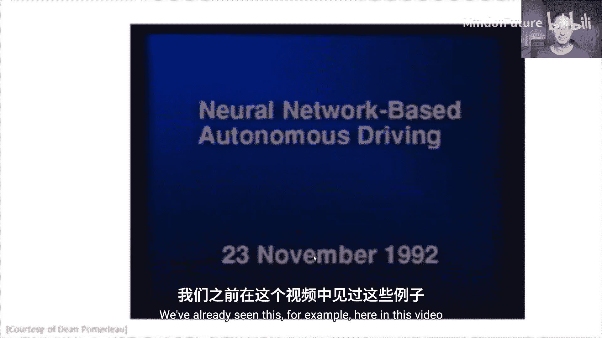
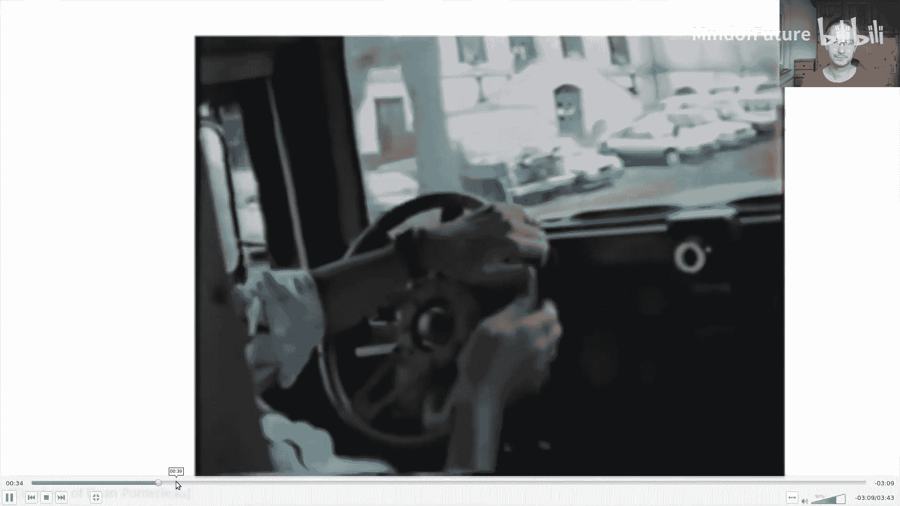
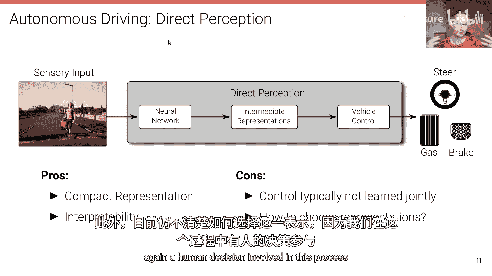

# 004：自动驾驶方法概述 🚗

在本节课中，我们将学习自动驾驶的不同实现方法。我们将从最直观的端到端学习方法开始，并重点介绍其中的模仿学习。模仿学习是目前最简单、也最有前景的自动驾驶方法之一，但同时也是实际部署最少的方法。让我们一起来探究其原因。

---

## 自动驾驶方法概览 🧩

上一节我们介绍了课程目标，本节中我们来看看实现自动驾驶的几种主要范式。

一个自动驾驶系统可以看作一个函数，它接收高维度的传感器输入（例如RGB图像、激光雷达扫描序列等），并输出低维度的控制指令（主要是转向和纵向控制）。我们的目标是找到一个鲁棒可靠的映射函数。

目前有三种主导的自动驾驶范式：
1.  **模块化流水线**
2.  **端到端学习**（模仿学习属于此类）
3.  **直接感知**

让我们逐一了解这些范式的区别。

---

### 模块化流水线 🧱

顾名思义，模块化流水线将整个自动驾驶栈分解为独立的组件。这是目前行业领导者（如Waymo、Uber、Tesla）以及早期DARPA挑战赛获胜者采用的主要范式。

以下是该流水线的一个简化示例：

1.  **低级感知**：车辆首先需要定位自身，并检测周围的车辆、建筑物、车道线等。
    *   **定位**：确定车辆在地图中的精确位置。
    *   **目标检测**：识别并框出周围的物体。

2.  **场景解析**：将感知到的所有信息整合成一个统一的、鲁棒的场景表示。这包括将车辆轨迹、消失点、车道标记等信息关联起来，形成一个关于环境的连贯理解。

3.  **路径规划**：结合高精地图信息和解析后的场景表示，在全局和局部层面规划行驶路径。
    *   **高精地图**：包含车道线、交通灯位置等丰富细节的高精度地图。

4.  **车辆控制**：执行规划好的路径，通过控制器调整方向盘、油门和刹车，使车辆沿着轨迹行驶。

**模块化流水线的优势**在于易于并行开发，且因为每个模块都由人类设计，所以系统行为相对可解释。

**然而，其劣势也很明显**：
*   **无法进行端到端联合训练**：每个模块都在不同的数据上针对不同的子任务（如检测框的准确性）进行优化，而非直接针对最终的驾驶性能进行优化。
*   **依赖高精地图**：当前的定位和规划严重依赖高精地图，而制作和维护这些地图需要大量人力，成本高昂且难以覆盖所有区域。

---

### 端到端学习 🔄

与模块化方法相反，端到端学习将“从传感器输入到控制指令”的映射视为一个整体的函数，通常用一个神经网络来表示。

这个神经网络可以通过不同的算法进行训练，其中最重要的两种是：
*   **模仿学习**
*   **强化学习**（我们将在后续课程中学习）

这种方法历史悠久，例如早在80年代的ALVINN项目，以及现代英伟达的自动驾驶演示，都采用了模仿学习的思路。

**端到端学习的优势**：
*   **直接优化最终目标**：模型直接学习驾驶任务，避免了子任务优化与最终目标不一致的问题。
*   **数据标注成本低**（特指模仿学习）：只需在车上安装摄像头和传感器，记录人类驾驶时的画面和操作，即可自动收集训练数据。

**其劣势包括**：
*   **泛化能力**目前通常不如模块化流水线。
*   **缺乏可解释性**：神经网络像一个“黑盒”，难以理解其内部决策逻辑。

---

### 直接感知 🎯

直接感知是上述两种方法的混合体。它仍然有一个模块化的结构，但保持了端到端训练的可能性。

具体来说，系统首先用一个神经网络从输入图像中预测出一个**中间表示**（例如语义分割图，或一组关键的“可驾驶性”参数），然后再用另一个神经网络或传统的车辆控制器，根据这个中间表示生成控制指令。

**直接感知的优势**在于其中间表示既紧凑又可解释。

**其挑战在于**：
*   如何选择合适的中间表示（这又引入了人为设计）。
*   如何有效地联合训练感知模块和控制模块。

---

## 总结 📝

本节课我们一起学习了自动驾驶的三种主要方法：**模块化流水线**、**端到端学习**和**直接感知**。模块化流水线结构清晰、可解释性强，但依赖高成本地图且非端到端优化；端到端学习直接针对驾驶任务进行优化，数据收集方便，但可解释性和泛化能力是挑战；直接感知则试图在两者之间取得平衡。在接下来的章节中，我们将深入探讨端到端学习中的核心方法——模仿学习。