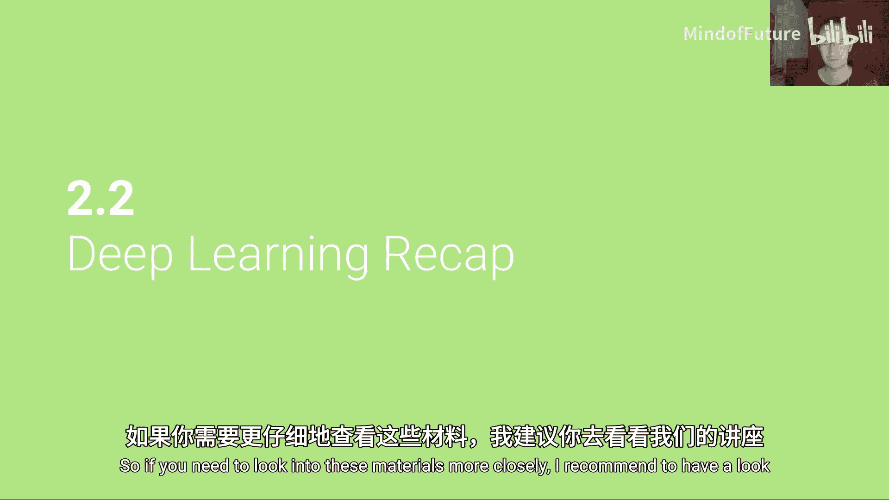
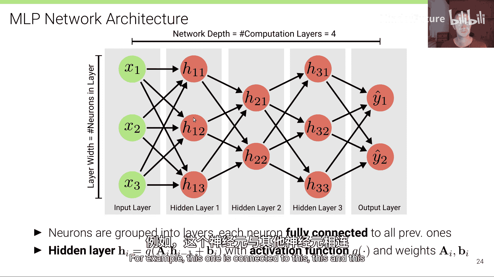
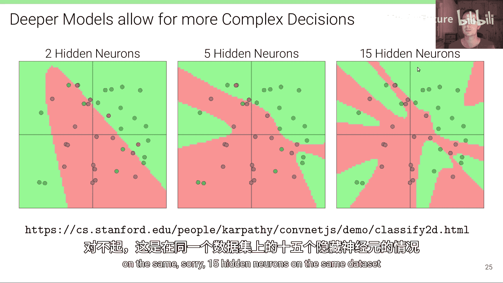
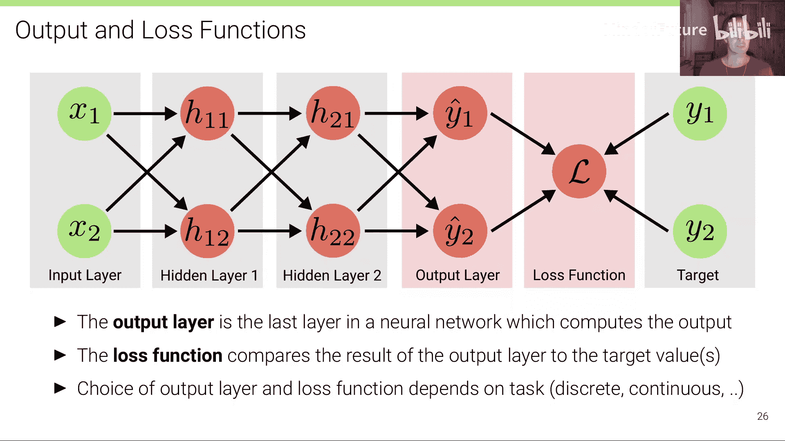
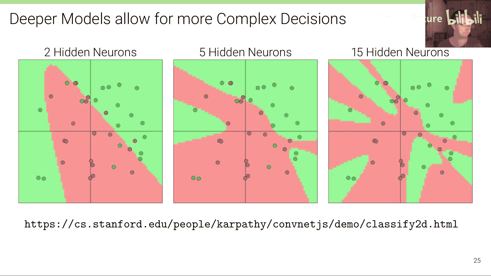
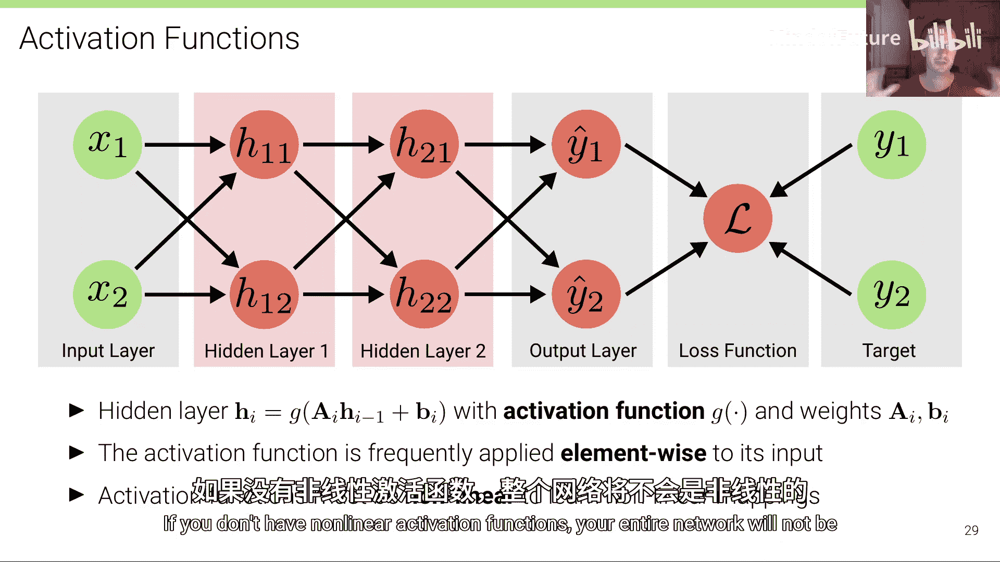
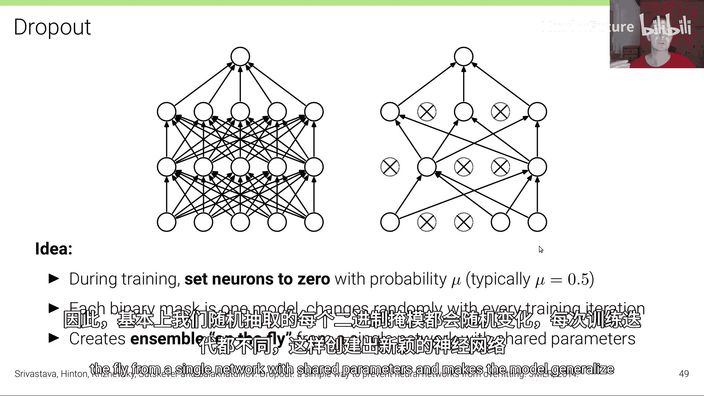
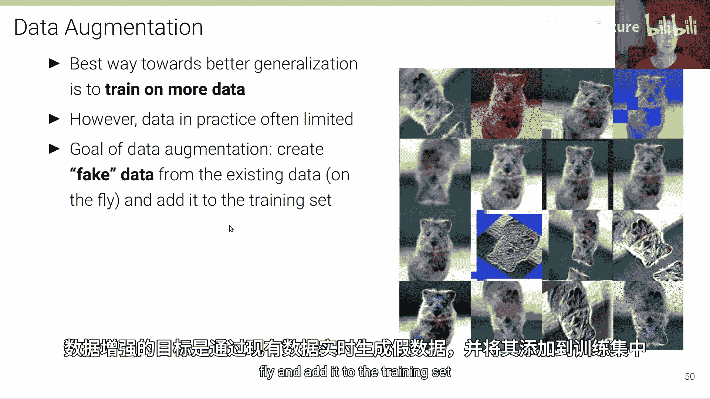

# 005：模仿学习 - 深度学习回顾 🧠

在本节课中，我们将要学习深度学习的基础知识，这对于理解本课程后续讨论的许多算法至关重要。虽然深度学习是本课程的先修内容，但我们认为进行一次快速回顾是很有必要的。本次回顾浓缩了图宾根大学深度学习课程前七讲的核心内容，我们将以较快的速度进行梳理。如果你需要更深入地了解这些材料，建议查阅我们的完整课程。

## 监督学习概述

上一节我们介绍了课程背景，本节中我们来看看机器学习的核心问题之一：监督学习。在模仿学习等场景中，我们同样会用到监督学习。

监督学习涉及一个参数化模型 **F**，其参数为 **W**。该模型接收输入 **X** 并预测输出 **Y**。输入可以是一张图像，输出可以是车辆的控制指令。

监督学习包含两个任务：
1.  **学习任务**：从包含 **(x, y)** 对的数据集中估计参数 **W**。
2.  **推理任务**：在给定训练好的模型（即参数 **W**）后，如何进行新的预测。

## 线性分类器

让我们从最简单的线性分类器——逻辑回归器开始回顾。

其数学公式如下所示。我们首先对输入 **X** 进行仿射变换（线性变换），即乘以权重 **W** 并加上偏置 **W₀**。然后将结果（一个标量）通过一个逻辑函数（Sigmoid 非线性函数）进行处理。Sigmoid 函数的形式如下，它将输入值的范围压缩到区间 **(0, 1)**，这个结果就代表了预测类别的概率。

决策边界位于 Sigmoid 函数参数等于 0 的位置。换句话说，即 **Wᵀx + W₀ = 0**。如下图所示，当 **Wᵀx > -W₀** 时，我们判定为类别 1，否则判定为类别 0。

那么，这个简单的分类器能解决什么问题呢？

以下是第一个问题：逻辑“或”(OR)运算。左侧以表格形式展示，右侧以图形形式展示。我们有一个二维输入，如果两个值中任意一个为 1，则输出为 1（图中绿色点，类别 1）；否则输出为 0（仅在坐标 (0,0) 处，图中红色点，类别 0）。

我们可以找到一个分类器，完美地将这两组点分开，如下所示。我们画一条线，清晰地将所有红点与所有绿点分开，其数学形式如顶部所示。

类似地，我们可以定义逻辑“与”(AND)运算符。图中这三个点是红色的，只有当 **x₁** 和 **x₂** 同时为 1 时，输出才是类别 1（绿色），否则是类别 0（红色）。与之前类似，我们可以定义一个线性分类器，用这里的公式表示，将红点与绿点分开。

我们还可以定义“与非”(NAND)运算符，它只是将“与”运算的结果取反。

现在的问题是，“异或”(XOR)运算符如何处理？“异或”运算如下所示：如果 **x₁** 或 **x₂** 中有一个为 1 而另一个为 0，则预测类别 1，否则预测类别 0。在这种情况下，问题变得复杂了。没有单一的决策边界可以正确分类这个数据集，无论是这样还是那样都不行。

那么，我们该怎么办？

## 特征提升与非线性分类

解决这个问题的一个方案是将特征，即二维特征空间，提升到一个更高维的特征空间。例如，考虑这里的特征空间，我们不仅拥有 **x₁** 和 **x₂**，还拥有它们的乘积 **x₁ × x₂**，如右图所示。现在，我们有了一个三维特征空间。你可以看到，右侧的这个点现在被“提升”到了顶部，因为只有对于 **x₁ × x₂**，第三个特征值才为 1。

在这种情况下，在这个三维特征空间中，我们实际上可以找到一个线性分类器，一个线性超平面，将这两个类别彼此分开，如图所示。换句话说，**非线性特征使得线性分类器能够解决非线性分类问题**。我们改变了表示方式，改变了特征空间，因此线性分类器能够解决之前无法解决的问题。

这是另一个例子。左侧的这个数据集无法被线性分离。但是，如果我们使用极坐标（半径 **r** 和角度 **θ**）来表示这个数据集，那么我们可以清晰地找到一个线性决策边界来区分这些点。

但是，如何选择这种变换？我们实际上应该如何改变表示？如果想手动完成，这在实践中可能非常困难。然而，在 2000 年代之前，手动设计特征空间是视觉和语音领域的主流方法。而在深度学习或表示学习中，我们希望从数据本身学习这些表示和变换，这当然方便得多。

## 组合分类器与神经网络雏形

让我们再看一下“异或”问题，你可以在右下角看到。为了正确分类这个数据集，我们可以做的是：这里可以有一个决策边界，代表“或”(OR)运算；这里可以有另一个决策边界，代表“与非”(NAND)运算。然后我们可以将这两个结合起来，得到“异或”运算。

用公式表示，**x₁** 和 **x₂** 的“异或”运算，等于对 **x₁** 和 **x₂** 进行“或”运算的结果，与对它们进行“与非”运算的结果，再进行一次“与”运算。通过简单地组合这三个运算，我们得到了“异或”运算。

这也可以写成一系列逻辑回归器的程序。以下是上一张幻灯片的表达式。我们可以将其写成一个程序，因为其中每个组件都是我们已经了解的内容。例如，前面我们已经看过“与”运算的具体公式，等等。

因此，逻辑回归器的程序如下所示：我们用“或”运算变换 **x**，得到一个隐藏特征值 **h₁**。我们用“与非”运算变换 **x**，得到另一个隐藏特征 **h₂**。我们将这两个连接成一个向量 **h**，然后用“与”运算对其进行变换，得到预测结果。

这可以写成右侧的计算图，其中绿色节点是输入，橙色节点是参数，红色节点是中间节点或输出节点。注意，**h(x)** 是 **x** 的非线性特征，因为这里的 Sigmoid 非线性函数。我们称 **h(x)** 为一个**隐藏层**。

## 多层感知机 (MLP)

这可以推广，其推广形式称为**多层感知机**，简称 **MLP**。MLP 是前馈神经网络，不像循环神经网络那样有任何反馈。它们组合了多个非线性函数。例如，**f(x)** 可以表示为 **ŷ(h₃(h₂(h₁(x))))**，简单地将这些隐藏特征堆叠起来，直到得到输出。

数据只指定输出层的行为，因此得名“隐藏”。每一层 **i** 包含多个神经元 **j**，每个神经元通过仿射变换 **aᵀx + b** 实现，后接一个非线性激活函数，例如 Sigmoid 函数。更一般地，我们在这里用 **g** 表示激活函数，因为它可能是不同的激活函数，我们很快会看到一些激活函数。

在 MLP 中，每一层的每个神经元都完全连接到前一层的所有神经元。整个链的长度就是模型的**深度**，因此称为**深度学习**。隐藏层越多，我们的模型就越深。

这是一个例子：有一个输入层，然后三个隐藏层，一个输出层。我们说这个网络，因为它有三个隐藏层和一个输出层，所以深度为 4。输入层不计入深度。另一方面，**宽度**是指每一层有多少个神经元。这里你可以再次看到，神经元被分组到各层，每个神经元都完全连接到前一层的所有神经元。例如，这个神经元连接到这个、这个和这个。

## 深度与模型复杂度

更深的模型允许更复杂的决策。这里有一个例子，我取自 Andrej Karpathy 的优秀网站，该网站有一个实时演示，你可以在其中对数据进行分类并做许多其他有趣的事情。你可以看到具有两个隐藏层、五个隐藏层和 15 个隐藏神经元的神经网络在相同数据集上的决策边界。

所以，深度和宽度当然都决定了决策可以有多复杂。

## MLP 的组成部分

我们来谈谈多层感知机的组成部分。

**输出层**是神经网络中的最后一层，它计算图中红色部分所示的输出。在输出之后，我们有一个**损失函数**，它将神经网络的输出与右侧绿色部分所示的一些期望目标值进行比较。

输出层和损失函数的选择取决于任务。例如，如果我们想预测离散值（如图像类别）或连续值（如车辆转向角）。

关于输出层：
*   对于分类问题，我们通常使用 Sigmoid（二分类）或 Softmax（多分类）非线性函数来获得概率值。
*   对于回归问题，我们可以直接返回最后一层之后的值，因为它是连续的。所以，我们在最后一个仿射变换之后不应用任何非线性函数。

损失函数也因任务而异：
*   对于分类问题，从最大似然原理推导出的损失函数是**交叉熵损失**，或在二分类情况下的**二元交叉熵损失**。
*   对于回归问题，我们可以使用标准的 **L1** 或 **L2**（欧几里得）损失。当然，还有很多其他选择。

每个隐藏层都有一个**激活函数**。回顾上一张幻灯片，一个隐藏层有一个线性变换加上一个非线性变换 **g**，**g** 被称为激活函数。激活函数通常以逐元素的方式应用于其输入，所以它实际上是一个只对标量进行操作的函数。

激活函数必须是非线性的，以便通过网络学习整体上的非线性映射。如果没有非线性激活函数，你的整个网络将不会是线性的。

以下是一些激活函数的例子：左上角是已知的 Sigmoid 函数，右边是流行的 **ReLU** 函数，它计算效率高，并且在梯度方面不会饱和。左下角还有很多其他函数。人们根据问题使用不同的激活函数，选择通常是经验性的，需要尝试不同的激活函数。

## 卷积神经网络 (CNN)

对于处理图像（如自动驾驶中的情况）特别重要的是**卷积神经网络**。

多层感知机的问题在于它们无法扩展到高维输入。如果你有一张百万像素的图像，那么你将会有非常多的连接和权重，这些权重很难学习并且需要大量内存来存储。

因此，卷积网络将数据表示为三维形式。在这种情况下，输入以图像的宽度和高度表示，第三维是深度，代表特征通道或特征图的数量。卷积网络交错使用离散卷积、非线性激活函数（如 ReLU 或 Sigmoid）以及池化操作，以减小下一层的空间维度。

卷积神经网络的关键思想是：
1.  利用**稀疏交互**。
2.  大量使用**参数共享**。
3.  学习**等变表示**，这意味着如果我将输入平移，那么卷积层的输出特征也会被平移，这是一个理想的特性，是图像处理中非常有用的归纳偏置。例如，如果我想检测物体，那么我希望无论物体出现在图像中的哪个位置，都能以相同的方式检测到它。

让我们更仔细地看一下这一点，这是全连接层与卷积层的比较。

在左侧，你可以看到全连接层，这里的输入也是一幅图像。在右侧，你可以看到对应的卷积层。你已经可以看到，全连接层有更多的权重，因为每个输入（每个宽度 **W**、高度 **H** 和通道数 **C_in**，再加上偏置）都连接到每个输出元素。因此，我们得到这个乘积与输出宽度 **W'**、高度 **H'** 和输出通道数 **C_out** 的乘积。

相比之下，卷积层的权重要少得多。在这里，对于这个输出，我们只连接位于同一位置的卷积核元素。因此，如果我们假设一个 3x3 的卷积核，那么我们不是连接所有输入，而是只连接 3x3 乘以通道数到这个输出。当然，这里我们也有一个偏置 (+1)。并且我们对所有位置使用相同的权重，我们将这个滤波器应用于输出的所有位置，但使用相同的权重。这就是为什么权重不会被复制。所以，我们在这里的权重数量减少了，这里的 **W** 和 **H** 也直接消失了。

但我们为每个输出通道单独进行此操作，所以我们这里仍然有 **C_out**。这就是所谓的**权重共享**，它负责减少参数数量，并使这些模型非常高效且具有等变性。

所有这些卷积操作，就像全连接操作一样，后面都跟着一个非线性激活函数，如 ReLU 或 Sigmoid。

这是卷积核在输入上滑动方式的示意图。

卷积的一个问题是，如果我们直接应用卷积，那么我们将无法计算图像边界处的值，因为卷积核会超出图像边界。为了应对这一点，并允许网络在卷积操作本身期间保持规范的图像尺寸（不改变张量的维度），一个简单的想法或解决方案是使用所谓的**填充**。我们在图像周围添加一个人工边界，用零填充或镜像图像的最后几行和几列。这有不同的变体。然后，如果我们这样做，当然，我们就可以计算并应用这个卷积核，并计算输出张量边界处的这些元素。这就是卷积操作。

## 池化操作

除了卷积操作，在图像分类以及基于图像输入为自动驾驶做决策的情况下，我们希望将信息缩小到一个单一值，因此我们需要快速减少空间维度。我们通过将池化操作与卷积交错进行来实现这一点。所以，这里我们有一个卷积，然后我们通过对附近的值进行平均或最大池化来简单地降低空间分辨率。

典型的池化操作将输入张量的空间维度减少两倍。通常，在减少空间维度时，特征通道的数量会增加，以保留或增加容量，因为我们正在失去空间分辨率，我们需要增加容量来存储所有相关信息。

下采样也增加了**感受野**的大小。感受野是原始输入中如果发生改变会影响输出的区域。如果我使用池化操作，将整个图像下采样到一个像素，那么当然，输入像素的任何变化都会改变这唯一的输出。

这是一个池化操作的例子。这是一个简单的池化操作，它计算所有这些值的平均值、均值或最小值，并将其填入这个单元格，然后我们在这里、这里和这里做同样的事情。你可以看到输入的维度是如何被减小的。

通常，卷积网络在最后，在将所有内容展平为空间维度基本为一个像素（即一个向量）之后，包含几个全连接层。然后，我们可以应用几层标准的 MLP 来得出我们的决策。这就是卷积网络的概要。

## 优化：梯度下降

现在我们来谈谈优化。为了优化神经网络，我们需要应用基于梯度的优化技术，因为神经网络的损失景观当然是非凸的，因为这些模型相对于参数是高度非线性的。

我们从某个特定点开始，然后沿着梯度方向前进，直到达到局部最优解。存在多个局部最小值，但显然，通过梯度下降我们只会找到一个。但好消息是，已知深度网络中有许多局部最小值是好的，所以无论我们陷入哪个局部最小值，大致来说，我们都有很大机会陷入一个好的局部最小值。这就是深度学习效果如此出色的魔力所在。

从数学上讲，我们想要找到最优参数 **W***，它是损失函数的最小值点。我们想要找到参数 **W** 的优化值，它是损失函数的极小值点，其中 **𝒳** 是数据集，**W** 是参数。我们想要最小化关于参数 **W** 的损失函数。

这是一个简单的梯度下降更新循环。当然，为了应用梯度下降，我们需要计算损失函数 **L** 关于参数 **W** 的梯度，它出现在梯度更新规则中。我们使用所谓的**反向传播算法**来计算，该算法使用动态规划来重用计算，以便高效地计算损失函数相对于所有可能数百万个参数的梯度。

它如何工作的概要：首先，通过计算图的前向传播高效地计算值或激活值。这是一个简单的计算图，包含一些输入、参数、隐藏层、输出层和一个损失层。我们简单地遵循计算图来计算所有值。然后，我们通过沿着这些边反向传播梯度来计算导数，并再次使用动态规划来计算所有这些梯度。

然而，我们需要为每个数据点进行一次前向和反向传播。如果我们想计算损失函数的梯度，而损失函数当然是相对于整个数据集的，并且需要在整个数据集上进行损失最小化，那么我们需要为训练集中的每个数据点或数据样本 **(xᵢ, yᵢ)** 计算损失函数关于参数的梯度。这对应于最大似然估计。

## 随机梯度下降 (SGD)

那么梯度下降算法是如何工作的呢？首先，我们将权重初始化为某个随机值。我们应该巧妙地做到这一点。有各种技术可以为神经网络正确初始化，例如 Xavier 或 He 初始化。然后我们选择一个学习率 **η**。

然后，对于我们训练集中的所有数据点，我们通过前向传播将训练元素 **x** 通过网络以计算相应的预测，然后通过反向传播获得梯度。然后我们使用梯度更新规则更新梯度。如果验证误差减小，我们转到步骤 2，否则我们认为已经收敛。

然而，这样做的挑战在于，通常有数百万个参数，所以 **W** 的维度非常大。而且，通常也有数百万个训练点。因此，计算总和非常慢，变得极其昂贵，有时甚至无法装入内存。

那么，我们能做什么？解决这个问题的方案叫做**随机梯度下降**。

其思想如下：整个训练集上的总损失可以表示为一个期望值。所以，这是 1/N（N 是训练集大小）乘以所有损失函数的总和，这里为了简洁明了，省略了 **x** 和 **y**，直接将索引加到 **L** 上。所以，这当然是损失函数在数据分布上的期望。

这个期望可以用一个更小的子集来近似，其中子集 **B** 的基数远小于整个训练集的基数（可能是数百万张图像），**B** 可能只有 64、32 等。这被称为**小批量大小**。因此，我们通过基于采样的估计来近似这里的期望，我们只需采样子集 **B**，并计算损失函数的平均值。因此，梯度也可以用这个子集来近似，所以我们也可以计算这个的梯度，它近似于我们实际想要计算的梯度。这就是**小批量梯度**。

随机梯度下降的工作方式如下，与之前非常相似，但现在使用小批量：
1.  初始化权重。
2.  选择学习率和小批量大小 **B**。
3.  在每次迭代中，从整个训练集中随机抽取大小为 **B** 的小批量。
4.  对于所有小批量元素，通过前向传播将输入通过网络以计算预测。
5.  然后通过反向传播获得批量元素梯度。
6.  然后更新梯度。
7.  如果验证误差减小，转到步骤 3，否则停止。

现在，这比以前快得多，因为当然，这里我们只对 **B** 个批量元素进行这个内部循环，而不是对整个训练集进行。

随机梯度下降有很多变体。其中一些使用一些技巧来更好地工作，例如带动量的 SGD、Nesterov 动量、RMSprop 或 **Adam**。Adam 由于结合了动量和梯度缩放，具有鲁棒性，是迄今为止最常见的选择之一。

## 学习率调度

如何设置学习率也很重要。固定的学习率通常在训练开始时太慢，在训练后期太快。因此，典型的学习率调度会调整学习率。它们以较高的学习率开始，然后在训练过程中降低学习率。

有不同的方法可以做到这一点。例如，可以使用指数衰减，或者一种非常传统、标准的方法是每隔一定迭代次数（比如每 **K** 次迭代）将学习率减半或逐步降低，如图所示。所以你可以看到，在这个学习率下，误差不再下降。但当我们改变学习率时，误差率会急剧下降。然后在这里再次发生。所以，适当地调整学习率确实有影响。

## 正则化

正则化当然很重要，因为我们处理的是一个具有许多参数的高容量模型。众所周知，如果我们的参数太少，模型会**欠拟合**，容量太低。另一方面，如果参数太多，那么我们会**过拟合**。我们很好地拟合了绿色的训练点，但没有很好地拟合蓝色的测试点。

这里的出路是**正则化**。我们取一个原本会自然过拟合的模型（来自第三个区域），但通过应用正则化器，将其带到第二个区域。

同样，有多种方法可以做到这一点。我将快速介绍其中一些。最常见的是**早停**。早停是一种非常朴素的方法，通过监控验证损失来避免过拟合，并在验证误差再次开始增加时停止训练。开始时，它下降。然后在某个点，训练损失继续下降，但验证损失开始增加。但我们希望找到验证损失最小的点。因此，我们将训练集分成两部分：训练集和验证集，并使用验证集来监控验证误差。这也可以用图来说明。这里是参数空间（本例中只有两个参数），这里是能量函数（损失函数，绿色）。这是训练损失。**W*** 是根据训练损失得出的理想参数集，但不是根据验证损失。那么，如果我们早停会发生什么？我们遵循这个轨迹，也许从参数 (0,0) 开始，然后遵循这个轨迹，但我们不会一直沿着训练景观走下去，而是在验证误差开始增加时停在这里。

类似地，我们可以使用 **L2 正则化**。我们可以直接在参数 **W** 上施加一个 L2 惩罚，通过将参数 **W** 的欧几里得范数添加到损失函数中。这个惩罚迫使正则化损失的最小值更接近原点，因此也起到了正则化的作用。这是未正则化的训练目标，其中最优点（最优值）是 **W***。这些是 L2 正则化器的等值面。而正则化的最优点 **W̃** 是 0 和 **W*** 之间的折衷，在这种情况下位于这里。

## Dropout 与数据增强

**Dropout** 是另一种正则化技术，它利用了集成学习的思想，即让许多不同的网络进行预测并平均这些预测。这里的想法非常简单。在训练期间，我们简单地以一定的概率随机将一些神经元设置为 0。基本上，我们随机抽取的每个二元 Dropout 掩码，在每次训练迭代中都会随机变化，因此从同一个神经网络中动态创建了一个新的神经网络。从而避免了神经网络权重的共同适应，并从具有共享参数的单个网络中动态创建集成，使模型在测试时泛化得更好。

在训练神经网络时，同样非常重要（正如你将在本课程相关的编程挑战中看到的那样）的是**数据增强**。实现更好泛化的最佳方法是使用更多数据进行训练。一切都与数据、数据、数据、数据有关。数据就是一切。

但在实践中，数据集通常是有限的。即使你有一个模拟器，通常也很难创建无限量的数据。现实中更是如此。数据增强的目标是从现有数据中动态创建虚假数据。

并将其添加到训练集中，我们通过稍微扰动数据来实现这一点，例如通过一些仿射变换、添加噪声、稍微改变输入的颜色或丢弃输入的某些区域。

重要的是，新数据也必须保留语义。如果我想预测特定的动物，那么当然，输入图像中的动物应该能被人类识别，它不应该变成不同的动物。例如，如果我有一个字符“6”，把它倒过来就变成了“9”，所以这是我不应该做的增强。但即使是像平移或添加逐像素噪声这样非常简单的操作，通常也能极大地改善泛化能力，这是你应该始终考虑的。

在自动驾驶的情况下，改变摄像机的视角也很有帮助，这在模拟中也很容易做到。有一些好的库可以使用，可以直接从你的数据中提供增强数据。

## 总结

本节课中我们一起学习了深度学习的基础回顾，涵盖了监督学习、线性与非线性分类、多层感知机、卷积神经网络的核心概念，以及训练神经网络的关键技术：梯度下降、随机梯度下降、学习率调度和各种正则化方法（如早停、L2正则化、Dropout和数据增强）。这些知识是理解后续自动驾驶算法，特别是模仿学习的基础。