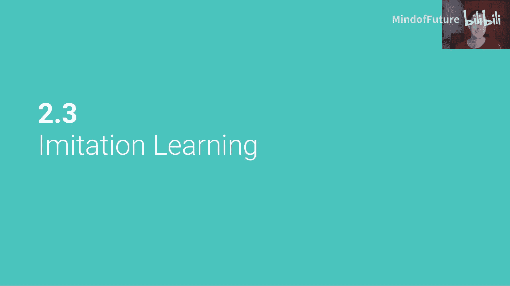
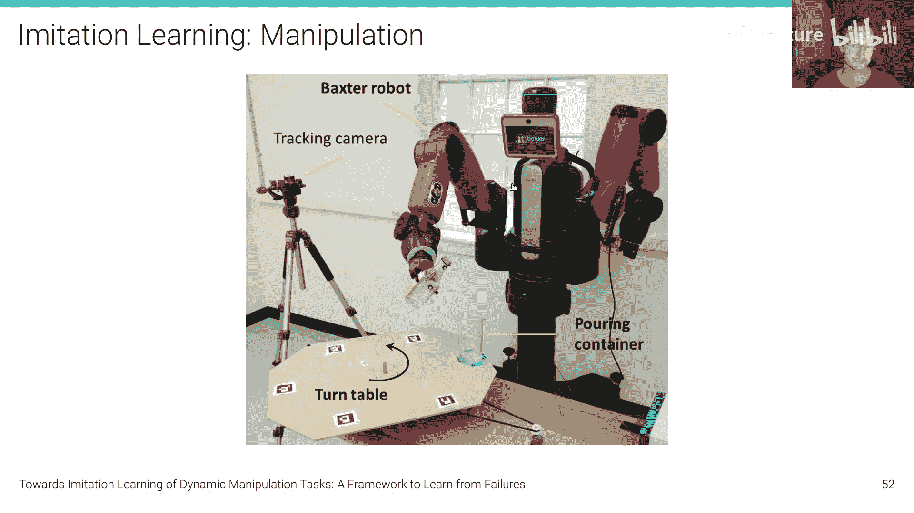
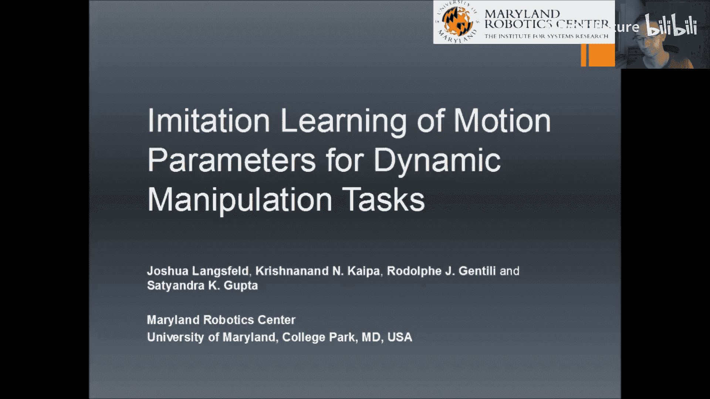
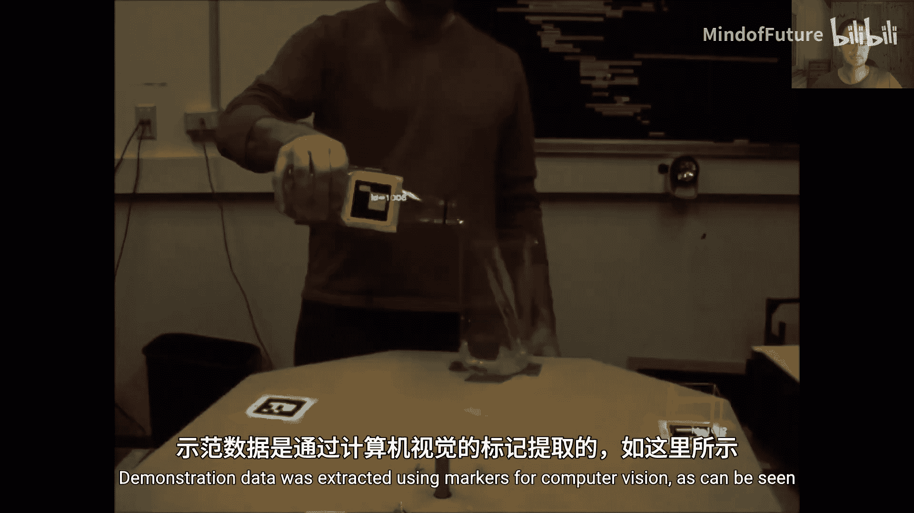
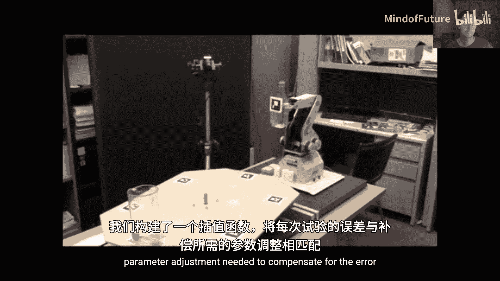
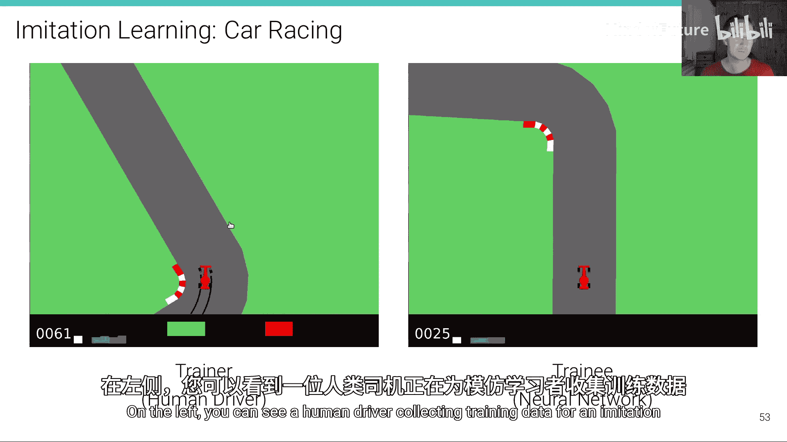
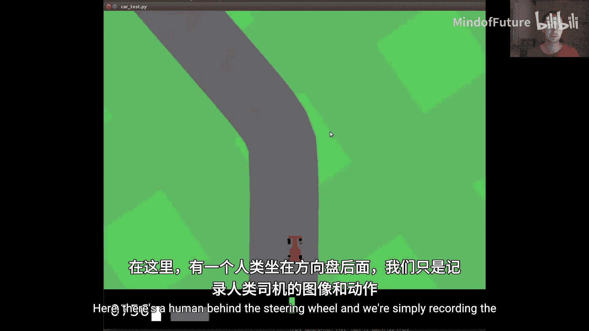
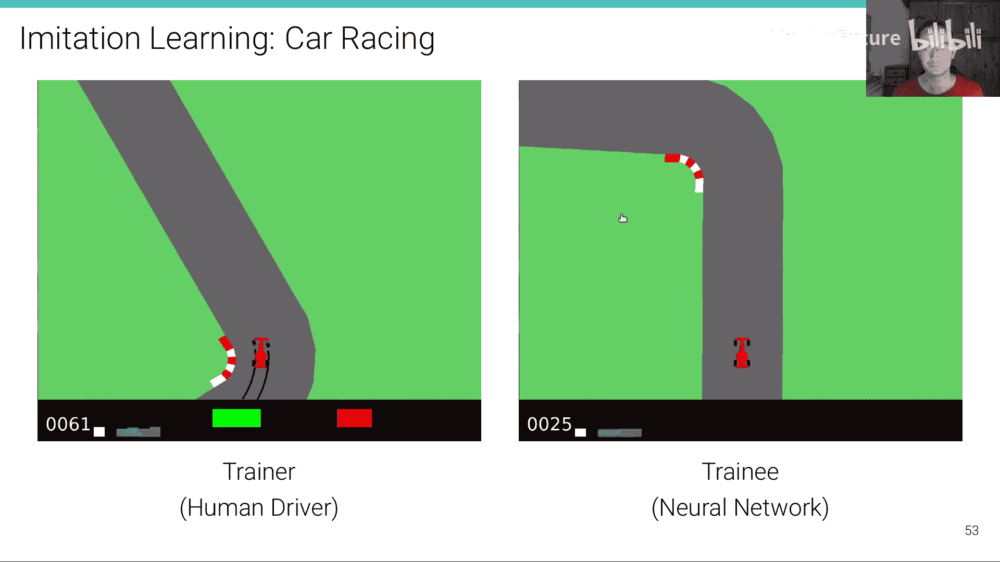
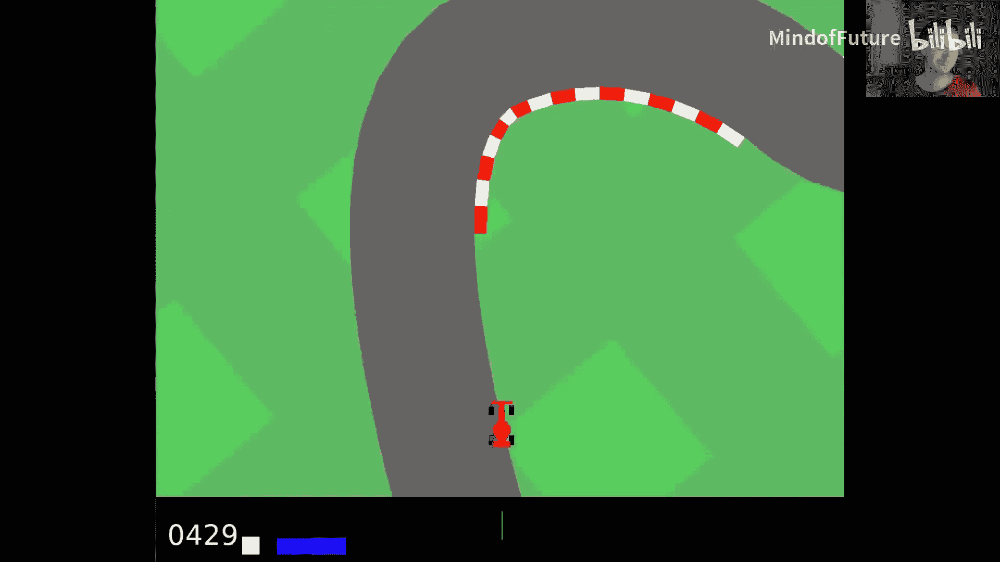
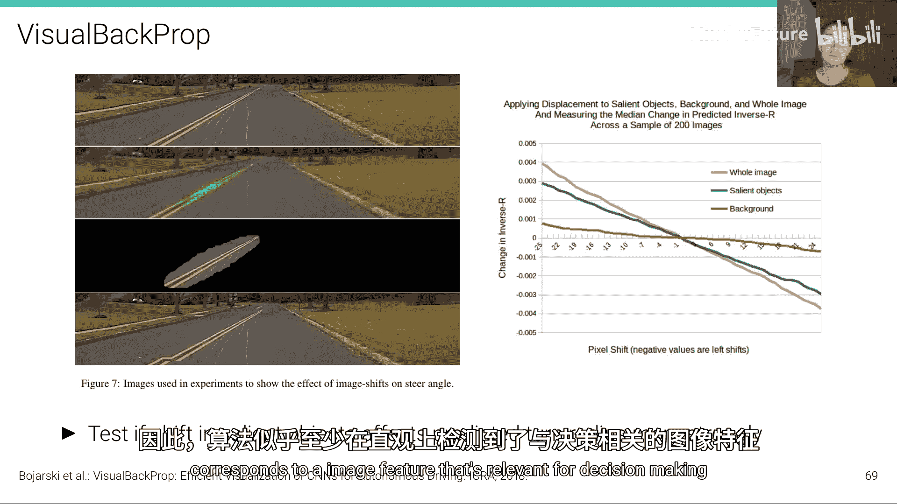

# 006：模仿学习 🚗

在本节课中，我们将要学习模仿学习的核心概念。模仿学习是一种让智能体通过观察专家演示来学习决策策略的方法。我们将从定义问题开始，介绍其基本形式，并探讨两种主要范式：行为克隆和更通用的模仿学习。最后，我们将通过一些实际应用案例来加深理解。

---

## 模仿学习的定义与动机

上一节我们介绍了模仿学习的背景，本节中我们来看看其正式定义。

模仿学习的动机在于，为复杂任务（如自动驾驶）手动编写策略通常非常困难。因此，我们采用数据驱动的方法。我们获取专家的演示数据，目标是训练一个策略来模仿专家所做的决策。

以下是模仿学习涉及的核心概念：

*   **状态 (S)**：智能体观察到的信息。例如，在自动驾驶中，状态可以是车辆摄像头拍摄的图像。状态可以是完全观测或部分观测的。
*   **动作 (A)**：智能体可以执行的操作。例如，转向角或油门/刹车指令。动作可以是离散的或连续的。
*   **策略 (π)**：一个由参数 θ 决定的函数，它将状态映射到动作。我们的目标是学习这些参数。
*   **最优动作 (A\*)**：专家演示者在特定状态下提供的动作。
*   **最优策略 (π\*)**：专家的策略，对于任何输入状态 S 都能给出最优动作 A\*。
*   **状态动态**：模拟器或环境模型。给定当前状态 S_i 和动作 A_i，它决定下一个状态 S_{i+1}。这可以是确定性的或概率性的。
*   **轨迹展开**：给定一个起始状态 S_0，按照策略 π 依次执行动作，生成一系列状态和动作对的过程。
*   **损失函数 (L)**：用于衡量策略输出的动作 A 与专家最优动作 A\* 之间的差异。

---

## 通用模仿学习与行为克隆

基于以上定义，我们现在可以正式定义模仿学习。我们从最通用的设置开始。

### 通用模仿学习

通用模仿学习的目标是找到策略参数 θ，以最小化以下期望值：

**公式：min_θ E_{s~p(s|π_θ)} [ L( A\*, π_θ(s) ) ]**

这个公式的含义是：**最小化策略 π_θ 在所有可能到达的状态分布 p(s|π_θ) 下，其动作与专家动作之间的期望损失。**

关键在于，这里的状态分布 **p(s|π_θ)** 取决于当前策略 π_θ 本身。这意味着在训练过程中，我们需要根据当前策略进行轨迹展开来采样状态，形成一个循环依赖：策略影响状态分布，而状态分布又用于评估和更新策略。这种方法更接近真实的交互过程，但实现起来更复杂，通常需要能够随时查询专家。

### 行为克隆

行为克隆是模仿学习的一个简化且更常用的变体。它的目标函数如下：

**公式：min_θ E_{(s, a\*)~p\*(s, a\*)} [ L( a\*, π_θ(s) ) ]**

这里的关键区别在于，期望是在一个**固定的、由专家演示生成的数据集分布 p\*(s, a\*)** 上计算的。我们不再根据当前策略采样状态，而是直接使用预先收集好的专家状态-动作对。

因此，行为克隆将模仿学习问题简化为了一个**监督学习**问题。我们只需拟合一个函数（例如神经网络），使其在固定数据集上，将输入状态映射到输出动作的误差最小化。

---

## 行为克隆的挑战与改进方法

行为克隆虽然简单，但存在一个根本性问题：**训练与测试的分布不匹配**。

行为克隆假设训练数据（专家演示的状态）是独立同分布的。然而，当我们部署训练好的策略时，它并不完美，可能会犯错误，导致进入一个专家从未演示过的新状态。由于策略没有学习过如何从这种“错误”状态中恢复，它可能会做出更糟糕的决策，从而进一步偏离专家轨迹，最终导致灾难性失败。这种现象称为**分布漂移**。

### 改进方法：DAgger

为了克服上述问题，一种流行的方法是 **DAgger**。它的核心思想是在行为克隆和通用模仿学习之间取得平衡。

以下是DAgger的基本步骤：

1.  使用初始的专家演示数据集训练一个策略。
2.  使用当前策略进行轨迹展开，收集新的“在策略”数据（即策略实际遇到的状态）。
3.  请专家为这些新收集的状态提供正确的动作标签。
4.  将新标注的数据与原始数据集合并。
5.  用合并后的数据集重新训练策略。
6.  重复步骤2-5。

通过迭代地让专家标注策略实际遇到的状态，DAgger逐步构建了一个更能代表策略最终状态分布的数据集，从而缓解了分布不匹配的问题。

### 针对自动驾驶的增强：关键状态采样与回放缓冲区

在自动驾驶场景中，直接应用DAgger可能效果不佳，因为驾驶数据极度不平衡（例如，直行数据远多于转弯数据）。我们提出了一种增强方法：

*   **关键状态采样**：不从所有“在策略”数据中均匀采样，而是根据某些准则（如策略的不确定性、动作的熵等）选择对策略提升最有价值的“关键”状态（如转弯、并线场景）请专家标注。
*   **回放缓冲区**：为了避免一次性加入过多困难样本导致训练不稳定，我们使用一个回放缓冲区。它逐步地将关键状态混合到训练数据中，并定期重放旧数据，确保训练的稳定性。

---

## 模仿学习的应用实例

现在，让我们看一些模仿学习在实际中的应用。

### ALVINN (1989)

这是一个开创性的工作。ALVINN使用一个仅有三层、约3.6万个参数的简单神经网络，将低分辨率道路图像映射到离散的转向指令。它在模拟图像上训练，并成功在真实道路上完成了长达90英里的自动驾驶测试。

### NVIDIA PilotNet (2016)

这是ALVINN的现代版本。PilotNet使用更复杂的卷积神经网络架构（受AlexNet启发，约25万个参数），并利用多摄像头数据进行数据增强，以获取更多样化的状态信息。它在一个真实的车辆上进行了演示。

为了理解这个“端到端”网络内部是如何决策的，研究人员采用了**可视化反向传播**技术。该技术能够高亮显示输入图像中对网络最终决策影响最大的区域。实验表明，被高亮的区域（如车道线）的移动会显著影响网络输出的转向角，而背景区域的移动则影响很小，这证明网络确实学习到了与驾驶决策相关的视觉特征。

---

## 总结

本节课中，我们一起学习了模仿学习的核心内容。我们首先定义了状态、动作、策略等基本概念，并区分了**通用模仿学习**和**行为克隆**这两种范式。我们认识到行为克隆虽然简单，但存在**分布不匹配**的根本缺陷。为此，我们介绍了**DAgger**算法及其针对自动驾驶场景的增强版本（关键状态采样与回放缓冲区）。最后，我们通过**ALVINN**和**NVIDIA PilotNet**这两个里程碑式的实例，看到了模仿学习在自动驾驶领域的成功应用与发展。模仿学习为复杂决策任务的策略获取提供了一条有效的数据驱动途径。