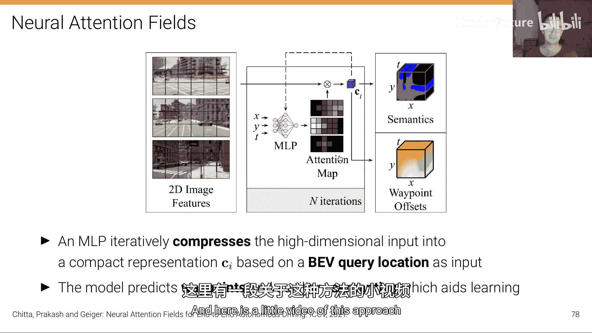
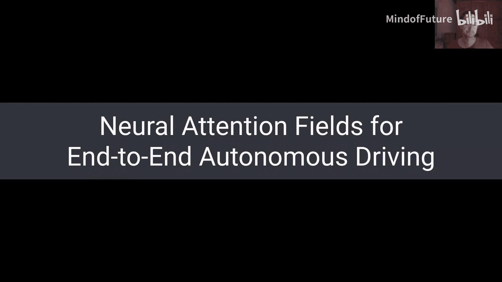
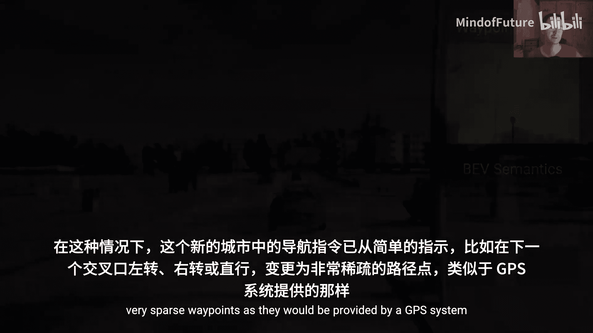
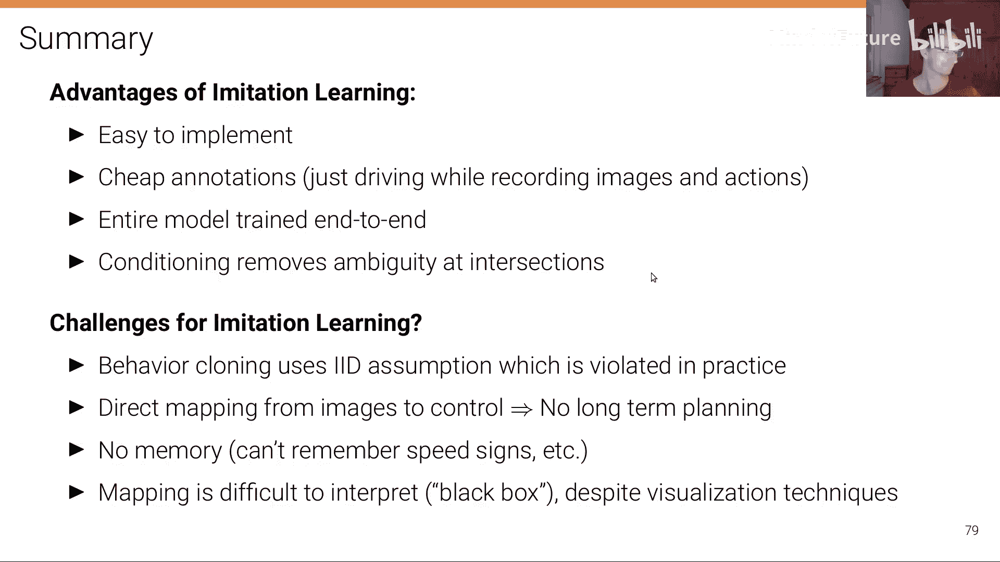

# 007：条件模仿学习 🚗

在本节课中，我们将要学习条件模仿学习。这是一种用于自动驾驶的高级模仿学习方法，它通过引入额外的导航指令来解决传统模仿学习在交叉路口等场景中面临的决策模糊性问题。

## 概述

上一节我们介绍了模仿学习的基本概念。本节中我们来看看条件模仿学习。在某些与自动驾驶相关的场景中，单纯的模仿学习是不够的。例如，在交叉路口，智能体可能有多个有效的行动或轨迹可以选择。如果没有额外的输入信息来指示去向，智能体就无法唯一地确定一个特定的行动。条件模仿学习的核心思想非常简单：除了状态之外，我们还向智能体提供一个条件信号，告诉它在下一个交叉路口应该做什么。例如，“在下一个路口直行”、“左转”或“右转”。利用这个额外的条件信号，行动就变得唯一了，模仿学习又可以正常工作了。这在城市驾驶场景中尤其重要，因为其中涉及变道或转弯。

## 条件模仿学习架构

以下是条件模仿学习的一个示意性概述。我们有一个策略（在相关论文中被称为控制器）。我们让这个控制器或策略同时基于观察（即状态 `S`）和导航命令 `C` 进行条件化。导航命令可以是“在下一个路口左转”、“右转”或“直行”。基于这两个输入，控制器可以发出一个行动，该行动通过状态分布改变环境的状态，从而产生一个新的状态，该状态再次输入到控制器中。

这种高级导航命令相对容易获取，因为现代GPS导航系统已经提供了这些信息。它们会告诉我们该做什么。这也是我们作为人类驾驶员在不熟悉的城市中驾驶时所需的输入信号。我们可以使用标准的消费级GPS，它不需要高清地图，传统地图就足够了，只需告诉车辆在下一个路口左转、右转或直行。这完全消除了由环境引入的任务模糊性。

在这个具体案例中，观察 `O` 是当前图像，行动 `A` 是转向角和加速度。这种方法首次在2018年ICRA会议上发表的论文《通过条件模仿学习进行端到端驾驶》中实现。

## 与朴素行为克隆的对比

让我们比较一下朴素的行为克隆和条件模仿学习（后者也是一种行为克隆，但被称为条件模仿学习）。

在左侧是行为克隆。我们有一个训练集，它是由专家演示者提供的 `N` 帧图像的状态-行动对数据集。目标是最小化一个损失函数，该函数最小化专家行动与策略针对相应状态返回的行动之间的差异。这里的假设是存在一个函数 `F`，当给定输入状态 `S` 时，该函数返回一个特定的行动 `A`。然而，这个假设在实践中常常被违背，例如在交叉路口，对于某个特定状态，可能存在多个有效行动。

相比之下，在条件模仿学习中，训练集通过额外的导航控制命令得到了增强。因此，数据集现在由三元组组成：对于每一帧，我们有专家行动 `A`、专家状态 `S` 和来自GPS的相应导航命令 `C`。目标也发生了变化：现在策略的输入是 `S` 和 `C`，而不是左侧的仅 `S`。这里的假设是存在一个将 `S` 和 `C` 映射到 `A` 的函数。这是一个更好、更合理的假设，因为它在定义状态时更加唯一。

## 网络架构

原始论文（ICRA 2018）描述了两种网络架构。它们差异不大，但略有不同，因此我想简要解释一下两者。

第一种架构（左侧）包含一个图像编码器、一些通过浅层MLP编码的测量值 `M`（例如车速）以及导航命令 `C`。这些信息随后被拼接起来，并由另一个网络来预测行动 `A`。

第二种架构（右侧）是先将图像和测量值拼接，然后由导航命令 `C` 在三个不同的专用子网络中进行选择，被激活的子网络基于其输入返回行动 `A`。测量值 `M` 在这篇论文中仅考虑了车辆的速度，这对于系统是一个有用的输入。如果只提供单张图像，算法将无法知道车辆是静止还是在行驶，因此提供速度信息很重要。

## 数据增强与因果混淆

该论文还引入了噪声进行数据增强。具体做法是向方向盘注入噪声，然后让专家（人类演示者）驾驶以纠正方向。虽然这很累人，只能收集几分钟的数据，但它有助于缓解行为克隆的一个问题，而条件模仿学习也在一定程度上解决了这个问题。你可以看到噪声是如何被注入的，然后人类如何向相反方向转向以抵消噪声，使车辆回到道路上，最终得到修正后的转向信号。

## 仿真环境与实验结果

现在，让我们看一些结果。我们将关注Carla仿真器，这是一个比我们在练习中使用的AirSim环境更复杂的仿真环境，它是全3D且具有一定程度的照片级真实感。在2018-2019年的早期工作中，该仿真器包含两个城镇：一个训练镇和一个测试镇。训练镇用于训练智能体，然后智能体被部署在测试镇，以测试其泛化能力。现代版本的Carla仿真器现在包含多达10个城镇，甚至有一个在线排行榜，人们可以提交他们的算法和智能体，类似于你们将提交智能体参与我们课程的排行榜。

Carla仿真器的优点是完全开源，任何人都可以使用，可以在传统消费级GPU上运行，并提供许多资源和环境，以及不同的传感器模态（如激光雷达、RGB相机等）。2019年在该仿真器数据集上的最先进方法称为“CILRS”，它探索了行为克隆在自动驾驶中的局限性（ICCV 2019论文）。其架构与之前的类似，当然也使用导航命令作为输入。但为了克服所谓的“因果混淆”问题，它采取了一些措施。

因果混淆问题是指在自动驾驶的模仿学习中，行动的真实原因常常与错误的原因混淆。例如，当车辆静止且交通灯变绿时，车辆可能不会将交通灯变绿视为启动的原因，因为前一帧静止与下一帧很可能也静止之间的相关性非常高，因此车辆会保持静止。克服这个问题有多种方法，其中之一是除了将速度作为输入外，还尝试让策略预测速度，这可以在一定程度上缓解因果混淆问题。

## 最新进展：结合注意力与鸟瞰图

我们研究小组的一项较新工作将条件模仿学习的理念更进一步，将其与隐式表示和注意力机制相结合。注意力很重要，因为自动驾驶系统的输入维度非常高（每秒多帧、高分辨率多图像），需要高效地缩小范围，聚焦于当前驾驶情境中重要的部分。这就是我们在这个模型中尝试做的。我们有一个多层感知机，可以用特定位置进行查询，并基于注意力迭代地将高维输入压缩成紧凑的表示 `C`。你可以看到这些注意力图，它们根据模型在当前迭代中认为对做出下一个决策重要的内容来查询输入。

该模型密集地预测航路点偏移和语义信息，这是在物理鸟瞰图视角下进行学习。我们发现，在鸟瞰图空间（车辆控制实际发生的空间）而非图像空间预测信息也很有用。在这里，我们预测航路点或航路点偏移，从而推导出航路点。在此基础上，我们使用一个更经典的控制器，根据预测的航路点来操控车辆。这是目前进行模仿学习的最先进方法之一。我们实际上不再模仿行动，而是模仿轨迹，然后使用传统的控制器，因为它们在自动驾驶中效果很好，我们无需重新学习。

## 总结

本节课中我们一起学习了条件模仿学习。模仿学习在自动驾驶中的优势在于易于实现、标注成本低（只需记录驾驶时的图像和行动），并且整个模型可以端到端训练。条件模仿学习可以消除交叉路口的模糊性，并成功通过交叉路口。

然而，模仿学习仍面临一些挑战。行为克隆使用的独立同分布假设在实践中常被违背。从图像到控制的直接映射在基本实现形式中不允许进行长期规划。在标准模型中，也没有真正的记忆机制来记住速度等信息，除非显式地将记忆纳入模型。此外，学习到的映射关系难以解释，因此我们需要良好的可视化技术来更好地理解模型在做什么，或者像最后展示的模型那样，融入注意力等机制，使内省自动构建到模型中。

这就是今天的全部内容。谢谢。