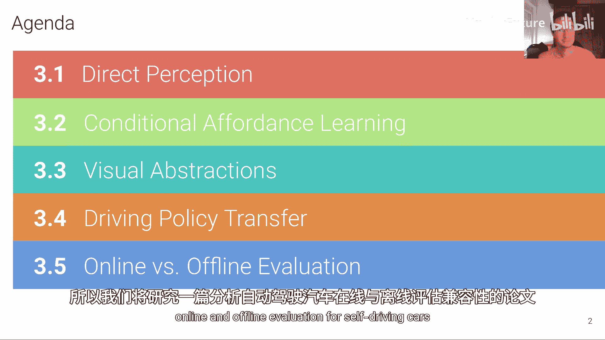
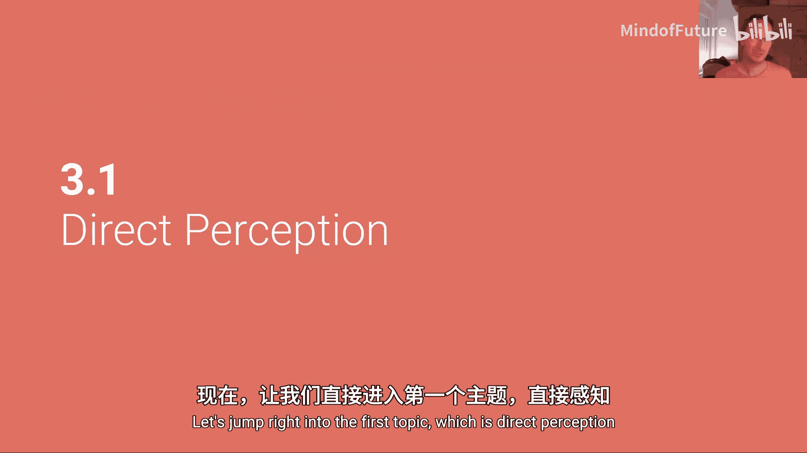
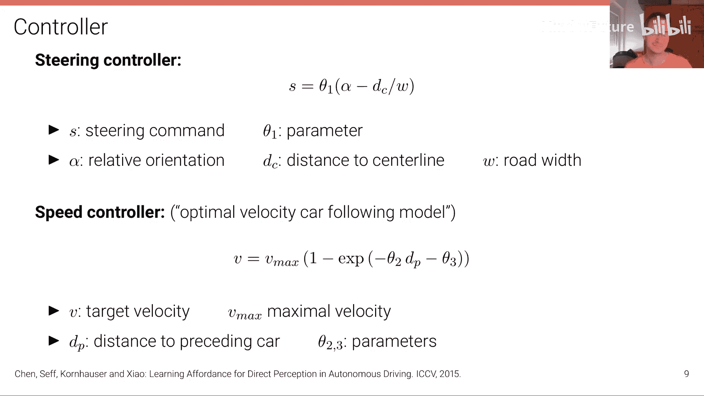
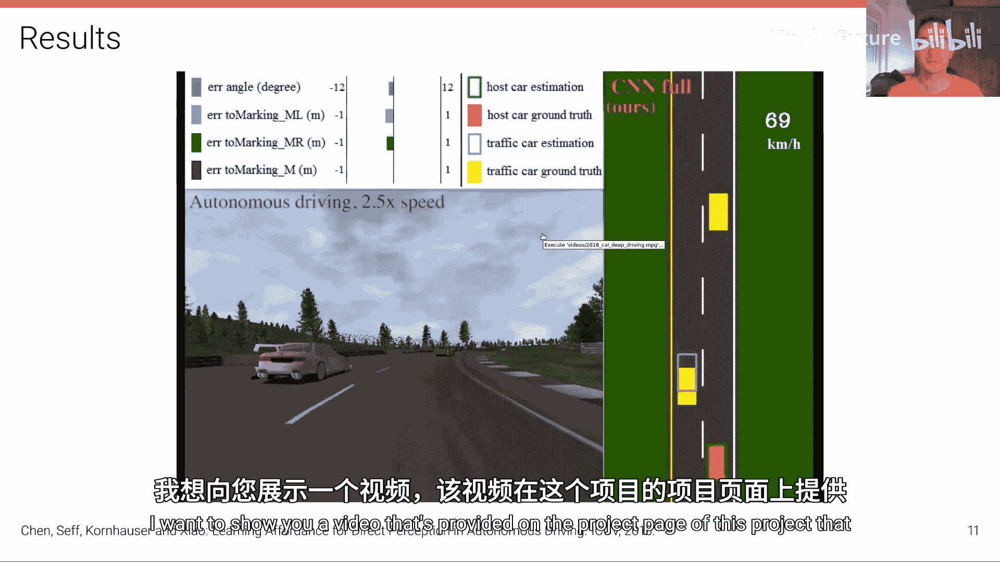
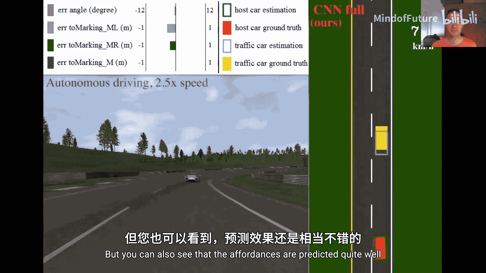
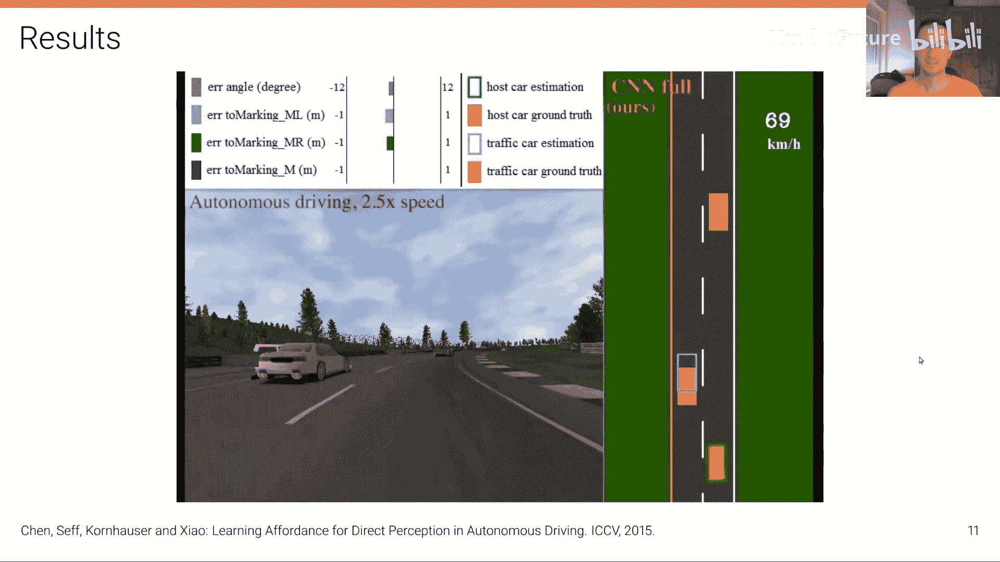
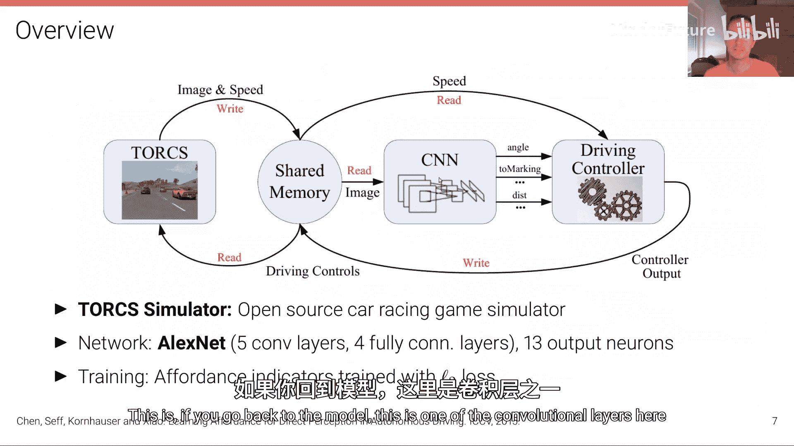

# 008：直接感知

在本节课中，我们将要学习自动驾驶中的“直接感知”方法。这是一种介于模块化流水线和端到端学习之间的混合方法，旨在结合两者的优点。

## 概述

直接感知方法的核心思想是，使用一个神经网络将传感器输入（如图像）映射到一个低维的中间表示，这个表示包含了驾驶决策所需的充分统计信息。然后，一个独立的控制器模块根据这个中间表示来生成车辆的控制指令。这种方法将感知与规划、控制解耦，既保持了模型的可解释性，又允许进行端到端的优化。

## 直接感知的概念

上一节我们介绍了模块化流水线和端到端学习两种方法。本节中，我们来看看它们的混合体——直接感知。

我们目前已经见过两种自动驾驶方法。一种是**模块化流水线**，它由多个独立模块组成，例如低级感知、场景解析、路径规划和车辆控制。模块化流水线的优势在于其模块化特性，可以由不同的大型团队独立开发，并且由于接口是人工设计的，因此具有可解释性。然而，其缺点是需要大量专家决策，且难以进行端到端学习。

另一种是**端到端学习**方法，它使用一个单一的整体机器学习模型（如神经网络）直接将传感器输入映射到车辆控制指令。这种方法模型简单，可以进行端到端训练，但通常泛化能力较差、数据需求量大且可解释性低。

直接感知是介于这两种方法之间的一种混合方法。它仍然是模块化的，但比传统的模块化流水线更简洁。它引入了一个中间表示：一个神经网络将传感器输入映射到这个低维的中间表示，然后一个车辆控制器根据这个表示来预测车辆的低级控制指令。这样，我们仍然拥有一个相对简单的系统，但有效地将感知与规划和控制解耦了。这既有利于提高模型的可解释性，也可能因为控制器没有与感知模型联合训练而获得更好的泛化能力。此外，它还允许我们利用经典的控制器（如PID控制器或有限状态机）或学习型控制器。

## 一个具体模型：学习自动驾驶的直接感知可供性

接下来，我们来看一个实现了这一范式的具体模型。我们将关注2015年的一篇论文《Learning Affordance for Direct Perception in Autonomous Driving》。

该论文的目标是实现一个用于高速公路驾驶的直接感知控制器，并在模拟环境中进行测试。其核心思想是预测一组“可供性”。可供性是一个源自心理学的术语，描述了环境中限制可能行动空间的属性。简单来说，它就是为智能体做出决策所需的、关于观测状态的充分统计信息。

在这篇论文中，作者为在一条三车道高速公路上驾驶设计了13个特定的可供性。第一个可供性是车辆相对于道路的角度，这对于转向至关重要。其余可供性根据车辆所处的两种状态（“车道内”状态和“压线”状态）而有所不同。

以下是两种状态下相关的可供性：

*   **当车辆处于“车道内”状态（位于两条车道线之间）时**：
    *   到左侧车道线的距离。
    *   到左侧相邻车道左侧车道线的距离。
    *   到右侧车道线的距离。
    *   到右侧相邻车道右侧车道线的距离。
    *   到当前车道前车的距离。
    *   到左侧车道前车的距离。
    *   到右侧车道前车的距离。

*   **当车辆处于“压线”状态（行驶在车道线上）时**：
    *   到左侧车道线的距离。
    *   到当前所压车道线的距离。
    *   到右侧车道线的距离。
    *   到左侧车道前车的距离。
    *   到右侧车道前车的距离。

系统在TORCS模拟器（一个开源赛车游戏环境）中实现、训练和评估。感知网络采用了简单的AlexNet架构，包含5个卷积层和4个全连接层，输出13个神经元对应13个可供性。训练采用简单的监督学习，使用L2损失函数，真值由模拟器提供。

## 控制器设计

现在，我们来看看如何利用预测出的可供性来控制车辆。论文中实现了一个简单的手工设计控制器。

控制器逻辑是一个有限状态机。在自动驾驶模式下，控制器读取感知模型输出的可供性指标，并检查左右车道是否可用。其决策逻辑如下：如果正在接近同一车道的前车，且左侧车道存在、可用并允许变道，则变道至左侧；否则，如果右侧车道满足条件，则变道至右侧；如果都无法变道，则减速。

具体控制指令的计算公式如下：

**转向控制器**：
`steering_command = θ₁ * relative_angle + (distance_to_center_line / road_width)`
其中，`relative_angle`是车辆相对于道路切线的角度，`distance_to_center_line`是车辆到目标车道中心线的距离。这是一个线性控制器，旨在减小角度偏差和横向偏移。

**速度控制器（最优速度跟车模型）**：
`target_velocity = V_max * [1 - exp( -θ₂ * (distance_to_preceding_car - θ₃) )]`
其中，`V_max`是最大允许速度，`distance_to_preceding_car`是到前车的距离。当前车很远时，目标速度接近`V_max`；当前车很近时，车辆会减速以避免碰撞。

这个简单的控制器虽然可能导致驾驶行为不够平滑，但在模拟环境中能够实现基本的跟车、变道等高速公路驾驶功能，展示了直接感知方法的可行性。

## 模型评估与可视化

该模型在TORCS模拟器中进行了评估。演示视频显示，车辆能够根据预测的可供性做出合理的驾驶决策，例如在接近前车且左侧车道空闲时执行变道。

为了理解感知网络内部的工作机制，作者使用了标准的网络可视化技术。例如，通过可视化第一个全连接层中特定神经元被激活程度最高的平均图像，可以发现网络学会了将相似的驾驶状态（如空旷道路、前方有车、准备变道等）进行聚类。此外，通过可视化卷积层的最大响应区域，可以看到网络能够聚焦于场景中的相关部分，如其他车辆和车道线。这些事后分析有助于提高直接感知模型的可解释性。

## 总结

本节课中，我们一起学习了自动驾驶中的直接感知方法。我们了解了它作为模块化流水线与端到端学习之间桥梁的定位，其核心是通过学习一个低维的中间表示（可供性）来解耦感知与控制。我们深入分析了一个具体实现模型，包括其定义的13个高速公路驾驶可供性、使用的AlexNet网络架构、以及基于有限状态机和简单公式的手工控制器设计。最后，我们看到了该模型在模拟器中的表现以及通过可视化技术对其内部工作机制的洞察。直接感知方法为实现可解释、可泛化且能进行端到端优化的自动驾驶系统提供了一条有希望的路径。