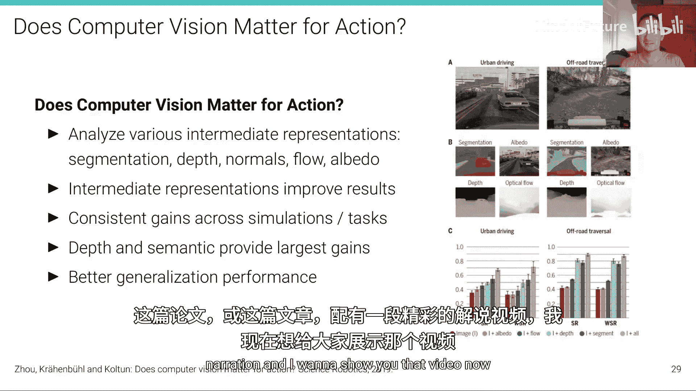
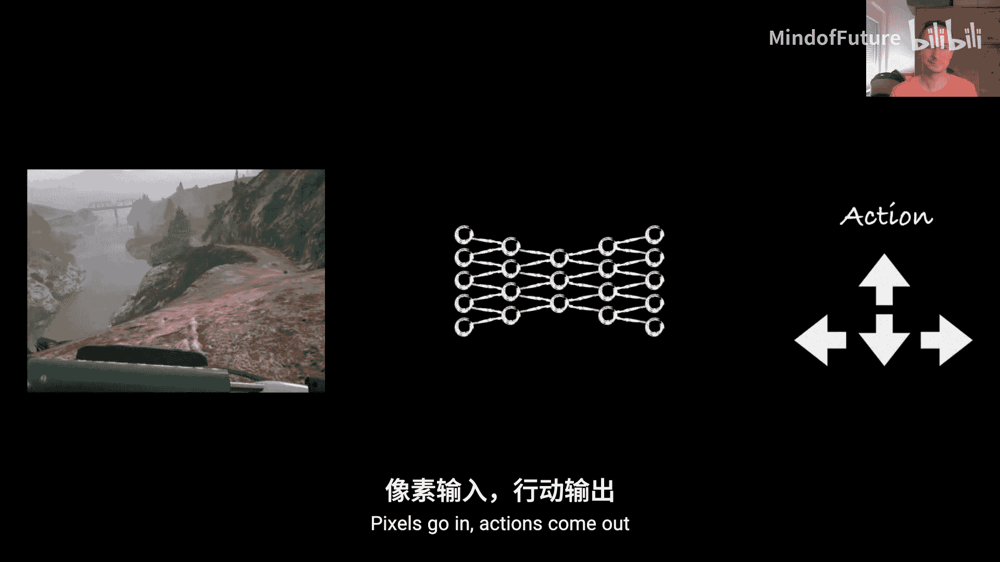
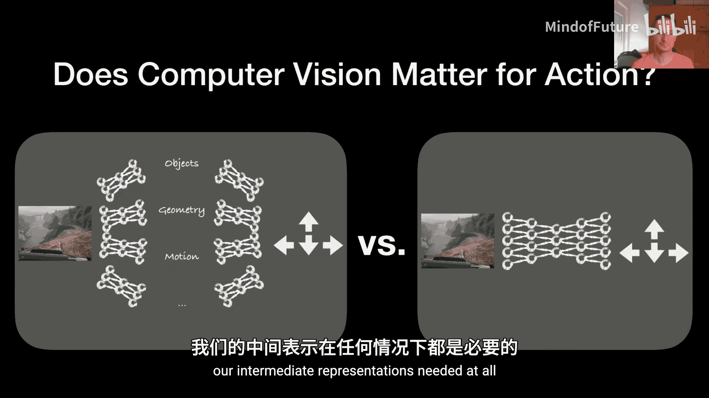
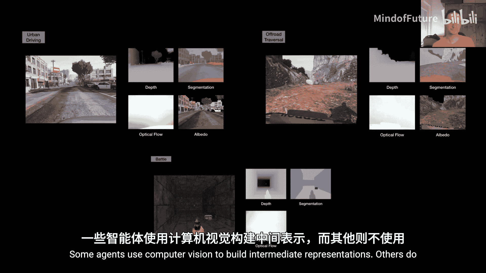
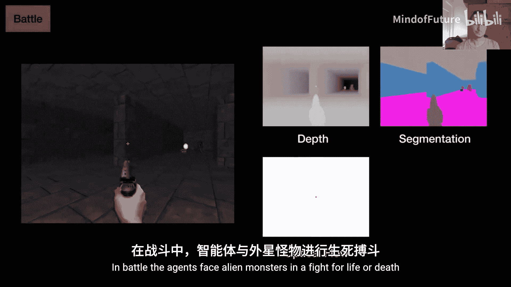
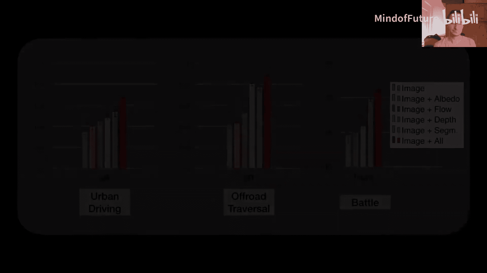
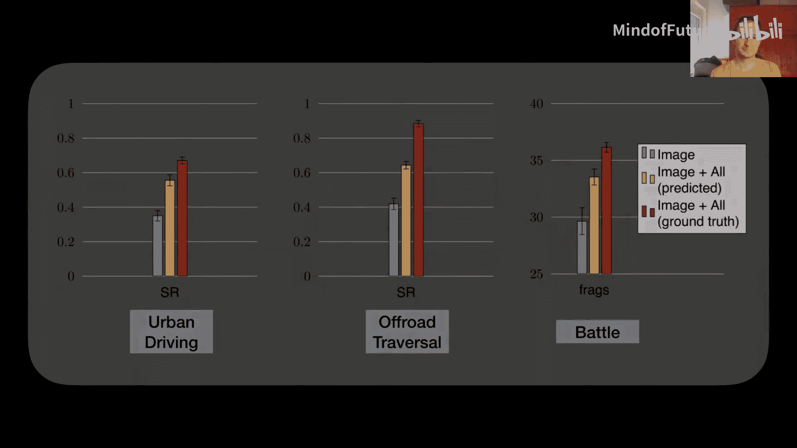
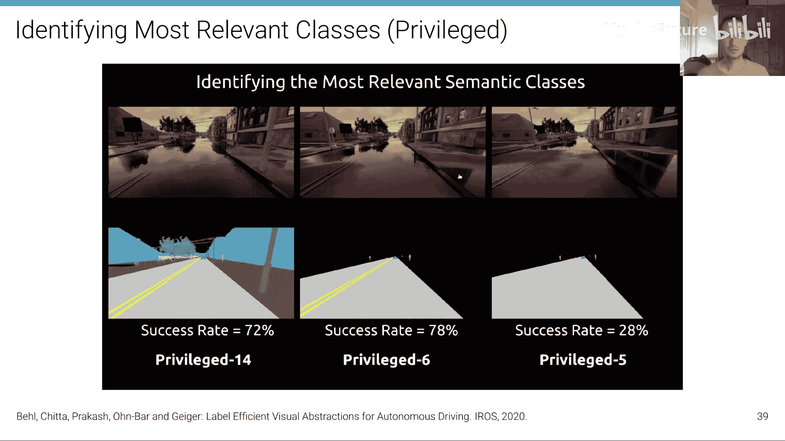
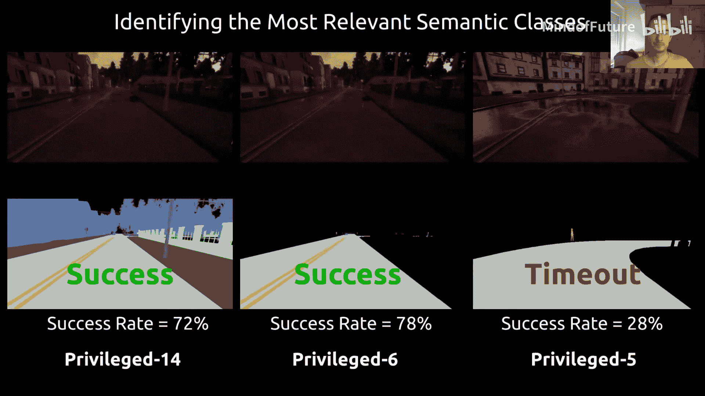
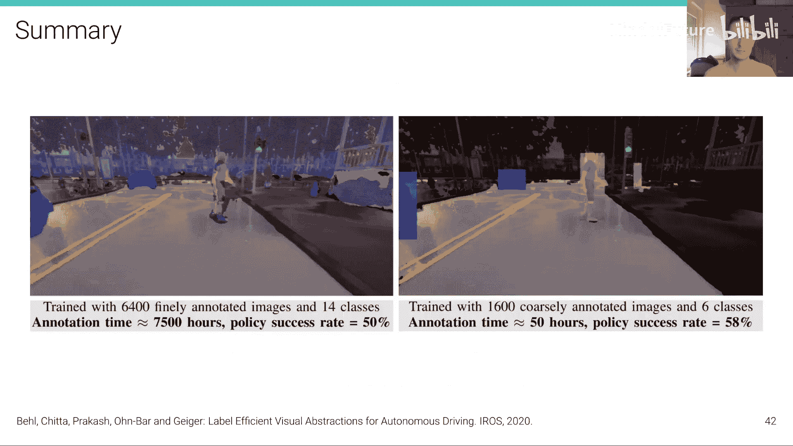

# 010：直接感知 - 视觉抽象

在本节课中，我们将探讨如何为自动驾驶系统选择合适的中间视觉表示。我们将分析不同视觉抽象方法的优劣，并研究如何在保证性能的同时，高效地获取训练数据。

## 概述

我们已经了解到，中间表示对于解耦感知与规划控制非常有用。然而，核心问题在于如何精确地选择这些中间表示。之前我们看到的模型使用了人工设计的低维可供性，但这不可避免地引入了人为设计误差。因此，我们能否使用更通用的中间表示，例如单目深度估计、立体视觉估计或语义分割等标准计算机视觉任务，来提高自动驾驶智能体的鲁棒性？如果使用这些表示，我们如何高效地学习感知模块？为了稳健地学习预测这些表示的模型，我们需要多少标注数据？这正是本单元将要探讨的内容。

## 视觉抽象的重要性

2019年，Sidel等人发表了一篇文章，探讨了计算机视觉对于机器人行动的重要性。他们分析了多种中间表示，包括语义分割、深度估计、法线预测、光流估计和反照率预测，评估它们对实现稳健驾驶行为的能力。

研究发现，中间表示通常能改善结果和泛化能力，并且在不同模拟环境和任务中都能带来一致的性能提升。特别是在自动驾驶场景中，深度信息和语义分割带来的提升最大：深度信息在越野驾驶中作用显著，因为几何结构至关重要；而语义分割在城市驾驶中非常有用，因为城市场景中的语义类别比越野环境更容易区分。

## 视觉抽象的特性

那么，一个好的视觉抽象应具备哪些特性？

首先，它必须具有**不变性**，能够对策略隐藏不相关的变异。如下图所示，对于一个室内场景，如果我们直接比较两张图像的像素空间，它们差异很大。然而，如果使用语义分割作为中间表示，在特征空间中，训练和测试数据的分布会重叠得更多，因为原始图像中不相关的、与度量无关的变异已被抽象掉。从语义分割图来看，这两张图像看起来几乎相同。

其次，一个好的视觉抽象应该是**通用的**，适用于广泛场景，能够解决我们在模拟器或真实世界自动驾驶中可能遇到的所有任务。它应该是状态的充分统计量。

当然，它还应是**数据高效**的，不需要太多内存和计算来生成。同时，它必须是**标注高效**的，即训练用于预测中间表示的感知模块时，所需的标注工作量相对较小。这是我们近期工作中关注的一个方面。

## 选择语义分割作为抽象

我们选择语义分割作为视觉抽象，因为研究发现它能编码任务相关知识（例如，道路是可行驶的）以及先验知识（例如，相关像素的分组）。此外，它可以使用标准的二维卷积策略网络进行处理，易于部署。

然而，语义分割的缺点是标注耗时。例如，为Cityscapes数据集中的单张图像进行标注，标注员需要90分钟。如果要标注成千上万甚至数百万张图像，成本会非常高昂。因此，拥有一个标注高效的视觉抽象至关重要。

## 高效标注的视觉抽象研究

我们在2020年IROS上发表的一项名为《Label Efficient Visual Abstractions for Autonomous Driving》的工作中探讨了这个问题。我们提出的问题是：
*   标注时间与驾驶性能之间如何权衡？
*   选择特定的语义类别是否能简化策略学习？
*   用少量图像训练的视觉抽象是否具有竞争力？
*   像Cityscapes基准测试中那样的细粒度标注是否真的重要？
*   视觉抽象能否减少训练方差（这是训练端到端驾驶模型时的常见问题）？

### 模型架构

我们考虑一个标准的视觉抽象模型。输入图像（状态或观测 `S`）通过一个参数为 `ψ` 的视觉抽象网络 `A` 转换为视觉抽象 `R`。然后，该视觉抽象再通过一个控制策略 `π`（参数为 `θ`）转换为控制命令 `A`，同时策略也考虑高层GPS导航指令 `C` 和输入速度 `v`。最终输出是动作 `A`。

用公式表示，动作 `A` 由这两个函数的复合得到：
`A = π(A(S), C, v)`

### 训练数据与流程

训练这两个模型需要标注数据：
1.  **表示数据集 R**：包含输入图像和语义真值标签图，用于训练视觉抽象网络 `A`。这个数据集通常较小，因为标注成本高。
2.  **动作数据集 A**：包含输入图像和对应的专家控制命令（如方向盘转角、加速度），用于训练控制策略 `π`。这个数据集可以很大，因为获取动作标签相对容易。

训练流程如下：
*   首先，使用较小的语义标注数据集 `R` 训练视觉抽象网络 `A`。
*   然后，将此网络应用于所有驾驶过程中采集的输入图像，生成对应的视觉抽象 `R`，并与车辆传感器测量的真实控制信号结合，形成一个庞大的控制数据集。
*   最后，使用这个大型控制数据集来训练控制策略 `π`。

这样，我们就用一个小数据集训练了抽象网络，用一个大数据集训练了策略。

### 使用的模型与损失

我们使用了2019年的先进模型——条件模仿学习模型（CILRS）。其输入是视觉抽象 `R`（而非原始图像）、导航指令 `C` 和车辆速度 `v`。事实证明，单帧图像加上车辆速度足以构成城市驾驶中状态的充分统计量。输出是控制动作 `A` 和预测的速度 `v_pred`（后者用作正则化器，以避免因果混淆问题）。

我们优化标准的模仿学习损失，最小化预测动作与真实动作、预测速度与真实速度之间的差异。

## 实验设计与结果分析

我们设计了不同的视觉抽象进行比较：

1.  **特权分割**：使用模拟器提供的语义分割真值作为输入，作为性能上界。
2.  **推断分割（14类）**：使用在14个类别上训练的最先进语义分割模型预测的分割图。
3.  **推断分割（6类）**：仅在6个我们认为对自动驾驶最相关的类别（道路、车道线、其他车辆、行人、绿灯、红灯）上训练的分割模型。
4.  **混合表示**：对两个“物体”类别（道路、车道线）使用分割模型，对四个“物体”类别（车辆、行人、红灯、绿灯）仅使用边界框检测器。这可以大幅降低标注难度。

我们在CARLA模拟器的“无碰撞”基准上进行评估，设置了不同交通密度的场景。

### 关键发现

*   **类别数量的影响**：从14个类别减少到6个类别，驾驶性能**没有显著下降**，甚至在部分场景中有所提升。这表明，让策略专注于相关类别，避免被无关信息分散注意力，可能更有益。然而，**移除车道线**会导致性能急剧下降，证实了车道线信息对驾驶至关重要。
*   **标注粒度的影响**：使用**混合表示**（边界框+分割）的性能与标准分割表示相当，在困难场景中甚至略有提升。同时，其标注时间从每图像约300秒大幅减少到20秒。
*   **数据效率**：研究表明，**明智地选择视觉表示和类别，比单纯标注更多图像更重要**。例如，使用1600张粗标注图像（混合表示，6类）训练的模型，其策略成功率（58%）甚至高于使用6400张细标注图像（14类）的模型（50%），而总标注时间从7500小时锐减到仅50小时。

## 总结

本节课我们一起学习了视觉抽象在自动驾驶中的关键作用。一个好的视觉抽象应具备不变性、通用性、数据高效和标注高效等特性。通过具体研究，我们发现语义分割是一种有效的抽象方式，但通过精心选择关键语义类别（如道路、车道线、车辆、行人、交通灯）并采用混合表示（结合分割与检测），可以在维持甚至提升驾驶性能的同时，极大降低模型对标注数据量和精细度的需求。这为构建更实用、更高效的自动驾驶感知系统提供了重要指导。核心在于，**质量重于数量**——智能地设计中间表示比盲目收集更多标注数据更为有效。