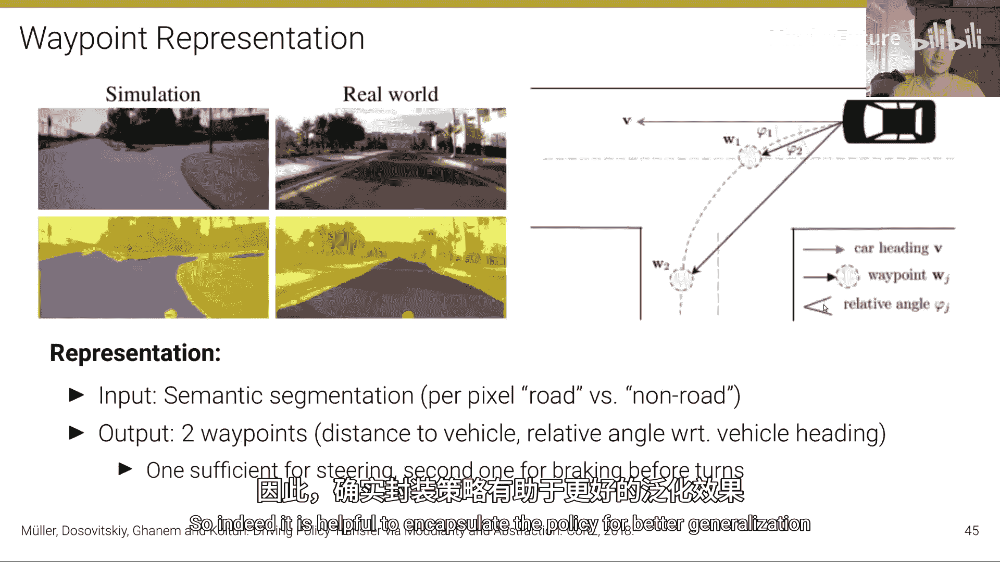
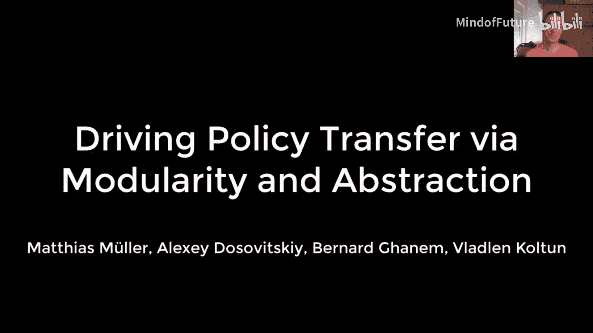
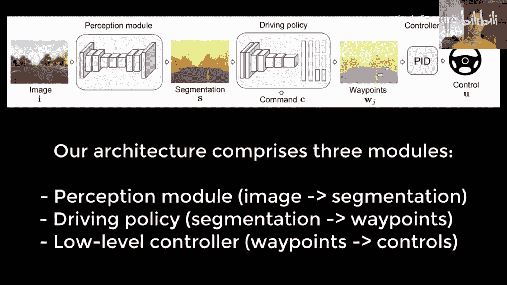

# 011：通过模块化与抽象实现驾驶策略迁移 🚗➡️🌍

在本节课中，我们将要学习如何通过模块化和抽象的方法，将在模拟器中学习的驾驶策略迁移到现实世界的车辆上，以解决策略迁移效果不佳的问题。

## 概述

我们已经了解了中间表示对于解耦感知与规划控制非常有用，这能让策略学习变得更容易。然而，并非所有硬件都相同。如果你希望将模拟器中学习的驾驶策略迁移到现实世界运行的车辆上，进一步将控制与规划解耦也很有帮助。这正是2018年CoRL会议上发表的论文《Driving Policy Transfer via Modularity and Abstraction》所研究和提出的方法。

## 核心问题与方法

上一节我们讨论了中间表示的作用，本节中我们来看看一种更进一步的模块化方案。论文考虑的核心问题是：在模拟器中学习的驾驶策略通常无法很好地迁移到现实世界。因此，该论文在“直接感知”理念的基础上，向模块化流程又迈进了一步。

其核心思想是封装驾驶策略。这里的驾驶策略和感知模块仍然是需要学习的神经网络，但通过封装，使得驾驶策略不直接暴露于原始感知输入，也不直接输出底层控制指令。

以下是该方法的整体架构流程：

1.  **输入**：一张图像。
2.  **感知模块**：生成一个中间表示，在本例中是语义分割图。
3.  **驾驶策略**：该策略接收高级GPS导航指令（如“左转”），并基于语义分割图预测一系列路径点。
4.  **控制器**：一个PID控制器接收这些路径点，并生成车辆所需的底层控制指令（转向和加速/刹车）。

这种方法的优势在于，当要将策略应用到新车辆时，只需替换控制器部分，而无需重新训练或微调驾驶策略本身。控制器通常参数不多，且我们对车辆的低层控制器（如ESP、自动刹车系统）已有深入理解，因此适配相对容易。

## 策略解耦的优势

通过这种设计，驾驶策略通过路径点表示，与具体的控制指令解耦；同时，通过语义分割图，也与原始的图像输入解耦。这意味着，对于新的场景或车辆，只需替换感知模块和控制器，而执行实际驾驶任务的策略核心可以保持不变。

所使用的具体表示是：**输入**为语义分割图，**输出**为两个路径点。第一个路径点用于转向控制，第二个路径点用于在转弯前刹车。随后，一个PD控制器会尝试基于这些路径点来跟随车道或道路。

## 实验结果与分析

以下是该论文的核心结果。论文进行了消融研究，比较了模型的不同变体：

*   **图像 -> 控制**：直接从输入图像映射到控制指令。
*   **图像 -> 路径点**：从图像映射到路径点。
*   **语义分割 -> 控制**：从语义分割图直接映射到控制指令。
*   **完整流程**：图像 -> 语义分割 -> 路径点 -> 控制指令（即论文提出的方法）。

研究所用的驾驶策略是标准的条件模仿学习策略（分支版本），控制器则是一个用于横向（转向）和纵向（加速/刹车）控制的PID控制器。

研究结果显示，特别是在**泛化能力**（上图中绿色和金色柱状图，代表训练时未见过的新城镇和新天气条件）方面，采用这种完全封装的、模块化和抽象化的策略性能最佳。这确实证明，封装策略有助于获得更好的泛化性能。

## 实际演示与应用

该项目还提供了一个精彩的演示视频，展示了其实际效果：

> “在这项工作中，我们在模拟器中训练了一个驾驶策略，然后无需任何微调，便将其部署到物理世界的车辆上。车辆基于语义分割图和高层指令（如在下一个路口左转）进行驾驶。因此，我们的驾驶策略不仅能够跟随车道，还能根据高层规划器或操作员的指令进行各种转弯。更重要的是，我们的驾驶策略能够泛化到各种先前未见过的环境。”

该方法通过模块化和抽象来解决迁移问题，结合了深度学习和经典模块化自动驾驶流程的优势。其架构包含三个模块：**感知模块**、**驾驶策略**和**底层控制器**。

研究首先在CARLA模拟器中验证了系统。在CARLA的Town 1、Weather 1环境中训练后，驾驶策略在该设定下表现良好。值得注意的是，分割网络是在Cityscapes数据集上训练的，因此在CARLA中提供的是有噪声的分割图，这是为了迫使驾驶策略学习泛化能力和对噪声的鲁棒性。

随后，在视觉上差异很大的CARLA Town 2、Weather 2环境中进行测试，模型展现了良好的泛化性能。

接着，该系统被部署到真实世界的机器人车辆上，在多样化的城市环境中进行测试：

测试涵盖了不同的环境和天气条件，包括欧洲阴天干燥的路面，以及冬季湿滑积雪的路面。

模型还在不同大陆、环境迥异、阳光明媚的条件下进行了评估。尽管背景纹理、光照条件和道路宽度差异巨大，学习到的驾驶策略依然能够良好泛化。该策略能够完成各种转弯，并成功跑完数条约1公里长的路线。

## 总结

本节课中，我们一起学习了一种通过**模块化**与**抽象**来实现驾驶策略迁移的方法。该方法通过引入**语义分割**作为中间表示，并让驾驶策略输出**路径点**而非直接的控制指令，有效地解耦了感知、规划与控制。这种设计显著提升了策略从模拟环境到真实世界的**泛化能力**，并且只需适配少量的控制器参数即可应用于新车辆，为实现更鲁棒、可迁移的自动驾驶系统提供了有力的思路。