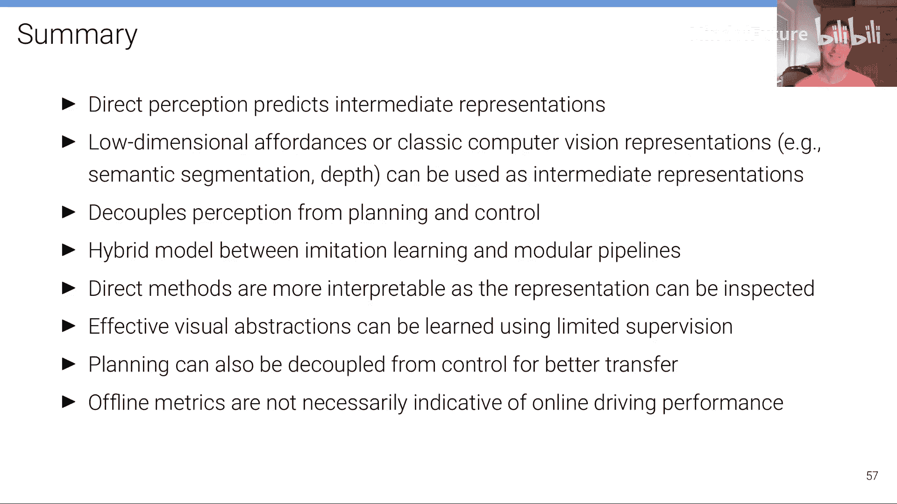

# 012：直接感知 - 在线与离线评估 🚗

在本节课中，我们将讨论自动驾驶智能体的评估方法。具体来说，我们将重点分析在线评估与所谓的离线评估之间的区别，并探讨一篇相关论文的研究结果。

---

## 概述

评估自动驾驶系统是开发过程中的关键环节。理想情况下，我们希望进行纯粹的在线评估，即在真实或模拟环境中让车辆实际运行。然而，这种方法成本高昂且存在风险。因此，研究论文中常使用基于预录制数据集的离线评估指标。本节我们将探讨这两种评估方式的差异，并分析离线指标在预测实际驾驶性能方面的有效性。

---

## 在线评估与离线评估

上一节我们介绍了直接感知方法，本节我们来看看如何评估基于这些方法构建的驾驶模型。

在理想情况下，我们当然希望进行纯粹的在线评估。这意味着使用真实车辆在真实世界环境或我们希望评估车辆的模拟环境中进行闭环测试。

然而，在现实世界中，这种方法既昂贵又危险。运营成千上万辆汽车仅用于测试成本高昂，而犯错则可能带来危险。

下图底部展示了在线评估的设置：环境生成观察结果，输入给智能体模型；模型做出预测或执行动作；该动作再次影响环境。如此形成一个闭环。基于模型在真实世界中的驾驶表现，我们可以测量其成功率、到达目标的速度、违规次数等指标。

由于在线评估成本高、风险大，研究论文中经常报告离线评估指标。离线评估指标可以基于预录制的验证数据集计算，因此廉价且易于实施。

上图顶部展示了这种设置：我们有一个预录制的数据集。数据集为我们提供观察结果输入模型，同时也包含真实动作标签。我们可以简单地测量模型预测（例如，预测转向角为-10度或+10度）与该特定数据点的真实转向角之间的误差，并将其作为模型的性能衡量标准。

但核心问题是：离线评估对于我们真正关心的在线任务有多大的预测性？

---

## 实证研究：方法与指标

为了探究上述问题，我们将分析一篇论文的实证研究。该研究使用在Carla模拟器中训练的、以均方误差（MSE）作为转向角损失的条件模仿学习智能体。这是一个标准的条件模仿学习设置，具体架构不重要，关键是该研究在在线和离线两种场景下评估了多种智能体，以测量其相关性。

以下是研究中考虑的在线评估指标：
*   **成功率**：成功完成的路线百分比。
*   **平均完成度**：在发生违规等情况前，车辆覆盖的到目标点平均距离比例。
*   **每公里违规数**：两次违规之间的平均行驶距离。

需要说明的是，当前的Carla评估指标已经改进（例如，违规分数和驾驶分数），但这项2018年的工作并未考虑这些新指标。不过，预计其结论仍然具有参考价值。

研究中考虑的离线评估指标（即人们常用来替代在线指标的代理指标）如下。注意，该论文仅研究了转向角相关的指标：

*   **均方误差**：衡量预测转向角与真实转向角偏差的平方。公式为 `MSE = (a - â)²`，其中 `a` 是真实转向角，`â` 是预测转向角。
*   **绝对误差**：使用L1损失衡量绝对偏差。公式为 `L1 = |a - â|`。
*   **速度加权绝对误差**：绝对误差乘以速度进行加权，假设高速下的误差危害更大。
*   **累积速度加权绝对误差**：上述误差在一定时间间隔内的累积值。
*   **量化分类误差**：首先将转向角量化为一系列离散区间，然后测量分类误差。
*   **相对误差**：设定阈值后的相对误差。

---

## 研究结果与相关性分析

该论文发现，在线评估指标之间通常具有较高的相关性。

例如，下图绘制了45个不同模型（在数据集大小、数据增强技术、网络架构等方面有差异）的成功率与平均完成度关系。每个点代表一个模型，点的半径表示模型停止训练时的迭代次数。可以看出，成功率与平均完成度，以及与每公里违规数都相关性良好。但每公里违规数与平均完成度之间的相关性稍弱。

然而，当比较在线指标与离线指标时，研究发现所有离线指标与在线指标的相关性都不高。

例如，成功率与转向均方误差、绝对误差或速度加权误差的对比图中，相关性分数（标注在图上）普遍较低。分析表明：
*   绝对误差比均方误差能更好地作为成功率的代理指标。
*   但相关性仍然不强，且速度加权并未带来显著改善。
*   累积误差也没有提升相关性。
*   更鲁棒的量化版本表现最好，但其与在线指标的相关性仍不及在线指标之间的相关性。

---

## 案例研究：深入理解差异

为了更好地理解为何在线与离线指标相关性不高，论文中进行了案例研究。

他们观察了两个模型在特定弯道机动中的表现。真实轨迹为蓝色，模型1（红色）使用单摄像头、无数据增强和L2损失训练；模型2（绿色）使用三个摄像头、数据增强和更鲁棒的L1损失训练，是一个更好的模型。

从轨迹图和局部放大图可以看出，两个模型的预测都有噪声，但模型1偶尔会产生非常大的预测误差。尽管从离线指标（如平均转向角偏差）来看，模型1的平均表现并不比模型2差太多，但这些偶发的大误差会导致车辆偏离道路、撞上物体或引发其他违规，最终导致路线任务失败。

这个案例揭示了在线与离线评估不完全兼容的原因：离线指标反映了平均性能，而在线驾驶安全可能取决于最差的偶发性能。偶尔的大错误足以导致任务失败，但它们在平均误差指标中可能被掩盖。

下图进一步说明了这一案例：模型1在每次试验中都发生碰撞，而模型2可以成功驾驶。这凸显了使用离线指标预测在线行为的困难。

因此，离线评估可以提示智能体的性能趋势，但最终仍需在在线环境中评估智能体。正如当前的Carla排行榜所做的那样：参与者提交其智能体，服务器在未公开的城市和天气条件下进行在线评估。由于是模拟器，在线评估是可行的。

---

## 总结

本节课我们一起学习了以下内容：

1.  **直接感知**方法预测中间表征，低维的功能可供性或经典的计算机视觉表征（如语义分割或深度图）可用作中间表征。
2.  这些中间表征将**感知与规划控制解耦**，从而通常能带来更鲁棒的驾驶行为和更好的泛化能力。它们是模仿学习与模块化流水线之间的混合模型。
3.  直接感知方法**更具可解释性**，因为其内部表征可以被检视。
4.  使用相当有限的监督信号，就可以学习到有效的视觉抽象。
5.  规划本身也可以与控制解耦，以实现更好的策略迁移（例如，迁移到新车辆或从模拟环境迁移到真实世界）。
6.  **离线评估指标不一定能指示在线驾驶性能**，因此在解释离线指标时需要谨慎。最终的性能验证离不开在线评估。

本节课到此结束，谢谢观看。