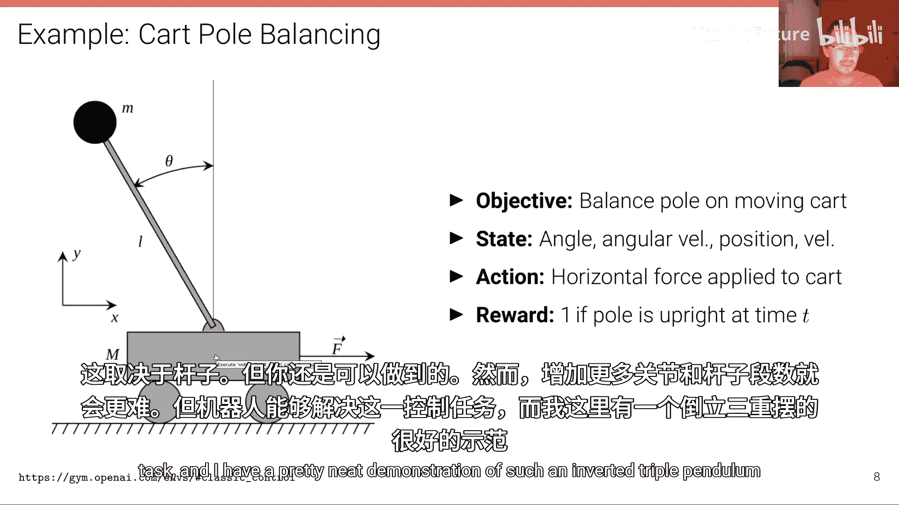
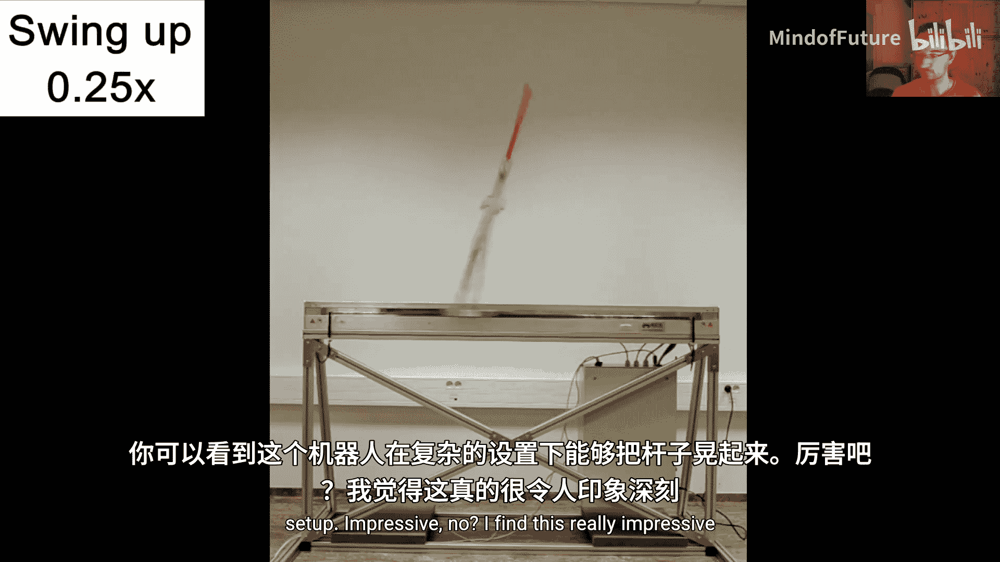
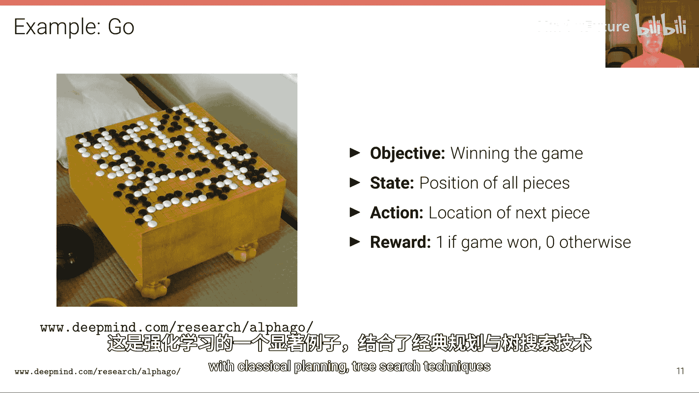
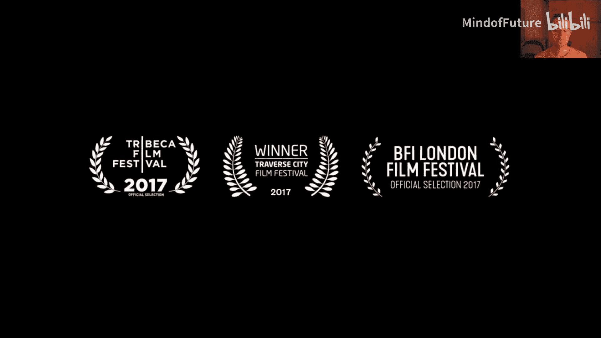
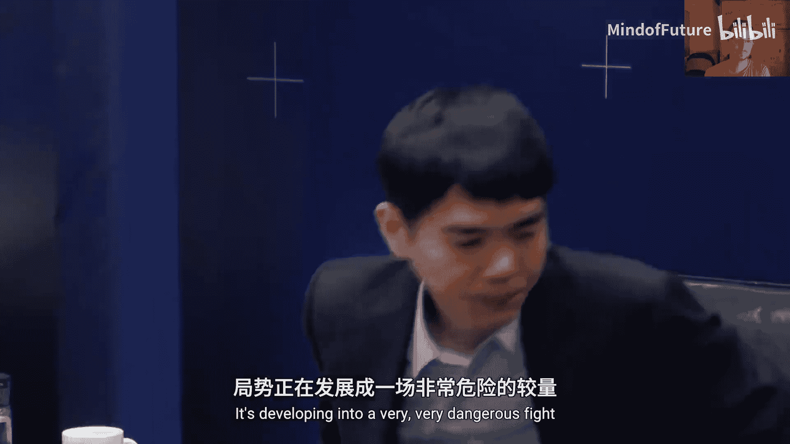
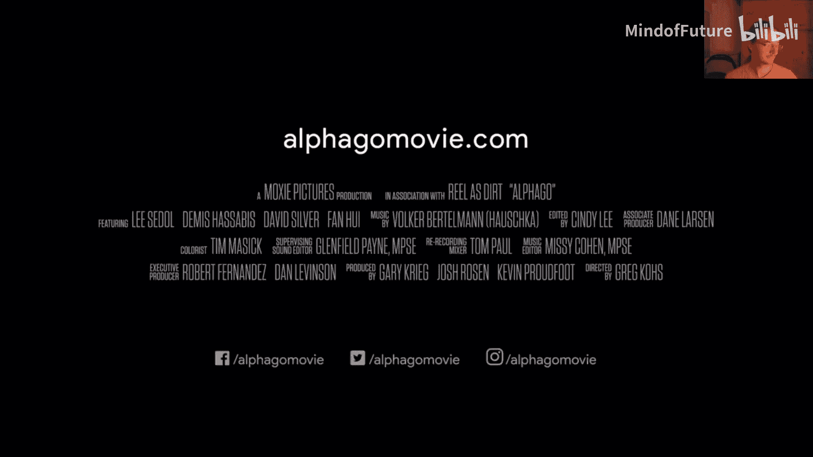
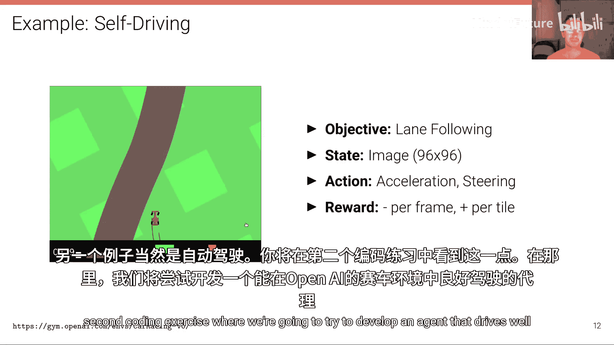
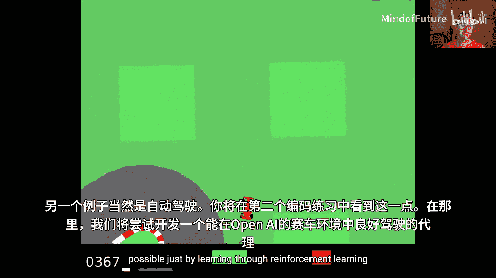
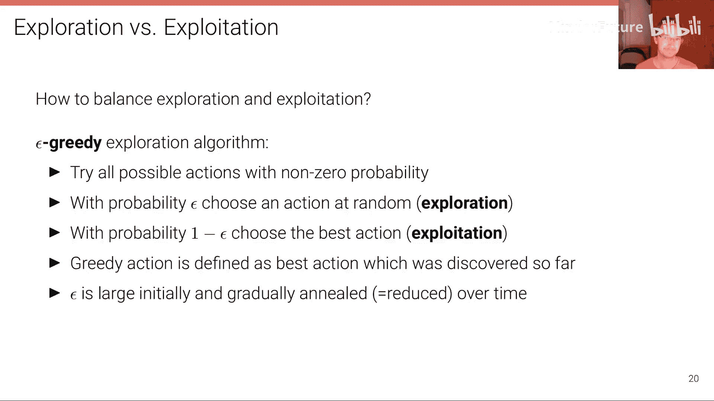

# 013：强化学习与马尔可夫决策过程 🚗

在本节课中，我们将要学习强化学习，这是一种无需专家演示即可学习机器人策略的流行技术。我们将通过马尔可夫决策过程这一框架来正式定义强化学习问题。

在第二讲和第三讲中，我们看到了如何通过模仿专家行为或预测专家可操作性来学习端到端的自动驾驶模型。本节课我们将讨论另一种技术，即强化学习。

本节课分为四个单元。在第一单元，我们将通过马尔可夫决策过程框架正式定义强化学习问题。在第二单元，我们将学习贝尔曼方程，以及它如何引出强化学习中最基础的算法之一——Q学习。最后，在第三单元，我们将了解基于深度神经网络的Q学习版本，即深度Q学习及其变体。

让我们从马尔可夫决策过程开始。

## 从监督学习到强化学习 🔄

到目前为止，我们考虑的是监督学习。模仿学习是一个监督学习问题，它需要大量的专家演示，我们基本上是试图模仿专家。这种方法的缺点当然是，首先我们必须能够获得这些专家演示，其次这些损失函数实际上并不是我们理想中想要优化的损失函数。它们是辅助损失函数，只是告诉我们希望接近专家，并且它们具有非常短期的效果。例如，在模仿学习中，我们对动作有逐帧的损失，我们不考虑未来，不预测未来会发生什么，只是通过模仿专家来隐式地做到这一点。同样，在直接感知中，我们看到我们在可操作性指标上设置了逐帧损失函数。

本节课我们将考虑一种不同的方法，我们不再试图模仿专家。相反，我们将尝试通过与环境的探索、利用和交互，基于我们真正关心的损失来学习模型。这些损失函数与我们之前为模仿学习考虑的转向角L1损失等标准损失函数非常不同。这些损失函数更加通用，它是一个更通用的框架。例如，损失函数可以包括我们希望最小化到达目标位置的时间（这是自动驾驶中我们希望做的），或者碰撞次数，或者驾驶时承担的风险，或者我们希望最大化舒适度等。因此，我们可以用强化学习框架中这种通用的损失函数来形式化自动驾驶。

## 机器学习的三大类别 📊

在机器学习教科书中，学习通常被分为三个不同的类别。

第一类我们已经见过，这是经典的机器学习框架，称为**监督学习**。我们有一个数据集，包含X、Y数据标签对。目标是学习从x到y的映射。这方面的例子包括图像分类、回归、模仿学习、可操作性学习等。

相比之下，在**无监督学习**中，我们只提供一个数据集，目标是发现数据背后的结构。例子包括聚类、降维、特征学习等。这种方法也被用于自动驾驶的上下文中，例如，使用简单的重建损失和图像重建损失来学习环境的世界模型，以学习高维状态的良好压缩。

最后，我们有**强化学习**，这就是我们本节课要讨论的内容。与前两种学习类型不同，智能体与环境交互。环境向智能体提供数值奖励信号，目标是智能体应该学习如何采取行动以最大化环境提供的奖励。这方面的例子包括学习机器人手臂的操纵任务（例如学习抓取物体）或控制任务，正如我们今天将看到的。

## 强化学习循环图示 🔁

强化学习可以用一个简单的图表来说明。

我们有一个在环境中运行的智能体，智能体可以是在真实世界环境或模拟环境（如Carla）中运行的自动驾驶汽车。智能体在时间T观察环境状态S_T。环境向智能体提供或暴露其状态（或部分状态）。通常，你无法获得环境的完整图像或完整状态，你只能看到环境的一部分。例如，汽车可能只拍照，所以你无法获得环境的3D状态，你只有一个2D投影，可能只是环境某个区域的投影，而不是智能体运行的整个世界。因此，状态通常是不完整的。然后，智能体在时间t将其动作A_T发送给环境。它基于当前状态，尝试为该状态、该观察做出最优动作。汽车观察图像，并根据所见适当转动方向盘。接着，环境向智能体返回两样东西：它返回奖励。奖励告诉智能体该动作有多好。例如，如果自动驾驶汽车到达了目标，它会告诉汽车这很好；如果汽车撞到了行人，它会告诉汽车这不好；如果它闯了红灯，它会告诉汽车这不好，发生了碰撞，这不好。所以环境返回奖励R_T，它评判动作A_T，这是一个简单的数值，可以是正数或负数。智能体希望最大化奖励，希望获得尽可能多的奖励，并最小化负奖励。环境返回的第二样东西是下一个状态。环境根据智能体的动作（当然也包括场景中所有其他智能体的动作，例如在像Carla这样的模拟器中模拟的），转换到下一个状态。例如，如果智能体向前移动，环境将下一个相机位置的图像提供回智能体，这就是观察S_T+1。

因此，强化学习的目标是选择动作以最大化未来的总奖励。环境提供奖励，我们希望获得尽可能多的正奖励。然而，动作可能具有非常长期的后果。例如，在自动驾驶中，我们可能只有在到达目标时才有奖励。这可能发生在驾驶一分钟后、30分钟后或两小时后。在到达那里之前，我们可能没有很多奖励。这使得学习问题变得非常困难，强化学习是一个真正困难的问题。此外，奖励可能是延迟的，而不是即时的。环境可能不会立即给你奖励，尽管你做了一个好的动作。因此，为了获得更多的长期奖励，牺牲即时奖励对智能体来说可能更好。这有一些例子，说明了这个问题有多困难。智能体需要在短期内决定下一个动作，它可能需要决定一个次优的动作，以便在长期获得非常高的奖励。例子包括可能需要数月才能成熟的金融投资，或者考虑一架需要救援人员但燃料不足需要加油的救援直升机。加油需要时间，但它可能会防止几小时后的坠毁。或者一个非常典型的例子是国际象棋游戏，牺牲一个特定的棋子，在短期内让你在棋盘上的棋子更少，但从长远来看可能帮助你赢得游戏。所以这使得问题变得非常困难。

## 强化学习问题实例 🎮

现在，让我们看一些具体例子，以更好地了解不同的强化学习问题可能是什么样子。

其中一个最简单的例子是所谓的**移动小车倒立摆平衡问题**。我们有一个可以左右移动的小车，我们可以向该小车施加一个力，使其向左或向右移动。这个问题的目标是平衡移动小车上的杆子，我们希望杆子保持直立。开始时，杆子可能实际上是朝下的，所以我们必须把它抬起来。状态是杆子的角度（这里有一个关节，所以这是角度）、角速度（角度的一阶导数）、小车在x方向的位置以及小车的速度。所以我们有一个四维状态空间，与自动驾驶或其他问题相比，这是一个非常简单的状态空间。而且，在这种情况下，它实际上是完全可观测的，不像我之前提到的自动驾驶，我们只有一张看不到一切的图片，但在这里我们看到了一切，我们只有这四个值。动作是施加水平力使杆子直立，但奖励，正如你在这里看到的，非常稀疏。如果杆子在时间T直立，奖励为1，否则为0。所以如果杆子朝下，系统（智能体）必须与环境互动，才能实际观察到第一个奖励，这使得问题非常困难。这个问题甚至可以变得更难。像这个倒立摆问题，人类可以解决。这很难，你可以自己尝试，把一根杆子放在手上，试着平衡它。这很难，取决于杆子。但你可以做到。但是，添加更多关节和更多杆段会使它变得更加困难。然而，机器人可以解决这个控制任务，我有一个相当巧妙的演示，展示了这样一个倒立三摆。可以看到机器人如何能够摆动它们的杆子竖起来。尽管设置复杂，但令人印象深刻。

另一个例子是**机器人运动**。这是取自OpenAI Gym中机器人学校环境的一个例子，我们的自动驾驶也发生在这个环境中。这只是OpenAI Gym中的另一个环境。这里的目标是，我们有一个由几块骨头和关节组成的机器人，就像机器人的铰接结构。你可以看到这里有不同的机器人。目标是让机器人向前移动。状态是所有关节的位置和角度，动作是我们可以施加在关节上的扭矩，类似于之前的倒立摆问题，但现在是一个复杂得多的铰接机器人。我们希望机器人学习如何移动。机器人对如何移动一无所知，所以我们希望学习如何移动。如果机器人（智能体）直立并向前移动，奖励为1，否则为0。以下是一些这些机器人使用强化学习学到的行为的例子。它们实际上已经学会了保持直立（不倒下）并同时尽可能快地向前移动的策略。你可以看到有趣的行为出现，其中一些行为实际上与真实生物也学会的行为相似。

另一个例子是**Atari游戏**。这是来自OpenAI Gym的Atari环境。它提供了一整套Atari游戏，你可以在这里看到。它们直接带有奖励，因为它们有游戏状态，有分数，你可以在游戏中看到你的分数，你可以从那里检索你的分数，你可以用它作为奖励来尝试学习这些游戏。因此，目标是最大化游戏分数，即奖励。状态只是屏幕的原始像素，210乘以160像素。对于其中一些游戏，使用强化学习来学习真的很容易，而那些具有非常复杂行为并需要长期规划的游戏则更难学习。动作是键盘上的标准动作：左、右、上、下。奖励是如果分数在时间T增加或减少。这就是你想要最大化的游戏分数。

你可能都听说过AlphaGo及其后继者。这也是强化学习的一个突出例子，在这种情况下，与经典的规划树搜索技术相结合。围棋是世界上最古老的持续进行的棋盘游戏，它是最简单也是最抽象的之一。在围棋上击败职业选手是人工智能长期以来的挑战。我们在人工智能中尝试过的一切，在尝试围棋游戏时都失败了。棋盘上可能的配置数量比宇宙中的原子数量还要多。AlphaGo找到了一种学习如何下棋的方法。到目前为止，AlphaGo已经击败了我们给它的每一个挑战，但在我们与像李世石这样的世界顶级棋手对弈之前，我们不会知道它的真正实力。这甚至有一部关于AlphaGo的电影。目标很简单，赢得游戏。它是完全可观测的。状态空间很简单，但由于可能出现的许多情况，它极其庞大。所以状态只是所有棋子的位置，动作是下一个棋子的位置。环境的定义超级简单。如果游戏赢了，奖励为1，否则为0，这是非常长期的奖励，极其长期的奖励，这使得它很热门。

另一个例子当然是**自动驾驶**。你将在第二个编码练习中看到这一点，我们将尝试开发一个在OpenAI Car Racing环境中驾驶良好的智能体，并尝试仅通过强化学习通过尽可能多的灰色瓷砖。这是一个智能体在这里驾驶的例子。在这种情况下，目标是车道跟随，状态也是图像，96乘以96像素，动作是加速和转向。如果我们继续到下一帧，奖励是负的。所以每一帧，我们得到一个负奖励。而我们每通过一个灰色瓷砖，就会得到一个正奖励。换句话说，我们希望尽可能在尽可能短的时间内通过尽可能多的灰色瓷砖。

## 马尔可夫决策过程形式化 📐

再次回到我们之前见过的强化学习循环，我们如何用数学形式化RL问题？

我们使用所谓的**马尔可夫决策过程**来实现。马尔可夫决策过程，简称MDP，定义了一个元组 (S, A, R, P, γ)。这个元组的五个组成部分是什么？

*   **S** 是所有可能状态的集合。例如，在围棋游戏中，是所有可能棋子在棋盘上组合的集合。
*   **A** 是所有可能动作的集合。
*   **R** 是给定状态-动作对的当前奖励的分布。因为环境可能具有随机性，我们在这里考虑最一般的情况。我们有一个分布。它可以是确定性的，给定一个状态和动作，它可以只是一个映射到R的函数，但它也可以是一个分布。其中可能存在不确定性，这通常是情况，例如，当我们有游戏或由于测量噪声导致的不确定观察时，事物是不确定的。所以我们考虑给定状态-动作对的奖励分布。
*   **P** 是这个元组的第四个元素，是给定状态-动作对的下一个状态的分布。所以是 P(S_{t+1} | S_t, A_t)。这是环境如何转换到下一个状态。
*   **γ** 是所谓的**折扣因子**，它决定了未来奖励的价值。它降低了未来奖励的价值，因为智能体只能向前看有限的步数。通常，考虑一百万年后的奖励与一分钟后的奖励价值相同是没有意义的。这就是这个折扣因子的作用。我们将在下一单元更详细地讨论这个问题。

几乎所有的强化学习问题都可以形式化为马尔可夫决策过程。这就是为什么它们提供了这个强大的数学框架，我们将在其中进行操作。

它们被称为马尔可夫决策过程，是因为它们遵循**马尔可夫性质**。马尔可夫性质指出，当前状态完全表征了世界的状态。这意味着，当且仅当 P(S_{t+1} | S_t) = P(S_{t+1} | S_1, ..., S_t) 时，状态S是马尔可夫的。换句话说，当前状态仅依赖于前一个状态。如果前一个状态已知，那么前一个状态之前的所有状态都不再重要。这就是马尔可夫性质。你可能已经通过隐马尔可夫模型或卡尔曼滤波器等熟悉这个了。

以下是一些与此等价的陈述：例如，给定现在，未来独立于过去；或者状态捕获了历史中所有相关信息；一旦状态已知，历史就可以被丢弃；状态S_t是未来的充分统计量，我们不需要知道以前的状态。

## MDP中的强化学习循环 🔄

现在让我们回到强化学习循环，我们已经在右边看到过，现在让我们在引入的马尔可夫决策过程的背景下看看这个循环。

我们从时间 t=0 开始。在时间 t=0，第一步。在第一步，环境从状态分布 P(S_0) 中采样初始状态。所以我们得到第一个状态。然后，对于 t=0 直到我们完成（直到模拟结束，有时也称为一次“rollout”，即策略在环境中与环境交互的展开）。所以对于 t=0 直到完成，智能体选择一个动作 A_t。然后环境采样奖励 R_t（给定状态和动作）以及下一个状态。智能体接收奖励和下一个状态，并选择下一个动作，依此类推。

## 策略：动作选择机制 🎯

我们实际上如何选择一个动作呢？我们已经知道选择动作的机制，它被称为**策略**。我们在模仿学习的背景下见过策略，我们将在这里再次在强化学习的背景下看看策略。

策略 π 是一个从状态空间到动作空间的函数，它指定在每个状态下要采取什么动作。给定任何状态，这个函数告诉我们应该采取什么动作，而策略正是我们想要学习的东西。它通常是一个由某些参数参数化的神经网络，或者如果状态和动作空间是离散的，它可能是一个查找表。因此，策略完全定义了一个智能体的行为。策略可以是确定性的，我们有一个从S到A的直接映射函数；也可以是随机的，它模拟不确定性，给我们返回一个分布。我们将其表示为 π(a|s)，即分布 P(A_t = a | S_t = s)。

作为一个小备注，MDP策略仅依赖于当前状态（正如你在这里看到的），而不依赖于整个历史。然而，当前状态当然可以包含过去的观察结果。这只是我们如何定义状态的问题。我们可以将状态定义为一个帧缓冲区，例如，我们作为智能体观察到的最后10帧图像的缓冲区。在这个形式化中，这完全没问题。这只是我们如何定义状态的问题。

## 如何学习策略？🤔

我们已经看到了一种方法，称为模仿学习。我们使用监督学习直接从专家演示中学习策略。

然而，在强化学习中，我们假设没有给出专家演示。相反，我们通过试错来学习策略。智能体自己发现哪些动作能最大化预期的未来奖励，这是我们想要最大化的量。智能体与环境交互并获得奖励，智能体发现好的动作，并根据通过这个试错游戏给予智能体的奖励来改进其策略π。

## 探索与利用的权衡 ⚖️

那么我们如何发现好的动作呢？我们需要探索状态-动作空间。这也使得RL在现实世界中通常不安全且难以执行。有一个完整的研究分支关于如何使RL安全，但当然，如果我们在模拟器中，比如在Carla中模拟自动驾驶，那就容易得多，因为我们不会构成任何安全风险，我们也可以模拟和探索不安全的场景。

因为我们需要探索状态-动作空间，我们一无所知，我们没有专家可以模仿。我们在这里结合了两个任务，这是强化学习的两个基本任务。

第一个任务称为**探索**。探索的目标是在状态S中尝试一个新动作A，然后我们观察奖励R_t。我们不知道那个动作是好是坏，但我们不在乎，我们只是想看看会发生什么。这就是为什么它被称为探索。探索发现了更多关于环境的信息，但牺牲了在该“回合”中给出的总奖励。因为我们正在尝试一个动作，在大多数情况下，这个动作实际上不会是一个好动作。然而，通过体验新的状态，我们可能在某个时候找到一个真正好的动作，因此我们可以从中学习，并尝试在未来更频繁地执行该动作。所以探索在开始时特别有用，当我们对环境一无所知时，我们需要探索，我们真的没有其他选择。我们需要探索才能找到有用的动作。游戏玩法中的一个例子是走一步新颖的实验性棋步。我们不知道会发生什么，我们尝试一下，看看这会导致什么。

RL中的另一个基本任务称为**利用**。在利用中，我们使用一个先前发现的好动作，一个我们知道是好动作的动作。当然，通过使用一个我们知道对特定状态有益的动作，通过利用这些信息，我们正在最大化奖励，因为我们知道这是一个好动作。但同时，我们牺牲了未探索的区域。如果我们只利用，如果我们发现了一些好动作，但我们没有考虑状态空间的大部分区域，在那里也许可以获得更高的奖励。我们陷入了一个循环，我们只是在探索我们已经知道的区域，从某种意义上说，我们只得到这个小奖励。所以游戏玩法中的例子是走你认为最好的一步。

在实践中，这两者之间存在权衡，你需要在探索和利用之间进行权衡。同时进行探索和利用很重要。开始时，你想从探索开始。随着你的智能体变得更好，你想更多地转向利用，因为你已经在更好的状态下运行了。

## ε-贪心探索算法 🎲

但是如何平衡探索和利用呢？有一个所谓的**ε-贪心算法**正是这样做的。

ε-贪心探索算法以非零概率尝试所有可能的动作。具体来说，以概率 ε，它随机选择一个动作，完全随机。这就是探索。以概率 1-ε，我们选择最佳动作。这就是利用。贪心动作被定义为迄今为止发现的最佳动作。所以最佳动作在某种意义上就是贪心动作，你查看一个状态的所有可能动作，查看你当前的策略，并最大化它以进行利用。以 1-ε 的概率，你进行利用移动；以 ε 的概率，你进行探索移动。

如前所述，在开始时，当你对环境一无所知时，你必须探索。因此，ε 的调度是这样的：开始时选择一个较大的 ε，然后逐渐退火，随着时间的推移逐渐减小它，这样当你的策略变得越来越好时，你就从探索转向利用。你希望更多地利用状态空间中那些能给你高奖励的区域，因为如果你在这些高价值区域探索，而不是随机地到处探索，你可能会发现一些更好的奖励。

---

本节课中我们一起学习了强化学习的基本概念，特别是通过马尔可夫决策过程框架来形式化问题。我们了解了强化学习循环、策略的作用，以及在学习过程中至关重要的探索与利用之间的权衡。下一节我们将深入探讨贝尔曼方程和Q学习算法。