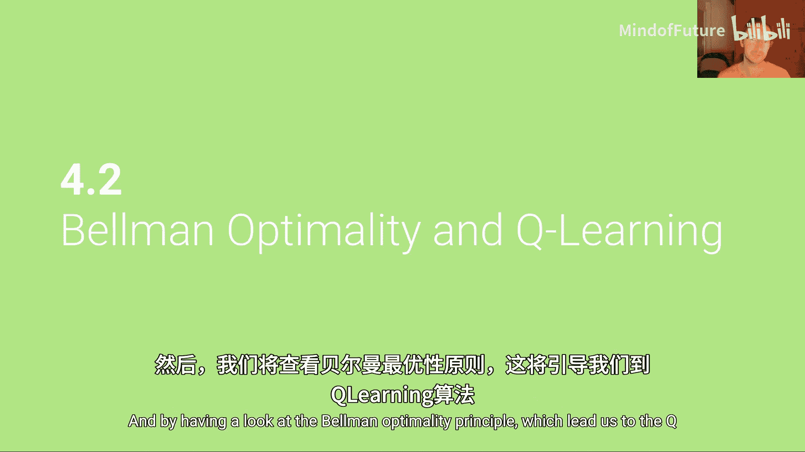
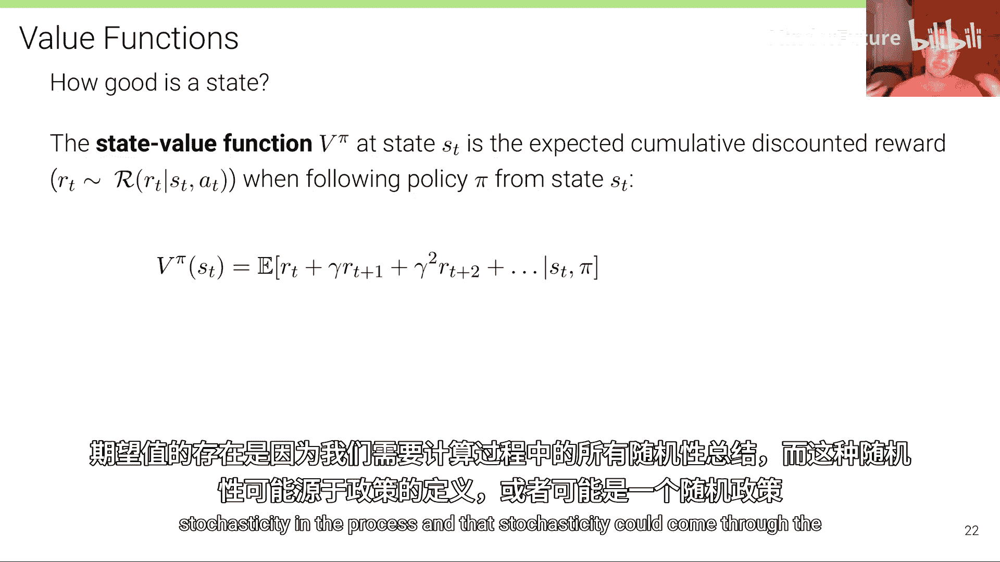
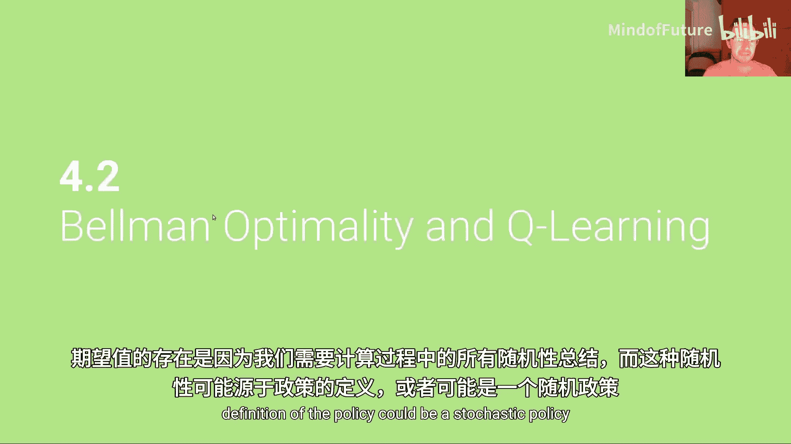
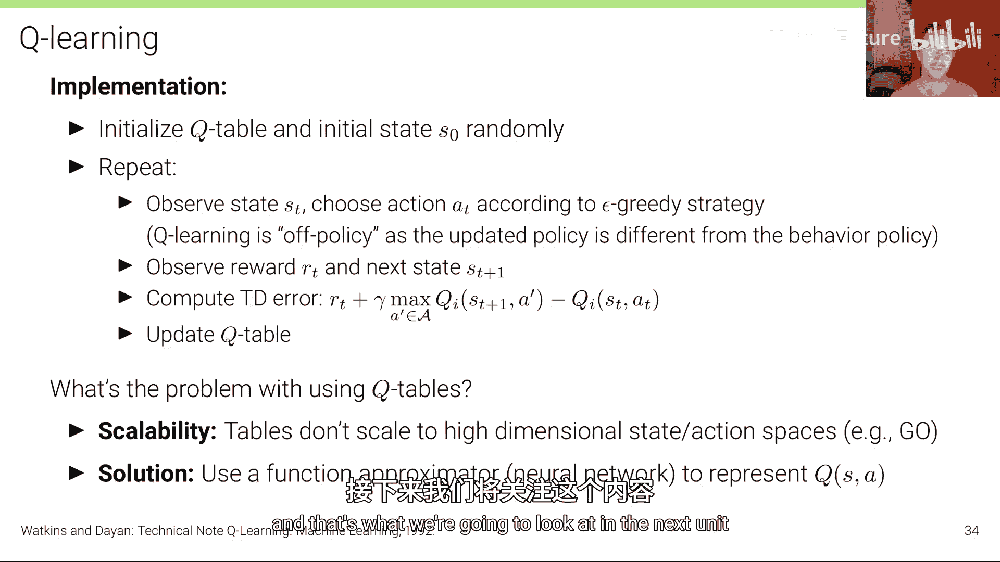

# 014：强化学习 - 贝尔曼最优性与Q学习 🚗🤖

在本节课中，我们将学习第一个，也是最基础、最常用的强化学习算法——Q学习。我们将从理解价值函数开始，探讨如何评估未来奖励，并引出贝尔曼最优性原理，最终学习Q学习算法。

## 价值函数

为了通过强化学习进行学习，我们需要知道一个状态的好坏。状态的好坏只能通过从该状态开始，遵循特定策略行动后所能获得的未来奖励来评估。

### 状态价值函数 V

状态价值函数 **V** 是针对一个固定策略 **π** 定义的。函数 **V^π** 在状态 **s_t** 的值，表示从状态 **s_t** 开始，遵循策略 **π** 所能获得的**期望累积折扣奖励**。

其数学定义如下：

**V^π(s_t) = E[ Σ_{k=0}^{∞} γ^k * r_{t+k} | s_t, π ]**

其中：
*   **E** 表示期望值，用于汇总策略、状态转移和奖励中可能存在的随机性。
*   **γ** 是折扣因子，取值范围在 0 到 1 之间（通常接近1）。它决定了未来奖励在当前时刻的价值，**γ^k** 使得更近期的奖励比远期奖励权重更高。例如，若 γ=0.5，则下一步奖励的权重仅为当前奖励的一半。

### 动作价值函数 Q

动作价值函数 **Q** 用于评估在特定状态下采取某个动作的好坏。函数 **Q^π** 在状态 **s_t** 和动作 **a_t** 的值，表示在状态 **s_t** 采取动作 **a_t**，然后遵循策略 **π** 所能获得的期望累积折扣奖励。

其数学定义如下：

**Q^π(s_t, a_t) = E[ Σ_{k=0}^{∞} γ^k * r_{t+k} | s_t, a_t, π ]**

与 **V^π** 的主要区别在于，**Q^π** 额外条件于初始采取的动作 **a_t**，而不是对动作取平均。

## 最优价值函数

上一节我们介绍了在给定策略下的价值函数。本节中，我们来看看理论上最优的价值函数是什么样的。

最优状态价值函数 **V*** 是所有可能策略 **π** 中，能得到的最大 **V^π** 值。它代表了在最优策略下，从某个状态开始能获得的最大累积折扣奖励。

**V*(s) = max_π V^π(s)**

类似地，最优动作价值函数 **Q*** 是所有可能策略 **π** 中，能得到的最大 **Q^π** 值。

**Q*(s, a) = max_π Q^π(s, a)**

**Q*** 具有一个关键性质：如果我们知道了 **Q***，那么最优策略 **π*** 也就随之确定了。我们只需要在每个状态 **s** 下，选择能使 **Q*(s, a)** 最大化的动作 **a** 即可。

**π*(s) = argmax_a Q*(s, a)**

然而，对于大多数有趣的问题，直接枚举所有策略来寻找 **Q*** 是计算上不可行的。它更多是一个理论概念。

## 一个简单示例：网格世界 🌐

为了直观理解最优策略，让我们看一个简单的“网格世界”例子。智能体在离散网格中移动，目标是到达标记为星号的终止状态，且每走一步都会获得一个负的奖励（惩罚），因此智能体需要尽快到达终点。

一个随机策略会为每个状态下的四个动作（上、下、左、右）分配相等的概率。而最优策略则如下所示：在靠近终点的格子，策略会指向直接到达终点的方向；在更远的格子，策略会指向通往终点的最短路径方向。

这个例子中，最优策略可以通过观察轻松得出。但对于复杂问题（如围棋或自动驾驶），我们无法通过“肉眼”观察得到最优策略。

## 贝尔曼最优性方程

既然直接搜索所有策略不可行，我们如何求解最优策略呢？这就是贝尔曼最优性方程发挥作用的地方。

贝尔曼最优性方程以理查德·E·贝尔曼命名，是动态规划和最优控制理论的核心。它将 **Q*** 函数表达为一个递归形式。

对于最优动作价值函数 **Q***，贝尔曼最优性方程如下：

**Q*(s_t, a_t) = E[ r_t + γ * max_{a} Q*(s_{t+1}, a) | s_t, a_t ]**

这个方程非常强大，它将一个需要计算未来所有时间步奖励的长期问题（原始定义），转化为一个只向前看一步的递归问题。方程包含两部分：
1.  **当前奖励 r_t**：在状态 **s_t** 执行动作 **a_t** 后立即获得的奖励。
2.  **未来价值**：折扣因子 **γ** 乘以在下一个状态 **s_{t+1}** 所有可能动作中，最大的 **Q*** 值。

这个方程是非线性的（因为包含 max 算子），通常没有闭式解。但幸运的是，我们可以使用迭代方法来求解它，其中最著名的就是 Q 学习算法。

## Q学习算法

上一节我们介绍了求解 **Q*** 的理论框架——贝尔曼最优性方程。本节中，我们来看看如何通过 Q 学习这个迭代算法来实际求解它。

Q 学习通过迭代更新来逼近 **Q*** 函数。其核心更新规则如下：

**Q_{i+1}(s_t, a_t) ← (1 - α) * Q_i(s_t, a_t) + α * [ r_t + γ * max_a Q_i(s_{t+1}, a) ]**

其中：
*   **α** 是学习率，控制着新信息覆盖旧估计的速度。
*   **γ** 是折扣因子。
*   **max_a Q_i(s_{t+1}, a)** 是基于当前估计 **Q_i**，对下一状态最优未来价值的估计。

这个规则可以重写为更常见的形式，突出其“时序差分”的本质：

**Q_{i+1}(s_t, a_t) ← Q_i(s_t, a_t) + α * [ r_t + γ * max_a Q_i(s_{t+1}, a) - Q_i(s_t, a_t) ]**

方括号内的项称为**时序差分误差**，它代表了当前估计与“目标值”（即时奖励加上对未来价值的估计）之间的差异。算法通过向目标值方向调整当前估计来学习。

以下是 Q 学习的基本步骤：
1.  初始化 **Q** 表（例如，全零或随机值）。
2.  重复以下过程：
    *   观察当前状态 **s_t**。
    *   根据 **ε-贪心**策略选择一个动作 **a_t**（以概率 ε 进行探索，随机选动作；以概率 1-ε 进行利用，选择当前 **Q** 值最高的动作）。
    *   执行动作 **a_t**，观察奖励 **r_t** 和下一个状态 **s_{t+1}**。
    *   使用上述更新规则更新 **Q(s_t, a_t)**。
3.  在足够多的迭代后，**Q** 函数会收敛到 **Q***（在适当条件下已被证明）。

需要注意的是，Q 学习是一种**离策略**算法，因为用于更新 **Q** 值的策略（贪婪策略，即 `max_a Q_i`）与智能体实际执行动作的策略（ε-贪心策略）是不同的。

## 从表格到函数逼近

Q 学习算法简单有效，但其经典形式依赖于用表格来表示 **Q(s, a)**。这对于状态和动作空间是离散且较小的问题很有效。

然而，表格法存在严重的**可扩展性问题**。对于状态或动作空间非常大甚至是连续的问题（例如围棋有超过宇宙原子数量的可能状态，自动驾驶的摄像头输入是连续的像素图像），我们无法创建和维护一个巨大的表格。

解决方案是使用**函数逼近器**（如神经网络）来代表 **Q** 函数。我们可以构建一个神经网络，以状态 **s** 和动作 **a** 作为输入，输出对应的 **Q** 值估计。例如，在自动驾驶中，可以使用卷积神经网络处理图像输入。这种方法被称为深度 Q 网络，我们将在后续单元中详细探讨。

## 总结

本节课中，我们一起学习了强化学习的核心算法——Q学习。我们从定义状态价值函数 **V** 和动作价值函数 **Q** 开始，理解了它们如何评估未来奖励。接着，我们探讨了最优价值函数 **Q*** 的概念，并认识到它直接隐含了最优策略。然后，我们通过贝尔曼最优性方程，建立了递归求解 **Q*** 的理论基础。最后，我们详细介绍了 Q 学习算法，它通过迭代更新时序差分误差来逼近最优动作价值函数，并讨论了使用函数逼近器（如神经网络）来解决高维状态/动作空间的可扩展性问题。