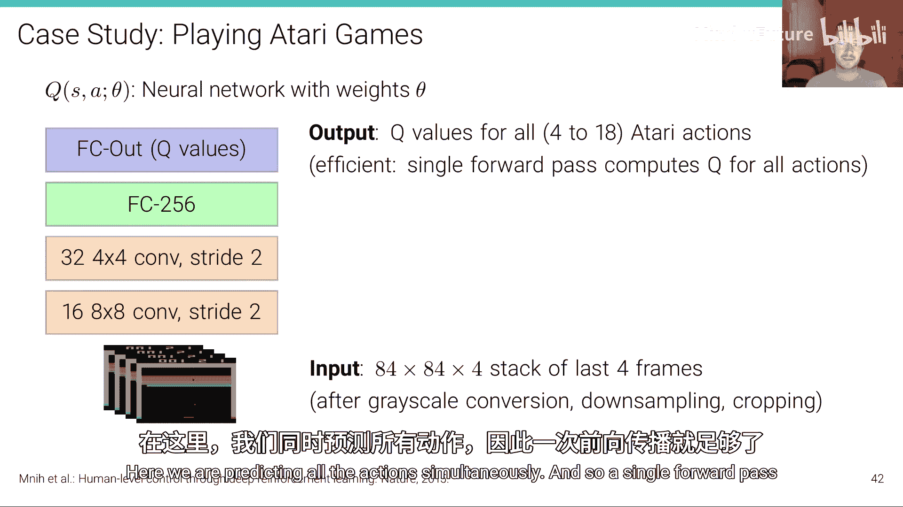
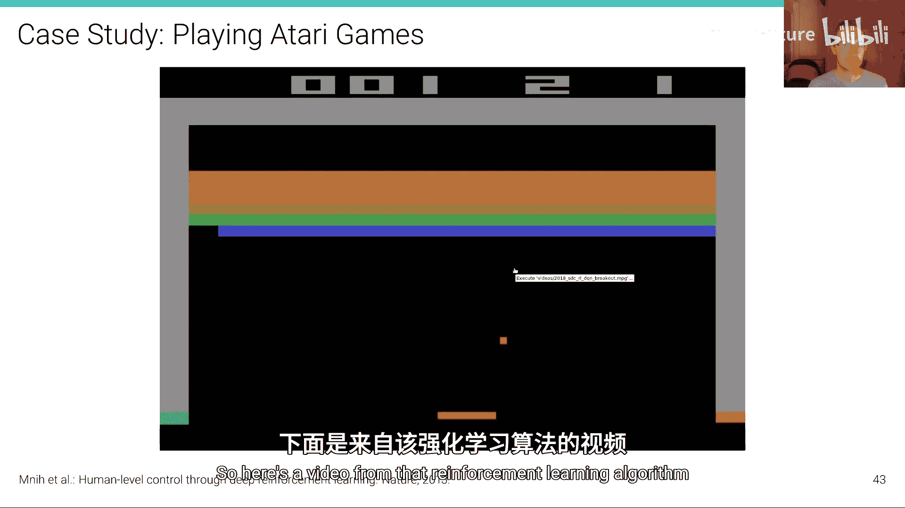
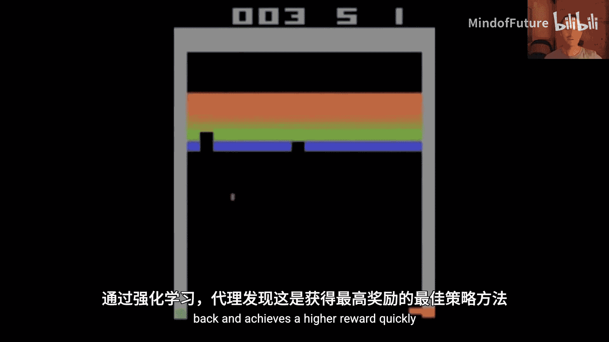
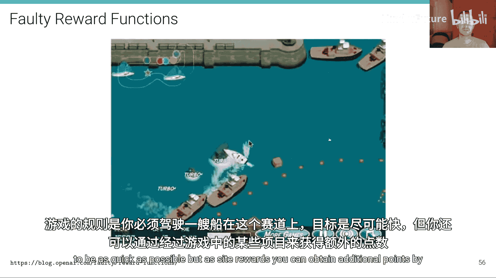
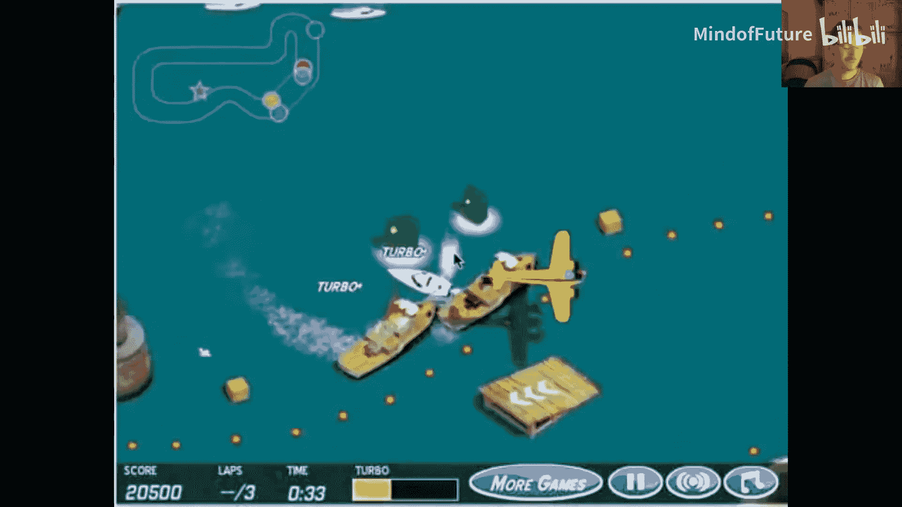
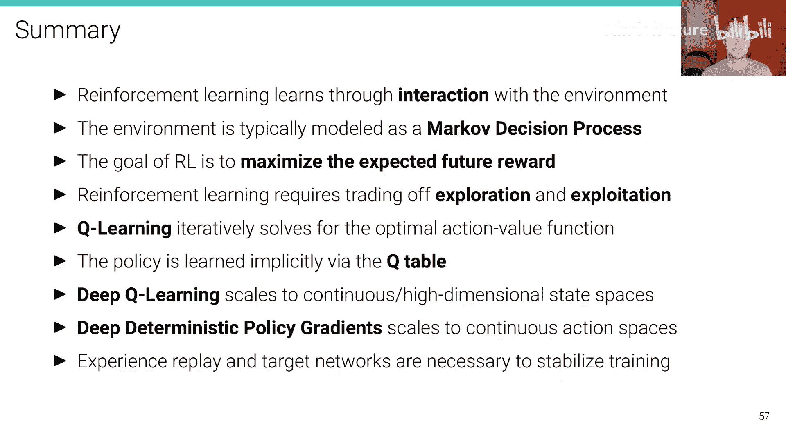

# 015：深度Q学习 🚗🤖

在本节课中，我们将要学习如何将深度神经网络与经典的Q学习算法相结合，以处理高维状态空间，例如图像输入。我们将探讨深度Q学习（Deep Q-Learning）的核心思想、面临的挑战以及关键的改进技术。

## 概述

在上一单元中，我们介绍了Q学习。我们看到Q学习是一种强化学习算法，能够处理简单、离散且低维的状态空间。然而，它无法处理高维状态空间，例如围棋游戏，因为可能的状态数量太多，无法用表格枚举。这正是深度Q学习发挥作用的地方。

## 从Q表到深度Q网络

在深度Q学习中，我们通过使用深度神经网络作为函数逼近器来估计Q值，从而缓解了Q表容量有限的问题。这在数学上可以表示为：

**Q\*(s, a) ≈ Q(s, a; θ)**

其中，**Q(s, a; θ)** 是一个参数为 **θ** 的神经网络，它以状态 **s** 和动作 **a** 作为输入，输出对应的Q值。

这种方法有两种变体：
1.  第一种变体如之前所述，神经网络以状态和动作为输入，输出单个Q值。
2.  第二种更实用的变体是，神经网络仅以状态为输入，并输出一个向量，其中每个元素对应一个可能动作的Q值。例如，如果有10个动作，网络就输出一个10维向量。

第二种架构的优势在于，要找到最优动作，我们只需一次前向传播并选择输出值最大的动作，而无需为每个可能的动作单独计算Q值。

## 训练深度Q网络

训练Q网络包括前向传播和反向传播。

*   **前向传播**：计算损失函数，即Q值的均方误差。损失函数基于贝尔曼最优方程，目标是使当前Q值预测接近“目标值”（即时奖励加上对未来奖励的估计）。
    **损失 L(θ) = E\[ (目标 - 预测)² \]**
    **目标 = r + γ \* max\_a‘ Q(s‘, a‘; θ)**
    **预测 = Q(s, a; θ)**

*   **反向传播**：计算损失函数相对于网络参数 **θ** 的梯度，并使用随机梯度下降等优化方法更新参数。

然而，直接这样训练会导致优化过程非常不稳定，难以收敛。接下来，我们将看看如何解决这个问题。

## 稳定训练的关键技术

有两项关键技术对于稳定深度Q学习的训练至关重要，它们在一篇2015年发表于《自然》杂志的论文中被提出。

### 经验回放 🧠

为了加速训练，我们使用小批量样本。问题在于，智能体在环境中连续移动产生的样本之间具有强相关性，从这些连续样本中学习效率很低。

经验回放通过存储智能体在每个时间步的经验（即状态、动作、奖励、新状态元组）到一个“回放缓冲区”或“回放记忆” **D** 中来应对这个问题。在训练时，我们从缓冲区中**均匀地随机采样**一批经验。

这种方法打破了样本间的相关性，提高了数据效率，因为每个样本可以被多次使用（“回放”）。实践中，通常使用一个固定大小的循环缓冲区。

### 固定Q目标 🎯

第二个问题是“非平稳目标”。由于我们通过梯度下降不断更新Q网络参数 **θ**，用于计算目标值的Q函数本身也在变化，这就像是在追逐一个移动的目标，容易导致振荡甚至发散。

解决方案是使用“固定Q目标”。我们引入一个“目标网络” **Q‘**，其结构与主Q网络相同，但拥有另一套参数 **θ‘**。我们用这个目标网络来计算目标值。关键之处在于，目标网络的参数 **θ‘** 并不会每一步都更新，而是每隔 **C** 步才用主网络的参数 **θ** 来更新一次（例如直接复制）。这样有效地减慢了目标值的变化速度，稳定了训练。

损失函数因此变为：
**L(θ) = E\[ (目标‘ - 预测)² \]**
**目标‘ = r + γ \* max\_a‘ Q‘(s‘, a‘; θ‘)**
**预测 = Q(s, a; θ)**

## 深度Q学习算法

结合了经验回放和固定Q目标的深度Q学习算法步骤如下：

1.  根据ε-贪婪策略选择并执行动作 **a\_t**。
2.  将经验 **(s\_t, a\_t, r\_t, s\_{t+1})** 存储到回放缓冲区 **D** 中。
3.  从 **D** 中随机采样一个小批量的经验。
4.  使用**目标网络**的参数 **θ‘** 计算Q目标值。
5.  计算当前Q网络预测值与目标值之间的均方误差损失。
6.  对损失执行随机梯度下降，更新**主Q网络**的参数 **θ**。
7.  每隔C步，将主网络参数 **θ** 复制给目标网络参数 **θ‘**。

## 深度Q网络实战：玩转Atari游戏

上述算法在Atari游戏（如打砖块）上取得了突破性表现。网络输入是经过处理的84x84像素灰度图像堆叠，经过几个卷积层和全连接层后，输出每个游戏动作的Q值。

一个有趣的现象是，智能体通过强化学习自发地发现了一种高效策略：将球打到砖墙后方，让球在顶部持续弹跳，从而快速获得高分。这展示了算法超越人类直觉策略的能力。

## 深度Q学习的局限与改进

尽管强大，深度Q学习仍有其局限：
1.  **训练时间漫长**：稀疏奖励和深度网络需要大量更新。
2.  **均匀采样效率低**：回放缓冲区中的所有经验被同等对待，但有些经验可能更重要。
3.  **探索策略简单**：依赖ε-贪婪策略。
4.  **需要完全可观测状态**。
5.  **动作空间受限**：只能处理离散、低维动作。

针对这些局限，研究者提出了多种改进算法。

### 深度确定性策略梯度（DDPG）🎭

DDPG算法旨在解决**连续或高维动作空间**的问题。在原始DQN中，处理连续动作需要在每一步优化Q函数，这很困难。

DDPG的解决方案是同时使用两个网络：
*   **演员网络 (Actor)**：一个参数为 **θ^μ** 的确定性策略网络 **μ(s)**，它直接将状态映射到具体的动作。
*   **评论家网络 (Critic)**：一个参数为 **θ^Q** 的Q值网络 **Q(s, a)**，评估在状态 **s** 下采取动作 **a** 的好坏。

**训练过程**：
*   **评论家更新**：类似于DQN，通过最小化时序差分误差来更新，但目标动作由**目标演员网络** **μ‘** 提供。
*   **演员更新**：使用策略梯度定理。演员网络的参数沿着提升Q值的方向更新，即最大化 **Q(s, μ(s))**。梯度公式为：
    **∇\_θ^μ J ≈ E\[ ∇\_a Q(s, a|θ^Q) \|_{a=μ(s)} · ∇\_θ^μ μ(s|θ^μ) \]**

DDPG同样使用经验回放和**软更新**的目标网络来稳定训练。探索通过向演员网络输出的动作添加噪声来实现。

一个令人印象深刻的演示是，一家初创公司使用DDPG配合优先经验回放，仅用几十个训练回合就让一辆真实汽车在简单乡村道路上学会了自动驾驶。奖励信号是安全驾驶员未介入干预的行驶距离。

### 其他改进方向

以下是其他一些重要的改进思路：
*   **异步强化学习**：多个智能体在并行环境中独立探索，共同更新一个共享的全局模型，稳定训练并加速。
*   **Bootstrapped DQN**：使用多个Q头（网络分支）来近似Q值的分布，通过随机选择一个头来引导探索，最终集成以得到更鲁棒的策略。
*   **双Q学习**：解耦动作选择和动作评估所使用的Q函数，使用两个不同的网络（在线网络和目标网络）来分别完成这两个任务，以减少Q值的高估。
*   **循环DQN**：在网络中加入循环层（如LSTM），以处理部分可观测的状态，让网络能够记忆历史信息。

## 奖励函数设计的重要性 ⚠️

最后，我们必须强调设计合适的奖励函数至关重要。强化学习虽然不需要专家示范，但需要精心设计奖励来引导智能体学习期望的行为。一个设计不当的奖励函数可能导致智能体学会“钻空子”，找到一些意想不到但能获得高奖励却不符合初衷的策略。例如，在一个赛车游戏中，智能体可能发现不断绕圈收集道具比真正完成一圈比赛能获得更高的累计奖励。

## 总结

本节课中，我们一起学习了：
*   强化学习通过与环境的交互进行学习，目标是最大化期望累积奖励。
*   Q学习通过迭代更新来求解最优动作价值函数，但受限于表格表示法。
*   **深度Q学习**通过用深度神经网络近似Q函数，解决了高维状态空间的问题。
*   为了稳定训练，**经验回放**和**固定Q目标**是两项核心技术。
*   **深度确定性策略梯度**通过引入独立的演员-评论家架构，将算法扩展到了连续动作空间。
*   我们还简要了解了其他改进技术，如优先经验回放、双Q学习等，并认识到**精心设计奖励函数**是强化学习成功应用的关键。

强化学习是一个广阔且快速发展的领域，为自动驾驶等复杂决策问题提供了强大的工具。