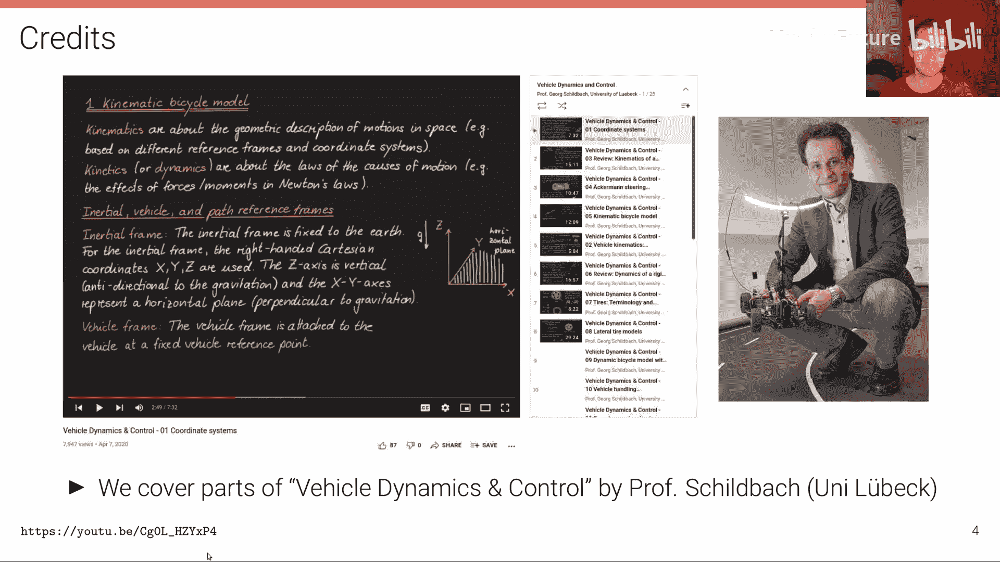
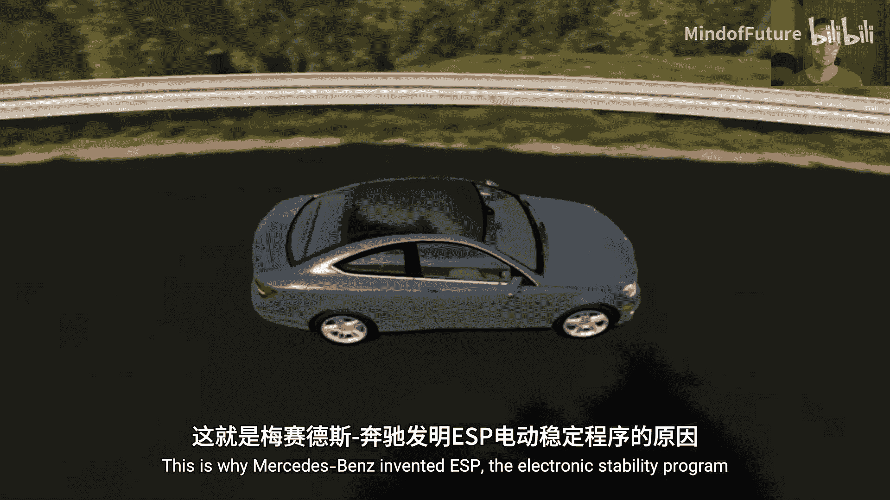
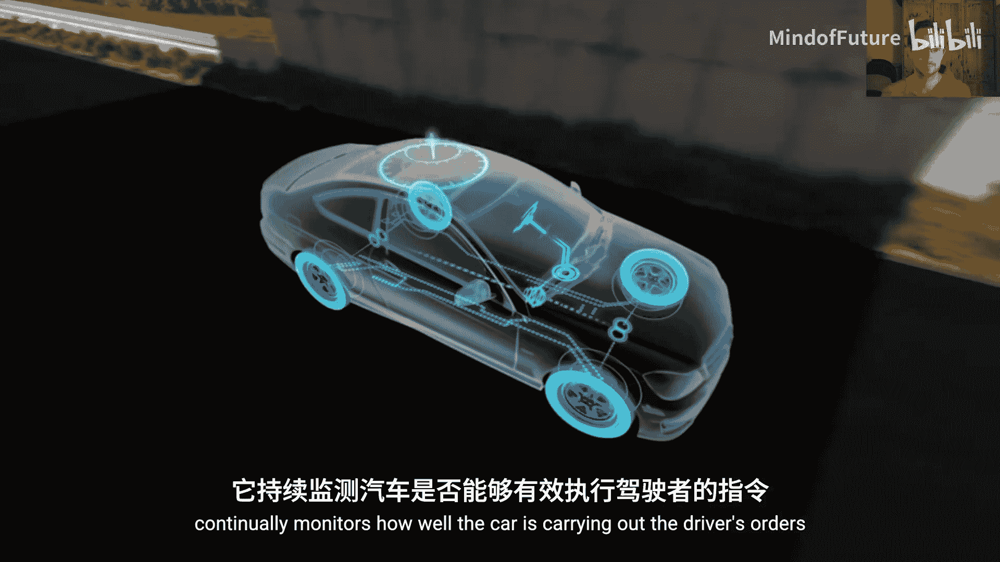
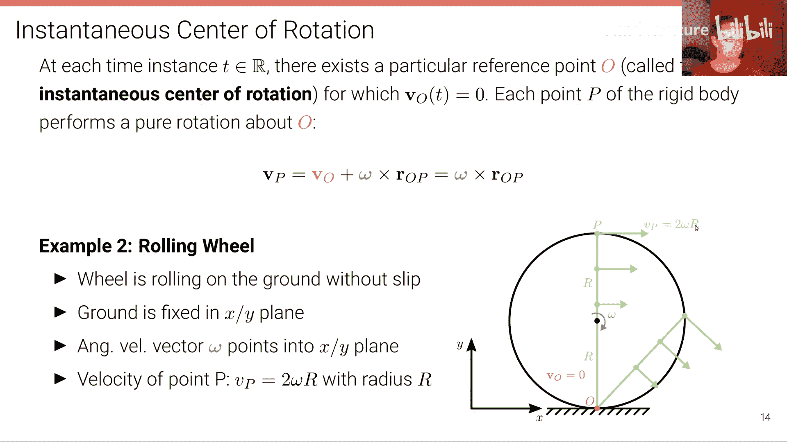

# 016：车辆动力学导论 🚗

在本节课中，我们将要学习车辆动力学的基础知识。我们已经了解到，通过直接从图像映射到车辆控制指令来控制车辆是可行的。但在实践中，通常更优的方法是使用一个独立的控制器来控制车辆。如果我们能很好地理解系统，就能更好地设计这样的控制器。因此，我们需要理解车辆的运动学和动力学，这正是本讲的内容。它涉及大量几何学知识，同时也涉及物理学和机械工程。

本讲分为四个单元。首先，我们将介绍并探讨为何需要更好地理解车辆动力学，并引入一些基本的几何和物理概念。在第二单元，我们将研究最基本的车辆模型，即**运动学自行车模型**。该模型不涉及力的作用，只考虑纯运动学，是一个纯几何模型，也是最简单的模型。接着，我们将研究**轮胎**，以及轮胎如何改变车辆行为，特别是在较高速度下，仅考虑运动学模型是不够的，我们必须同时建模动力学，包括力、摩擦和滑移。这将引导我们进入第四单元要介绍的**动力学自行车模型**。

现在，让我们从导论部分开始。在开始之前，我要特别感谢吕贝克大学Schilpar教授的“车辆动力学与控制”课程，本讲部分内容基于此，这是一门非常出色的课程。如果你想更深入地理解本讲中的概念，我推荐你观看这门课程，链接已在页脚处提供。

## 理解车辆动力学的重要性

如前所述，为了控制车辆，我们需要了解车辆动力学。事实上，今天的汽车内部已经集成了许多复杂的控制器。例如，**电子稳定程序** 独立控制汽车的四个车轮，这些系统正是基于我们对车辆动力学的理解而构建的。

当你驾驶时，许多力作用在你的车辆上。你可能在日常驾驶中感受到其中一些力，比如在转弯时身体会向一侧倾斜。当你转动方向盘时，你的车不只是向一侧移动，它实际上会围绕一个垂直轴旋转。在某些条件下，车辆可能旋转过度或不足，例如当你急转弯避让障碍物、过弯太快或遇到湿滑路面时。这就是为什么梅赛德斯-奔驰发明了**电子稳定程序**。ESP的传感器网络持续监测车辆执行驾驶员指令的情况。ESP将你的转向输入与每个车轮的速度和车辆的旋转速度进行比较。在几毫秒内，ESP就能感知车辆是否偏离了你的预期路线。当你快速转向避让障碍物时，车辆倾向于继续直线前进。此时，ESP会对内侧后轮进行制动，产生一个旋转力，帮助车辆转向你指示的方向。当你恢复时，车辆尾部可能发生侧滑，ESP会对前外侧车轮进行制动，帮助车辆旋转回正确路线。必要时，ESP还可以降低发动机功率以帮助更快地恢复控制。当物理定律与人的本能相遇时，ESP帮助你保持在正确的路线上并保持控制。

因此，理解车辆动力学的一个很好的动机是，我们希望获得对车辆的控制权。控制实际上是下一讲的主要主题，但本讲首先侧重于更精确地理解车辆的行为。

## 基本概念：运动学与动力学

现在，让我们介绍一些非常基础和核心的概念，我们将按顺序构建这些概念，以理解车辆运动学和动力学。

首先定义的两个术语是**运动学**和**动力学**。

*   **运动学** 源自希腊语，意为“运动”或“移动”。它描述点和物体的运动，特别考虑位置、速度、加速度以及更高阶的导数。运动学运动的例子包括天体运动、粒子系统、机械臂或人体骨骼的运动。在右侧，你可以看到一个图示，展示了位置、速度和加速度之间的关系。众所周知，它们通过各自的时间导数相关联：速度是位置的时间导数，加速度是速度的时间导数。如果我们沿着速度方向前进一小步（速度乘以时间），我们就到达了轨迹上的下一个位置。
*   **动力学** 则描述运动的原因，即运动的根本原因。例如，力和力矩的影响。它包含了像牛顿第二定律这样的物理定律：**F = m × a**，即力等于物体的质量乘以它的加速度。这些都是非常基础的物理定律。

这两个概念在本讲中都扮演着基础角色。我们将首先推导不考虑力的**运动学自行车模型**，然后推导一个更现实的、考虑力和动力学的模型，即**动力学自行车模型**。

## 完整约束与非完整约束

我们需要引入的另一个概念是构型空间上的约束，称为**完整约束**。

*   **完整约束** 是对构型的约束。例如，考虑一个在三维空间（X, Y, Z）中自由移动的粒子。我们可以通过将该粒子的Z坐标设置为0来约束它，使其只能在X-Y平面内移动。如果我们这样做，这个粒子就只能移动在由X和Y向量张成的平面内，因为我们只能修改X和Y的位置，而将Z位置固定为0。我们可以将此条件表达为粒子构型的函数等于0。在这个简单情况下，该函数就是Z。当然，可能存在更复杂的完整约束系统，例如机械臂，我们通过固定机械臂的手部（末端执行器）和基座来约束它，使得机械臂可以移动，但手部和基座保持固定。这种形式的约束（F(x, y, z) = 0）被称为完整约束。它们约束了构型空间。在这个例子中，我们将其约束在X-Y平面上。然而，系统可以在该约束空间内自由移动，这意味着**可控自由度等于总自由度**。在这个例子中，可控自由度是2，我们可以控制该粒子，在X和Y方向上施加力，并将其移动到X-Y平面上的任何位置。

另一方面，所谓的**非完整约束**是对速度的约束。例如，假设一个车辆，我们用一个非常简单的模型来参数化它。在这种情况下，该车辆被参数化（这是一个二维车辆的俯视图），参数包括车辆在二维坐标系中的X、Y位置（我们将车辆原点设在后轴中心），以及车辆的朝向角 **ψ**（Psi），即车辆前进方向与坐标系X轴之间的夹角。因此，我们有一个三维构型空间：x, y 和车辆朝向 ψ。给定这样一个模型，二维车辆速度可以描述为：x方向的速度（即x的一阶时间导数）等于速度大小乘以cos(ψ)；y方向的速度等于速度大小乘以sin(ψ)。如果我们解第二个方程求速度v，并将其代入第一个表达式，最终只得到一个表达式：**ẋ sin(ψ) - ẏ cos(ψ) = 0**。这是一个对速度的约束，因为它包含了x和y的时间导数（即速度）。这里需要注意的重要一点是，这个约束是一个非完整约束，因为它不能表达为构型空间函数F(x, y, ψ) = 0的形式，这与之前的完整约束例子不同。这就是非完整约束与完整约束的区别：完整约束是对构型空间的约束，而非完整约束是对速度的约束。

这意味着这辆车实际上不能像上一张幻灯片中提到的粒子（那是一个完整约束的例子）那样自由地向任何方向移动。对于这个非完整约束，我们限制了车辆可以移动的方向。例如，它不能立即侧向滑动。我们只能向前移动并旋转车辆，但不能立即侧向移动。我们无法在这里进行侧方停车。因此，我们约束了速度空间，但没有约束构型空间。在这种情况下，**可控自由度小于总自由度**。我们可以控制两个自由度：速度（一维的速度大小，不是速度向量）和航向。我们可以控制这两个量来驾驶车辆，但我们不能直接控制构型。然而，尽管不能直接控制构型，我们最终仍然可以到达构型空间中的任何可能点。这在右侧进行了说明：我们约束了速度空间，但没有约束构型空间。因此，通过特定的停车操作，我们可以从这个位置到达那个位置（通过前进、后退等操作），但我们不能直接从A点直线移动到B点，因为这种运动被这个速度上的非完整约束所禁止。

总结完整系统与非完整系统：
*   一个**完整系统**约束构型空间，这意味着我们可以在该约束空间内自由地向任何方向移动，并且可控自由度等于总自由度。这种约束可以用构型函数等于0来描述。一个例子是约束在X-Y平面上的三维粒子。
*   相比之下，一个**非完整系统**约束速度空间。它不能自由地向任何方向移动，并且可控自由度小于总自由度。例如，在汽车中，我们只能控制两个自由度，但总自由度是三个。因此，这些约束不能以上述形式描述。一个例子就是具有这种速度约束的汽车。

需要注意的是，一个机器人可以同时受到完整约束和非完整约束的约束，汽车就是一个很好的例子。因为汽车是三维空间中的一个刚体（我们接下来会解释刚体的含义），它是一个作为一个整体在三维空间中移动的物体。因此，它实际上有六个自由度：三维空间中的位置和绕三个规范方向轴的朝向。但是，由于汽车通常在平坦的地面上行驶，从俯视图角度考虑它们就足够了。因此，我们可以使用三个完整约束将汽车保持在地面上：我们将Z坐标约束为0，并且还将车辆的侧倾角和俯仰角约束为0，同时不约束车辆的偏航角或航向角。这样我们就剩下了航向角和X、Y位置。然后，我们可以添加一个额外的非完整约束来防止侧向滑动，并确保我们建立的车辆模型像真实车辆一样运动，并受到与真实车辆相同的约束。

## 坐标系

理解了存在的系统类型后，现在让我们讨论坐标系，因为我们需要这些坐标系来定义后续的车辆运动。

在坐标系方面，我们考虑三种不同的坐标系：
1.  **惯性坐标系**：这是世界坐标系，固定在地球上。其垂直的Z轴指向重力向量g的反方向，X和Y是水平面，这意味着Z轴垂直于X-Y平面。这是一个右手正交坐标系。
2.  **车辆坐标系**：附着在车辆上，固定在车辆的一个参考点上（例如后轴中心）。X_V指向车辆前方，Y_V指向车辆侧方，Z_V指向车辆顶部（根据ISO 8855标准定义）。
3.  **水平坐标系**：其原点与车辆坐标系的参考点相同。但X轴和Y轴是车辆坐标系X_V轴和Y_V轴在水平面上的投影。水平面由惯性坐标系的X和Y向量张成。因此，我们有效地移除了X-Y平面之外的任何可能旋转，使该坐标系位于X-Y平面内。

## 点的运动学

让我们继续讨论运动学。首先考虑一个点的运动学。我们已经提到，运动学涉及位置、速度和加速度等。

让我们看一个单点在三维空间中的运动学。在三维空间中，我们有由X, Y, Z指定的惯性坐标系，以及该三维点P的位置，由向量 **r_P** 指定。我们可以通过在任何时间t指定该向量 **r_P** 来指定该三维点的轨迹，这是一个三维向量 [x(t), y(t), z(t)]^T。显然，该点的速度是这个向量的一阶时间导数，加速度是这个位置向量 **r_P** 的二阶时间导数。

## 刚体的运动学

我们看了一个点的运动学，现在让我们看看刚体的运动学。

*   **刚体** 指的是由无限多个无限小的质点组成的集合，这些质点刚性连接。这意味着它们的相对位置随时间保持不变。例如，刚体上任意两点C和P之间的相对距离保持不变。我可以旋转和平移这个刚体，但这些点之间的相对距离保持不变。
*   刚体的运动可以简洁地描述为：一个任意参考点（我们称之为C）的运动，加上所有其他点P相对于C的相对运动。因此，我们可以指定点C及其运动，以及所有其他点相对于该点的运动，来描述刚体的运动。
*   同样，C是固定在刚体上的参考点，P是刚体上的任意点。C的位置是 **r_C**，点P相对于C的位置是 **r_C/P**。该刚体的角速度由向量 **ω** 表示。角速度向量描述了刚体如何旋转，其长度 **|ω|** 指定了旋转的角速度大小，向量 **ω** 的方向是旋转轴。因此，刚体绕该轴 **ω** 旋转。
*   由于点P相对于C存在这种相对关系，我们当然可以将P的位置描述为 **r_C** 加上 **r_C/P**，这表示为 **r_P**。类似地，我们也可以描述速度：刚体上任意点的速度是参考点C的速度加上一个旋转分量。因此，当我们描述刚体运动时，总有一个线性分量和一个旋转分量。旋转分量就是角速度向量 **ω** 与从C到P的相对向量的叉积。
*   由于刚性，P上的点只能相对于C旋转。因此，刚体有六个自由度：三个用于位置，三个用于朝向。
*   在每个时间实例t，存在一个特定的参考点O，称为**瞬时旋转中心**，该点的速度为零。刚体的每个点P都围绕该参考点O进行纯旋转，这意味着任何点的速度（由平移部分和旋转分量组成）仅包含旋转分量。

我们考虑的第一个例子是一个转动的轮子。在第一个例子中，这个轮子完全离地，这意味着它不接触地面，可以自由移动。轮轴在X或Y方向上不移动，它是固定的。它围绕瞬时旋转中心O旋转。角速度向量 **ω** 在这种情况下指向X-Y平面。现在，该转动轮子上任何点的速度（这里不再是三维，而是二维）可以描述为角速度（现在这不是向量，而是标量）乘以半径。因此，我们越靠近外侧，速度越大，运动越快。如果我们非常靠近旋转中心，速度向量接近于零；如果我们在旋转中心，速度向量为零。并且它随半径线性增加，如表达式所示：**v_P = ω × r**。

让我们考虑第二个例子，一个滚动的轮子。在这种情况下，轮子在地面上无滑移地滚动。地面固定在X-Y平面，所以地面不能移动，因此轮子必须移动。角速度向量 **ω** 再次指向X-Y平面。在这种情况下，点P的速度是角速度 **ω** 乘以半径 **r** 的两倍。瞬时旋转中心（即存在纯旋转且没有平移速度的点）是轮子与地面的接触点。当然，这仅在特定时间实例t成立。如果我们稍微向前移动一点，进入未来，那个点也会移动。具体来说，在这种情况下，随着轮子向右移动，该点将沿着轮子和地面移动。因为所有这些点都围绕轮子与地面的接触点旋转，而不是围绕轮子的中心旋转，所以这些向量会发生变化，速度是 **2ωr**。

本节课中我们一起学习了车辆动力学的基础导论，包括运动学与动力学的区别、完整与非完整约束的概念、三种重要的坐标系（惯性系、车辆系、水平系），以及点和刚体的基本运动学原理。这些概念是理解后续更复杂车辆模型（如运动学和动力学自行车模型）的基石。