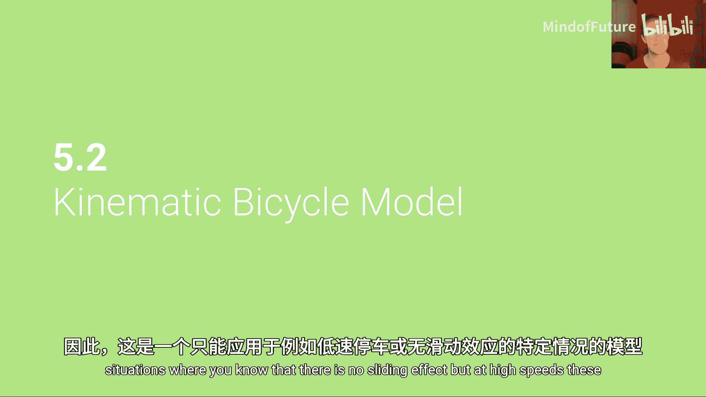
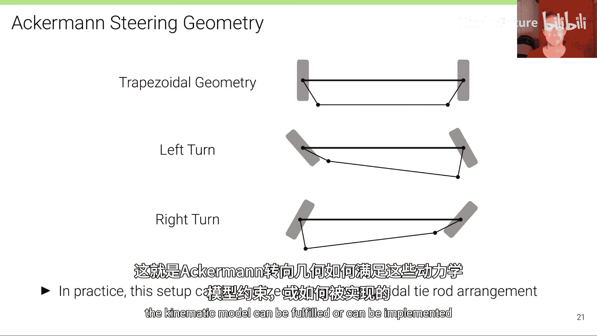

# 017：车辆动力学 - 运动学自行车模型 🚗

在本节课中，我们将要学习运动学自行车模型。这是最重要且最简单的车辆模型之一。它基于许多简化假设，其中核心假设是车轮没有滑移。这意味着车轮始终沿着其朝向的方向运动，不会在地面上发生侧滑。因此，该模型主要适用于低速场景（如泊车）或已知无滑移效应的场景。在高速情况下，该模型的可靠性会降低。

## 刚性体与旋转中心

上一节我们介绍了车辆被视为刚性体的概念。本节中，我们来看看如何描述其运动。刚性体意味着车身上所有点的相对位置保持不变。我们可以将车辆的运动视为围绕一个**旋转中心**的转动。

当车辆围绕旋转中心转动时，车身上所有点都沿着各自的圆形轨迹运动，且速度方向始终与轨迹相切。这意味着，任何点的速度向量都垂直于连接该点与旋转中心的直线。这一关系可以用以下公式表达：

\[
\vec{v} \perp \vec{r}
\]

其中，\(\vec{v}\) 是点的速度向量，\(\vec{r}\) 是从旋转中心指向该点的向量。

## 模型的核心假设

以下是运动学自行车模型做出的几个关键简化假设：

1.  **双轮近似**：将实际车辆的四轮系统简化为一个由前后两个“虚拟”车轮组成的自行车模型。这在许多建模场景中已足够。
2.  **平面运动**：只考虑车辆在XY平面内的运动，忽略车辆的侧倾和俯仰，只保留描述车辆朝向的**横摆角 \(\psi\)**。
3.  **无车轮滑移**：假设车轮的滚动方向始终与其自身的朝向一致。这是该模型称为“运动学”模型的原因，它忽略了轮胎的动力学滑移效应。

## 模型参数详解

现在，让我们详细定义模型中的各个参数。参考下图，我们可以识别出以下关键量：

*   **\(\psi\)**：**横摆角**。车辆纵轴线（连接前后轮中心的黑线）与全局坐标系X轴之间的夹角，代表车辆的“朝向”。
*   **\(\delta_f, \delta_r\)**：**前轮转向角**与**后轮转向角**。分别表示前轮和后轮相对于车辆纵轴线的偏转角度。
*   **\(v\)**：车辆**质心速度**的大小。
*   **\(\beta\)**：**车辆侧偏角**。这是车辆质心速度向量的方向与车辆纵轴线（朝向 \(\psi\)）之间的夹角。**请注意**：虽然模型假设车轮无滑移，但车辆整体是可以有侧偏角的。
*   **航向角**：车辆质心速度向量的方向，等于 \(\psi + \beta\)。
*   **\(L\)**：**轴距**。前后轮中心之间的距离，\(L = l_r + l_f\)，其中 \(l_r\) 和 \(l_f\) 分别是质心到后轴和前轴的距离。
*   **\(R\)**：**转弯半径**。从旋转中心到车辆质心的距离。

## 运动方程推导

基于上述模型，我们的目标是推导出描述车辆如何移动和转动的**运动方程**。我们想知道车辆位置 \((x, y)\) 和横摆角 \(\psi\) 随时间的变化率，即它们的导数 \(\dot{x}, \dot{y}, \dot{\psi}\)。

首先，位置的变化率（即速度）很容易从几何关系得出：

\[
\dot{x} = v \cdot \cos(\psi + \beta)
\]
\[
\dot{y} = v \cdot \sin(\psi + \beta)
\]

接下来，推导横摆角变化率 \(\dot{\psi}\)（即横摆角速度）更为复杂。为了简化，我们考虑一个更常见的情况：**仅前轮转向**（即 \(\delta_r = 0\)）。大多数民用车辆都属于这种情况。

## 仅前轮转向的简化推导

在仅前轮转向的设定下，我们可以利用简单的三角几何来推导 \(\dot{\psi}\)。观察下图中的几何关系：

以下是推导步骤：

1.  在红色三角形中，根据正切定义有：\(\tan(\delta) = \frac{L}{R'}\)，其中 \(R'\) 是旋转中心到后轮的距离。由此可得 \(1/R' = \tan(\delta) / L\)。
2.  同样在红色三角形中，有 \(\tan(\beta) = l_r / R'\)。将第一步的 \(1/R'\) 代入，得到 \(\tan(\beta) = l_r \cdot \tan(\delta) / L\)。
3.  考虑质心处的转弯半径 \(R\)，有 \(\cos(\beta) = R' / R\)，因此 \(1/R = \cos(\beta) / R'\)。
4.  质心处的角速度 \(\dot{\psi}\) 等于线速度除以转弯半径：\(\dot{\psi} = v / R\)。
5.  将第3步的 \(1/R\) 代入第4步，再将第1步的 \(1/R'\) 代入，最终得到：

\[
\dot{\psi} = \frac{v}{L} \cos(\beta) \tan(\delta)
\]

这就是仅前轮转向时，车辆横摆角速度的表达式。

## 小角度近似

当车辆近似直行或转向角很小时（即 \(\delta\) 和 \(\beta\) 很小），我们可以对模型进行进一步简化：
*   \(\cos(\beta) \approx 1\)
*   \(\tan(\delta) \approx \delta\) （因为 \(\tan\) 函数在原点附近近似线性）

此时，运动方程简化为：

\[
\dot{x} = v \cdot \cos(\psi)
\]
\[
\dot{y} = v \cdot \sin(\psi)
\]
\[
\dot{\psi} = \frac{v}{L} \delta
\]

这个简化形式非常直观，广泛应用于路径规划和控制的初步分析中。

## 离散时间模型

为了在计算机中模拟车辆运动，我们需要离散时间版本的运动方程。假设时间步长为 \(\Delta t\)，则车辆状态更新公式为：

\[
x_{t+1} = x_t + v \cdot \cos(\psi_t) \cdot \Delta t
\]
\[
y_{t+1} = y_t + v \cdot \sin(\psi_t) \cdot \Delta t
\]
\[
\psi_{t+1} = \psi_t + \frac{v}{L} \delta \cdot \Delta t
\]

## 阿克曼转向几何

最后，我们需要讨论一个重要的实践问题：**阿克曼转向几何**。在真实的四轮车辆中，如果直接将自行车模型的前轮转角 \(\delta\) 同时应用于左右两个前轮，会导致轮胎滑移。

为了避免滑移，在转弯时，内外侧前轮的转向角应该不同。连接旋转中心与左右前轮中心的直线并不重合，因此为了满足“速度方向垂直于旋转半径”的无滑移条件，左右轮的朝向（即转向角 \(\delta_L\) 和 \(\delta_R\)）必须不同。

满足运动学自行车模型约束的左右轮转向角关系，就称为**阿克曼转向几何**。当转向角较小时，可以近似计算为：

\[
\delta_L \approx \frac{L}{R} + \frac{B}{2R}
\]
\[
\delta_R \approx \frac{L}{R} - \frac{B}{2R}
\]

其中，\(B\) 是后轮轮距（左右后轮之间的距离）。

在实际车辆中，通常通过一个**梯形转向机构**来实现近似阿克曼几何。该机构在转向时，能自动让内侧车轮比外侧车轮转过更大的角度，从而减少轮胎磨损并满足运动学约束。

## 总结

本节课中我们一起学习了**运动学自行车模型**。我们首先了解了其核心假设：将四轮车辆简化为两轮、仅考虑平面运动、并假设车轮无滑移。然后，我们详细定义了模型的各个状态量和参数，包括横摆角、转向角、侧偏角和轴距等。

接着，我们推导了描述车辆运动的微分方程，并特别针对常见的仅前轮转向情况，利用三角几何得到了横摆角速度的表达式。在小角度条件下，该模型可以进一步简化。我们还给出了用于计算机仿真的离散时间更新公式。

最后，我们探讨了模型在实际应用中的一个关键点——阿克曼转向几何，解释了为什么真实车辆的左右前轮转向角不同，以及如何通过机构设计来实现它。

运动学自行车模型因其形式简单、计算高效，成为自动驾驶领域进行轨迹规划、控制和状态估计的基础模型之一，尤其在低速场景下非常有效。