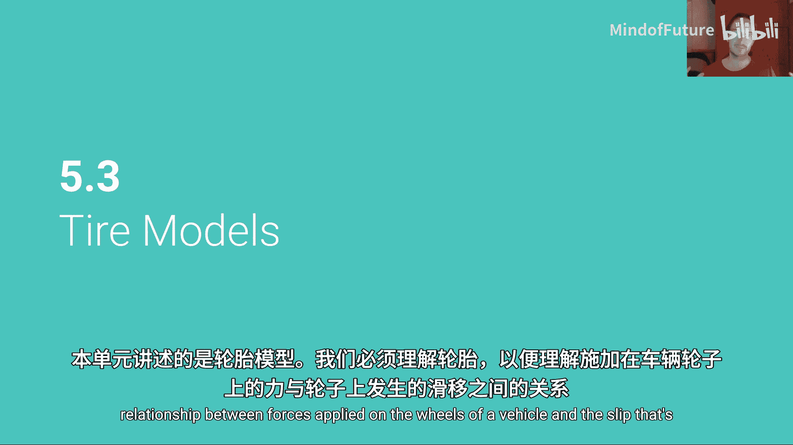
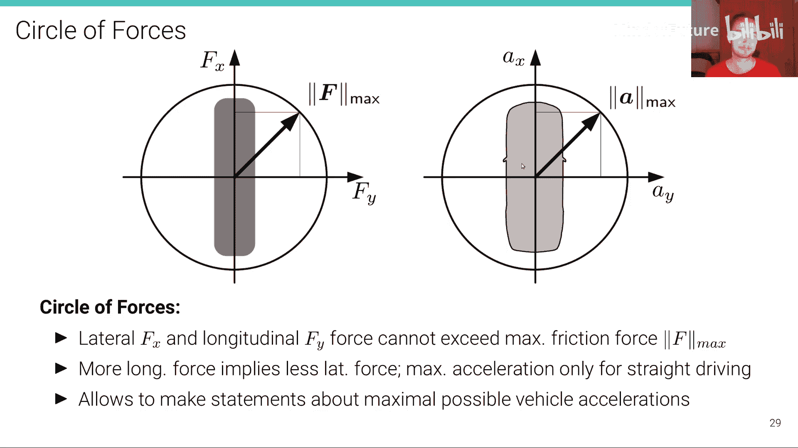

# 018：轮胎模型 🚗

在本节课中，我们将要学习轮胎模型。理解轮胎对于理解施加在车辆车轮上的力与车轮发生的滑移之间的关系至关重要。

## 概述

上一节我们介绍了车辆动力学的基础，本节中我们来看看轮胎模型。为了理解施加在车轮上的力与车轮滑移之间的关系，我们必须理解轮胎。

通过观看这段视频，可以清楚地看到这辆车没有遵循运动学自行车模型。因此，运动学自行车模型是不够的。在这种情况下，运动学自行车模型的哪个假设被违反了？

显然，车轮发生了滑移。每个车轮都存在一个滑移角。因为我们假设运动学自行车模型没有滑移，所以该模型在这里被严重违反。当然，这是一个极端情况，但在现实中，车轮总是存在轻微的滑动。它们永远不会完美地遵循运动学自行车模型。这当然取决于地形和地面类型，例如是冰面、草地还是沥青路面。但总是存在一些滑移，因此我们需要超越目前所学的运动学自行车模型。

为了超越并理解什么是滑移以及滑移与力之间的关系，我们需要更好地理解轮胎。

## 轮胎基础

这是一个轮胎的例子。它由橡胶制成，内部充满加压空气。基于气压和车辆重量，轮胎与地面在一个称为接触斑块的区域接触，该区域定义了车轮与地面之间的接触。

现在，我们可以对车轮的轴施加一些力，这意味着车轮开始向前移动。但由于车轮与地面之间没有完美的接触，总是存在轻微的滑动，车轮的旋转速度不会完全等同于车辆向前移动的速度。这两者之间的差异被称为滑移。

我们将使用轮胎模型来描述施加在轮胎上的横向力和纵向力。存在许多不同复杂程度的轮胎模型，甚至深入到分子级别。但我们将在这里使用一个非常简单的定性描述，称为胎面块模型，它很好地说明了基本现象和力曲线的定性行为。

## 胎面块模型

我们试图回答的问题是：轮胎为什么会滑移？它们究竟如何滑移？这与施加在轮胎上的力有何关系？

我们将考虑胎面块模型。它之所以被称为胎面块模型，是因为我们在宏观层面上将轮胎视为由许多小胎面块组成。你可以看到，这里的每一个小块基本上都是一块附着在轮胎上的橡胶。图中只显示了轮胎的底部。在这个例子中，你可以看到五个这样的胎面块。从图中已经可以看出，这些胎面块看起来并不相同，只有这里的这个胎面块处于其标准位置和标准形状，而其他这些则是它的变形版本。

它们为什么会变形？一旦车辆被外部驱动，一旦我们施加一个力，即对车轮施加一个周向力，这个胎面块就开始变形和滑移。

我们对车轮施加一个力。想象一下，从一个速度为零的车辆车轮开始施加力。这意味着，为了推动车辆前进（因为车辆有质量），我们需要施加一个相对于地面的力。这个力必须通过这些胎面块传递。

现在发生的情况是，一旦一个胎面块进入接触斑块（即轮胎与地面接触的区域），这个力就会通过使胎面块变形而逐渐建立起来。胎面块向后移动得越多，力就越大。这由下图所示。沿着这个接触区域移动得越多，胎面块变形就越大。然后，一旦胎面块离开接触区域，它就会弹回其原始位置。基本上，在离开接触区域后，它又恢复成这样。

这已经是产生滑移的原因。你可以看到，这些胎面块为了传递力以对地面施加力而发生变形。因此，在这个区域，车轮的速度与如果它与地面完美接触时的速度不同，因为这个力是通过这些变形的胎面块传递的。所以，基本上你通过这个现象产生了滑移。轮胎胎面块接触地面时，它们变形并滑移。当失去接触时，就会发生滑移，因为它们变形然后滑移。因此，车轮的速度和地面的速度不相同。

## 静摩擦与滑动摩擦

这被称为静摩擦。之所以称为静摩擦，是因为胎面块在变形时始终与地面保持接触，它们没有在地面上滑动。然而，当车轮的驱动力增加并超过最大静摩擦力时，就会进入滑动摩擦区域。这个最大摩擦力取决于轮胎材料和地面材料的分子特性，例如是沥青还是冰面等。

一旦超过这个最大静摩擦力，我们就进入了滑动摩擦区域，这些胎面块开始更早地滑移。它们不是在最后弹回原始位置时才滑移，而是可能在这里就已经开始失去与地面的接触，因为力太强了。这就是我们所说的滑动摩擦。

这意味着，在下图的第一部分，胎面块仍然与地面接触，因此行为与此处相同。但在这一点，它们开始滑动。由于滑动摩擦力小于静摩擦力，这会导致传递的驱动力下降，这基本上是我们想要避免的。

例如，如果你在红灯起步时对车轮施加过大的力，你将无法快速移动，因为你立即进入了滑动摩擦区域。同样的情况也发生在高速时突然猛烈刹车，你也会进入滑动摩擦区域。因此，在这种情况下，如果胎面块从一开始就滑动，只能施加滑动摩擦力。滑动摩擦力低于静摩擦力，这是你想要避免的。这也是现代制动系统，如防抱死制动系统（ABS）所做的事情。一旦它们检测到滑移过大，就会开始释放车轮的制动，以便仍然能够操控车辆。我们稍后会讨论为什么否则无法操控车辆。

但总的来说，我们也要避免滑动摩擦，因为它低于静摩擦。如果没有ABS，我们就无法如此有力地刹车，无法像有该系统那样快速停下来。

## 滑移与力的关系曲线

这是另一条曲线，它绘制了相对于滑移率S可以施加在车辆上的力。其中滑移率是车轮表面速度与车辆速度之间的差异，它是一个相对数值。这意味着，如果车轮与地面完美接触且没有滑移，滑移率S将为0，因为此时车轮表面速度与车辆速度相同。例如，当你以恒定速度行驶，没有加速或减速，并且没有力施加在车辆上时，就会发生这种情况。比如在低速行驶时，没有其他力作用在车辆上，并且你没有对车轴施加任何力。

现在，我们可以在这张图中看到，曲线看起来是这样的。我们还可以看到，力F在开始时随着滑移率S线性增长。这是胎面块变形但仍与地面接触的区域。但在某一点，当我们达到静摩擦极限，滑移率变得太大时，这会导致F减小。我们处于滑动摩擦部分。滑动摩擦再次小于静摩擦，因此我们总是希望避免这种情况，例如通过像ABS这样的系统。

## 低摩擦路面的变化

现在，对于湿滑的低摩擦路面，这条F(S)曲线会如何变化？给你一点时间思考这个问题。你认为它会如何变化？

曲线的起点不会改变。因为胎面块的弹性没有改变，我们观察的是相同的轮胎、相同的橡胶材料，胎面块的变形方式相同。然而，由于静摩擦力减小，可以施加的最大力会降低，因为可能地面不像沥青那样，而是冰面。因此，我们无法再施加相同的最大力。所以，胎面块由于摩擦力的减小而更早开始滑动。这由这里的曲线说明。因此，定性地看，两条曲线看起来相似。在开始时，两者都是线性的，但对于低摩擦曲线，可以施加的最大力更小，因此我们也更早开始滑动。

## 横向力分析

以上是针对纵向力和纵向滑移的分析，但我们可以对横向力进行同样的分析，实际上这里的图表看起来非常相似。在这种情况下，我们看的是力，我们称之为Fy，即横向力，指向车辆侧面。力相对于滑移率的图表看起来相似，开始时有一个线性部分，然后当我们达到最大力时，就进入滑动摩擦区域，我们也希望避免横向滑动。

因此，横向力Fy与纵向力类似，但现在胎面块是横向移动。对于小的滑移率S和小的车轮滑移角α，横向力由以下表达式给出：

**Fy = C * α**

其中C是一个称为侧偏刚度的常数，α是该车轮的滑移角，即车轮的前进方向与该车轮实际移动速度方向之间的夹角。我们这里不推导这个公式，暂时接受这个事实。因此，近似地，我们有Fy = C * α，这从图中看也是合理的。如果α为0，那么你实际上遵循运动学自行车模型，该车轮没有滑移角，车轮速度方向与车轮朝向相同。但如果α很大，那么我们有一个大的滑移角，车轮的速度具有很大的横向分量，因此我们正在横向滑动。

## 力圆现象

另一个值得讨论的有趣现象是所谓的力圆。力圆告诉我们，可以施加在车轮上的横向力和纵向力并不是独立的，因为它们不能超过一个最大摩擦力Fmax。所以我们有这个圆，所有我们可以施加在该车轮上的力都位于这个圆内。我们无法施加更强的力。这意味着更大的纵向力意味着更小的横向力，或者说最大加速度只能用于直线行驶。

例如，考虑你想从50公里/小时的速度完全停下来，你猛踩刹车，导致你在纵向方向上开始滑动。这意味着你现在无法再转向了。车辆变得完全无法操控，无法转向。这当然是不好的。因此，你应该做的是，如果你想避开一个障碍物，并且仅仅因为速度太快而无法通过刹车来避开障碍物，你不应该刹车那么猛，而应该转向绕过那个障碍物。在防御性驾驶课程中学到的是，开始时猛踩刹车，但随后松开刹车以便转向绕过物体，避免与物体接触。当然，这也是防抱死制动系统背后的动机。它只是避免你进入曲线的滑动阶段，因此即使完全踩下刹车，你仍然能够操控你的车辆。

这不仅允许我们对施加在车轮上的力做出陈述，而且可以对整个车辆可以施加的加速度做出类似的陈述，因为车辆有四个车轮，如果这对所有四个车轮都适用，那么车辆加速度也有类似的行为。这就是我刚才提到的，如果你想完全停下来，你就不能再进行横向加速，所以你总是需要在这两者之间权衡。同样，如果你遇到强烈的侧风，但你已经超过了纵向的X方向加速度，那么与没有加速时相比，你会受到侧风更强烈的影响。

## 总结

本节课中我们一起学习了轮胎模型。我们了解到，由于轮胎胎面块的变形和滑移，车辆在现实中总会存在滑移，这超越了运动学自行车模型的假设。我们通过胎面块模型定性地理解了静摩擦与滑动摩擦的区别，以及力与滑移率之间的关系曲线。我们还学习了横向力的近似公式 **Fy = C * α**，并认识了力圆的概念，它揭示了纵向力与横向力之间的制约关系，这对于理解车辆操控极限和防抱死制动系统（ABS）等安全系统的工作原理至关重要。