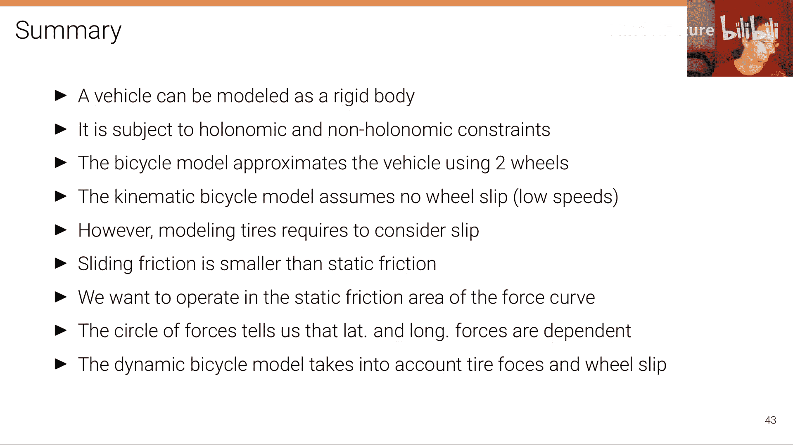

# 019：车辆动力学 - 动态自行车模型 🚗


在本节课中，我们将学习如何定义动态自行车模型。我们将从最基本的模型形式入手，该模型考虑了轮胎的横向滑移。

## 概述

上一节我们介绍了考虑轮胎滑移的必要性。本节中，我们将基于刚体动力学原理，推导出最简单的动态自行车模型方程。我们将从单个质点的运动开始，逐步扩展到刚体的平动与转动，最终将这些原理应用于车辆模型。

## 刚体动力学基础

在定义车辆模型之前，让我们先回顾一下质点和刚体的动力学。

### 质点的平动

首先，考虑三维空间中的一个质量为 **M** 的质点 **P**。设向量 **r** 表示该质点的位置，**v** 表示其速度，**a** 表示其加速度。

该质点的**线性动量 p** 定义为：
```
p(t) = M * v(t)
```

根据牛顿第二定律，线性动量的时间导数等于作用在该质点上的净力：
```
d(p)/dt = M * a(t) = Σ F
```
其中，**Σ F** 是所有作用在质点 **P** 上的力的矢量和。

### 刚体的平动与转动

现在，考虑一个质量为 **M** 的刚体 **B**。设其质心 **C** 的位置为 **r**，速度为 **v_c**，加速度为 **a_c**。

刚体的线性动量定义为：
```
P_B(t) = M * v_c(t)
```
刚体的质心运动就像一个质量为 **M** 的质点，因此有：
```
M * a_c = Σ F
```
其中，**Σ F** 是所有作用在刚体上的力的矢量和。

然而，刚体不仅有平动，还有转动。其转动运动与刚体的几何形状和质量分布有关。

设 **ρ** 为刚体的质量密度函数。刚体的总质量为：
```
M = ∫_B ρ dV
```
我们定义刚体的**惯性张量 I** 为一个矩阵，其元素由以下公式定义：
```
I = [ ∫ (y²+z²)ρ dV,  -∫ xyρ dV,      -∫ xzρ dV;
      -∫ xyρ dV,       ∫ (x²+z²)ρ dV, -∫ yzρ dV;
      -∫ xzρ dV,       -∫ yzρ dV,      ∫ (x²+y²)ρ dV ]
```

考虑刚体的转动。设角速度向量为 **ω**。刚体绕该向量旋转，旋转速率等于该向量的模长。

刚体关于质心 **C** 的**角动量 L_c** 定义为：
```
L_c = I * ω
```

根据角动量原理，角动量的时间导数等于作用在刚体上的净力矩：
```
d(L_c)/dt = I * (dω/dt) = Σ M_c
```
其中，**Σ M_c** 是所有力关于质心 **C** 的力矩之和。力矩等于力乘以力臂。

### 简化情况

在某些情况下，问题可以得到简化。如果我们选择的体坐标系与刚体的**主轴系**（对称轴）对齐，则惯性张量 **I** 是对角矩阵。

对于我们关心的车辆运动，通常假设车辆在 **XY** 平面内运动（俯视图）。此时，绕 **X** 轴和 **Y** 轴的角速度及力矩均为零。因此，角动量退化为一个标量：
```
L_c = I_zz * ω_z(t)
```
角动量原理也简化为标量方程：
```
I_zz * (dω_z/dt) = Σ M_z
```

## 动态自行车模型定义

有了这些动力学基础，现在让我们回到车辆模型，定义考虑力和轮胎滑移的动态自行车模型。

我们考虑一个具有前轮转向角 **δ** 的自行车模型，后轮与车辆方向对齐。对于这个最简单的动态自行车模型，我们做出以下关键假设：

1.  车辆运动被限制在 **XY** 平面（俯视图）。
2.  车辆被视为一个刚体。
3.  仅考虑由线性轮胎模型产生的**横向轮胎力**，忽略纵向力。
4.  假设转向角 **δ** 很小，因此有：`sin(δ) ≈ δ`, `tan(δ) ≈ δ`, `cos(δ) ≈ 1`。
5.  假设纵向速度 **V_x** 恒定。

在这些假设下，我们来推导模拟车辆运动所需的方程。

### 横向动力学方程（平动）

首先考虑横向（侧向）动力学。根据牛顿第二定律，在横向（Y方向）上有：
```
M * a_y = Σ F_y
```
作用在车辆上的横向力来自两个轮胎。因此：
```
M * a_y = F_r + F_f
```
其中，**F_r** 是后轮横向力，**F_f** 是前轮横向力。由于 **δ** 很小，前轮力在车辆Y方向的分量近似为 **F_f** 本身。

车辆质心的横向加速度 **a_y** 由两部分组成：横向速度 **V_y** 的变化率，以及由于车辆旋转（角速度 **ω**）产生的向心加速度 **ω * V_x**。因此：
```
a_y = d(V_y)/dt + ω * V_x
```
结合以上两式，得到第一个基本方程：
```
M * [ d(V_y)/dt + ω * V_x ] = F_r + F_f
```

### 横摆动力学方程（转动）

接下来考虑转动（横摆）动力学。根据简化后的角动量原理：
```
I_zz * (dω/dt) = Σ M_z
```
作用在车辆上的力矩由轮胎力乘以相应的力臂产生：
*   后轮力 **F_r** 产生的力矩为 `-l_r * F_r`（负号表示其方向与正转向相反）。
*   前轮力 **F_f** 产生的力矩为 `+l_f * F_f`（正号表示其方向与正转向相同）。

因此，得到第二个基本方程：
```
I_zz * (dω/dt) = -l_r * F_r + l_f * F_f
```

### 轮胎力模型

现在，我们需要定义轮胎力 **F_r** 和 **F_f**。根据上一节的内容，在轮胎特性曲线的线性区域，横向力与轮胎侧偏角 **α** 成正比。

对于后轮（无转向角）：
```
F_r = -C_α_r * α_r
```
其中，**C_α_r** 是后轮侧偏刚度，负号表示力方向与图示定义的侧偏角方向相反。对于小侧偏角，有 `α_r ≈ tan(α_r) = V_{r,y} / V_{r,x}`。

对于前轮（有转向角 **δ**）：
```
F_f = -C_α_f * α_f
```
其中，**C_α_f** 是前轮侧偏刚度。`α_f ≈ tan(α_f) = V_{f,η} / V_{f,ξ}`，这里 **η** 和 **ξ** 是以前轮平面定义的坐标系。

### 轮胎处的速度

我们需要计算轮胎接地点的速度，以确定侧偏角。

**后轮速度**（与车辆方向一致）：
*   纵向速度：`V_{r,x} = V_x`
*   横向速度：`V_{r,y} = V_y - ω * l_r` （减去因旋转产生的速度分量）

**前轮速度**（在车辆坐标系XY下）：
*   纵向速度：`V_{f,x} = V_x`
*   横向速度：`V_{f,y} = V_y + ω * l_f` （加上因旋转产生的速度分量）

为了得到前轮平面（ξ-η坐标系）下的速度，需要进行旋转变换，旋转角为前轮转向角 **δ**。利用小角度假设 `cos(δ)≈1`, `sin(δ)≈δ`，并假设纵向速度远大于某些横向速度分量，可以得到简化后的表达式：
```
V_{f,ξ} ≈ V_x
V_{f,η} ≈ V_y + ω * l_f + V_x * δ
```

### 闭合方程与状态空间形式

将轮胎速度表达式代入轮胎力公式，再将得到的 **F_r** 和 **F_f** 代入之前推导的横向与横摆动力学方程，经过整理，我们可以得到一个闭合的系统方程。

这个系统可以写成简洁的**状态空间表示形式**。定义状态向量为：
```
x = [ V_y,  ψ,  ω ]^T
```
其中，**V_y** 是车辆横向速度，**ψ** 是车辆横摆角（航向角），**ω** 是横摆角速度。

系统的状态方程可以写为：
```
d(x)/dt = A * x + B * u
```
其中，输入 **u** 就是前轮转向角 **δ**。矩阵 **A** 和 **B** 中的元素由车辆质量 **M**、转动惯量 **I_zz**、轴距 **l_f**, **l_r** 以及轮胎侧偏刚度 **C_α_f**, **C_α_r** 等参数决定。

通过这个状态空间模型，我们可以模拟车辆在给定转向角输入序列下的动态响应，即计算出 **V_y**、**ψ** 和 **ω** 如何随时间变化。如果需要全局位置，可以额外添加方程，但会使模型变为非线性。

## 总结

本节课中，我们一起学习了动态自行车模型的推导。我们了解到：

1.  车辆可以被建模为一个受完整和非完整约束的刚体。
2.  自行车模型用两个车轮来近似四轮车辆。
3.  运动学自行车模型假设无轮胎滑移，仅适用于低速场景。
4.  要准确建模轮胎行为，必须考虑滑移，正如赛车漂移例子所示。
5.  滑动摩擦力小于静摩擦力，因此我们应确保轮胎工作在静摩擦（即力-滑移率曲线的线性区域）。
6.  摩擦力圆概念表明，轮胎的纵向力和横向力是相互耦合、此消彼长的。
7.  动态自行车模型通过引入基于侧偏角的线性轮胎力模型，在一定程度上考虑了轮胎滑移的影响，从而能够描述车辆在更宽泛工况下的动力学特性。



通过本讲推导的状态空间方程，我们获得了对车辆横向及横摆动态进行仿真和分析的基础工具。