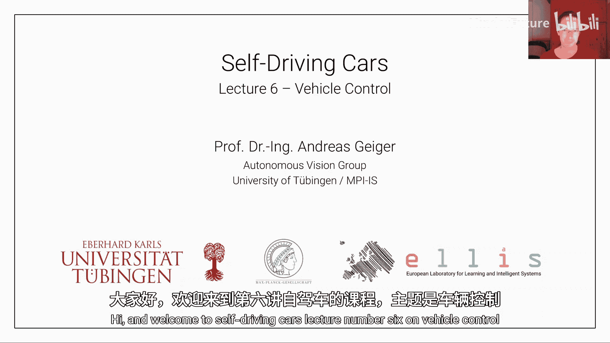
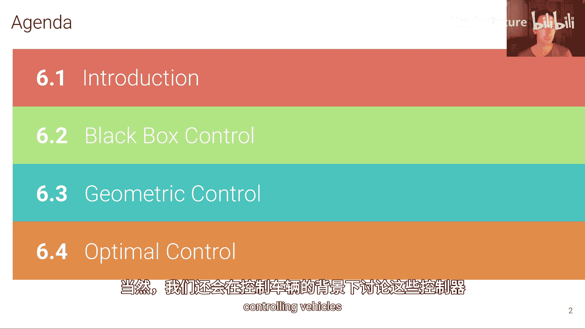
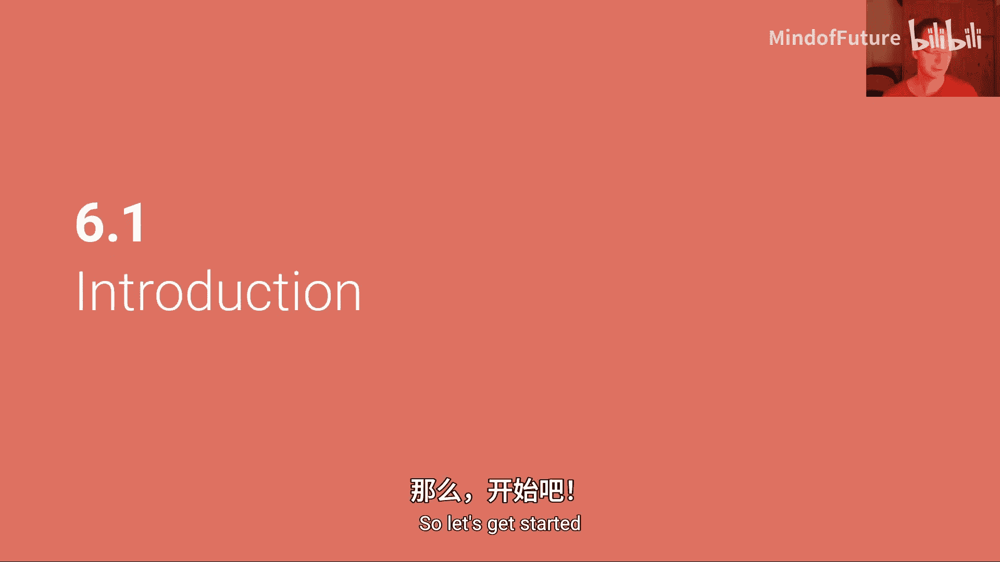
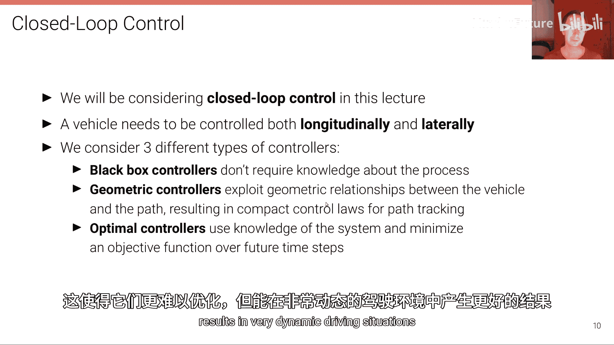

# 020：车辆控制简介 🚗

在本节课中，我们将要学习车辆控制的基本概念。车辆控制是自动驾驶汽车和现代驾驶辅助系统的核心模块，它负责将规划好的路径或指令转化为车辆的实际操控命令，如方向盘转角和油门/刹车控制。

---

## 控制问题与动机

首先，我们介绍控制问题并阐述为什么需要控制系统。

自动驾驶汽车需要车辆控制模块，现代驾驶辅助系统同样需要。例如，上一讲提到的电子稳定程序（ESP）通过独立控制每个车轮来提升车辆操控性，降低高动态场景下的事故风险。因此，精密的控制器已广泛应用于当今的汽车中。

以下是使用此类控制系统的驾驶辅助系统发展简史：
*   **1926年**：伺服制动系统。
*   **1951年**：伺服转向系统。
*   **1958年**：定速巡航系统，用于将车速控制到设定值。
*   **1978年**：防抱死制动系统（ABS）。
*   **1986年**：牵引力控制系统（ASR）。
*   **1995年**：电子稳定程序（ESP）。
*   **2000年代**：自适应巡航控制（ACC），使用传感器探测前车距离并自动调整车速。
*   **2002年**：紧急制动辅助、车道保持辅助、自动泊车等。

所有这些系统都需要对车辆的精确了解和有效控制。

---

## 开环与闭环控制

控制系统主要分为两种类型。第一种称为开环控制器。

开环控制器之所以得名，是因为它不具备我们接下来要讲的闭环控制器那样的反馈“回路”。下图展示了一个开环控制器的结构。

我们使用统一的变量来描述这个过程。控制器的输入（图中橙色部分）是参考变量或设定点 **R(t)**（t 是时间索引）。例如，在定速巡航系统中，这可以是我们想要达到的目标速度。

控制器随后输出一些校正变量，作为被控过程（图中绿色部分）的输入。控制器的设计目标是计算这些校正变量，使得被控变量 **y** 能尽快达到参考值 **R**。

然而，过程还会受到干扰 **z(t)** 的影响，这些是环境效应，我们可能无法完全预测。正如下一点所述，开环控制在实际中难以实施。

开环控制要求对过程及其所有影响因素有精确了解。由于没有关于被控变量的反馈，控制器无法得知其当前状态，也无法处理未知干扰，因此容易导致系统漂移。现实中几乎总存在未知干扰，所以我们需要所谓的闭环控制器。

下图展示了闭环控制器的结构。

唯一的变化是，现在我们有一个传感器来测量过程，并将测量值反馈给控制器。具体来说，参考变量 **R(t)** 与测量值相减，其结果我们称为误差 **e(t)**。

控制器现在的任务比之前简单得多：它只需要将这个误差减小到0。我们希望测量值变得与参考变量相同。由于有这个明确的反馈回路，控制器可以输出校正变量给过程，使得误差 **e(t)** 随时间减小。这被称为闭环控制，因为图中存在一个闭合的反馈回路。

---

## 经典控制实例：离心调速器

控制器历史悠久，离心调速器可能是最著名也是最早的控制系统实例之一，它可用于控制蒸汽机等设备。以下视频片段解释了其工作原理。

> 离心调速器是一种通过调节工作流体的输入来控制机器运行速度的装置。由詹姆斯·瓦特于1788年发明，成为驱动工业革命的许多机器的基本组件。最常见的是安装在蒸汽机上。动力通过皮带和飞轮连接从发动机输出轴传递给调速器，随着发动机运行，调速器开始旋转。调速器操作节流阀，当其旋转速度越快，作用于飞球的离心力使它们克服重力向外和向上移动，带动杠杆臂。随着杠杆臂弯曲，它们拉下一个垂直轴，使其进入节流阀并减小蒸汽通过的间隙。如果调速器旋转得足够快，轴将完全切断蒸汽进气口。调速器的使用在工业革命期间及之后对于大型发动机和机械的运行至关重要。如果发动机运行过于剧烈，则有震散的风险。此外，在大型工厂中，许多相同的机器（如纺织厂的动力织机）配置为由单一发动机驱动，必须始终保持恒定、平稳和稳定的速度，否则生产的产品会不规则。博物馆中可以找到许多离心调速器的例子，设计用于安装在蒸汽机和水轮机上，尽管大小和复杂程度不同，但每一个都是其机器同样关键的组成部分。

这是一个非常直观的控制器示例。

---

## 本讲将涉及的控制器类型

本课程中我们将考虑闭环控制，因为这是对车辆唯一有意义的控制方式。车辆需要在纵向（速度）和横向（方向）上都被控制。

我们将探讨三种不同类型的控制器：

上一节我们介绍了控制的基本概念，本节中我们来看看具体的控制器类型。以下是本讲将详细讲解的三种控制器：

*   **黑盒控制器**：这是最通用的闭环控制器形式，它不需要关于过程的任何知识。过程对控制器来说就像一个黑盒，控制器唯一的目标就是最小化前面提到的误差 **e(t)**。
*   **几何控制器**：与黑盒控制器相反，几何控制器（特指为车辆设计的）利用关于车辆的知识。它们利用车辆与路径之间的几何关系，从而形成用于路径跟踪的紧凑控制器。在这个背景下，我们将再次回顾我们熟悉的自行车模型。
*   **最优控制器**：最优控制器也利用系统模型，但可能方式更明确。它们通过最小化未来时间步长的目标函数来进行控制，具有更长的“前瞻”潜力。它们优化起来更困难，但在非常动态的驾驶场景中能带来更好的结果。

---

## 总结

本节课中我们一起学习了车辆控制的基础。我们首先明确了控制问题的必要性，并回顾了驾驶辅助系统中的控制应用。接着，我们区分了开环控制和闭环控制，理解了反馈机制对于应对现实世界干扰的重要性。通过离心调速器的例子，我们看到了一个经典的控制系统实现。最后，我们概述了本课程将要深入探讨的三种控制器类型：黑盒控制器、几何控制器和最优控制器，为后续的学习奠定了基础。