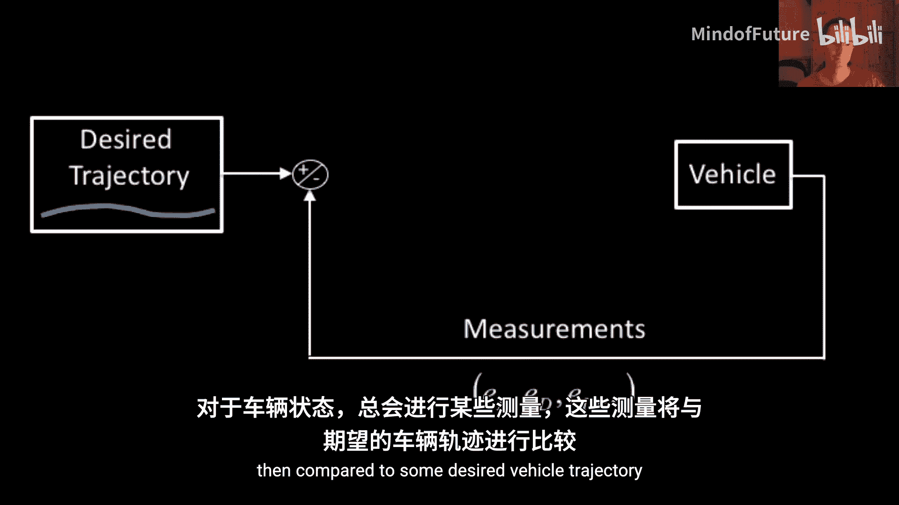
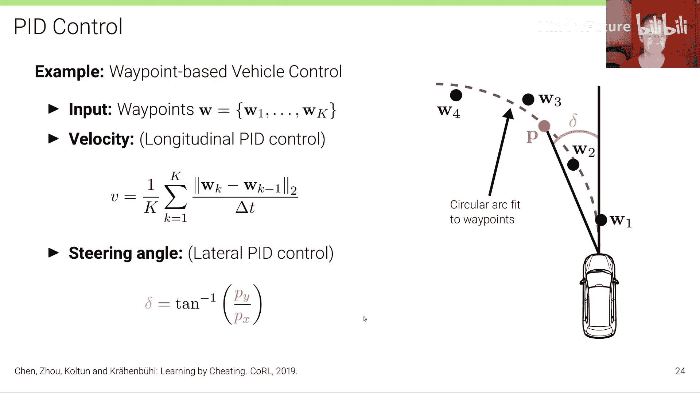
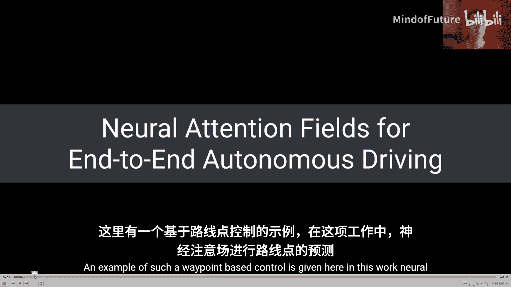

# 021：车辆控制 - 黑盒控制 🚗

在本节课中，我们将要学习第一类控制器——黑盒控制器。我们将了解其基本概念、工作原理，并通过具体例子理解其在自动驾驶车辆控制中的应用。

## 概述

黑盒控制器之所以得名，是因为它们不依赖于对被控过程内部机理的了解。因此，它们具有通用性，可以潜在地应用于任何过程。本节我们将从最简单的黑盒控制器开始，逐步深入到工业中最常用的PID控制器。

## 黑盒控制器简介

上一节我们介绍了控制系统的整体框架，本节中我们来看看黑盒控制器的具体形式。

黑盒控制器不假设了解被控过程的内部知识，因此具有通用性，可以潜在地应用于任何过程。

### 开关控制器

最简单的黑盒控制器形式称为开关控制器。

开关控制器也称为滞环控制器，常用于家用恒温器等场景。它之所以被称为开关控制器，是因为它在两种状态之间 abrupt 切换。

该控制器的数学公式很简单。我们需要定义从误差 `E` 到校正变量 `U` 的映射。

开关控制器的工作原理如下：

以下是其最简单的形式：

*   如果误差高于阈值 `τ`，则 `U` 定义为 `U1`（控制器的一个参数）。
*   否则，`U` 定义为 `U2`（控制器的另一个参数）。

因此，这个最简单的控制器有3个参数：`U1`、`U2` 和 `τ`。以恒温器为例，如果温度低于某个阈值，它会输出校正变量 `U1`（例如打开加热）；否则输出 `U2`（例如关闭加热）。

然而，这种简单的控制器对于控制汽车来说效果不佳，会导致非常颠簸和不舒适的行为。我们需要更好的方案。

## PID控制器

更好的方案是PID控制器，它同样属于黑盒控制器。

PID控制器是工业应用中最常见的控制器，因其简单性和广泛的应用范围，在约95%需要控制器的场合中被使用。

PID控制器同样不需要了解被控过程的内部知识。与开关控制器不同，它包含三个部分：

1.  **比例环节**：输出一个与误差成比例的校正值。公式为 `Kp * E(t)`，其中 `Kp` 是比例增益参数。
2.  **积分环节**：对所有先前时间步的误差进行积分。公式为 `Ki * ∫E(t) dt`，其中 `Ki` 是积分增益参数。
3.  **微分环节**：计算误差随时间的变化率（导数）。公式为 `Kd * dE(t)/dt`，其中 `Kd` 是微分增益参数。

PID控制器的数学公式如下：

`U(t) = Kp * E(t) + Ki * ∫E(t) dt + Kd * dE(t)/dt`

控制器输出 `U` 是这三个部分乘以各自参数后的总和，作为校正变量传递给被控过程。

### 为什么需要三个环节？

这三个环节各有不同的作用：

*   **比例环节** 是最重要的，它确保我们实际在控制过程，使误差按增益 `Kp` 成比例地减小。
*   **单独使用比例环节** 在实践中往往效果不佳，通常会导致超调和振荡。因为当误差减小到零时，控制器没有意识到已经达到目标，会继续向反方向调整，从而产生符号相反的误差。
*   **微分环节** 的加入可以缓解这个问题。它引入了阻尼行为，从而避免超调或振荡。仅有比例和微分环节的控制称为PD控制。
*   **积分环节** 能够通过累积过去的误差测量值来校正稳态误差。包含全部三个环节的才是完整的PID控制器。

## 控制器行为示例

为了更直观地理解，让我们看一个比例控制器和比例微分控制器的例子。

首先，理解用于生成这些图的系统。被控变量是位置 `y(t) = x(t)`。校正变量 `u(t)` 是加速度，而加速度是位置的二阶时间导数。因此，这是一个简单的双重积分器系统：输入 `u`（加速度），经过两次积分后输出 `y`（位置）。

假设我们想让一辆初始位置为0的汽车向前移动1米。参考信号（蓝色）在20个时间步后从0阶跃到1。

### 纯比例控制

我们实现了一个比例控制，比例增益 `Kp = 0.05`，微分增益 `Kd = 0`。

仿真结果（红色虚线）并不理想。车辆开始加速，但由于是纯比例控制，它没有意识到误差已减小到0，因此继续运动并超调。由于系统的质量和惯性，减速和加速一样慢，车辆需要一直运动到2米处才能完全停止。然后它开始反向加速，再次超调，最终停止在起始点0。结果是围绕目标值持续大幅振荡。

如果将比例增益增加到 `Kp = 0.5`，振荡会变得更快，但仍然存在振荡行为，永远无法达到并维持参考值的稳态。

这说明了单独使用比例控制器的问题。

### 比例微分控制

现在，我们加入微分环节，构成PD控制器（`Kp = 0.05`, `Kd = 0.1`）。

振荡行为得到了阻尼。因为微分环节让我们知道正在接近目标值，所以超调量减少。每次摆动都超调更少，直到在目标值附近达到稳定。

如果将微分增益增加到 `Kd = 0.5`，阻尼效应更强。在这个简单系统中，甚至可以完全避免超调，快速达到参考值并保持稳定。

这个例子说明了在比例控制器中加入微分环节的重要性。对于像双重积分器这样的系统（在自适应巡航控制等场景中很常见），这非常关键。

## 参数整定：齐格勒-尼科尔斯方法

那么，如何最优地选择这些增益参数呢？

由于PID控制器常用于控制黑盒过程，我们需要启发式方法。最常用的是齐格勒-尼科尔斯方法。

该启发式算法很简单：

1.  首先，将积分和微分增益设为0。
2.  仅使用比例控制器，从0开始增加比例增益 `Kp`，直到系统出现**持续振荡**。此时的增益称为**最终增益** `Ku`。
3.  测量在 `Ku` 下的振荡周期 `Tu`。
4.  根据以下通过计算机仿真经验推导出的公式设置参数：
    *   `Kp = 0.6 * Ku`
    *   `Ki = 2 * Kp / Tu`
    *   `Kd = Kp * Tu / 8`

这些启发式值提供了一个良好的起点。但在实践中，通常需要根据具体问题进行手动微调，以使控制器达到最佳性能。

## 在车辆控制中的具体应用

现在，让我们看看PID控制器在车辆控制中的一些具体应用示例。

### 纵向车辆控制（速度控制）

纵向控制指控制车辆的速度。变量定义如下：
*   **参考变量 R(t)**：目标速度 `v(t)`。
*   **校正变量 U(t)**：油门和刹车踏板设置（影响加速度）。
*   **被控变量 Y(t)**：当前速度。
*   **误差 E(t)**：目标速度与当前速度之差（有符号误差）。

参考速度可以基于与前车的距离来设置，例如使用公式：`v(t) = v_max * (1 - exp(-距离/时间常数))`，从而实现简单的自适应巡航控制。

### 横向车辆控制（路径跟踪）

横向控制的一种形式是定义**横向误差**，即车辆重心与应跟随路径上最近点之间的距离。

变量定义如下：
*   **参考变量 R(t)**：0（我们希望横向误差为0）。
*   **校正变量 U(t)**：转向角 `δ`。
*   **被控变量 Y(t)**：横向误差。
*   **误差 E(t)**：`0 - Y(t)` = 负的横向误差。

## PID控制演示视频摘要

一个演示视频生动地展示了不同控制器的效果：

1.  **开关控制**：转向角只有固定左转或右转两个状态。控制效果颠簸，乘客不舒适。
2.  **比例控制**：转向角与横向误差成比例（`转向角 = Kp * 横向误差`）。性能随增益 `Kp` 增加而改善，但增益过高且起始误差大时，系统可能失控。即使使用最佳增益，车辆到达中心线时可能仍是歪斜的，导致反复超调。
3.  **比例微分控制**：加入微分项，考虑横向误差的变化率（`+ Kd * d(横向误差)/dt`）。比例增益增加“拉回”力，微分增益增加“抵抗”快速运动的阻力。微分增益太低（欠阻尼）仍会振荡；太高（过阻尼）纠正偏移很慢；适当的值（临界阻尼）能让车辆快速接近目标轨迹且横向误差率接近0。
4.  **比例积分微分控制**：加入积分项，累积横向误差总和（`+ Ki * ∫横向误差 dt`），用于纠正如侧风或车辆机械缺陷导致的稳态误差。需要同时调整三个增益。增益太大会不稳定；太小则响应过慢；合适则能快速纠正偏差。

## 实践案例：基于航点的PID控制

最后，介绍一个实践中使用的PD控制器案例，该案例也用于我们的研究小组在Carla模拟器中的智能体上。

在一篇2019年的论文《Learning by Cheating》中，实现了一种基于航点的PID控制器。感知栈（如神经网络）输出未来一系列时间点的航点 `W1...Wk`。

基于这些航点，可以定义两个控制器：

1.  **纵向PID控制器（速度控制）**：
    *   通过计算相邻航点之间的L2距离，除以时间间隔，再取平均，来估计期望速度。
    *   将此期望速度设置为纵向PID控制器的参考速度。如果航点预测得近，车辆应走慢；预测得远，则应走快。

2.  **横向PID控制器（转向控制）**：
    *   将一条圆弧拟合到远处的航点。
    *   在该圆弧上选择一个特定前瞻距离的点 `P` 作为转向目标点。
    *   通过计算车辆航向与指向目标点 `P` 的方向之间的角度差来设置转向角。

这种方法允许根据高级驾驶策略输出的航点进行平滑的车辆控制。

## 总结

本节课中我们一起学习了黑盒控制器。我们从最简单的开关控制器入手，了解了其原理和局限性。然后，我们深入探讨了工业中广泛应用的PID控制器，详细解释了其比例、积分、微分三个环节的作用和数学表达。通过系统响应示例，我们直观地看到了纯比例控制的振荡问题以及加入微分环节的阻尼效果。我们还介绍了使用齐格勒-尼科尔斯方法进行参数整定的启发式步骤。最后，我们探讨了PID控制器在车辆纵向速度控制和横向路径跟踪中的具体应用，并通过一个基于航点的实际控制案例结束了本课。理解这些基础的黑盒控制原理，是构建更复杂自动驾驶控制系统的重要基石。