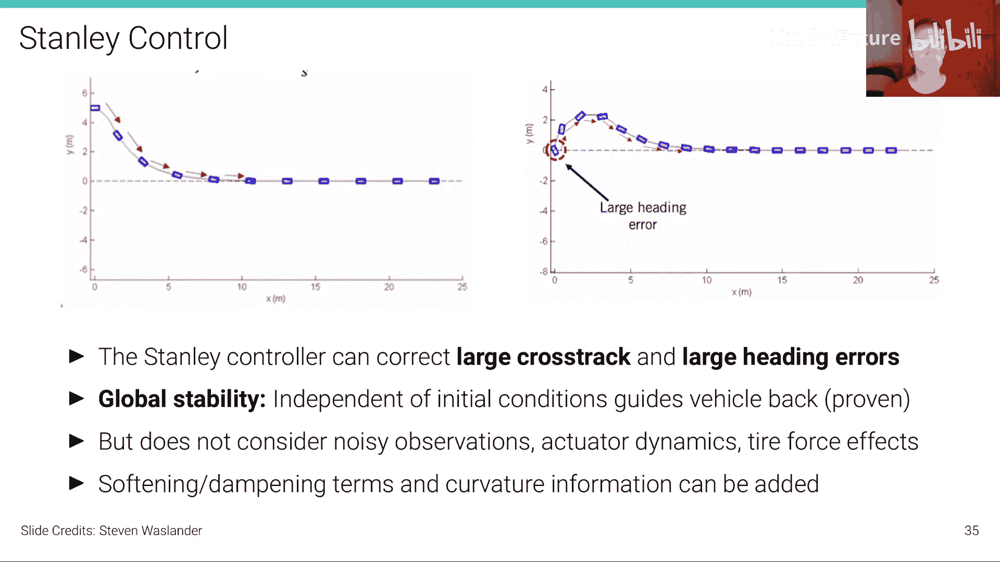

# 022：车辆控制 - 几何控制

在本节课中，我们将要学习几何控制器。这是一种利用车辆模型知识的控制器，与之前介绍的不依赖模型的黑箱控制器不同。我们将重点探讨两种具体的几何控制方法：纯追踪控制器和斯坦利控制器。

上一节我们介绍了不依赖任何过程知识的通用控制器。本节中，我们来看看如何利用已知的车辆动力学模型来构建性能更好的控制器。

## 🎯 纯追踪控制器

纯追踪控制器的目标是跟踪路径上的一个目标点，该点位于车辆前方一个特定的预瞄距离 **D** 处。控制器的目的是通过调整前轮转向角 **δ**，使车辆后轴中心沿着一条圆弧轨迹接近该目标点，从而最小化横向跟踪误差 **e**。

以下是控制器工作原理的几何关系推导图示：

图中，**α** 是车辆当前航向与指向目标点的视线之间的夹角。**L** 是车辆的轴距。**R** 是期望圆弧轨迹的半径。

我们的目标是建立转向角 **δ** 与夹角 **α** 之间的关系。根据运动学自行车模型和几何关系，可以推导出以下公式：

首先，根据正弦定理和三角恒等式，可得到轨迹曲率 **κ** 与 **α** 的关系：
**κ = 1 / R = 2 sin(α) / D**

接着，根据运动学自行车模型，转向角 **δ** 满足：
**tan(δ) = L / R**

将曲率公式代入，得到纯追踪控制律：
**δ = arctan(2L sin(α) / D)**

当转向角较小时，可近似为：
**δ ≈ 2L sin(α) / D**

在实际应用中，预瞄距离 **D** 通常与车速 **v** 相关，例如设为 **D = K * v**，以确保在高速时不会进行过于激进的转向。

现在，我们来看看这个控制律如何与横向误差 **e** 关联。根据几何关系，有 **sin(α) = e / D**。将其代入上述控制律，可得：
**δ = arctan(2L e / D²) ≈ (2L / D²) * e**

这表明，纯追踪控制器本质上是一个针对横向误差 **e** 的比例控制器，其比例系数与轴距 **L** 和预瞄距离 **D** 有关。

## 🏆 斯坦利控制器

斯坦利控制器是纯追踪思想的一个改进，由斯坦福大学车队在DARPA挑战赛中成功使用。与纯追踪控制器不同，斯坦利控制器以车辆前轴为参考点，选择路径上距离前轴最近的点作为目标点，并且没有预瞄距离。

其控制律结合了横向误差校正和航向误差校正，公式如下：
**δ = arctan(k * e / v) + ψ**

其中：
*   **e** 是前轴中心到路径的横向误差。
*   **v** 是车辆当前速度。
*   **ψ** 是车辆当前航向与路径在目标点处切线方向的夹角（航向误差）。
*   **k** 是一个可调增益参数。

该控制律的第一项 **arctan(k * e / v)** 用于修正横向误差。误差越大或车速越低，转向指令越强。第二项 **ψ** 直接修正航向误差，使车辆方向与路径对齐。

斯坦利控制器具有良好的理论特性，例如可以证明其横向误差能够指数收敛到零，并且具有全局稳定性。当然，它仍是一个相对简单的模型，未考虑轮胎力、执行器动态和观测噪声等因素。实践中常通过添加阻尼项或融合路径曲率信息对其进行改进。

以下是斯坦利控制器在不同初始误差下工作的两个示例图示：

最后，值得一提的是，斯坦利控制器在真实的DARPA Grand Challenge中得到了验证，能够引导自动驾驶车辆在复杂地形（如狭窄的山路）上稳定循迹行驶。

## 📝 总结

本节课中我们一起学习了两种基于几何模型的车辆路径跟踪控制器。
1.  **纯追踪控制器**：通过跟踪前方一个预瞄点，使车辆沿圆弧运动，其控制律近似为一个横向误差的比例控制器。
2.  **斯坦利控制器**：以前轴为参考，综合校正横向误差和航向误差，被证明具有全局稳定性，在低速场景下表现优异。

这两种控制器都充分利用了车辆的运动学模型知识，比通用的黑箱控制器更高效、更具可解释性，是自动驾驶控制领域的基础方法。