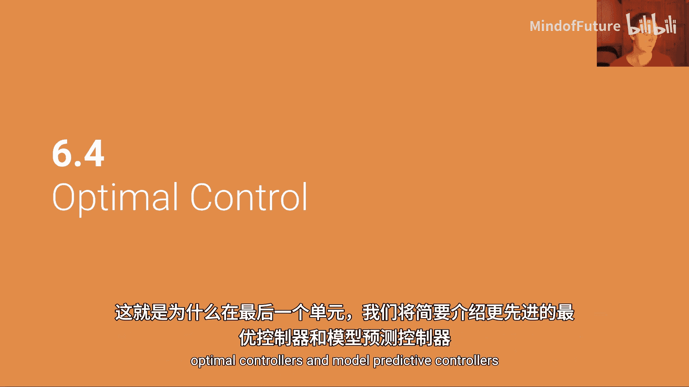
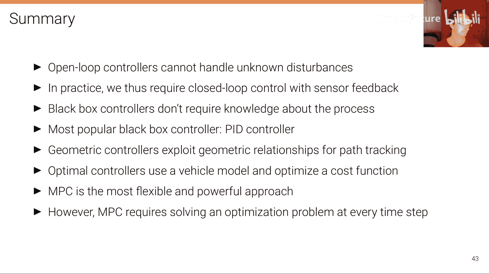

# 023：最优控制 🚗

在本节课中，我们将学习最优控制与模型预测控制。这两种控制器利用车辆动力学模型，能够预测未来状态并进行全局优化，从而处理高速驾驶等需要前瞻性的复杂场景。

## 控制器面临的共同问题

上一节我们介绍了几何控制器，本节中我们来看看所有控制器面临的一个共同局限。

目前所见的所有控制器都存在一个问题：它们无法展望很远的未来。然而，由于我们希望车辆能以高速行驶，并且车辆本身具有质量，因此常常需要，特别是在高速情况下，提前展望未来，并预判即将到来的路口、其他车辆或弯道。现有的控制器难以处理此类情况。因此，在最后一个单元，我们将简要介绍更高级的最优控制器和模型预测控制器。

## 最优控制基础：线性二次型调节器

最优控制器和模型预测控制器都利用了底层的动力学模型。与之前看到的几何控制方法相比，这些控制器对模型的利用更为深入。

让我们以动态自行车模型为例进行回顾。

以下是上一讲中见过的动态自行车模型方程，其状态 **X** 包含横向速度、横摆角和横摆角速度。这是一个简单的微分方程，其中状态的一阶时间导数被表达为状态的线性系统加上一个向量乘以输入（本例中为前轮转向角 **δ**）。

因此，我们得到了一个非常简单的线性微分方程。这意味着我们可以将其写成以下线性系统形式：

**ẋ = A x + B δ**

其中：
*   **ẋ** 是状态 **x** 的时间导数。
*   **A** 是系统矩阵。
*   **x** 是状态向量（包含横向速度、横摆角和横摆角速度）。
*   **B** 是输入向量。
*   **δ** 是标量输入（转向角）。

给定这样一个方程，线性二次型调节器是最常见的最优控制器形式之一。

给定这个具有边界条件（初始条件 **x(0) = x_init**）的连续线性时不变系统，以及一个二次型成本泛函 **J**，其定义为：

**J = 1/2 ∫₀^∞ [ x(t)ᵀ Q x(t) + δ(t)ᵀ R δ(t) ] dt**

其中 **Q** 是一个对角权重矩阵，用于为未来的特定状态分配成本；**R** 用于对控制输入（如转向角）施加成本。这个模型具有很强的表达能力，我们可以通过它定义未来的成本。

有趣的是，在这种特定的简单形式下，如果我们能以这种简单形式表述系统，那么最小化成本 **J** 并满足约束的反馈控制 **δ** 由以下表达式给出：

**δ = -K x**

其中 **K = R⁻¹ Bᵀ P**，而 **P** 是黎卡提方程的解。这里不深入细节。重要的是，我们得到了一个封闭形式的解。

但这个封闭形式解的存在，是因为我们以特定方式（二次型成本泛函和连续时间线性系统）进行了公式化。这些是相当强的假设，并不总是符合现实。我们通常希望在建模上更加灵活，这便引出了模型预测控制。

## 模型预测控制：灵活性与计算权衡

虽然之前看到的最优LQR控制器有封闭形式的解，但模型预测控制推广了这一思想，同时放弃了封闭形式解，需要在执行控制器时进行实时优化。这使得计算成本更高，但同时也获得了建模的灵活性。

模型预测控制将LQR推广到非线性成本函数和动力学系统。这非常有用，例如，我们可以考虑从直道进入弯道的情况、非线性特性，并且可以从简单的动态自行车模型局部坐标定义，转换到我们几乎总是感兴趣的车辆全局坐标定义。正如在动态自行车模型讲座最后讨论的，这会使系统变为非线性，因此仅适用于线性系统的LQR不再适用，但模型预测控制可以处理。

这是表达能力最强的控制器，随着计算成本越来越低，以及许多待控制系统能够承载大量计算，它现在被广泛使用。

它非常灵活。例如，它允许使用滚动时域。我们不需要一直建模到无限远的未来，而是可以为未来一个固定的时间窗口建模，并且可以为不同的时间步分配不同的权重。我们可以说，减少近期未来的误差比展望更远的未来更重要，因为更远的未来我们的感知测量也可能更不确定。此外，我们可以纳入任意约束，任何可以优化的东西都可以纳入。

然而，如前所述，它计算成本更高。现在我们需要在控制器每次迭代执行时进行非线性优化。控制器通常需要以很高的频率执行（例如每秒1000次）来控制一个系统，这意味着你需要每秒解决1000次非线性优化问题。但这仍然是可行的。

形式上，模型预测控制可以用以下方程表述：目标是相对于未来 **T** 个时间步的输入转向角序列 **δ₁, ..., δ_T**，最小化一个成本函数的总和。在每个时间步，我们可能有一个不同的成本函数，它取决于车辆未来的状态。车辆从某个初始条件开始，我们有一个动态模型（如动态自行车模型），允许我们通过迭代执行来模拟车辆未来 **T** 个时间步的状态。

你可以将其想象成一个大的计算图，一个展开的计算图。你将这个优化问题展开到未来，然后优化这些参数 **δ**。我们也可以容纳任意约束。

因此，我们将动态模型展开 **T** 次，然后应用非线性优化来寻找参数，类似于在深度学习中展开循环神经网络并优化神经网络参数的方式。

## 实例对比：为何模型预测控制至关重要

最后，让我们看一个具体例子，说明为什么模型预测控制很重要，特别是在考虑高速驾驶时。

顶部是一个经典PID或路径跟踪控制器的示例。假设车辆沿着一条道路行驶，这里有一个右转弯，实际上是一个相当急的右转。我们想要跟踪道路中心线上、车辆前方一定距离处的这个点。假设最初车辆以50公里/小时行驶。因为我们跟踪那个点，并且道路上没有限制，我们可能会加速。现在我们以60公里/小时行驶。由于仍在直行，并且只局部观察环境，我们进一步加速到70公里/小时。一切似乎都还好，我们不知道这里有一个右转弯。但是，一旦我们加速到70公里/小时，我们会突然发现，路径上的目标点向右移动了，但我们速度太快，无法及时刹车。我们继续减速，试图跟踪那个点，但已无法做到。因此，我们虽然减速，但仍会撞到道路的另一侧。

相比之下，模型预测控制器将模型展开 **T** 个时间步（根据我们设定的长度）。只要我们有地图或能观测到未来的环境，它就知道未来的整个轨迹。因此，我们早在这一点就知道未来必须减速，这意味着我们现在就可以开始减速。我们遵循这条轨迹，在每个时间步，模型预测控制都会重新计算未来 **T** 个时间步。在这里，我们计算了这些时间步；现在在这里，我们计算这些时间步以及一个未在此显示的未来时间步。因为我们在计算未来，我们在滚动执行我们的车辆模型。理论上，我们可以假设未来的轨迹。因此，我们早已知道在这一点需要减速，以便实际完成这里的右转。所以我们减速到30公里/小时，再到20公里/小时，然后完成右转。这就是在考虑高速驾驶和需要长远展望的情况下，路径跟踪与模型预测控制的区别。

## 总结

本节课中我们一起学习了最优控制与模型预测控制。

我们了解到，开环控制器无法处理未知扰动，因此在实践中需要带有传感器反馈的闭环控制器。

我们也看到，黑盒控制器不需要关于过程的知识，其中最流行的是PID控制器。

我们学习了几何控制器利用几何关系进行路径跟踪。

而最优控制器则使用车辆模型并优化全局成本函数。

其中，模型预测控制是最灵活和强大的方法，但它需要在每个时间步解决一个优化问题。