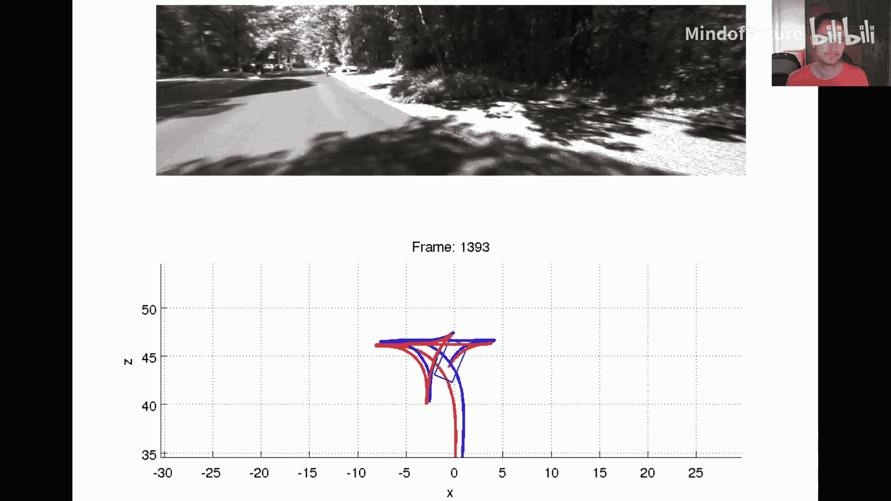
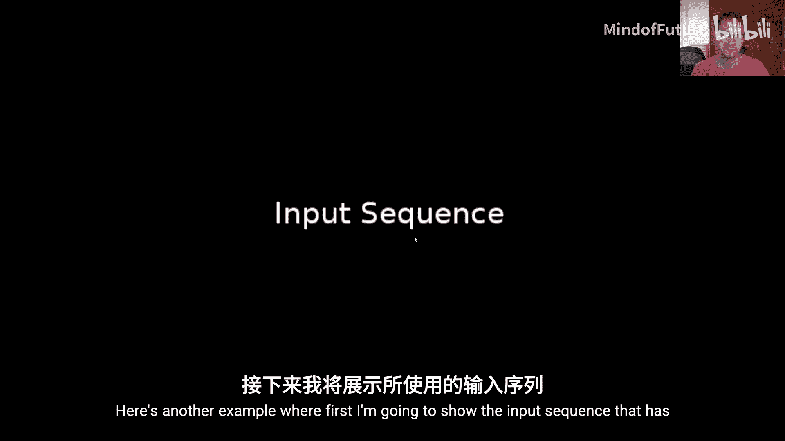
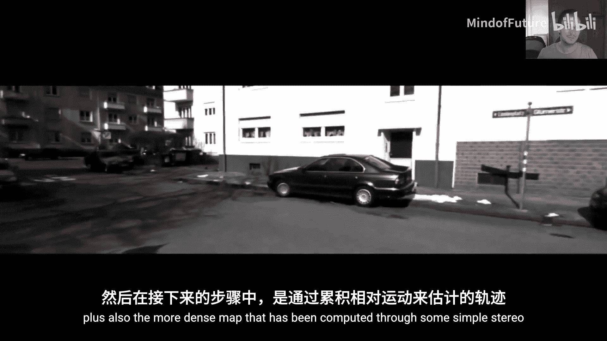
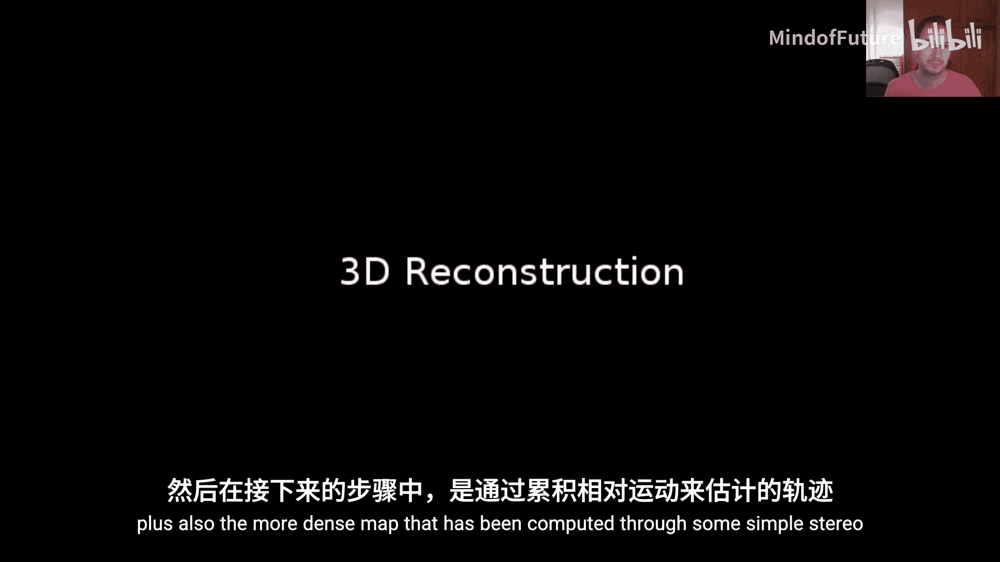
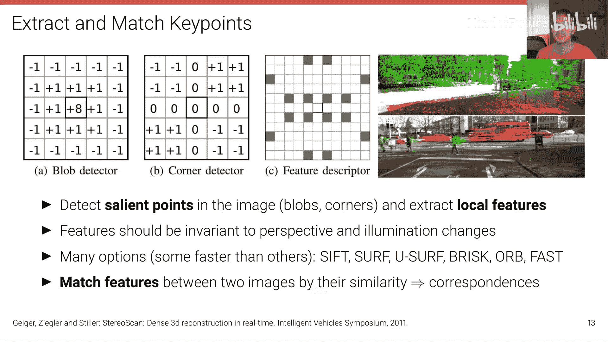
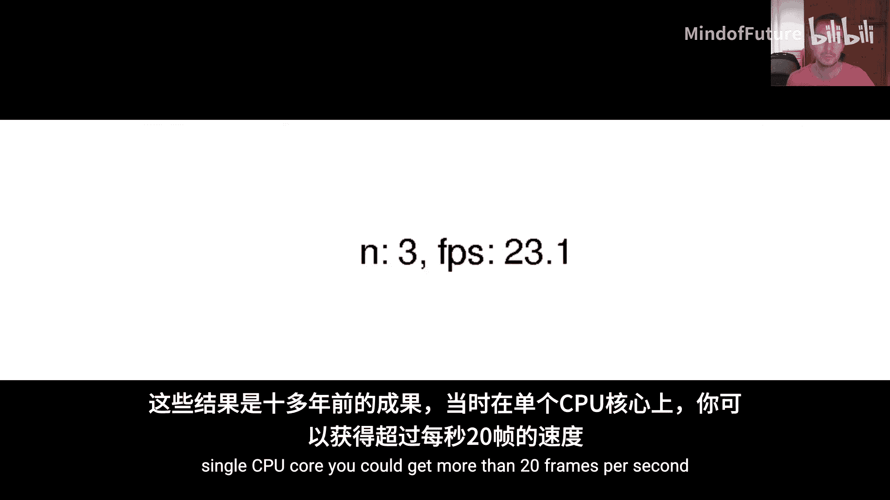
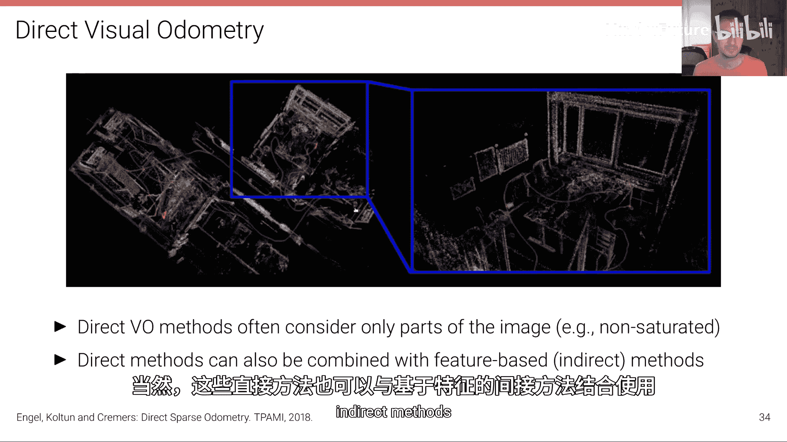
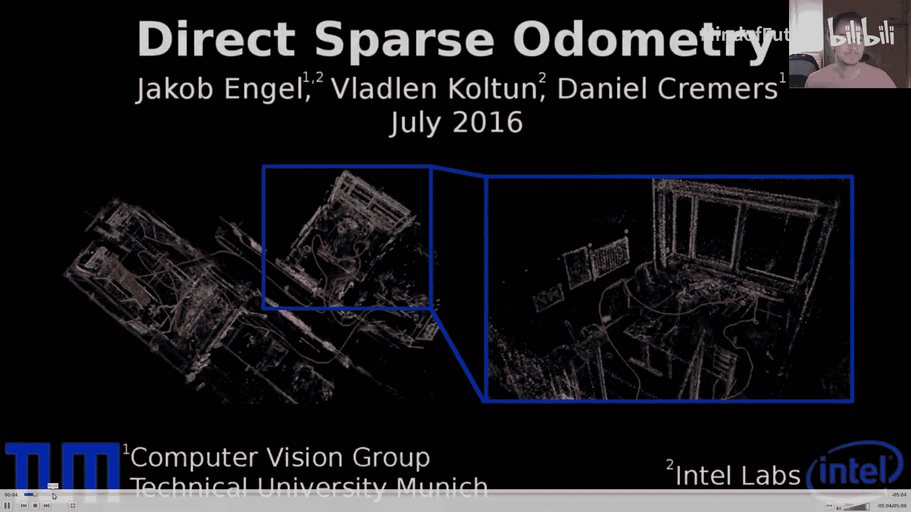
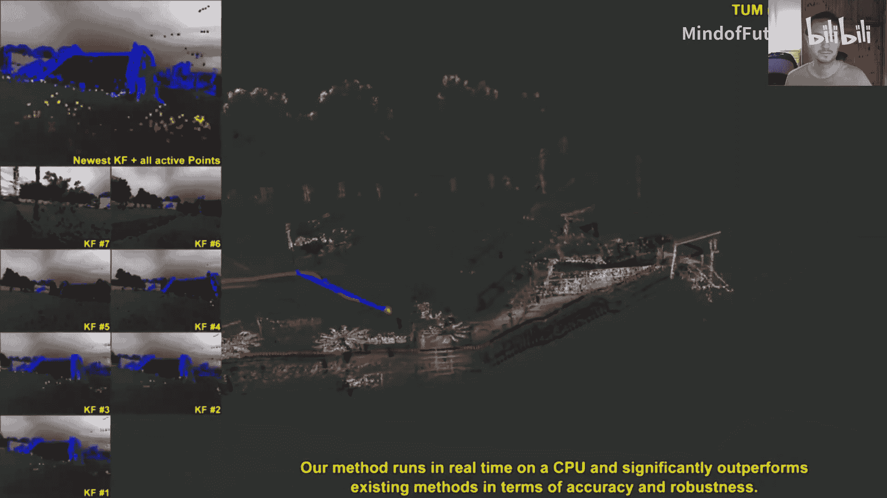

# 024：里程计、SLAM与定位 - 视觉里程计

在本节课中，我们将要学习自动驾驶汽车中一个核心的模块：自我运动估计与定位。我们将重点探讨视觉里程计，这是一种通过图像序列来估计车辆自身相对运动的技术。

我们已经完成了本课程的一半。在接下来的六节课中，我们将更深入地研究经典的模块化流水线，特别是构成该流水线的各个独立模块。例如，低级感知与场景解析，这将是接下来几节课的内容。以及路径规划与决策制定，这将是第12讲的内容。当然，还有车辆控制，我们已经在之前的两节课中讨论过了。

在本节课中，我们将专注于自我运动估计和定位。自动驾驶汽车在动态环境中运行，因此必须了解其自我运动（即自身的运动）以及其他交通参与者的运动。本课的重点是估计自身的运动，即所谓的自我运动。

我们将考虑三种不同类型的运动估计。第一种称为视觉里程计。视觉里程计是指从图像中估计相对自我运动。例如，在时间T，你可以看到左边的车辆；在时间T+1，你可以看到右边的车辆。从时间T到时间T+1，车辆经历了一个具有旋转 **R** 和平移 **t** 的刚体变换。这是一个六自由度的刚体变换。我们想要估计的是这个刚体变换的六个参数，它们将当前姿态与前一时刻的姿态联系起来。这就是为什么它被称为相对自我运动估计，因为我们不是将车辆定位到全局参考系（如地图）中，而是将其定位到前一时刻的姿态。

我们将要研究的另一类是SLAM，即同步定位与建图。其目标是构建地图并同时在该地图中定位。我们将看到这两个任务必须联合处理。例如，地图可能由一些地标组成。我们希望联合估计这些地标的位置和车辆的姿态。这样，之后我们既在地图中完成了定位，也生成了一个可以在以后再次行驶到同一区域时用于定位的地图。

第三类是定位问题，即给定一个地图（例如，由地图公司提供的高清地图，或通过SLAM算法预先行驶并建图自动计算出的地图），我们希望找到车辆的全局姿态，即车辆相对于该给定地图的位置。这些地图可能非常大，可达数百或数千公里，因此这个定位问题也可能相当复杂。

所有这些任务在实践中都很有用。例如，估计相对于前一帧的自我运动对于在更长的时间范围内整合轨迹、衡量我们的动力学模型预测效果以及控制车辆都很重要。当然，我们需要知道我们是如何行驶的。相对于地图的定位也很重要，因为我们可能向地图中添加有用信息，例如交通灯的位置，这可能反过来促进交通灯的检测。或者我们可能在其中加入其他信息，如车道标记，以帮助我们保持车道或了解车道数量，所有这些元信息都可能很有用。

因此，在实践中，所有这些对于自动驾驶都是必需的。以下是今天的路线图：在第一单元，我们将介绍视觉里程计；在第二单元，介绍SLAM；最后是定位。让我们从视觉里程计开始。

## 什么是里程计？

这是之前的图片。现在我们将更一般地看待里程计，它不一定是视觉的，不一定需要从图像传感器估计，也可以使用其他传感器。问题是，我们希望通过可用的传感器来估计自我位置随时间的变化，并且通常有多个传感器，我们希望将它们结合起来。

里程计（Odometry）一词源于希腊语，`odos` 意为路线，`metron` 意为测量，因此我们想要测量车辆所经过的路线。在上面的例子中，汽车在两帧之间经历了刚体运动。

里程计产生的是相对运动估计，而不是相对于地图的全局位置。因此，它容易受到随时间累积的误差影响。它只在局部精确。如果你获取这些相对运动估计并将它们随时间累积，就会产生漂移。我们稍后将在SLAM中看到这种漂移情况以及如何使用闭环技术来解决。但如果你只考虑里程计问题，你总是会有漂移，因为你是通过相对测量随时间积分位置，所以误差会随着时间的推移越来越大。对于估计非常长时间范围内的全局位置来说，这不是一个好技术。但它擅长估计局部的相对运动，而这通常是自动驾驶中重要的，因为我们想知道我们是如何在局部移动的。

里程计信息可以通过多种传感器获得。以下是两个非视觉的例子。第一个是轮式里程计。轮式里程计系统使用车轮编码器来测量车轮旋转。你可以在这里看到这样一个编码器。我选择这张图片是因为它非常直观。当然，在现代自动驾驶车辆中，这些传感器被集成在车辆内部。一个非常不精确的版本今天在我们所有人的汽车中都有，如果你进入你的汽车，你会看到自购买以来行驶的公里数，等等。这是同样的原理，只是自动驾驶车辆使用的这类传感器应该更精确。

另一种里程计传感器称为惯性测量单元（IMU）。你可以在这里右边看到一个非常昂贵的，常用于自动驾驶车辆。但你的智能手机中也有这样的IMU，例如，用于确定你是竖屏还是横屏拍照，这些加速度传感器被使用，或者当你拿起智能手机时，屏幕会亮起等等。惯性测量单元通过内置在这些模块中的加速度计以及通过滤波跟踪和更新此信息的复杂算法来测量物体的力。加速度计当然只估计加速度，通常是线性加速度和角加速度。为了从加速度获得姿态，我们需要积分两次，这意味着噪声也被积分了两次。因此，我们不能仅使用IMU数据来获得精确的姿态估计。这就是为什么IMU经常与其他类型的传感器结合使用，例如视觉传感器或GPS传感器。

最后，我们有使用相机图像的视觉里程计算法，这是我们今天重点关注的。多个系统经常被组合起来以相互补充，例如，如果你驶入隧道，图像变暗，很难匹配特征，因此在这短暂的时间内，另一个传感器接管是很重要的，这就是为什么你通常会融合这些信息，例如，VIO（视觉惯性里程计）意味着我们将视觉里程计与惯性测量单元结合起来，在实践中，惯性测量单元经常与GPS或轮式里程计等结合使用，以使其更鲁棒。

## 视觉里程计简介

以下是视觉里程计的一个例子。视觉里程计关注的是从图像中跟踪相机的姿态（相机的位置和方向）相对于环境。如果你能跟踪相机姿态并且相机已校准，你就知道相机相对于车辆坐标系的相对姿态，因此通过知道相机运动，你也知道车辆运动。

视觉里程计通常考虑有限的近期帧集以实现实时性能。在大多数情况下，里程计只考虑将当前帧相对于前一帧进行配准，估计两幅图像之间的相对运动。这也导致了随时间累积的误差。

另一个需要注意的点是，视觉里程计虽然主要关注运动估计（相对运动估计），但它们通常也必须构建一个局部稀疏地图。这是一个副产品，不是这些技术的重点。但这是一个副产品，意味着它们被用来估计运动。我们将看到，与SLAM算法或密集建图算法相比，它们通常不那么精确，也不那么密集，但它们是估计姿态所必需的。

这里有一个例子，在背景中你可以看到场景的3D重建，这不是视觉里程计算法产生的稀疏局部地图。它是一个通过立体重建获得的更密集的地图，用于说明场景的样子。但视觉里程计算法的实际输出是这条红色轨迹。你可以看到这些小三角形，它们是相机姿态。每个三角形对应一帧。你可以看到车辆是如何沿着这条路行驶，然后驶过这座桥的。所有这些都是仅通过图像测量确定的。整个运动都是通过图像测量确定的。然后，通过知道每一帧中每个独立相机的姿态，我们当然可以将从立体视觉获得的所有局部重建组合成一个非常好的全局重建，正如你在这里看到的。因此，我们也可以使用里程计信息来局部地映射环境。

以下是视觉里程计在实践中如何工作的一个例子。作为对比，红色的是非常精确的GPS惯性测量单元的轨迹，正如你在上一张幻灯片中看到的，蓝色的是算法的估计。你可以看到算法如何将相对运动估计累积成地图上的全局位置（相对于第一个姿态估计）。你可以看到它仅根据图像测量，就相当可靠地跟踪了这个停车操作。

这是另一个例子，首先，我将展示使用的输入序列，然后是估计的轨迹，该轨迹是通过视觉里程计计算的相对运动累积而成的，再加上通过一些简单的立体匹配算法计算的更密集的地图。所以这里没有涉及任何GPS或激光雷达。这只是一个被整合到这个局部环境中的图像序列。

## 视觉里程计方法详述

现在让我们更详细地看看这些方法。我们将看两种方法。第一种方法称为间接视觉里程计。它之所以被称为间接，是因为我们这里有一个间接步骤，即特征检测、提取和匹配步骤。

输入序列中的输入图像通过特征检测器，该检测器检测图像中的显著点，并尝试在相应的帧（通常是相邻帧）之间匹配这些显著点，以获得所谓的图像对应点。然后，我们有一个算法，最小化这些对应点重投影回图像的重投影误差，同时返回一些稀疏地图。通过这个，我们得到运动，即相对运动估计。这被称为间接视觉里程计方法，因为它经过了特征匹配步骤。有时它也被称为基于特征的视觉里程计方法。

相比之下，直接方法省略了这个中间步骤，直接从输入图像序列到相对相机参数和地图。它们不是最小化稀疏特征对应点的重投影误差，而是最小化光度误差，它们通过估计每个像素的深度作为地图，然后计算扭曲图像之间的光度一致性，尝试将一幅图像扭曲到另一幅，以对齐运动或图像序列中的两幅连续图像，从而找到最优运动。

这两种方法都有优点和缺点，我们将在本单元稍后讨论。让我们首先从经典的间接视觉里程计方法开始。

## 间接视觉里程计：特征匹配

如前所述，第一步是对于每幅图像，我们需要找到图像中独特的、显著的点，这些点可以与前一帧中找到的点相匹配。我们通过寻找图像中的显著点来做到这一点，例如斑点。这里有一个简单的5x5滤波器，我们可以在图像上滑动以找到斑点。这是一个棋盘格滤波器，我们可以用它来找到角点。然后，我们可以获取像素强度或梯度，并将它们组合成特征向量来描述这些角点和斑点。然后，通过将这些向量的特征值与在前一帧中提取的特征向量进行匹配，我们可以得到对应点，如这些小箭头所示。所以，这些点的起点是前一帧中的位置，点的终点是当前帧中的位置。这是针对自我车辆移动的场景。这是针对自我车辆静止但其他物体移动的场景。

这些特征应该对透视和光照变化具有不变性，并且有很多选择，有些比其他的更快，例如SIFT、SURF、BRISK、ORB、FAST，或者像这篇论文中这样非常简单的特征通常对于自动驾驶来说就足够了。我们通常不需要像通用计算机视觉中那样具有不变性，因为我们比较的两帧是在非常接近的时间内拍摄的。这意味着没有发生太大变化。当然，我们希望在一定程度上对透视和光照变化具有不变性，但我们不必，例如，对180度旋转（将图片倒置）具有不变性，这在驾驶中通常不会在两帧之间发生。因此，我们可以使用一些更简单的特征，这些特征在实时中效果很好。

然后，我们通过特征向量的相似性在两幅图像之间匹配这些特征。因此，我们可能在第一帧中构建一个KD树，在这个特征描述符所在的特征空间中。然后我们将当前帧与之匹配，这在实践中对于至少像这里这样的简单描述符来说效率相当高。所以在这个案例中，是非常简单的5x5核用于寻找特征，加上所谓的非极大值抑制以仅保留最显著的特征，然后使用这种特征描述符在非常特定的稀疏位置处的梯度，并将它们堆叠成一个向量，然后在前一帧中找到最接近的匹配。你会得到类似这样的结果。

这些是十多年前的结果，即使在那个时候，在单个CPU核心上，你也可以获得每秒超过20帧的速度。正如你所看到的，这里有很多图像特征被匹配，这对于估计视觉里程计来说已经足够了，视觉里程计实际上只包含六个参数，即刚体变换的六个参数，因此我们可以非常快速地获得大量测量值。这是基于特征方法的第一步。

## 从特征到运动估计

现在，下一步是我们如何从提取的这些特征对应点中实际得到相对运动估计。为了理解这一点，我们首先需要看看图像形成过程。我取了计算机视觉第2讲和第3讲的一些幻灯片，并为这节课相当紧凑地浓缩了它们，以便快速回顾或快速介绍图像形成的工作原理，因为我们需要知道这一点才能理解这些视觉里程计算法是如何工作的。

好的，那么让我们从图像形成开始。简而言之，我们首先需要讨论基本元素，这些通常是点。例如，2D点可以用所谓的非齐次坐标表示，只需堆叠两个坐标。这是一个简单的2D向量，描述2D点，例如图像中的像素。类似地，我们可以用3D向量描述3D点。这很清楚。

但我们也可以使用所谓的齐次坐标来描述它们。使用齐次坐标，我们总是将维度增加一，因此一个2D点（一个像素）变成一个3D向量，一个3D点变成一个4D向量。我们这样做是因为我们喜欢这些点，它们来自一个称为射影空间 **P^2** 的空间。原因是，我们认为所有仅相差一个比例因子的齐次向量是等价的。它们定义了一个等价类。这意味着齐次向量仅定义到比例因子。

那么，为什么我们要人为地从二维增加到三维呢？嗯，这使我们以后的生活更容易。然后我们可以定义，例如，本质上非线性的图像投影过程为一个线性函数，一个线性映射。因此，我们可以使用简单的线性代数来定义我们需要定义的许多映射。我们也可以更容易地用这个定义推导出极线几何。

所以这是一个点的齐次坐标，我们可以用齐次坐标描述同一个点，但我们如何在这两种表示之间进行转换呢？哦，注意，在本课程中，我们总是像在计算机视觉课程中那样，在符号上方加一个波浪号来表示这些是齐次坐标。

一个非齐次向量 **x** 被转换为齐次向量 **x̃**（这里缺少一个波浪号），如下所示：**x̃ = [x, y, 1]^T**。所以我们只需添加一个维度，并在那里放入元素1。这也被称为增广向量，如果一个齐次向量的最后一个元素是1，我们称之为增广向量。这是从非齐次向量到齐次向量的简单转换。

要向相反方向转换，我们只需除以最后一个元素 **w̃**。假设我们有一个任意的齐次向量，其中 **w̃** 不等于1。我们可以将这个向量除以 **1/w̃**，使得最后一个元素变为1。这样我们就得到了所谓的增广向量，我们可以通过只看前两个元素来读取非齐次部分，即 **x̃/w̃** 和 **ỹ/w̃**，这对应于 **x**。

这就是我们如何在齐次和非齐次向量之间转换的方法，只需在末尾添加一个1，或除以最后一个元素。

这是这种关系的图形说明，你可以看到三维空间中的齐次向量。然后增广向量是我们连接原点和该点的直线与位于 **w̃ = 1** 的平面相交处的向量。你已经可以从这个说明中看出，这某种程度上类似于透视投影。我们已经有一些看起来非常类似于3D点如何投影到2D图像平面的东西。

那么透视投影究竟是如何工作的呢？让我们看看这张图片。一个3D点 **X_c** 透视投影到像素坐标（我们称之为屏幕坐标 **x_s**）在2D图像平面上。首先，我们必须注意光线总是直线，所以我们有一条通过相机中心和3D点的射线，该射线与图像平面相交于点 **x_s**。现在的目标当然是估计那个蓝色点 **x_s** 相对于相机坐标系的位置。

惯例是让主光轴（即 **z** 轴）与图像平面垂直对齐。所以主光轴是垂直穿过图像平面的轴。因此，我们这样对齐这个坐标系，使得 **z** 轴与该轴对齐。这是一个惯例。为了清晰起见，这里没有显示 **y** 坐标，所以我们从侧面看图像平面。这是我们在这里进行测量的地方。为简单起见，当然，在 **y** 方向上，它的工作方式完全相同。

现在的问题是，我们如何从3D坐标和相机坐标系推导出2D像素的位置？为此，我们只需看这里的相似三角形。我们有一个大三角形，然后是一个小三角形。因此，我们可以看到 **x_s**（这里的距离，2D像素的 **x** 分量）除以焦距（相机中心与图像平面之间的距离）等于3D点在相机坐标中的 **x** 坐标除以3D点的 **z** 坐标（3D点在相机坐标中的距离）。换句话说，在透视投影中，相机坐标中的3D点通过除以它们的 **z** 分量并乘以焦距映射到图像平面，如果我们把焦距移到另一边，我们看到我们需要取 **X** 坐标除以 **Z** 坐标再乘以焦距。我们必须这样做。我们可以对3D点的 **x** 坐标和 **y** 坐标都这样做，以获得该像素在图像平面上的 **x** 位置和 **y** 位置。

这里要注意的一点是，拥有齐次坐标的优雅之处在于，如果我们用齐次坐标来写这个，这个非线性方程（它是非线性的，因为我们除以了一个 **z**）突然变成了一个线性表达式。这在右边有说明。我们取一个增广向量 **[X, Y, Z, 1]^T**，乘以这个矩阵，这给了我们齐次向量（一个三维向量）。你可以看到，如果我们这样做，例如在第一行，我们得到 **f * x**，在最后一行，我们得到 **1 * z**。所以作为齐次向量的最后一个元素，我们有 **z**，作为第一个元素，我们有 **f * x**。因此，如果我们将这个向量转换为非齐次形式并除以最后一个元素，我们恰好得到这个表达式。一个小备注：焦距的单位通常选择为像素，因为我们将以米为单位的3D点转换为像素，所以这里我们有以米为单位的东西，输出应该是像素为单位的东西，这就是为什么 **f** 的单位通常选择为像素。

所以我们看到透视投影可以非常简单地写成这样。正如这里推导的，但如果我们使用齐次坐标，我们可以有一个更简单的线性形式，因为那些隐式地为我们做了除以 **z** 的操作。

到目前为止，我们假设的是图像坐标系的原点位于主光轴与图像平面相交的点。但通常我们使用正的像素坐标工作，其中图像坐标系位于图像的角落，因此通常添加一个主点偏移 **c_x** 和 **c_y**，以便将图像坐标系移动到图像平面的角落。

当我们看透视投影模型时，这看起来如何？嗯，我们只需将 **c_x** 和 **c_y**（这个所谓的主点）添加到方程中。我们在这里添加的另一件事是所谓的 **s** 参数，它决定了图像的倾斜度，但通常这个项是0。然而，现在我们已经定义了完整的针孔透视投影模型，我们也可以用齐次形式（右边的线性形式）来写这个。现在红色的元素。这个所谓的3x4投影矩阵的3x3子矩阵。投影矩阵的这个红色部分称为校准矩阵 **K**。校准矩阵 **K** 的参数称为相机内参。与外参相对，外参指的是相机姿态，例如相对于世界坐标系。这些是内参。

你可以看到，与之前相比，我们现在有独立的 **f_x** 和 **f_y**，我们有这个 **s** 参数，并且我们有主点。在这种情况下，**f_x** 和 **f_y** 是独立的，这允许不同的像素纵横比。**s** 的出现是因为传感器可能没有垂直于光轴安装，所以我们在投影中得到一个小 **s**。但通常不需要，因为现在的制造工艺非常精确，所以在实践中，我们经常设 **f_x = f_y**，只有一个焦距，并且 **s** 为0。但我们必须对主点建模，因为我们真的想要正的坐标，而不是负的像素坐标。

好的，这就是内参的样子。当我们在相机坐标中有一个3D点时，这就是图像形成过程，但我们也可以链接这些变换。例如，一个3D点可能不是用相机坐标表示的，而是用世界坐标表示的（这里是橙色）。但我们可能知道相机相对于世界坐标的姿态，所以我们仍然可以将世界坐标中的那个点投影到图像平面。

这是如何工作的？让 **K** 再次成为校准矩阵（内参）。让 **R** 和 **t** 成为世界坐标系和相机坐标系之间的刚体变换。这是相机姿态，或者这些参数被称为外参。我们可以简单地链接这两个变换，将世界坐标中的一个点投影到图像坐标。这在底部有说明。再次，因为在齐次坐标中更简单。

因此，屏幕上的齐次坐标点，正如我们所见，是投影矩阵（包括校准矩阵和零向量）乘以相机坐标中的增广向量（这是相机坐标中的3D点）。而相机坐标中的3D点本身只是世界坐标中增广向量的一个线性投影，一个通过 **R** 和 **t** 的刚体变换。我们可以取世界坐标中的那个向量，通过乘以 **R** 并加上 **t** 将其转换为相机坐标。因此，我们可以将其写为这里的简单线性表达式。然后我们可以简单地链接这些变换，得到一个单一的投影矩阵，所以如果我们愿意，我们可以预先将这两个相乘，得到一个单一的矩阵，该矩阵接受世界坐标中的3D点并将其投影到屏幕上。当然，它将是齐次的，因此为了推导出实际的非齐次像素坐标，我们需要再次除以最后一个元素。

好的，这就是图像形成的简要介绍。现在让我们看看所谓的极线几何，它构成了最简单的视觉里程计算法的基础，该算法试图估计给定两幅图像之间相机所经历的相对运动。再次，我们将假设相机已经预先校准，这对于大多数视觉里程计系统来说是成立的。所以相机内参是已知的。

现在的目标是恢复相机姿态，我们也可以从中恢复3D结构，从图像对应点。描述这一点的所需关系由双视极线几何描述。如果你想了解更多关于这方面的内容，而不是我们在这里可以涵盖的，我建议你看看我们的计算机视觉课程。

极线几何在右边有说明。让 **R** 和 **t** 再次表示捕获的这两幅图像之间的相对姿态。所以我们想估计 **R** 和 **t**。一个3D点在这个设置中被投影到图像1中的像素 **x_1** 和图像2中的像素 **x_2**，只需将连接3D点和相机原点的线与图像平面相交。

3D点和两个相机中心张成所谓的极平面（这里是橙色）。像素 **x_1** 在图像 **x_2** 中的对应点必须位于所谓的极线 **l_2** 上。这是通过将极平面与图像平面相交形成的线。这里就是这条线。类似地，在相反的方向上，对于这个点，对应点必须位于这条线 **l_1** 上。此外，所有极线都通过相应的极点。第一幅图像中有一个极点，第二幅图像中有一个极点。如果图像被校正，如果相机面向同一方向，那么这些极点在无穷远处，但在这种特定情况下，它们甚至在图像域内。所有的极线都必须通过那个极点。这基本上就是连接相机中心的线与图像平面相交的地方。

为了说明这一点，我做了一个小动画，你可以看到如果我移动3D点会发生什么。如果我移动3D点，那么极平面会改变。3D点在图像中的投影以及极线也会改变，但你可以看到极点 **e_1** 和 **e_2** 对于这两种情况保持不变。

好的，这描述了双视极线几何。现在极线几何的一个基本性质是所谓的极线约束，我们不会在这里推导它，它在计算机视觉课程中有推导，但我只是把它给你。极线约束由这个公式给出，我们取第二台相机图像平面上的一个齐次点，乘以所谓的本质矩阵 **E**（这是一个3x3矩阵，它是一个齐次矩阵，因为我们只能估计到比例因子，并且因为这是一个齐次方程，比例因子无关紧要），然后乘以另一幅图像中的对应点（相同的点，另一幅图像中的对应像素）。所以在这里，如果我们取那个点，那么对应点就是这里的这个点。这三个的乘积必须等于0。这是描述极线几何的极线约束。

这个约束必须对所有对应点 **x_1** 和 **x_2** 成立。对于所有，如果你想，对于沿着对应极线的所有点，这个约束都会说它们是0。我们还不知道这些点具体在哪里，我们不知道3D点，但如果它们是潜在的对应点，它们必须是0。

现在，本质矩阵 **E** 进一步分解为一个平移部分（这里的符号表示将平移向量转换为一个反对称的3x3矩阵，代表平移向量）和一个3x3旋转矩阵 **R**。这意味着我们可以首先从n个图像对应点确定本质矩阵 **E**，然后将 **E** 分解为 **R** 和 **t**，这就是我们寻求的里程计信息。

## 从对应点恢复运动

让我们做第一步，我们可以从n个图像对应点恢复本质矩阵 **E**，这些对应点形成了 **E** 九个元素中的n个齐次方程。所以，如果我们看这个方程，我们可以把它写成一个线性系统的一行。因此，我们得到一个线性系统，其中有很多这样的约束，取决于我们有多少图像对应点。但是，因为这个方程只定义到比例因子，我们需要约束比例因子，我们可以通过使用奇异值分解（SVD）来做到这一点。由于 **E** 是一个齐次矩阵，我们使用奇异值分解来约束比例因子，我们不会在本课中再次练习它，我参考早期的计算机视觉课程，看看这具体是如何工作的，我只是告诉你，你可以使用SVD来获得解。

注意，这里的一些项是两个图像测量的乘积，例如，这里有 **y_1** 和 **y_2**。因此，与那些只有一次测量的项相比，它们不对称地放大了测量噪声。因此，使用SVD来获得 **E** 解的所谓的归一化八点算法，首先对观测值进行白化处理，使其具有零均值和单位方差，然后再计算，并在最后相应地反变换由SVD恢复的矩阵。所以我们归一化和反归一化以应对这种不对称性。但这只是一个细节。

这里的主要关键点是，我们使用SVD从一组线性方程中恢复 **E**，这些方程是我们从这个极线约束推导出来的，给定我们事先确定的对应点。正如我们所见。

现在，从 **E**，我们可以恢复平移向量 **t** 的方向 **t̂**（我在这里用这个帽子表示我们只能恢复方向）。仅从单目图像序列中，存在固有的尺度模糊性，我们只能恢复方向。所以，如果我们看这里的本质矩阵，我们在左边乘以方向向量 **t̂**，我们看这个三重积，我们可以证明这必须是0，因为我们有一个三重积，其中两个向量在这里指向同一个方向。因此，**E** 是奇异的，我们在这里再次得到 **t̂** 作为与奇异值零相关的左奇异向量。在实践中，由于测量噪声，奇异值不会恰好是0。因此，我们可以选择最小的那个。另外两个奇异值大致相等。所以通常一个比其他的小得多，我们可以选择那个。

旋转矩阵 **R** 也可以计算，但它更复杂一些。因此，如果你想知道如何做到这一点，我会参考Cliky的教科书。再次注意，本质矩阵有5个自由度，3个用于旋转，2个用于平移。换句话说，这意味着仅使用单目视觉里程计无法确定全局尺度。如果我们只给出一个单目图像序列，我们无法确定绝对尺度。这根本不可能。这是不可观测的。这就是为什么在这里我们也必须将尺度限制为一个固定的假设值，以获得解。

现在，我们可以通过非线性优化进一步改进我们刚刚推导出的 **R** 和 **t** 的代数估计。

让 **π** 表示3D点 **X_i** 投影到2D图像平面，同时考虑外参 **R** 和 **t** 以及我没有在这里明确写出的内参。让 **x_{1,i}** 和 **x_{2,i}** 表示第一帧和第二帧中的2D特征对应点。所以 **X_i** 是一个3D点，**x_{1,i}** 和 **x_{2,i}** 是图像中的2D像素对应点。

现在，我们可以做的是最小化所谓的重投影误差，我们可以将所有对应点的3D点投影到两幅图像中，并针对运动以及可选地针对3D位置进行优化。这在这里有说明。所以我们想找到 **R** 和 **t** 的最优值，如果我们还想优化并有时间预算这样做，我们也可以优化3D点 **X**，通过解决这样一个非常小的光束法平差问题，我们在这个表达式中相对于 **R**、**t** 和可选的 **X** 进行最小化。

这个表达式是什么？嗯，它是所有对应点的和，我们试图最小化重投影误差，即第一幅图像中测量的对应点与预测的对应点之间的差异，以及第二幅图像中测量的对应点与预测的对应点之间的差异。你可以看到，对于这里的预测，我们使用相同的函数，只是在第一种情况下，在第一台相机中，我们使用外参集（单位矩阵和零平移向量）投影3D点，因为这个点被假设在第一台相机的坐标系中，所以我们不需要应用任何外参变换。但对于第二台相机，我们首先使用将点从第一坐标系变换到第二坐标系的外参变换3D点，然后我们应用内参（相机校准矩阵）将其投影到图像平面。这就是这里的区别。

我们特别针对 **R** 和 **t** 优化这个表达式。但我们也可以针对 **X** 进行优化，这会增加我们进行此优化所需的时间，但会改善结果。

与之前的代数解相比，优化重投影误差通常会产生更好的结果，但我们需要初始化参数，所以我们需要首先有代数解。原因是这更符合我们拍照时的实际噪声统计，因为在这里，例如，我们使用了L2范数，这对应于假设这些像素坐标对应点在图像平面上服从高斯噪声，这对于所有不是异常值但正确的点来说是一个相对较好的假设。而代数解有一个非常不同的噪声假设，不那么现实。

三角测量可用于初始化 **X**。因此，给定来自代数解的 **R** 和 **t**，我们可以反向投影光线并找到3D点，以便为此优化初始化 **X**。当然，我们可以通过不在此优化中包含 **X** 来获得加速，但如果代数解有误差，那么我们也无法修复它们。

必须考虑异常值。如果有一个错误的对应点，它当然会严重影响结果，因为它也像内点一样以平方范数被积分。因此，必须移除它们以免影响估计，有各种技术。你可以在这里使用鲁棒的损失函数，这些函数不是平方的，通常使用的是所谓的RANSAC（随机抽样一致性），你使用所需的最小对应点集（例如，在八点算法的情况下是四个对应点）进行第一次估计。然后你这样做很多很多次，并检查所有其他点是否遵循你估计的模型，然后你选择获得最多投票（大多数点同意）的那个，然后你包括所有内点并进行最终的优化步骤。

再次，对于非线性优化，平移向量的长度无法确定。所以平移向量的长度是未知的，但这种模糊性可以解决，例如，如果你有立体图像并且你知道校准，你知道基线，那么你也可以恢复这个信息，或者如果你使用VIO（视觉惯性里程计），正如我们在开头看到的，我们可以将轮式里程计与这种视觉里程计结合起来以解决尺度模糊性。

现在，这看起来如何？我试着在这里说明。我们可以使用现成的非线性最小二乘求解器（如Levenberg-Marquardt）来优化这个表达式。在这个特定情况下，我尝试只优化 **R** 和 **t**。你可以看到，在这种情况下，我选择的图像测量值都稍微位于投影的右侧。因此，为了最小化这些红色的重投影误差，我必须做的是将相机稍微向左移动，以减少这些误差。现在这只是优化 **R** 和 **t**，如果我们也能优化3D点，那么这些重投影误差也可以减少。

再次，如果有立体相机可用，我们可以针对所有四幅图像进行优化，这样我们可以得到更鲁棒的估计，并且我们也可以估计全局尺度，即平移向量的长度或场景的尺度，这两者是等价的。此外，立体测量允许瞬时三角测量。所以在这里，如果你在第一帧中有立体图像，你可以在左右相机之间找到对应点。通过这个，你知道点的深度，所以你可以直接从单帧三角测量3D点，然后通过这些三角测量的3D点将第二对立体图像相对于第一对进行配准。所以它使事情更简单，但需要两个相机。

## 直接视觉里程计

现在，这是间接视觉里程计，我们优化特征的重投影误差。对于直接视觉里程计，我们跳过那一步。我们避免手工制作的关键点检测、描述和匹配，而是直接基于图像中的所有像素将两幅图像彼此对齐。

这样做的好处是，我们也可以使用那些描述性不强的像素进行这个过程，因此我们可能有更多的信息。当然，为了做到这一点，我们需要深度，深度可以来自像RGB-D相机这样的传感器，这当然不适用于自动驾驶，因为它不能在户外工作，但它可以来自激光雷达，或者立体传感器，或者来自多视图立体视觉。

这个想法非常简单，在这里有说明。如果我们知道，这里是橙色的一台相机和红色的一台相机。如果我们知道每像素深度，所以这里是图像强度 **I_1** 和每像素深度 **D_1**（这是深度图），那么我们可以从任意视点模拟一幅图像，并且我们可以优化那个视点，使得模拟图像的像素与我们实际观察到的像素一致。所以我们优化 **R** 和 **t**，只要模拟图像尚未与实际观察到的第二幅图像完全一致。

你可以看到这里第一幅图像平面上的点 **x_1** 对应于这条虚线，落到这个3D点 **X** 上。如果我们知道深度，那么当然，我们从那个2D像素坐标知道那个3D点。因此，我们可以将那个点投影到另一幅图像中。所以我们可以扭曲这里的强度，或者实际上做的是将强度从这里扭曲回这幅图像，以最小化相对于外参（姿态）的光度误差，即这台相机相对于那台相机所经历的姿态。换句话说，理想情况下，图像 **I_2** 扭曲到第一台相机图像平面等于第一幅图像平面。

在数学上，这可以紧凑地描述如下。在底部，我们针对 **R**、**t** 和 **D_1** 优化这个表达式，通过找到这个表达式的最小值，我们在图像域的所有像素上求和，并比较第一幅图像在该像素 **x** 处的强度（或RGB值或图像梯度）与第二幅图像在3D点投影到第二幅图像平面处的强度。因此，在这种情况下，这个投影函数必须不仅知道第一幅图像点 **x**（所以这个 **x** 实际上是图像平面上的一个点），还要知道相机的刚体变换外参和该点的深度，以使这个变换发生。然后，一旦我们完成了这个变换，我们就可以查询第二幅图像中该像素的强度，并将其扭曲到第一幅图像中，然后我们可以尝试最小化两者之间的差异，再次相对于 **R**、**t** 和第一幅图像的深度图。

现在，这是一个关于这是如何工作的例子。你可以在这里看到的是一种称为直接稀疏里程计的方法。它于2018年问世，是最流行的方法之一。它也是一个经过大量优化的方法，因此可以实时运行。与使用图像中的所有像素（其中一些像素可能饱和且信息量很少）相比，它只使用图像的非饱和区域部分。这就是为什么这张地图看起来仍然有些稀疏。但这足以获得鲁棒的里程计估计。

当然，这些直接方法也可以与基于特征的间接方法结合使用。

让我们看看这些结果。所以你可以在这里看到相机是如何移动的。它正在重建这个大厅。相机移动得越远，重建变得越亮。虽然看起来这些是点特征，但实际上它们不是点特征，而是用于光度对齐过程的特征。只是不需要整个图像来获得鲁棒的估计。实际上，包含信息量不大的像素甚至可能有害，因为你整合了噪声。你可以看到该方法能够跟踪相机多长时间。

他们在这个特定视频中演示的是，最终的姿态实际上非常接近初始姿态。你可以看到这些自行车现在被重建了两次，因为这个里程计算法不知道这是同一个位置。但这是故意这样做的，以证明即使经过几分钟的录制，我们也可以得到相当接近的结果。所以这种方法的漂移（误差累积）对于视觉里程计方法来说是相当低的。

## 间接与直接方法比较

一些关于间接方法与直接方法比较的说明。

直接方法通常能带来更准确的结果，因为它们利用了整个图像，然而，满足实时性要求需要高效的实现。此外，它们受到局部极小值的影响，需要适当的初始化。

基于特征的方法通常更快，但一般来说，准确性较低。这是因为通常只能找到少数可靠的特征对应点。然而，它们对初始化更鲁棒，更不容易陷入局部极小值。因此，这两种技术经常结合使用，例如，基于特征的方法可用于初始化姿态，然后使用直接方法进行微调。

在本节课中，我们一起学习了视觉里程计的基本概念，包括间接（基于特征）和直接（基于光度）两种主要方法。我们了解了如何从图像对应点中恢复相机的相对运动，以及这些方法各自的优缺点。视觉里程计是自动驾驶汽车理解自身运动、进行定位和建图的基础模块之一。