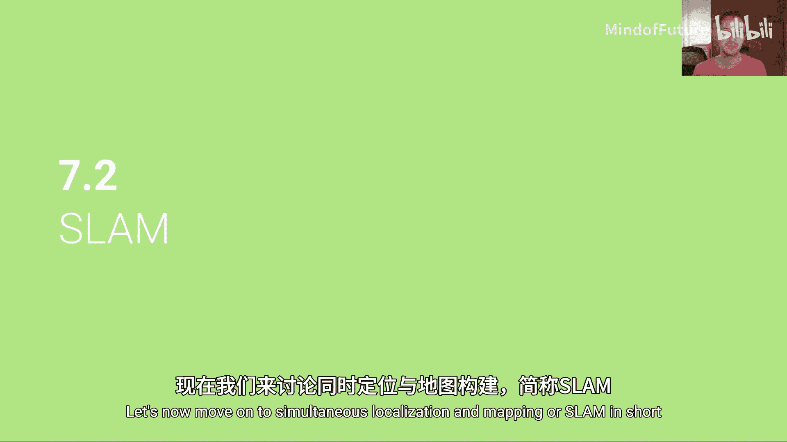
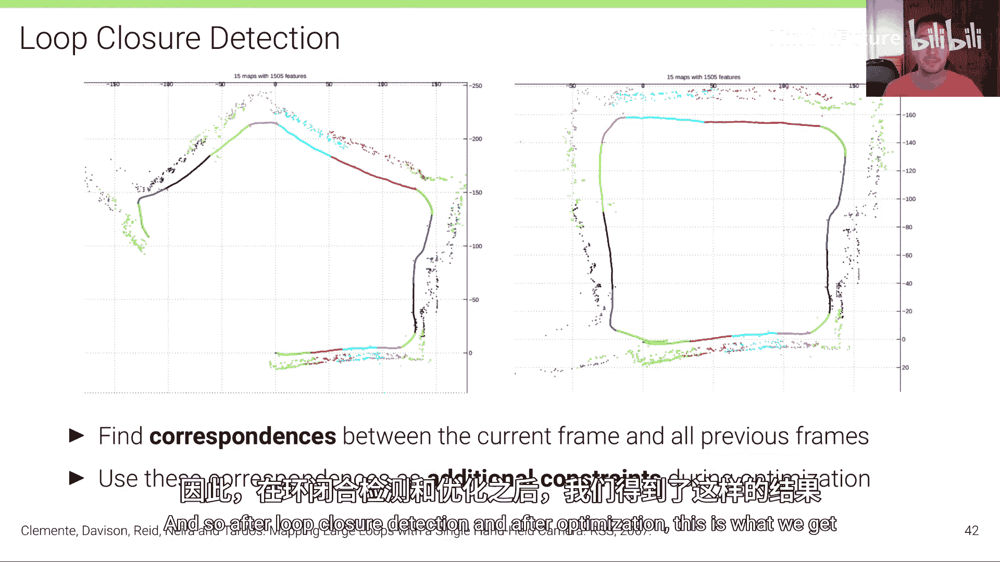
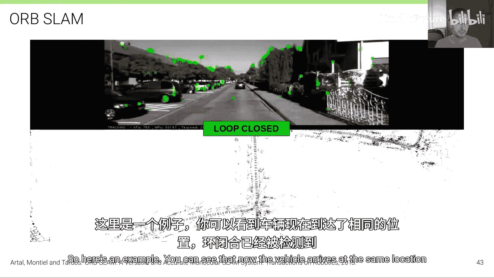
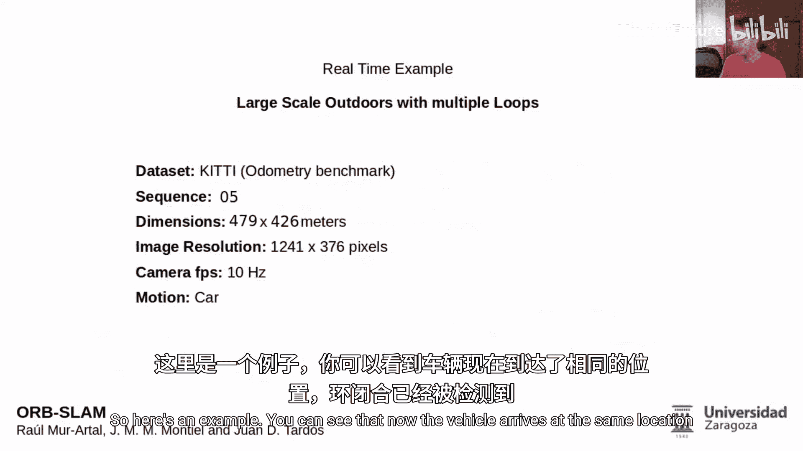
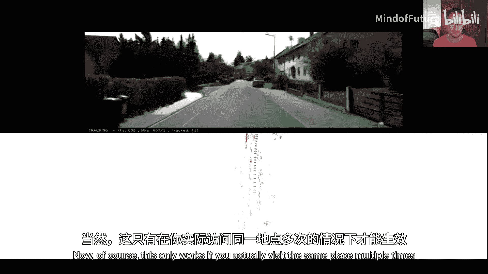
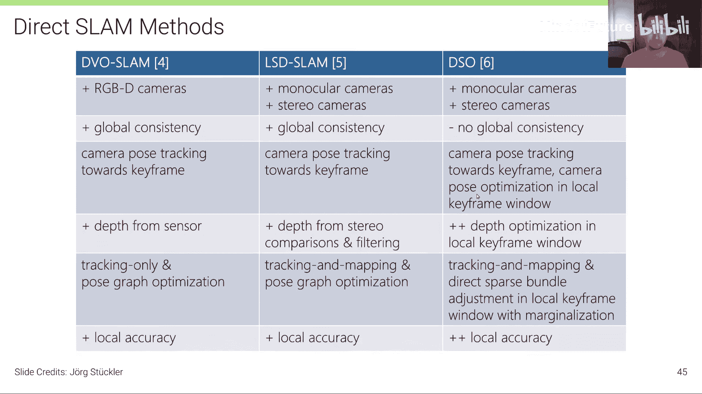

# 025：同步定位与建图 (SLAM)

在本节课中，我们将要学习同步定位与建图，简称SLAM。我们将了解SLAM如何通过联合优化相机位姿和地图来构建全局一致的地图，并介绍其核心概念——回环检测。

## 从里程计到SLAM

上一节我们主要讨论了相邻两帧图像间的运动估计优化。这种方法并未特别关注构建全局一致且精确的地图，地图只是作为估计相对运动的副产品而得到。

在本节中，我们将考虑在更大窗口上进行优化，即优化迄今为止记录的所有帧。我们将同时优化相机位姿和地图。在间接SLAM中，地图可以是三维特征点的位置。

## SLAM的核心挑战

SLAM是一个“鸡生蛋，蛋生鸡”的问题。**精确的定位需要精确的地图，反之亦然**。因此，联合优化相机位姿和地图是必要的。

SLAM的另一个关键特性，除了在大窗口上进行优化外，是能够通过所谓的**回环检测**来纠正累积误差。这使得生成的地图更具全局一致性，并可用于定位目的。

## 特征点法SLAM与光束法平差

与视觉里程计类似，SLAM也存在间接（基于特征点）和直接法。同时，SLAM方法也有多种形式，例如基于滤波的方法（如EKF-SLAM）和基于光束法平差的方法。

在本节中，我们将重点介绍通过光束法平差实现的特征点法SLAM。课程末尾会提供其他SLAM算法的参考资料。

以下是特征点法SLAM的目标：

*   **目标**：优化重投影误差，即图像中观测到的特征点与根据相机参数和三维点云投影到图像平面上的点之间的距离。

下图展示了室内场景（右）和KITTI自动驾驶数据集（左）的示例。在左图中，绿色线条是恢复的轨迹，黑色点是构成地图的三维地标（特征点）。

## 光束法平差形式化定义

这个过程在计算机视觉中被称为**光束法平差**。让我们正式定义它。

*   令 **π** 表示所有 **N** 个相机的集合。此符号也指代相机的内参和外参。
*   令 **X_W** 表示世界坐标系中的三维点集。
*   令 **x** 表示在所有相机图像中对应的图像屏幕观测值。

当然，并非每个三维点都在每个相机图像中被观测到，但为了求解SLAM问题，我们必须至少在多个图像中观测到部分三维点。

光束法平差最小化所有观测的重投影误差：

**min_{π, X_W} Σ_{i=1}^{N} Σ_{p=1}^{P} w_{ip} * || x_{ip} - π_i(X_{Wp}) ||^2**

这个公式与之前视觉里程计中优化两视图的公式非常相似，区别在于现在我们要优化 **N** 个相机视图和 **P** 个地标（特征点）。我们最小化观测值 **x_{ip}** 与对应投影 **π_i(X_{Wp})** 之间的差异。

*   **w_{ip}** 是一个指示符，表示点 **p** 是否在图像 **i** 中被观测到。
*   **π_i(X_{Wp})** 是根据相机模型将三维地标投影到二维图像平面的函数。它包含将点从世界坐标系变换到相机坐标系的外参变换，以及进一步变换到像素坐标系的内参变换。

下图再次说明了这个过程。与之前类似，但现在三维地标（地标）是在某个世界坐标系中表示的。我们同时估计所有相机的位姿。为了图示简洁，这里只展示了两个相机和三个地标。

在光束法平差中，我们联合优化相机参数和三维地标。

## 优化的稀疏性与计算优势

需要指出的是，优化过程并不像初看起来那么困难。用于更新非线性优化器的**海森矩阵**虽然很大，但通常非常稀疏。原因是地标之间或位姿之间没有直接的约束关系。

我们可以重新排列海森矩阵，使其呈现稀疏结构。例如，矩阵的左上角块对应位姿维度，右下角块对应地标维度。虽然位姿与许多地标相连，但位姿之间不相连，地标之间也不相连，从而形成了稀疏矩阵。这种稀疏性在使用稀疏优化器时能带来巨大的计算优势。

## 回环检测

最后，我们来讨论回环检测。回环检测旨在纠正随时间累积的误差漂移，正如之前在视觉里程计中讨论的那样。

其原理是：当我们在环境中移动并再次访问同一个地方时，可以尝试将当前帧的特征点不仅与前一帧匹配，还可以与很久以前的帧进行匹配。如果我们发现当前帧的特征点与过去某帧的特征点非常相似，就检测到了一个回环。

检测到回环后，我们可以将这些额外的对应关系作为新的约束条件添加到优化过程中。优化后，地图中原本因漂移而错位的两部分会被“拉”到一起，变得全局一致。当然，这只有在实际多次访问同一地点时才有效。回环检测是SLAM的一个核心方面。

## 其他SLAM方法概览

最后两张幻灯片（来自补充材料）展示了各种间接和直接SLAM方法的示例。这些方法在类型上有所不同：有些是在线算法，有些使用光束法平差；有些使用单目相机，有些使用双目或RGB-D相机等。这里不详细展开这些表格，仅作为参考资料提供。

## 总结

本节课中，我们一起学习了同步定位与建图。我们了解到SLAM通过联合优化所有历史帧的相机位姿和三维地图，解决了定位与建图相互依赖的问题。核心方法光束法平差通过最小化重投影误差来实现这一目标。此外，回环检测通过识别重访地点并添加额外约束，有效纠正了累积误差，从而得到全局一致的地图，为自动驾驶等应用提供了可靠的定位基础。