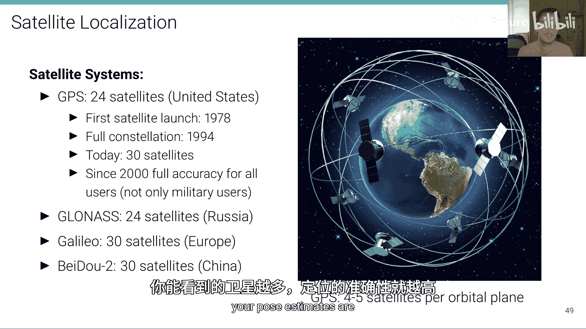
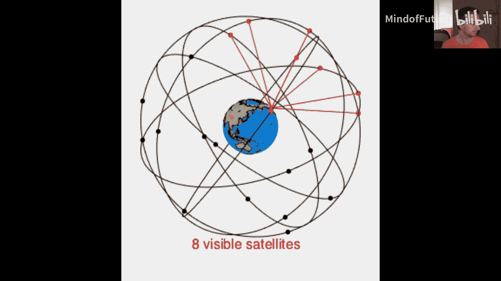
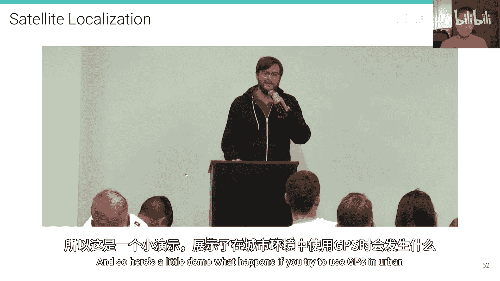
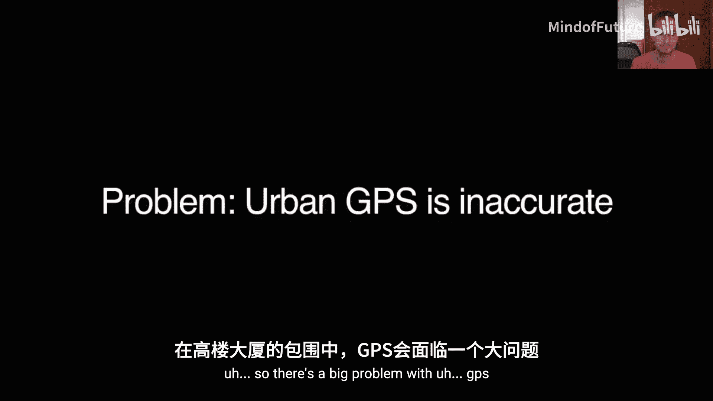
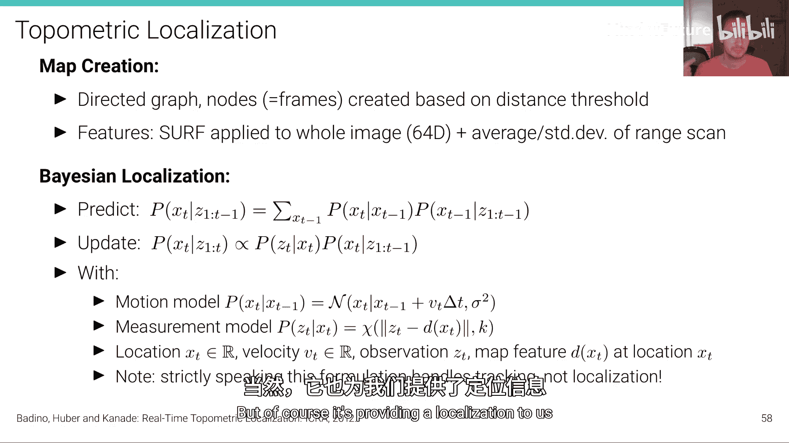
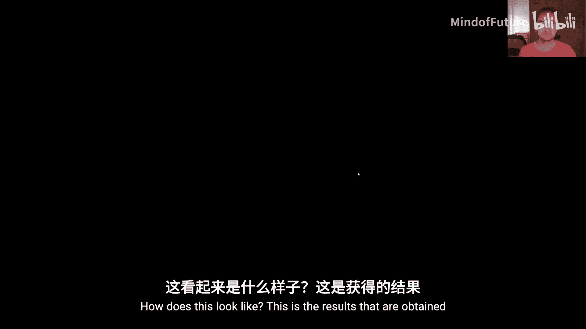
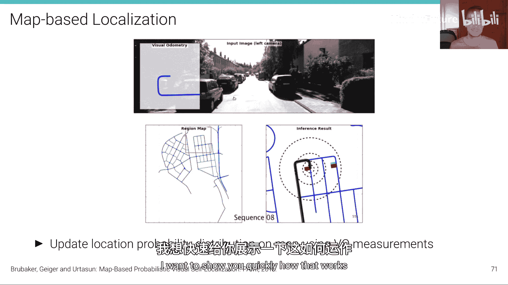
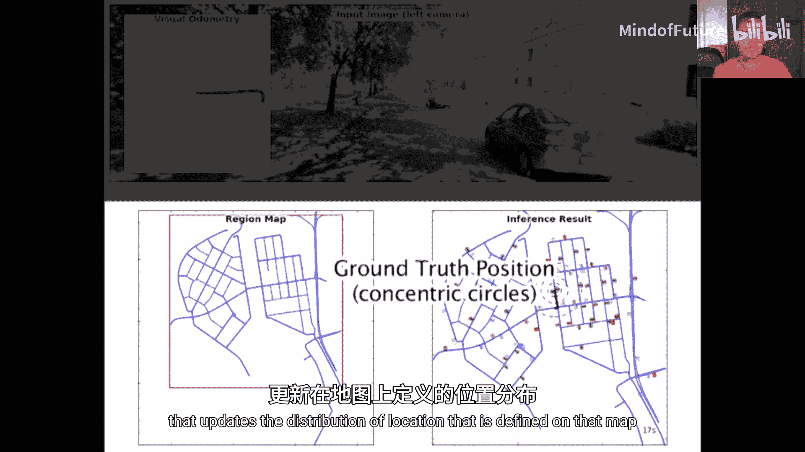
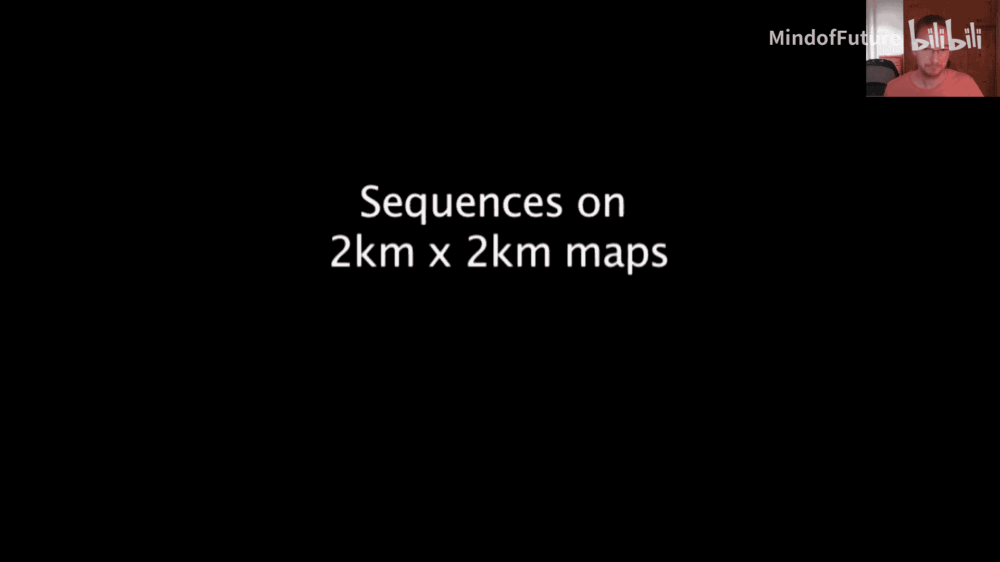
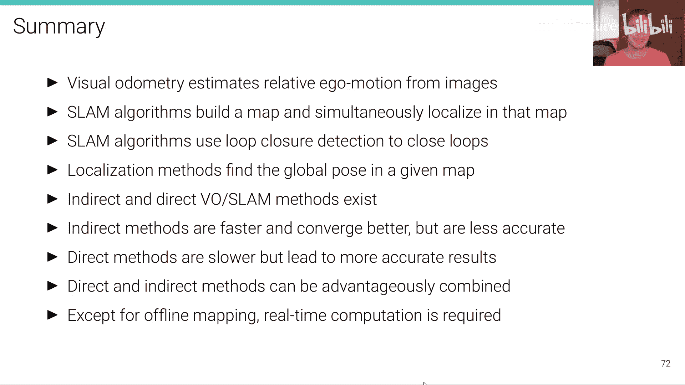

# 026：定位技术

在本节课中，我们将要学习自动驾驶汽车如何确定自身在环境中的精确位置，即定位技术。定位是路径规划、车辆控制和利用先验地图信息（如交通标志）的基础。我们将探讨多种定位方法，包括卫星定位、视觉定位以及基于地图的定位。

## 卫星定位 🛰️

上一节我们介绍了里程计和SLAM，本节中我们来看看如何利用外部基础设施进行全局定位。卫星定位是我们最熟悉的定位方式之一。

全球定位系统（GPS）由美国于1978年首次部署，最初由24颗卫星组成。如今，多个国家拥有自己的卫星系统，例如俄罗斯的格洛纳斯（GLONASS）、欧洲的伽利略（Galileo）和中国的北斗（BeiDou）。现代GPS接收器可以同时利用所有这些系统的信号，可见卫星越多，定位精度和可用性就越高。

卫星定位的原理称为**三边测量法**。其目标是已知卫星位置，通过测量到多颗卫星的距离，利用球体几何关系来确定接收设备（车辆）的位置。

距离通过测量信号发送与接收之间的时间延迟来计算，公式为：
`距离 = 光速 × 时间延迟`

由于光速极快，微小的计时误差都会导致巨大的位置误差。卫星搭载原子钟以保证时间精度。理论上，三颗卫星即可确定一个三维位置点，但实践中需要第四颗卫星进行时间同步校正，因此至少需要四颗可见卫星。

为了提高精度，可以使用**差分GPS**。该方法利用位置精确已知的地面基站接收GPS信号，通过对比来校正大气效应等因素引起的误差，可将精度提升至厘米级。

然而，卫星定位存在若干问题：
*   **可用性**：在隧道或高楼林立的城市街道中，卫星信号可能被遮挡。
*   **精度**：原始GPS精度在米级，差分GPS可达厘米级，但后者依赖基站且易受环境限制。
*   **信息不全**：仅提供位置，不提供朝向（旋转），无法获得完整的6自由度位姿。
*   **频率低**：更新频率最高为5-10 Hz，对于需要高速控制（如500-1000 Hz）的车辆来说太低。
*   **多路径效应**：在城市峡谷中，信号可能经建筑物反射后到达接收器，导致测量误差，使定位结果跳跃。

因此，仅依赖GPS无法满足自动驾驶高精度、高可靠性的定位需求。

## 视觉定位 👁️

鉴于卫星定位的局限性，我们需要其他技术，视觉定位是其中重要的一类。其核心思想是预先构建一个包含已知位置及其关联特征的地图或数据库。

地图可以是一系列带有特征向量的路标集合，特征可以从图像或激光扫描中提取。建图应在与定位时相似的传感器配置和环境条件下进行，以最小化域偏移。在定位时，系统从当前输入（如图像）中提取特征，并在数据库中检索匹配项，从而确定位置。

视觉定位面临的主要挑战包括：
1.  **地图规模庞大**，需要实时高效检索。
2.  **场景外观和几何结构会剧烈变化**，例如昼夜、季节、天气变化都会导致同一地点看起来完全不同。

### 拓扑-度量定位

我们首先看一种图像级别的定位技术：**拓扑-度量定位**。该方法仅将当前位置定位到地图中某个图像帧的ID上，而不恢复精确的6自由度位姿。

该方法由CMU团队在2012年提出。他们将地图构建为一个有向图，每个节点代表一帧图像。系统为整个图像计算一个全局特征描述符（例如64维），然后在图数据库中寻找最相似的图像节点。

定位过程采用**贝叶斯滤波框架**。该框架通过运动模型预测位置概率分布，再利用观测（当前图像特征）进行更新，迭代地估计车辆最可能位于哪个图像节点附近。这本质上是一种已知初始位置后的跟踪。

### 基于学习的定位

我们也可以使用神经网络直接回归相机位姿。例如，PoseNet（ICCV 2015）使用一个23层的深度卷积网络（基于GoogLeNet），输入RGB图像，直接输出相机的3D位置和3D旋转（用四元数表示）。

这种方法的优点是对特征匹配错误和异常值相对鲁棒。但通常难以达到很高的精度，位姿预测结果与真实值之间存在一定偏差。

### 基于特征的定位

接下来我们看看基于特征的定位，这与之前讨论的SLAM方法非常相似。其目标是先在环境中构建一个稀疏特征点地图（例如使用SLAM技术），每个3D点都关联一个特征描述符（如SIFT或深度学习描述符）。

定位时，从当前查询图像中提取特征，然后在庞大的地图特征数据库中进行高效检索匹配（常用KD树或倒排索引等近似搜索算法）。由于地图规模巨大，匹配会产生大量错误对应关系（异常值）。

关键步骤是**几何验证**。我们使用**RANSAC**算法来处理高比例的异常值：
1.  随机选取**最小数量**的特征对应（对于6自由度位姿，最小集是3个2D-3D对应）。
2.  用这组最小集计算一个位姿假设。
3.  检查地图中其他特征点在该位姿假设下，投影到图像上的位置与实测2D点的吻合程度，统计“内点”数量。
4.  重复上述过程多次，选择内点数量最多的位姿假设作为最佳估计。
5.  最后，仅使用所有内点进行优化，得到精确位姿。

这种方法即使在高异常值率（如超过80%）的情况下也能鲁棒地工作。

## 基于地图的定位 🗺️

最后，我们简要介绍基于地图的定位。其思想是在一个简单的路线图（如从OpenStreetMap下载的道路网络）上定义一个位置概率分布，然后利用视觉里程计测量的运动信息来更新这个分布。

系统开始时位置概率均匀分布。当车辆检测到转弯等特定动作时，那些在道路图上不可能发生该动作的位置概率会降低，而可能发生的位置概率会升高。随着时间的推移，概率分布逐渐收敛，车辆就能在没有初始位置先验的情况下实现全局定位。这种方法不提供精确的6自由度位姿，但能确定车辆在道路网络中的大致位置。

## 总结

本节课中我们一起学习了自动驾驶中的多种定位技术：
*   **卫星定位**（如GPS）依赖外部基础设施，易受遮挡和多路径效应影响，精度和频率有限，常需与其他传感器融合。
*   **视觉定位**利用视觉特征进行定位，包括：
    *   **拓扑-度量定位**：实现图像级别的粗略定位。
    *   **基于学习的定位**：用神经网络直接回归位姿，鲁棒但精度一般。
    *   **基于特征的定位**：通过匹配稀疏特征点并利用RANSAC进行几何验证，能在庞大特征地图中实现精确、鲁棒的6自由度定位。
*   **基于地图的定位**：利用先验道路网络和运动信息进行概率滤波，实现高效的全局定位。

我们还回顾了视觉里程计与SLAM的区别与联系：里程计估计相对运动，SLAM同时建图与定位，而定位技术则利用这些生成的地图或其它先验信息来确定全局位姿。间接法（基于特征）通常更快、收敛性更好；直接法（基于像素强度）通常更精确但计算量更大；二者可以结合使用。对于自动驾驶而言，实时性至关重要，因为定位信息必须立即提供给后续的决策与控制模块。