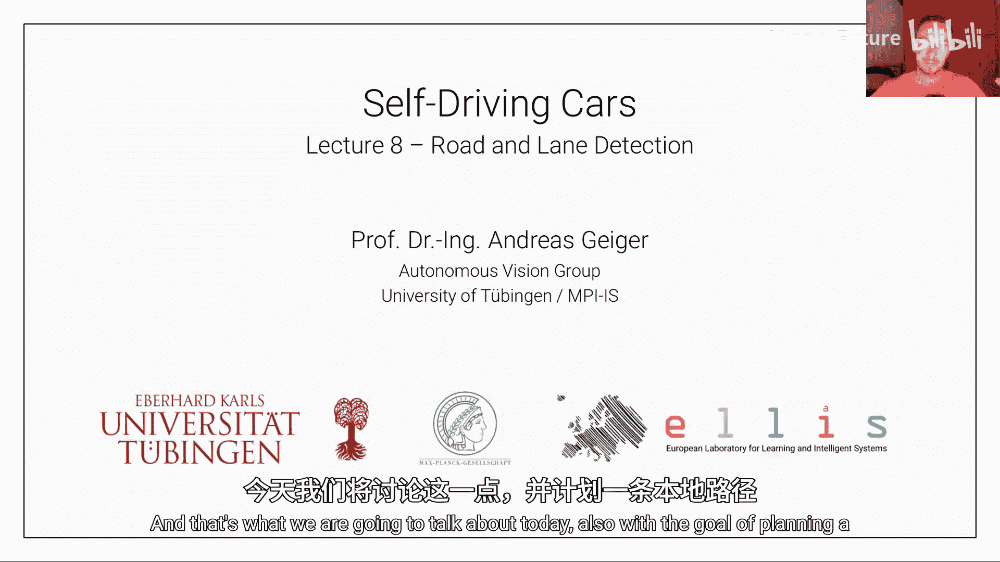
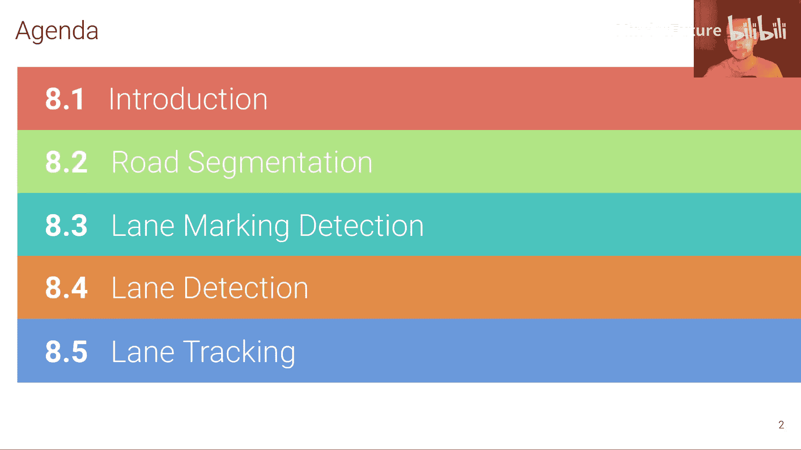
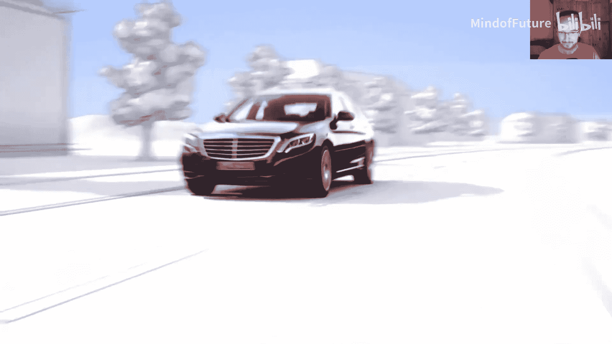
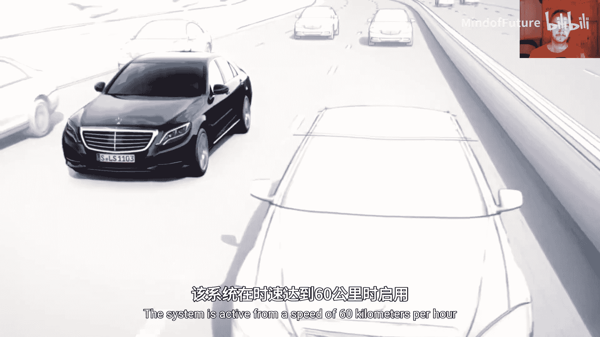
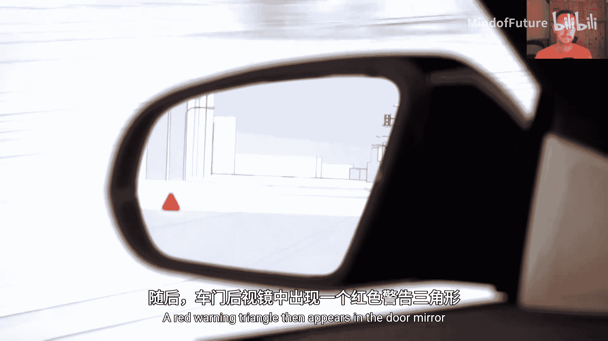
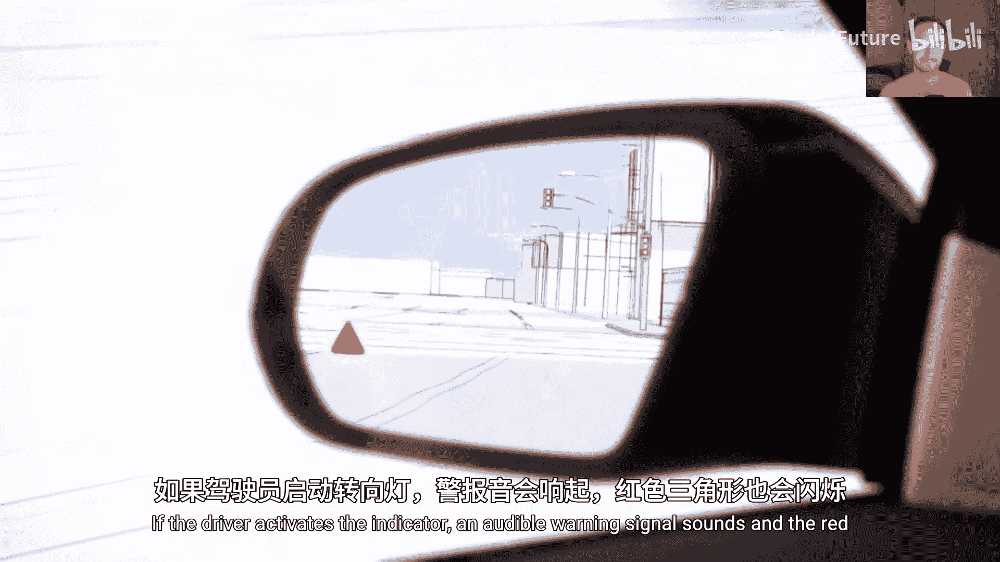
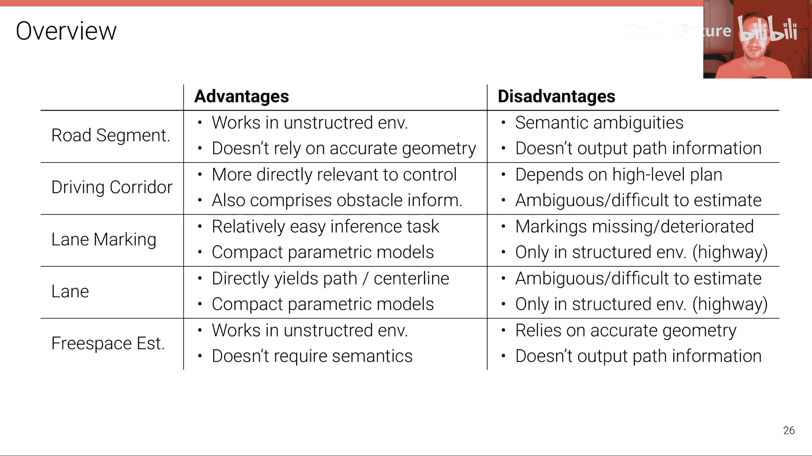

# 027：道路与车道检测简介 🛣️

在本节课中，我们将要学习自动驾驶中的一个核心感知任务：道路与车道检测。我们将探讨其重要性、不同的输出表示方法以及在实际驾驶场景中面临的挑战。

上一讲我们学习了如何构建地图并利用地图进行定位，以规划车辆的路径。然而，车辆通过自身传感器感知到的局部环境信息同样至关重要。今天，我们将讨论如何利用这些局部信息来规划车辆的局部路径。

本讲内容分为五个单元：
1.  首先，我们将介绍并阐述道路与车道检测问题。
2.  其次，我们将讨论道路分割，即语义分割。
3.  第三，我们将探讨车道线检测。
4.  第四，我们将学习车道检测，即如何将检测到的车道线汇总成可用于车辆控制的连贯车道估计。
5.  最后，我们将看到一个在简单场景下进行车道跟踪的算法示例，了解如何随时间整合车道检测的估计结果。

现在，让我们开始学习。

## 现有系统与应用 🚗

道路与车道检测算法已广泛应用于当今的许多汽车中。先进的商用系统包括：
*   **车道偏离预警**：当车辆偏离当前车道时警告驾驶员。
*   **车道保持辅助**：通过轻微的转向干预辅助驾驶员，使车辆保持在车道内，但驾驶员可以轻松覆盖系统的指令。
*   **车道保持与车道偏离防护**：能够自主地将车辆保持在当前车道内的系统，例如在交通拥堵时自动转向。

以下是一个展示奔驰主动车道保持辅助系统的视频描述摘要：
该系统通过摄像头识别道路标线，并利用雷达传感器监控车辆周围的交通状况。当系统判断车辆可能无意中偏离车道时，会通过ESP系统对单侧车轮进行制动干预，确保车辆不压过实线。同时，仪表盘会显示警告。如果车辆越过虚线，方向盘会振动以提示驾驶员反向转向。该系统还能在相邻车道被占用且存在碰撞风险时做出反应。系统在车速超过60公里/小时后激活。

## 道路与车道检测的表示方法 📊

道路与车道检测的目标是在没有详细全局地图的情况下，通过感知车辆附近的可行驶区域进行导航。有多种线索可用于此目的：
*   **几何线索**：例如，某区域相对于路面是否凸起。
*   **语义信息**：例如，道路通常具有特定的灰色调或纹理。
*   **人造线索**：例如，为辅助驾驶员而设置的车道标线。

我们可用的输入主要是图像，这也是我们今天讨论的重点。此外，激光雷达和雷达可用于感知几何线索。

有多种可能的输出表示形式，以下是几种主要类型：

**1. 道路分割**
这是一种语义线索。目标是将图像中的每个像素分类为道路或非道路像素。下图展示了一个理想情况下的道路分割结果，所有道路像素被高亮为红色。
道路分割是纯粹的语义线索，它告诉我们车辆可以在哪里行驶，可以通过深度神经网络等语义分割算法实现。它不考虑可达性，也不包含车道信息。

**2. 行驶走廊**
行驶走廊预测估计车辆前方应行驶的通道，同样是一个逐像素的估计（像素掩码）。它可能考虑障碍物。可能存在多个可行的行驶走廊，具体选择哪一个取决于高层规划。

**3. 车道线**
车道线用于辅助驾驶员，因此也可用于驾驶辅助系统或自动驾驶汽车。道路通常通过车道线划分为多个车道。车道线检测的目标是首先检测出车道线（有时也包括路缘石），然后为这些被检测出的像素拟合一个参数化模型（如样条曲线）。这种方法在高速公路上效果良好，但在城市中由于车道线经常不可见、不完整或被遮挡，效果会变差。

**4. 车道**
车道检测的目标是识别车道。车道检测算法将两条车道线（例如，我们所在车道的左、右车道线）分组为一个单一的车道。这样我们就知道这两条参数化曲线共同构成了一个车道。通过这种方式，我们可以获得车道宽度、中心线等信息，这些可用于导航。同样，与导航相关的车道取决于高层规划。

**5. 自由空间估计**
自由空间估计的目标是估计图像中可以无碰撞到达的位置。这是一个纯粹的几何线索。它询问哪些地方可以直接到达，通常基于来自激光雷达或立体视觉的几何信息进行计算。基本形式的自由空间估计通常基于简单的深度图输入，然后通过算法沿射线检测第一个不符合道路几何模型（例如一个平面）的点。

## 从图像域到鸟瞰图 🌍

以上所有表示形式都位于2D图像域中。然而，车辆是在3D物理世界中行驶的，在自动驾驶中，这可以合理地近似为鸟瞰图。在2D图像域中估计的量（如距离）对我们的控制任务并不直接有用。因此，我们应该将这些表示映射到3D空间或鸟瞰图中。
这种映射是可能的。例如，给定对道路表面的估计（如拟合一个平面），我们可以利用该平面将图像中的观测（如车道线）扭曲到鸟瞰图中。这个过程会引入不确定性，并且使场景看起来截然不同，这本身就说明了执行这种映射并非易事。

## 实际挑战与复杂性 ⚠️

在深入第一个单元之前，我们需要理解这个问题在实际中有多复杂。作为人类驾驶员，我们每天都在解决这个问题，看似不难，但对机器而言却充满挑战。以下是一些从实际驾驶数据集中选取的示例，说明了各种挑战：

*   **语义模糊**：在居民区道路，可行驶区域（道路）与人行道之间的界限可能不明确。基于几何的自由空间估计可能将人行道也判为可行驶，但这取决于高度阈值，且阈值设置很脆弱。车道边界检测在此也会失败。
*   **光照与阴影**：在高速场景，阴影区域会使道路颜色变暗，但分割算法可以处理。自由空间估计则需判断路肩草地是否可穿越（几何上可能，但语义上不可）。
*   **施工与新旧标线**：施工区域可能出现新旧标线并存（如黄线与残留白线），难以判断哪条有效。此外，还存在自行车道、人行横道等无关标线，以及因眩光导致的检测困难。
*   **标线缺失与标志依赖**：在没有车道线的乡村道路，导航需依赖交通标志（如指示方向的蓝色路牌）。自由空间估计可能将路缘较低的车道入口误判为可行驶。
*   **停车场与无结构环境**：停车场导航无法仅靠车道线，环境非结构化。路缘高度不定，低路缘难以稳健检测。
*   **铁路轨道混淆**：在交叉口，缺失车道线时，铁轨在特定光照下易与车道线混淆，需要整体推理或先验地图信息来消除歧义。
*   **施工区与遮挡**：施工区标志改变道路布局，可用车道可能被部分阻挡，需要处理遮挡问题。
*   **隐含车道与狭窄汇流**：在没有标线的道路上，可能存在隐含的两车道，但在某点会基于细微线索汇流成一车道，需要结合规划与反应控制来应对对向交通。
*   **标线语义多样与严重遮挡**：标线可能有不同语义（如表示禁停区）。允许的行驶方向不易推断。其他交通参与者、停放的车辆或建筑物可能造成严重遮挡。

这些例子说明了为何今天讨论的算法无法在所有场景下工作，以及为何在实践中需要针对不同情况使用多种算法的组合。

## 方法概述与比较 📋

以下是五种不同表示方法的优缺点概述：

*   **道路分割（语义分割）**
    *   **优点**：适用于非结构化环境；不依赖于几何估计。
    *   **缺点**：存在语义模糊性（如人行道）；不直接输出路径信息（仅为像素掩码）。

*   **行驶走廊估计**
    *   **优点**：与控制更直接相关；可包含障碍物信息。
    *   **缺点**：仍仅为像素掩码；依赖于高层规划；可能模糊且难以估计。

*   **车道线检测**
    *   **优点**：若标线清晰则相对容易检测；可使用紧凑的参数化模型表示。
    *   **缺点**：标线经常缺失或损坏；仅在高度结构化的环境（如高速公路）中可靠。

*   **车道检测**
    *   **优点**：直接产生可用于控制的路径或中心线；可使用紧凑的参数化模型表示。
    *   **缺点**：经常模糊且难以估计；同样仅在结构化环境中可靠。

*   **自由空间估计**
    *   **优点**：适用于非结构化环境（如越野）；不依赖语义，因此具有鲁棒性。
    *   **缺点**：依赖于输入几何信息的质量；不直接输出路径信息。

本节课中，我们一起学习了道路与车道检测的基本概念、多种输出表示形式及其优缺点，并了解了在实际复杂驾驶场景中面临的挑战。在接下来的单元中，我们将深入探讨具体的算法和技术。