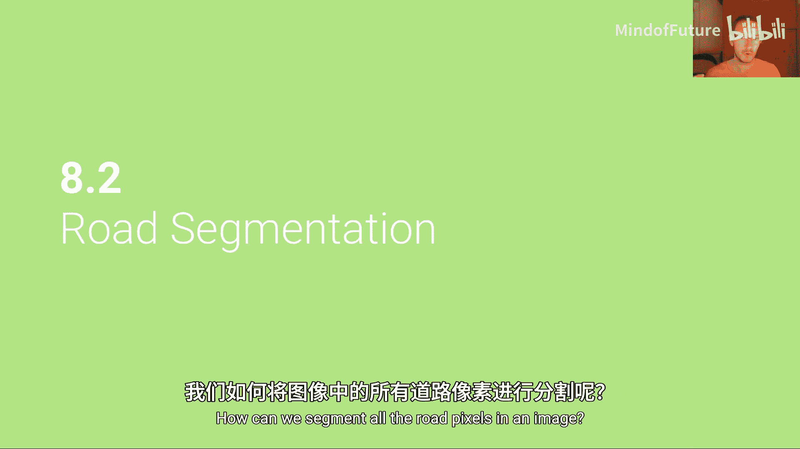
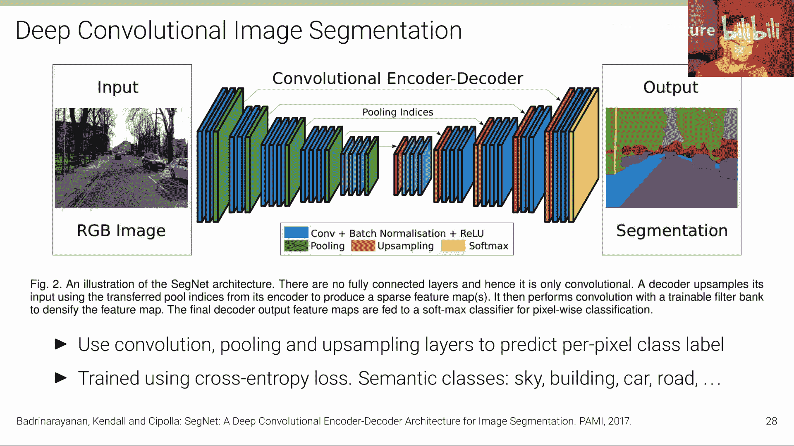
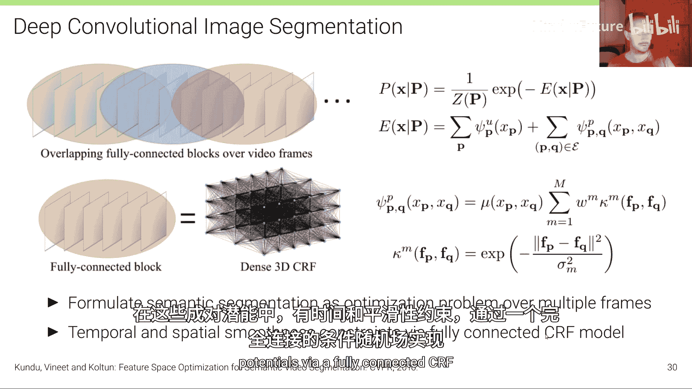
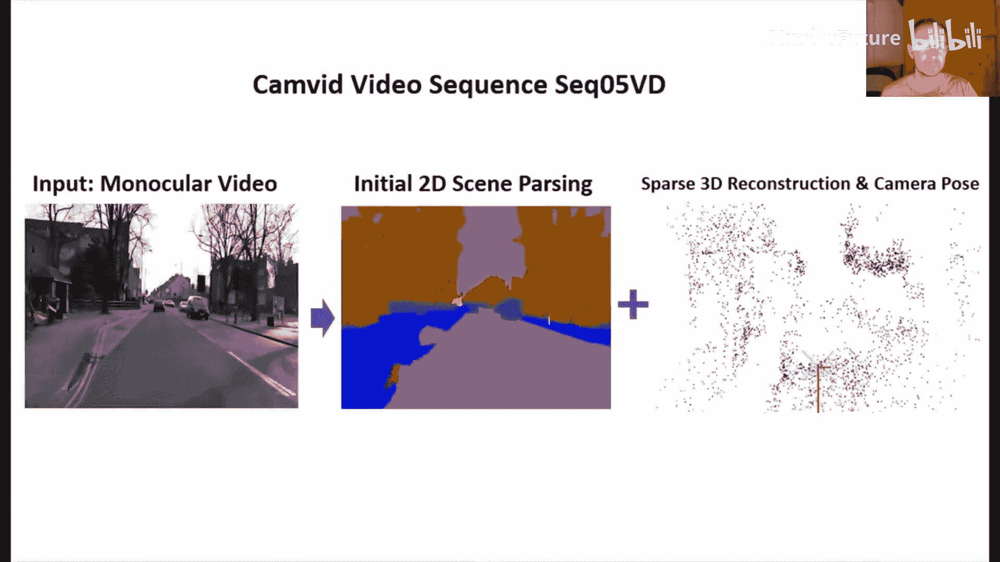
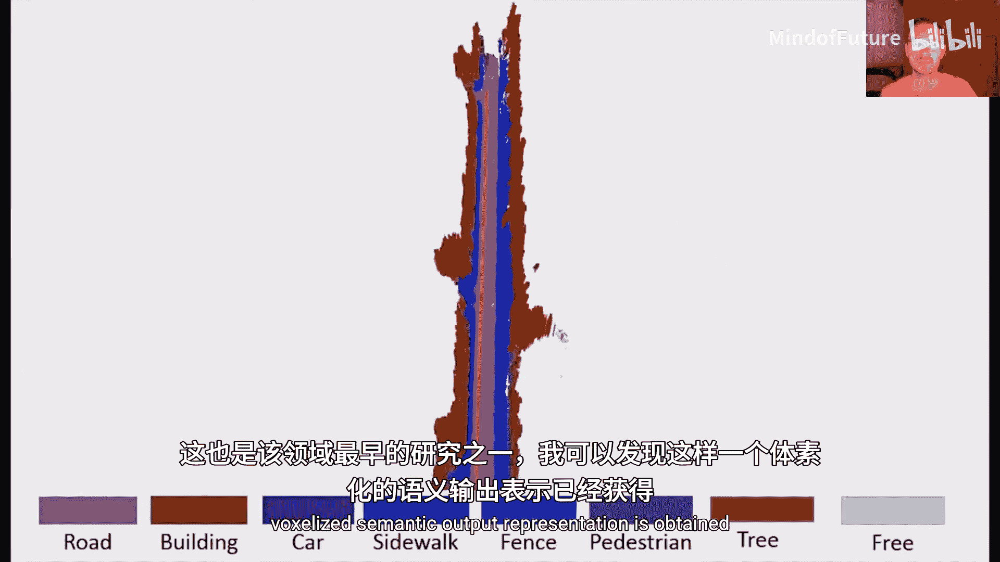
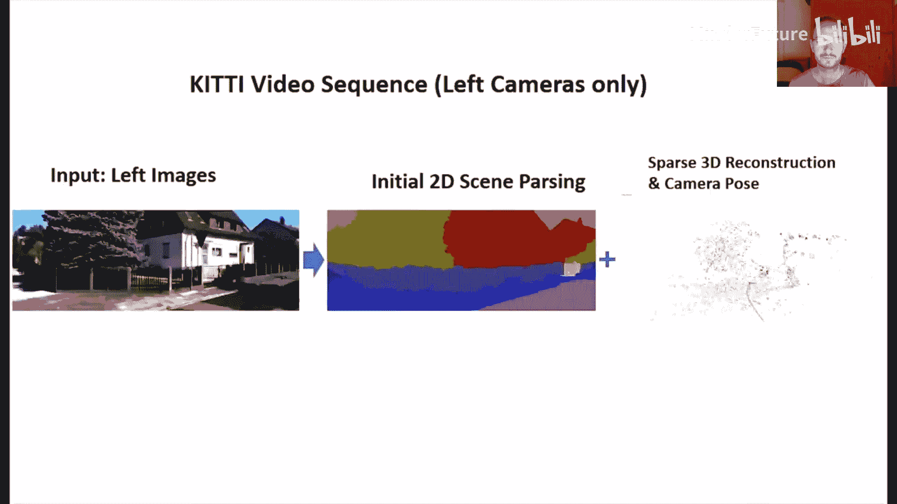

# 028：道路与车道检测 - 道路分割 🛣️

在本节课中，我们将要学习如何使用深度卷积神经网络进行图像分割，特别是针对自动驾驶场景中的道路像素分割。

## 概述

道路分割的目标是识别图像中所有属于道路的像素。现代方法的核心是使用深度卷积神经网络进行语义分割，即为输入图像中的每一个像素预测一个语义类别标签。

## 语义分割网络架构

上一节我们介绍了道路分割的基本概念，本节中我们来看看实现这一目标的核心技术——编码器-解码器网络。

语义分割任务为每个像素分配一个类别标签（例如：天空、树木、建筑物、人行道、道路）。这本质上是一个逐像素的分类问题。我们之前了解的卷积神经网络（CNN）通常用于图像分类，它会通过卷积层和池化层逐步缩小特征图的空间分辨率，最终输出一个单一的分类结果。

语义分割算法在此基础上增加了一个解码器部分，形成了**编码器-解码器**结构。
*   **编码器**：与标准CNN类似，通过卷积和池化操作压缩空间信息。
*   **解码器**：通过上采样操作逐步恢复特征图的空间分辨率，直至达到原始输入图像的大小。

这种结构因其形状常被称为 **U-Net** 或沙漏网络。其一个关键特性是**跳跃连接**，它允许编码器中间层在相应分辨率下的特征信息直接传递到解码器的对应层，这有助于在恢复分辨率时保留更多的细节。

以下是该网络工作流程的简化描述：
1.  输入RGB图像。
2.  编码器进行特征提取和下采样。
3.  解码器进行上采样和特征融合。
4.  输出与输入同分辨率的语义分割图。

## 网络训练方法

了解了网络结构后，我们来看看如何训练这样的网络。

训练分割网络参数的标准方法是经验风险最小化。我们需要一个有标注的数据集，其中包含图像及其对应的逐像素标签。

训练时，我们为每个像素定义一个分类损失函数。最常用的是**交叉熵损失**。对于训练集中的每一张图像，网络会为每个像素预测一个类别概率分布，损失函数则衡量这个预测分布与真实标签分布之间的差异。通过反向传播和优化算法（如随机梯度下降）最小化总损失，模型就能学习预测正确的语义类别。

## 分割效果演进与优化

早期的基础分割模型效果有限。例如，在最初的SegNet论文结果中，虽然能大致区分道路、车辆等区域，但边界模糊，精度不高。

为了提升效果，后续研究引入了后处理优化。一个典型的方法是将卷积神经网络的输出与**条件随机场** 相结合。CRF可以建模像素间在空间（甚至时间）上的关联性，通过定义一元势能和二元势能，使分割结果在空间和时间上更平滑、更一致。
*   **一元势能**：基于CNN对每个像素的独立分类置信度。
*   **二元势能**：鼓励在空间或时间上接近的像素拥有相同的标签。

这种结合了深度学习和概率图模型的方法，在2016年的Cityscapes等数据集上取得了显著更清晰、更准确的分割结果。

## 三维语义建图与应用

语义分割不仅可用于二维图像，还能扩展到三维空间。

一种方法是同时进行两项工作：将输入图像通过语义分割网络，同时使用SLAM技术计算局部三维地图。然后将二维图像的语义信息融合到三维地图中，从而构建出**语义化的三维地图**。这种表示能更丰富地描述环境，对于自动驾驶的路径规划和理解至关重要。

## 面向自动驾驶的特定分割

最后，我们可以针对自动驾驶的具体需求定制语义类别。

例如，道路分割不仅可以区分“道路”与“非道路”，还可以进一步细分道路内部结构。可以训练一个模型来区分**自我车道**、**相邻车道**以及**对向车道**。这样的细粒度分割能为车道保持、变道等决策提供更精确的信息。从示例中可以看出，算法能够较好地区分这些不同的车道区域。

## 总结

本节课中我们一起学习了道路分割技术。我们从基础的语义分割概念出发，深入了解了编码器-解码器网络（如U-Net）的架构及其训练方式。我们还看到了通过结合条件随机场进行后处理如何提升分割效果，以及如何将二维语义信息融合到三维地图中。最后，我们探讨了为自动驾驶定制细分车道类别的具体应用。这些技术是自动驾驶汽车理解道路环境的基础。