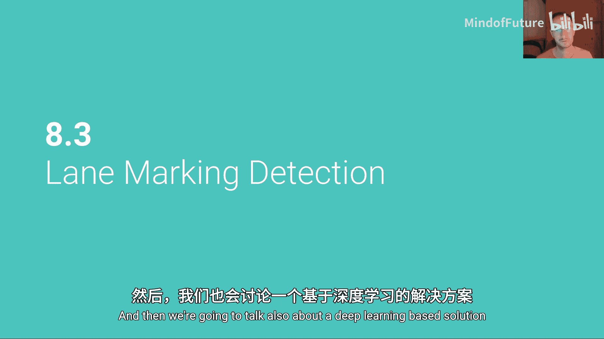
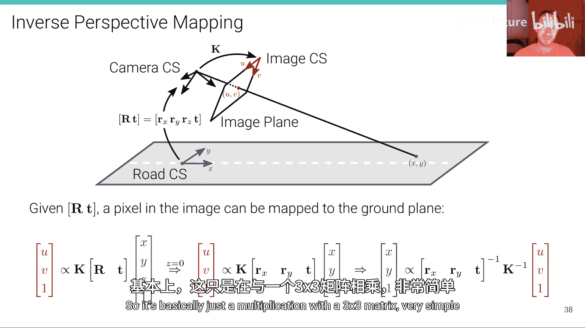
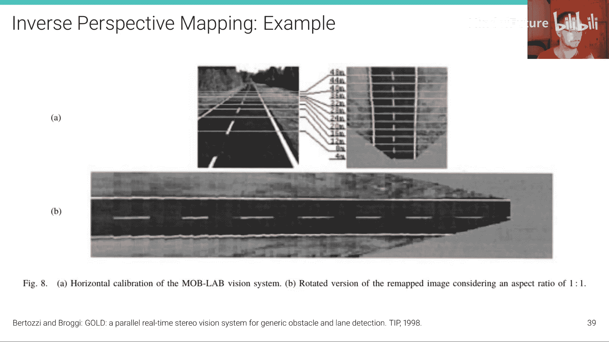
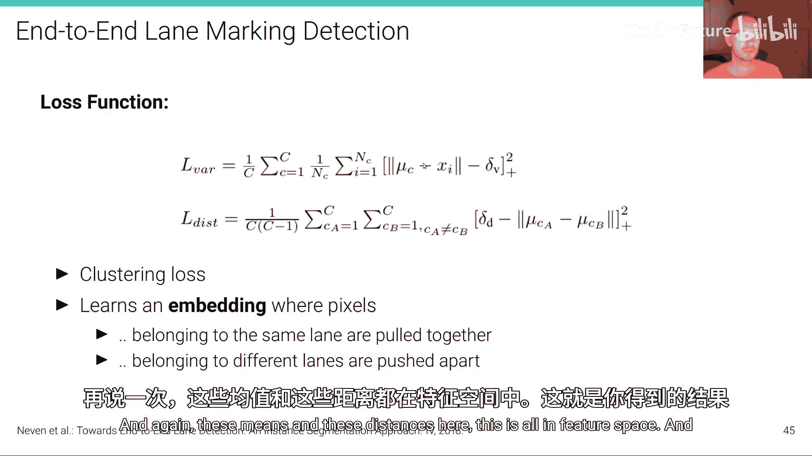

# 029：车道线检测 🛣️

在本节课中，我们将要学习如何检测车道线。我们将首先介绍一个非常简单的算法，然后探讨一种基于深度学习的解决方案。

## 概述
车道线检测是自动驾驶系统中的一项基础任务。它旨在从车辆前方的图像中识别出车道标记，为路径规划和车辆控制提供关键信息。本节将介绍两种主要方法：基于传统图像处理的方法和基于深度学习的方法。

## 简单梯度检测算法

上一节我们介绍了车道线检测的重要性，本节中我们来看看一个非常基础的检测算法。

观察道路图像，我们可以发现车道线通常是明亮的，并且与深色的路面背景形成鲜明对比。这意味着我们可以计算图像的梯度，并将车道线的轮廓识别为强烈的梯度响应。

例如，我们可以使用水平卷积核 `[-1, 0, +1]` 对图像进行水平滤波。然后观察梯度图像（这里展示的是梯度绝对值图像），我们会得到类似下图的结果。

除了使用这种简单的梯度滤波器，也可以使用可转向滤波器或特定模板。如果你知道车道线的宽度和道路的几何形状，就可以利用这些信息，当然也可以学习特征。

现在，让我们保持简单，继续分析这个简单的梯度图像。我们可以沿着图像的每一行（图中用红线标出）寻找大的梯度值。我们已经知道梯度的符号。可以看到，如果存在一条车道线，这里总会有两个相邻的峰值：车道线左侧有一个强梯度，右侧也有一个强梯度。

我们可以利用这个信息来筛选出车道线。例如，如果有深度图可用，我们可以过滤掉不在地平面上的点。我们可以在车辆前方的深度图中拟合一个平面，并假设这就是路面，从而去除来自树木等背景的噪声。我们还可以移除孤立的点（如图中这个点），因为在其紧邻区域内没有相反的梯度，所以它不可能是车道线，只是一个异常值。

以下是这个简单流程的结果，对于这张简单的图像，效果可能出奇地好。我们可以看到，检测到的车道线左边界用绿色标出，右边界用红色标出，同时还有一些残留的异常值。

我们可以进一步使用一些启发式方法（如检测非直线标记）或使用随机抽样一致性进行鲁棒拟合来剔除误检。

从这张图中还需要注意一个重要问题：并非所有车道线都被检测到。特别是最左边这条，由于透视畸变，观察角度非常倾斜，我们未能识别出来。可以看到，这里的梯度非常微弱，很难将白色与灰色的路面区分开来，因此它低于此处用于检测车道线的阈值。

如果你采用这种基于阈值的方法，那么根据你如何调整阈值，你需要在检测所有想要的车道线（但会得到很多误检）和不检测所有车道线之间进行权衡。

## 逆透视映射到鸟瞰图

正如前面提到的，我们真正感兴趣的不是图像域中的车道线，而是鸟瞰视图中的车道线。那么，如何将我们在图像域中检测到的车道线映射到鸟瞰图中呢？

请记住，我们在这里检测到的本质上是像素。将它们映射到鸟瞰图的过程称为**逆透视映射**，如下图所示。

逆透视映射将图像平面上的每个像素（此处矩形表示图像平面）映射到相应的地平面点。例如，图像平面上的像素 `(u, v)` 将被投影到地平面上的点 `(X, Y)`。其中 `(u, v)` 在图像坐标系中表示，而地平面上的点则在道路坐标系中表示。

只有当每个像素的深度已知时，逆透视映射才可能实现，因为这样我们可以将其反投影到3D空间；或者，如果我们有一个地面模型（例如一个平面）。这个平面可以从深度信息中估计出来。

图中其他组成部分包括：刚体变换 `R` 和 `T`（道路坐标系和相机坐标系之间的变换），通常道路坐标系直接放置在相机坐标系下方，因此它是唯一定义的；以及校准矩阵或内参 `K`，它将相机坐标系中的点映射到图像平面。

换句话说，我们定义了完整的变换链。现在，我们可以取道路坐标系中的一个点，将其映射到相机坐标系，然后再映射到图像坐标系。

那么，我们如何获得地平面呢？换句话说，我们如何得到外参，即刚体变换 `R` 和 `T`？它将道路坐标系变换到相机坐标系。

一个非常简单的解决方案是：我们直接假设一个预先确定的固定平面。因为我们知道相机在车辆上的位置是固定的，相对于车辆总是固定的，所以相对于地面也大致固定（如果我们不是在过于崎岖的地形中行驶）。

当然，这不是一个很好的模型，因为车辆会俯仰（加速或刹车时）。如果你假设一个固定平面，那么当车辆这样运动时，这个假设就不成立了。因此，在实践中更好的是估计路面平面。你可以通过立体视觉或激光雷达测量来估计路面平面。如果我拥有立体视觉或激光雷达，我就有一个3D点云，我可以（例如，使用语义分割算法或直接假设正前方区域属于路面）对这些3D点拟合一个平面，从而定义我的地平面。这是通常的做法。当然，这需要更复杂一些的处理，例如随时间跟踪这个平面估计，并对异常值具有鲁棒性。

现在，这就是你通过将平面拟合到3D点云来获得 `R` 和 `T` 的方法。3D点云是在相机坐标系中指定的，所以如果你将平面拟合到该点云，你就得到了这个刚体变换。

假设这已经完成，我们已经知道了 `R` 和 `T`。那么，图像中的一个像素可以按如下方式映射到地平面。

在左侧，我们看到的是针孔相机模型的标准方程（来自我们几节课前的图像形成讲座）。我们取道路坐标中的一个3D点 `(X, Y, Z)`（这里只显示了两个轴，但还有第三个轴，不过不相关，我们有一个Z坐标）。所以我们有一个道路坐标中的点 `(X, Y, Z)`，我们看这个末尾带1的增广向量。然后，我们将其与外参 `[R|t]` 相乘，再与内参 `K` 相乘，就得到了齐次表示下的像素坐标 `λ * [u, v, 1]^T`。我们需要除以最后一个元素才能得到非齐次表示。

因为我们假设路面是平坦的，所以我们假设这里的点位于 `(X, Y)` 但 `Z = 0`。换句话说，`Z = 0`。这意味着这里的方程简化了：`Z` 消失了，旋转矩阵 `R` 的第三列 `R_z` 也消失了。`R_x` 是第一列，`R_y` 是第二列。这基本上就是张成坐标系的基。但 `Z` 不再相关，因为我们假设 `Z = 0`。

这就是剩下的方程。现在你可以看到，左边是一个齐次3D向量，右边也是一个齐次3D向量，我们有一个3x3矩阵 `K` 和一个3x3矩阵 `[R|t]`。因为这是定义良好的3x3矩阵，我们可以求逆。所以，我们可以将 `K` 移到另一边得到 `K^{-1}`，将 `[R|t]` 移到另一边得到 `[R|t]^{-1}`，然后得到最终的方程。这基本上是一个由 `[R|t]^{-1}` 与 `K^{-1}` 相乘定义的**单应性变换**。

如果我们用这个单应性矩阵乘以齐次向量 `[u, v, 1]^T`，然后除以最后一个元素，我们就得到了道路坐标系中点的非齐次版本，可以直接读出 `X` 和 `Y`。所以，这基本上只是与一个3x3矩阵相乘，非常简单。

这里有一个例子，来自一篇非常古老的论文（Bertozzi & Broggi, 1998）。你可以看到它的样子。你还可以看到，远处的点会严重畸变，因此这些区域有很大的不确定性，而在近距离，测量更精确。如果这里有一辆车，它也会严重畸变，因为它不满足平面假设。但在这个特定场景中，是一条空路，所以你可以看到这条空路如何很好地变换到鸟瞰视角。

这里我们有一些车辆在场的例子。你可以看到，这辆车在鸟瞰图中严重畸变。但现在我们有了鸟瞰图表示。如果我们检测到了车道线，我们就可以在鸟瞰图中找到它们。这样，我们就得到了我们想要的、对车辆控制有用的格式。

## 从像素到参数化曲线

我们已经完成了这种转换，但我们仍然只有像素。从图像到鸟瞰图的转换仍然给我们一幅图像，只是一组像素。其中一些是白色的（属于车道线），一些是黑色的（不属于车道线）。但这只是一组像素，因此对于控制来说还不是非常有用。

相反，我们需要的是一组参数化曲线，可以用来控制车辆，定义我们想要跟踪的路径（例如使用纯追踪控制器）。那么，如何从像素到曲线呢？

车道线检测本身并不足够，因为它只返回图像或道路平面空间（即鸟瞰空间）中的一组像素。为了对导航有用，我们需要将其转换为更具语义意义的参数化模型。通常使用低维参数化模型，如直线、多项式或样条曲线。

需要说明的是，这是一个**多模型拟合问题**。我们基本上每个车道线对应一个模型。但图像中通常有多个车道线，所以我们需要为每个车道线估计一个模型。我们不能假设只有一个模型，还必须确定有多少个车道线。这被称为多模型拟合问题。当然，还必须处理异常值，模型必须对噪声具有鲁棒性。

这里有一个此类算法的例子，也是一个相当古老的算法，但在当时被广泛使用。在这种情况下，车道线已被检测并转换到鸟瞰图，正如我们刚才讨论的。然后，通过随机采样连续线段上的点，使用RANSAC程序将参数化样条曲线拟合到这些车道线上，并评估该样条曲线与已识别的车道线像素的重合程度。

在顶部，你可以看到这样一个通过一些控制点确定的样条曲线，然后将其拟合到车道线上。这里有一个评分函数（我们不会深入细节），它告诉我们样条曲线对观测值（即我们检测到的像素）的拟合程度。然后进行一些后处理，去除一些异常值并使结果更平滑、更连贯。

以下是一些结果，你可以看到这个非常简单的算法如何工作。它效果不是特别好，但在一定程度上有效。所以你可以尝试基于此来操控你的车辆，但你可以看到它在十字路口会失败，而且很难可靠地检测到道路最左边或最右边的车道线。因此，如果这是我的车道保持系统的输入，我可能不会依赖这辆车，我可能会手握方向盘。但如前所述，城市内驾驶是困难的，即使是最先进的系统，在城市内也常常遇到麻烦，因此它们通常只在高速公路上可靠地开启。

## 基于深度学习的车道线检测

现在，这是一个非常简单的算法。我们能用深度学习做得更好吗？如何用深度学习检测多条车道线？

我们可以说，我们知道语义分割算法，所以我们可以采用这样的算法，将输入图像映射到车道线或直接映射到车道。但这样做的问题是，我们需要检测多个车道线（通常，比如你所在车道的左侧车道线和右侧车道线），并且需要区分它们。仅仅将它们检测为“车道线”是不够的，因为如果你想拟合一个参数化模型，你需要知道哪个是哪个。因此，用于分割（语义分割或道路分割）的标准交叉熵损失在这里是不够的。

那么解决方案是什么？一种解决方案是**实例分割**。这种方法在通用的实例分割算法中已经使用过，但在这里被适应于车道识别问题。其核心思想不是直接预测类别标签，而是预测每个像素的特征，然后在特征空间中对这些特征进行聚类。

以下是它的工作原理：
1.  **输入图像**：我们有一个共享编码器，产生特征嵌入。
2.  **两个解码器**：
    *   第一个解码器产生**每个像素的特征嵌入**（图中用彩色图表示，但实际上是每个像素可能64维的特征）。
    *   第二个解码器是一个分割分支，执行**二值车道线分割**（这可以使用标准语义分割和交叉熵损失来完成）。
3.  **掩码与聚类**：我们用二值车道线分割掩码来过滤像素嵌入，只考虑属于前景（即车道线上）的像素。
4.  **训练目标**：我们训练模型，使得不同车道线（如左车道线和右车道线）在这个嵌入空间中相距很远。这样，当我们在特征空间应用聚类算法时（图中可视化为二维空间，但通常是更高维），属于不同车道线的像素会形成不同的簇。
5.  **输出**：一旦我们完成了聚类，我们就知道了各个实例。注意，这不依赖于车道线的数量，模型是灵活的，我们不需要预先知道有多少条车道线，因为模型会通过聚类机制来确定。

那么，这是如何学习的呢？二值车道线分割是通过标准交叉熵学习的，但特征嵌入部分不是。它是通过一个聚类损失函数学习的，该损失函数包含两个部分：
*   **第一部分**：属于同一车道的像素的特征应该被拉近。
*   **第二部分**：属于不同车道的像素的特征应该被推远。

我们假设有可用的真实实例分割标签，但我们并不试图直接预测实例标签（因为我们不知道有多少个实例，标签本身没有意义），而是使用这个真实标签来定义上述损失函数。

这是你得到的结果。对于这些例子，车道线被检测得相当好。因为我们使用了更复杂的、基于深度神经网络的方法，所以对于那些在图像边界更远处、或者实际上没有任何标记的车道，我们也能相当鲁棒地得到这些车道线。算法只是学习到那里应该有标记，如果偶尔出现一个车道标记，就足以让算法识别出整个车道边界。

在这项工作中，这个实例分割结果也被用作拟合过程的输入，然后为每条车道拟合一个样条曲线。但现在这是一个非常简单的过程，因为我们已经有了分割结果，我们只需要取所有这些像素并拟合参数化模型。你可以在底行看到这个结果。

## 总结

本节课中我们一起学习了车道线检测的两种主要方法。我们首先介绍了一个基于图像梯度的简单算法，它通过寻找梯度峰值来定位车道线边界，但受限于阈值选择和透视畸变。接着，我们探讨了如何通过逆透视映射将图像中的车道线转换到鸟瞰视图，这需要已知或估计路面平面。最后，我们介绍了一种基于深度学习的先进方法，它通过预测像素特征嵌入并进行聚类来实现实例级别的车道线分割，从而能够更鲁棒地处理多条车道线和复杂场景。从像素到最终用于车辆控制的参数化曲线，是车道线检测流程的最终目标。