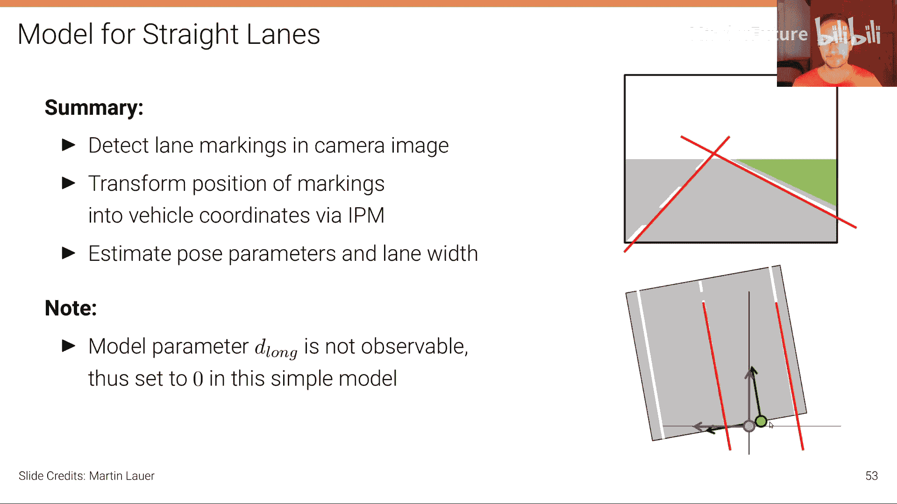

# 030：车道检测 🛣️


## 概述
在本节课中，我们将学习如何将检测到的车道线标记聚合为一个完整的车道模型，以便车辆能够跟随车道中心线行驶。我们将介绍一个简单的线性道路模型，并讲解如何通过观测到的车道线标记来估计车辆在车道内的位置、航向角以及车道宽度等关键参数。

---

在上一节中，我们学习了如何检测车道线标记，以及如何将它们从图像空间映射到鸟瞰图空间中的道路平面上。然而，仅仅检测单个的道路或车道线标记并不足以引导车辆行驶。我们需要将这些标记聚合为一个完整的车道模型，例如，以便车辆能够跟随车道中心线行驶。这正是本节“车道检测”要讨论的内容。

为了便于说明，本节我们将考虑一个非常简单的模型，即线性道路模型。当然，这种模型并非适用于所有场景，但它适用于例如在高速公路上直线行驶的情况。


上图展示了直线车道的模型。这是一个几何模型，模拟了高速公路场景，其中本车道由左右两侧的车道线标记界定。现在的问题是，我们能否为整个车道区域拟合一个单一的模型？

我们首先定义需要建模的参数。第一个未知参数是车道宽度 `B`。根据道路情况，我们可能对车道宽度有一些先验知识，但通常车道宽度是可变的，因此我们在估计时也需要为车道宽度估计一个单一的值。`B` 是一个正实数。

下一个参数是车辆相对于车道中心线的横向偏移 `d_lat`。图中绿色坐标系是道路坐标系，蓝色坐标系是车辆坐标系。`d_lat` 就是这两个坐标系在水平方向（即横向）上的位移。类似地，我们还有纵向位置 `d_long`，即图中所示的纵向距离。`d_lat` 和 `d_long` 共同描述了车辆坐标系相对于道路坐标系的位置。

此外，在这个简单的鸟瞰图模型中，我们还需要考虑车辆的横摆角 `ψ`，类似于我们讨论过的自行车模型中的角度。`ψ` 的取值范围在 `-π` 到 `+π` 之间。在图中，`ψ` 相对较小。

因此，我们想要估计的完整状态可以用四个变量来描述：
*   车道宽度 `B`
*   车辆相对于道路坐标系的纵向位置 `d_long`
*   车辆相对于道路坐标系的横向位置 `d_lat`
*   车辆的横摆角 `ψ`

我们的目标是通过观测车道线标记的测量值来估计这些参数（车道宽度和车辆位姿）。我们该如何实现呢？

首先，让我们看看两个坐标系之间的变换关系。我们有绿色的道路坐标系和蓝色的车辆坐标系。根据之前的定义，我们可以将一个在车辆坐标系中的点（例如车道标记上的点 `(x_vehicle, y_vehicle)`）通过一个简单的 2D 刚体变换转换到道路坐标系中。这个变换包含一个基于车辆横摆角 `ψ` 的旋转矩阵，以及车辆相对于道路坐标系的纵向和横向位移 `(d_long, d_lat)`。

用公式表示，从车辆坐标系到道路坐标系的变换为：
```
[x_road]   [cosψ  -sinψ] [x_vehicle]   [d_long]
[y_road] = [sinψ   cosψ] [y_vehicle] + [d_lat ]
```

类似地，我们也可以进行反向变换，从道路坐标系映射到车辆坐标系：
```
[x_vehicle]   [cosψ   sinψ] ( [x_road]   [d_long] )
[y_vehicle] = [-sinψ  cosψ] ( [y_road] - [d_lat ] )
```

在道路坐标系中，车道线标记的描述非常简单。车道线是图中所示的红色垂直线。在道路坐标系中，任何红色点（车道标记点）的 `x` 坐标就是沿 `X` 方向的路径长度 `L`，而 `y` 坐标则是 `+B/2`（右侧车道线）或 `-B/2`（左侧车道线）。

因此，我们可以将道路坐标系中的车道标记点 `(L, ±B/2)` 代入上面的反向变换方程，从而将其映射到车辆坐标系中。经过数学上的重新排列，并假设横摆角 `ψ` 接近于 0，我们可以得到一个非常简单的表达式：
```
y_vehicle ≈ -ψ * x_vehicle ± B/2 - d_lat
```

这个表达式建立了车辆坐标系中 `y` 和 `x` 之间的关系，并且包含了我们想要估计的参数：横摆角 `ψ`、车道宽度 `B` 和横向位置 `d_lat`。这意味着我们现在可以利用观测到的 `(x, y)` 点来估计这些参数。

这引出了一个简单的回归问题，如果我们有足够的观测点，可以独立地在每一帧解决。假设我们在左侧车道线上有 `N_L` 个点 `(x_i^L, y_i^L)`，在右侧车道线上有 `N_R` 个点 `(x_j^R, y_j^R)`，我们通过解决以下最小化问题来估计参数：
```
(B*, d_lat*, ψ*) = argmin_{B, d_lat, ψ} [ Σ_i (y_i^L - (-ψ * x_i^L - B/2 - d_lat))^2 + Σ_j (y_j^R - (-ψ * x_j^R + B/2 - d_lat))^2 ]
```

我们最小化的是平方误差项的和。每个误差项衡量的是在车辆坐标系中，测量到的车道线标记点的 `y` 坐标与我们模型预测值之间的平方距离。我们的模型就是上面的近似公式，输入 `x` 坐标和参数 `ψ, B, d_lat`，输出预测的 `y` 坐标。

可以看到，误差项内部的所有参数 `ψ, B, d_lat` 都是线性出现的。这意味着这是一个线性最小二乘问题，存在闭合形式的解。解可以通过求解一个简单的线性方程组得到。

值得注意的是，在这个简单的模型中，纵向位置参数 `d_long` 是不可观测的。在进行上述公式变换和消除 `L` 的过程中，`d_long` 也被消去了。直观上理解，我们不知道车道标记相对于某个全局参考系的绝对纵向位置，只知道那里有一条车道线，因此 `d_long` 无法仅从单帧图像中确定。在右侧的示例图中，我们简单地将 `d_long` 设为 0，然后估计 `d_lat`、`B` 和 `ψ`。




## 总结
本节课我们一起学习了如何从检测到的车道线标记构建完整的车道模型。首先，我们需要在相机图像中检测车道线标记，并使用逆透视映射将它们的位置转换到车辆坐标系中。然后，我们介绍了一个简单的线性车道模型，并展示了如何利用鸟瞰视图中的测量值，通过求解一个线性最小二乘问题，来估计车辆在车道内的横向位置 `d_lat`、车道宽度 `B` 以及车辆的横摆角 `ψ`。这个方法为自动驾驶车辆理解自身在车道内的位姿提供了一个基础而有效的解决方案。