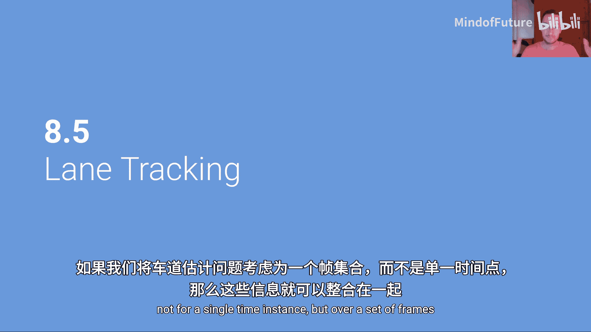
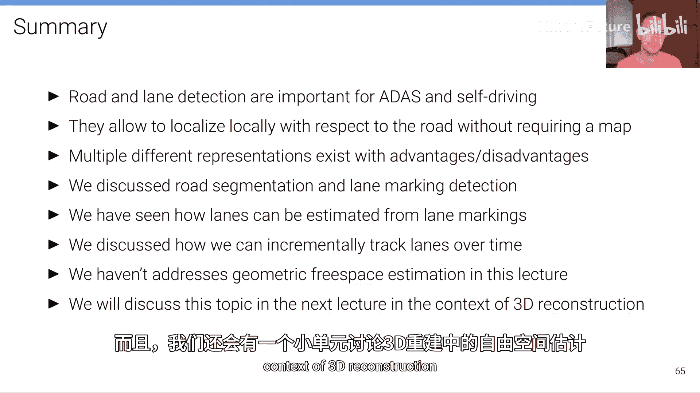

# 031：车道追踪 🛣️

在本节课中，我们将学习如何利用多帧图像信息，通过状态估计方法来持续、稳定地追踪车道参数。我们将从单帧车道估计的局限性出发，引入车道追踪的概念，并详细介绍其数学模型和实现方法。

## 概述

上一节我们介绍了如何从单帧图像中检测车道线并估计车道参数。然而，单帧估计存在两个主要问题：一是忽略了历史帧中可能包含的宝贵信息，导致鲁棒性不足；二是无法估计车辆沿车道的纵向位置。本节我们将探讨**车道追踪**，其核心思想是将车道参数估计问题扩展到多个连续的时间帧上，通过整合历史观测数据、车辆运动模型以及其他传感器信息，来获得更优、更稳定的估计结果。

## 状态向量与运动模型

为了进行车道追踪，我们首先需要定义随时间变化的状态向量。我们沿用上一节的状态向量，但将其视为一个随时间演变的序列。状态向量包含以下参数：
*   **车道宽度** (B)
*   **车辆的纵向位置** (s)
*   **车辆的横向位置** (t_lat)
*   **车辆的航向角** (ψ)

接下来，我们需要定义**状态转移方程**，它描述了状态如何从一个时刻（t）演化到下一个时刻（t+1）。这本质上是一个运动模型。

假设车辆在相邻两帧间的相对运动由平移向量 **m** 和相对航向变化 φ 描述。那么，状态转移方程可以写作：

**s_{t+1} = s_t + m_x * cos(ψ_t) - m_y * sin(ψ_t)**
**t_lat_{t+1} = t_lat_t + m_x * sin(ψ_t) + m_y * cos(ψ_t)**
**ψ_{t+1} = ψ_t + φ**
**B_{t+1} = B_t** (假设车道宽度不变)

为了简化模型并得到线性方程（便于后续使用经典滤波器），我们假设航向角变化很小（这在高速公路等场景下是合理的）。利用小角度近似（cos(ψ) ≈ 1, sin(ψ) ≈ ψ），上述方程可以简化为线性形式：

**x_{t+1} = A * x_t + b**

其中，**x_t** 是 t 时刻的状态向量，**A** 是状态转移矩阵，**b** 是输入向量。这个线性方程清晰地描述了状态如何随时间线性演变。

## 观测模型

仅有运动模型还不够，我们还需要将实际的传感器观测（如检测到的车道线点）与状态关联起来。这就是**观测模型**。

与单帧估计类似，我们假设在车辆坐标系（鸟瞰视图）中观测到了一系列左右车道线的点。对于任意一个观测到的横向位置 **x**，根据当前状态估计，我们可以预测其对应的纵向位置 **y**。

预测公式如下（与上一节相同）：
*   对于左车道线点：**y_L = p - t_lat - ψ * x_L + B/2**
*   对于右车道线点：**y_R = p - t_lat - ψ * x_R - B/2**

其中，**p** 是一个与纵向位置相关的参数。这个关系可以简洁地写成一个线性方程：

**y = C * x**

这里，**y** 是观测到的纵向位置向量，**C** 是观测矩阵。该方程表明，对纵向位置 **y** 的预测可以通过观测矩阵 **C** 与状态向量 **x** 的乘积得到。

## 线性系统与卡尔曼滤波

现在，我们得到了一个完整的线性状态空间表示：
1.  **线性状态转移方程**：**x_{t+1} = A * x_t + b**
2.  **线性观测方程**：**y_t = C * x_t**

这是一个**线性动态系统**。如果我们进一步假设过程噪声和观测噪声都是高斯噪声，那么就可以使用**卡尔曼滤波器**来最优地、以闭合形式求解这个状态估计问题。卡尔曼滤波器正是为这类线性高斯系统设计的。

以下是卡尔曼滤波器在车道追踪中的工作流程简述：
1.  **预测步骤**：利用运动模型（如来自视觉里程计的信息），将上一时刻的状态向前推演，得到当前时刻状态的先验估计。这个预测可能包含误差累积。
2.  **更新（创新）步骤**：获取当前帧的实际车道线观测数据。将预测的状态与当前的观测值进行比较，通过卡尔曼增益计算出一个修正量，对先验状态进行校正，得到后验状态估计。这一步有效地融合了运动预测和当前观测，从而得到更准确的状态。

通过这种“预测-校正”的循环，我们可以持续、稳健地追踪车道参数，即使在某些帧检测不完整或有噪声时也能保持良好的估计。

## 更复杂的道路模型

直线车道模型虽然简单，但不足以描述所有驾驶场景。因此，我们需要引入更复杂的模型。

**圆形车道模型**：用曲率（κ = 1/半径）来描述弯道。当曲率为0时，即退化为直线模型。然而，直接从直线进入圆形弯道会导致曲率（进而加速度）发生突变，产生不舒适的“急动”。在实际道路设计中，通常会使用**回旋曲线（Clothoid）模型**。

**回旋曲线模型**：其核心特征是**曲率随路径长度线性变化**。这使得车辆可以从直线平滑地过渡到固定曲率的弯道，避免了加速度的突变。在数学上，这会导致状态方程变为非线性（例如，横向位置 y 成为路径长度的三次多项式）。对于这类非线性系统，需要使用更高级的状态估计器，如**扩展卡尔曼滤波（EKF）**、**无迹卡尔曼滤波（UKF）** 或**粒子滤波**。

一篇开创性的论文《Recursive 3-D Road and Relative Ego-State Recognition》就成功地将回旋曲线模型与扩展卡尔曼滤波结合，用于3D道路和车辆状态的估计，为自动驾驶的状态估计奠定了基础。

## 总结

本节课我们一起学习了车道追踪技术。我们从单帧估计的局限性出发，引入了基于多帧信息的状态估计框架。我们定义了包含车道宽度、车辆位置和航向的状态向量，并建立了线性的状态转移方程和观测方程，从而构成了一个可以用卡尔曼滤波器求解的线性高斯系统。最后，我们探讨了更符合实际道路设计的圆形和回旋曲线模型，并指出这些非线性模型需要更高级的滤波技术。

车道检测与追踪是高级驾驶辅助系统（ADAS）和自动驾驶的关键技术，它使得车辆能够在无需全局地图的情况下实现相对于道路的局部定位。然而，我们尚未讨论另一个重要部分——**可行驶空间估计**，这将在下一讲结合三维重建技术进行探讨。