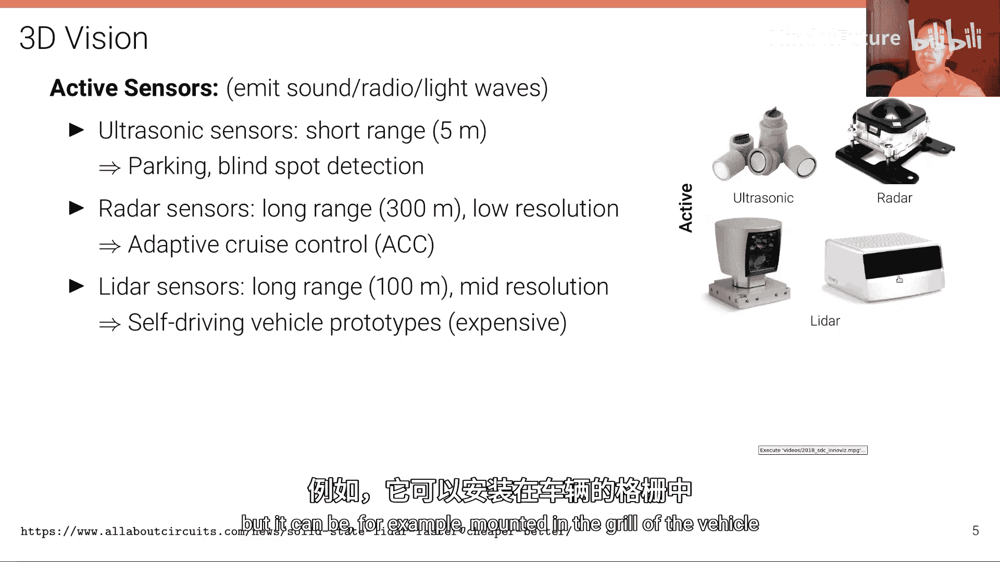
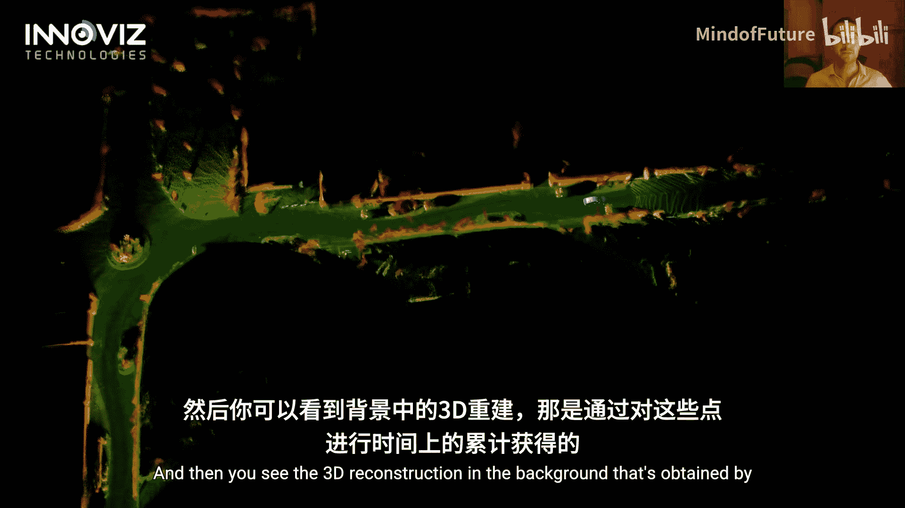
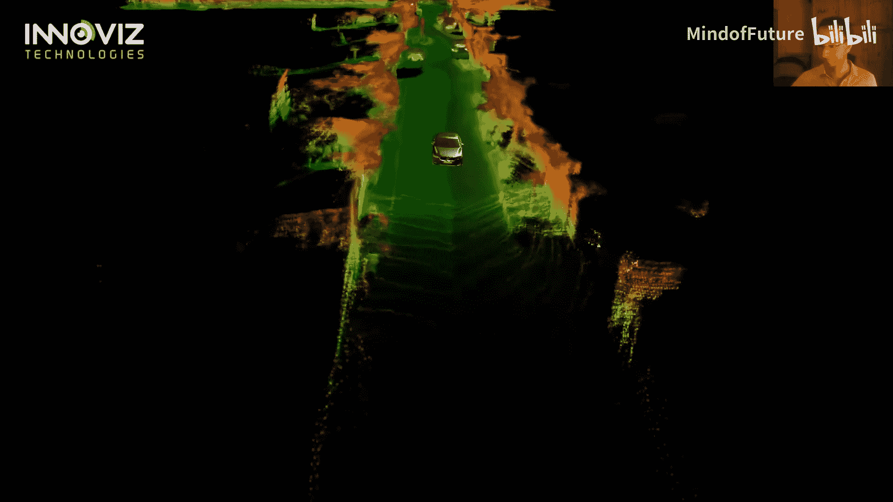
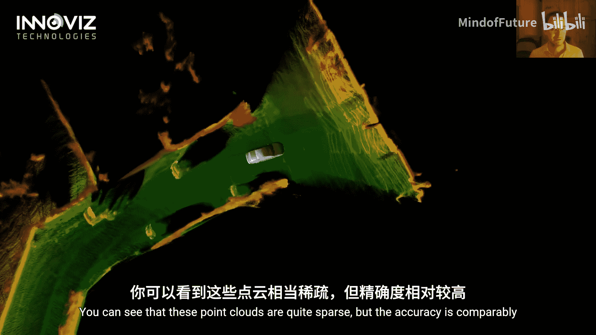
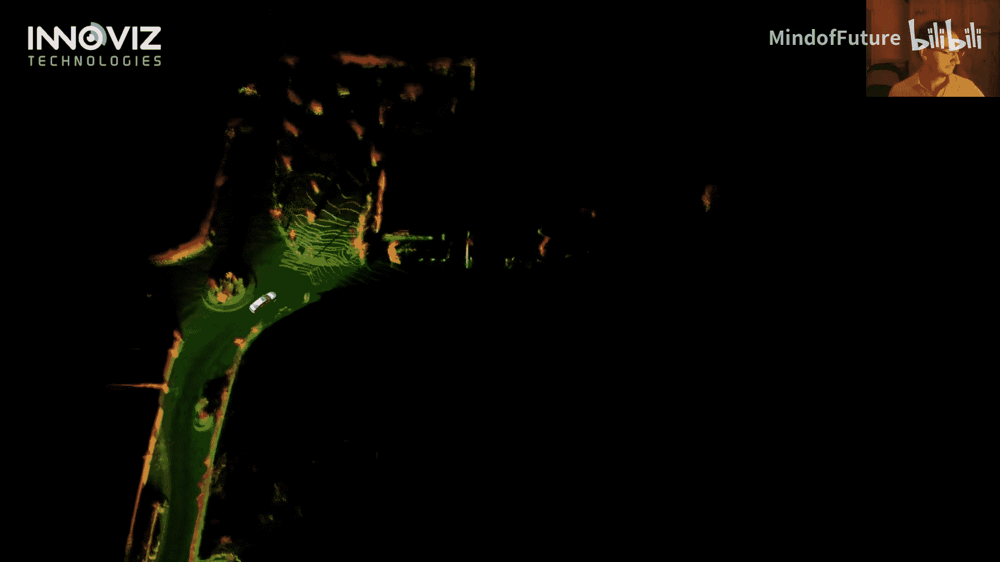

# 032：三维重建与运动估计 - 立体匹配

在本节课中，我们将要学习自动驾驶汽车的一项基础任务：三维重建。具体来说，我们将深入探讨**立体匹配**技术，它利用两个同时拍摄的图像来生成**视差图**或**深度图**，从而感知环境的三维结构。

## 概述：为什么需要三维感知？

自动驾驶汽车需要精确了解周围环境的几何结构，以确保安全导航。例如，当车辆需要绕过前方停放的车辆时，必须非常清楚其精确位置和形状，才能在不发生碰撞的情况下安全通过。

为了实现三维感知，自动驾驶汽车通常融合多种传感器：
*   **主动传感器**：如激光雷达（LiDAR）和雷达（Radar），它们主动发射波（光波/无线电波）并测量反射时间来计算距离。
*   **被动传感器**：如摄像头，它们不发射任何信号，仅被动接收环境光。

立体相机属于被动传感器，它由两个刚性连接的摄像头组成，通过比较两个视角图像的差异来推算深度。其优点是成本低、分辨率高，但需要额外的计算来处理图像以获取深度信息。

## 立体匹配的基本原理

立体匹配的核心思想是：**同一场景点在两个相机图像中的水平位置存在差异，这个差异称为“视差”**。距离相机近的物体，其视差大；距离远的物体，其视差小。

以下是立体匹配的标准处理流程：
1.  **相机标定**：确定两个相机的内部参数（如焦距、畸变）和外部参数（相对位置和姿态）。
2.  **图像校正**：根据标定结果，对图像进行重投影，使得两个相机的图像平面对齐，对应的极线变为水平线。这极大地简化了后续的匹配搜索。
3.  **立体匹配**：在校正后的图像上，为左图（或右图）的每个像素，在右图（或左图）的同一水平行上搜索最相似的图像块，从而计算其视差值。
4.  **后处理**：通常包括左右一致性检查，以剔除误匹配的异常值。
5.  **深度计算**：通过三角测量原理，将视差图转换为度量深度图。转换公式为：
    `深度 Z = (焦距 f * 基线 B) / 视差 d`
6.  **三维重建（可选）**：可以融合多个深度图或结合相机运动估计，构建更完整的三维场景模型。

上一节我们介绍了立体匹配的整体流程，本节中我们来看看其中几个关键步骤的细节。

### 极线几何与图像校正

在已知两个相机相对姿态（通过标定获得）的情况下，**极线几何**约束告诉我们：左图像中的一个点，其在右图像中的对应点必然位于一条特定的直线上，这条线称为**极线**。这使我们的搜索范围从整幅图像（二维）缩小到一条线（一维）。

为了进一步简化，我们希望这些极线是水平的。**图像校正**过程通过图像重投影（单应性变换）来实现这一点，使得两个虚拟相机的图像平面共面且行对齐。这样，匹配搜索就只需要在左右图像的同一水平行上进行。

### 块匹配算法

图像校正后，最简单的立体匹配方法是**块匹配**。其核心思想是：对于左图中的一个像素，在右图的同一行上滑动一个固定大小的窗口，计算窗口间的相似度，相似度最高的位置即视为匹配点，其水平偏移量即为视差。

以下是几种常见的相似度度量方法：
*   **平方差之和**：计算两个图像块向量之间各像素强度差的平方和。公式为：`SSD = Σ (I_left(x, y) - I_right(x-d, y))^2`
*   **零均值归一化互相关**：先对图像块进行零均值化和归一化，再计算互相关值，对光照变化更鲁棒。公式为：`ZNCC = Σ [(I_left - μ_left)/σ_left * (I_right - μ_right)/σ_right]`

然而，块匹配算法存在局限性：
*   **前景滑动问题**：当匹配窗口横跨深度不连续的区域（如物体边缘）时，窗口内包含不同深度的像素，导致匹配错误，产生“边缘膨胀”效应。
*   **窗口大小权衡**：小窗口对细节敏感但噪声大，大窗口结果平滑但会模糊边缘细节。

### 视差后处理与深度计算

由于噪声和遮挡，初始视差图通常包含错误。一种有效的后处理方法是**左右一致性检查**：分别计算以左图为参考和以右图为参考的视差图，并检查它们是否相互一致。不一致的像素通常被视为遮挡区域或误匹配，可以被剔除。

得到可靠的视差图 `d` 后，即可通过三角测量公式计算每个像素的深度 `Z`：
`Z = f * B / d`
其中，`f` 是相机焦距，`B` 是两个相机光心之间的距离（基线）。值得注意的是，深度误差随距离的平方增长，这意味着立体视觉在远距离处的深度估计精度会下降。

### 进阶方法简介

除了基础的块匹配，还有更先进的方法：
*   **基于能量最小化的方法**：将立体匹配建模为一个能量最小化问题，能量函数包含数据项（匹配代价）和平滑项（相邻像素视差应相似的约束）。通过如**图割**、**置信传播**等算法求解，能得到更全局一致的结果。
*   **基于深度学习的方法**：使用卷积神经网络直接从图像对回归视差图。例如，**DispNet** 等端到端网络通过在大规模合成数据上预训练，再在真实数据上微调，能够学习复杂的匹配关系和上下文信息，获得非常清晰、准确的视差图。

## 总结

本节课中我们一起学习了**立体匹配**技术，这是自动驾驶汽车利用双目视觉进行三维环境感知的核心。我们从需求出发，介绍了立体匹配的完整流程：包括相机标定、图像校正、匹配算法、后处理以及深度计算。我们探讨了基础的块匹配算法及其局限性，并简要了解了更先进的基于全局优化和深度学习的方法。立体匹配生成的深度图，为后续的自由空间估计、障碍物检测等导航任务提供了重要的几何信息基础。